<p align="center">
  
</p>

<h1 align="center">RHOAI Nightly Updater</h1>

The RHOAI Nightly Updater is a web app that installs and updates Red Hat OpenShift AI (RHOAI) nightly builds on your own ROSA HCP or OpenShift cluster. It also deploys odh-dashboard pull requests, sets up test environments on its Environment page (S3 storage, pipeline servers, MLflow, a CPU model) and explains what is wrong when RHOAI is not healthy. You need no `oc` commands day to day: everything is a button, and every change asks for confirmation first.

<p align="center">
  <picture>
    <source media="(prefers-color-scheme: dark)" srcset="docs/images/page-status-dark.png">
    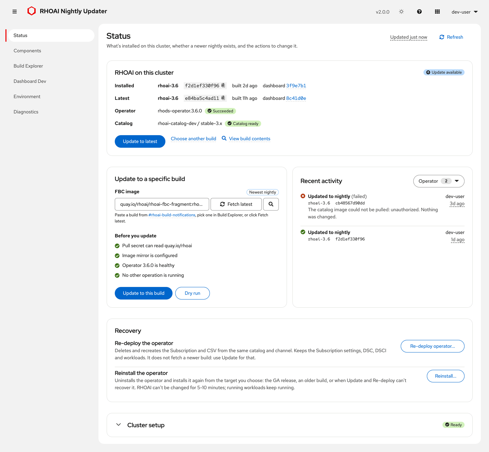
  </picture>
</p>

## Install

Download the latest release's `install.sh`, read it, then run it. You need `oc` (logged in as cluster-admin) and `curl`:

```bash
curl -fsSLO https://github.com/DaoDaoNoCode/rhoai-nightly-updater/releases/latest/download/install.sh
less install.sh
bash install.sh --dry-run && bash install.sh
```

The installer prints the app URL when it is done. To check the download, compare `sha256sum install.sh` (macOS: `shasum -a 256 install.sh`) with the SHA-256 in the [release notes](https://github.com/DaoDaoNoCode/rhoai-nightly-updater/releases/latest). For a specific version, download `https://github.com/DaoDaoNoCode/rhoai-nightly-updater/releases/download/vX.Y.Z/install.sh` instead.

**New here? Follow the [Quick Start](docs/QUICKSTART.md)**: install, one-time setup, your first update and the Environment page, step by step. Upgrading from 2.x to 3.0.0? Read [UPGRADING §5](docs/UPGRADING.md#5-upgrade-to-v300): the S3 storage moves, and models need a project label. Installed before releases existed (your Deployment uses `:latest`)? Read [UPGRADING.md](docs/UPGRADING.md) first. Cluster configured from Git by Argo CD? Deploy the Helm chart `deploy/chart` instead: [GITOPS.md](docs/GITOPS.md).

## A short tour

### Status: what is installed, and Update

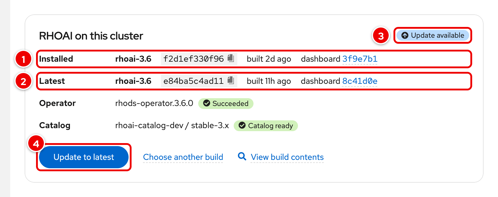

1. **Installed**: the nightly build the cluster runs (tag, digest, build date, dashboard commit).
2. **Latest**: the newest build of the same stream on Quay.
3. The verdict: **Update available**, **Up to date**, **Operator failed** or **No Subscription**.
4. **Update to latest** installs the newest build. Progress streams step by step; if OLM fails, the previous catalog and Subscription are restored.

The same page has one-time cluster setup (pull secret, image mirror), **Update to a specific build**, **Recent activity** and **Recovery** (**Re-deploy operator...**, **Choose a build...**).

### Components: is RHOAI ready?

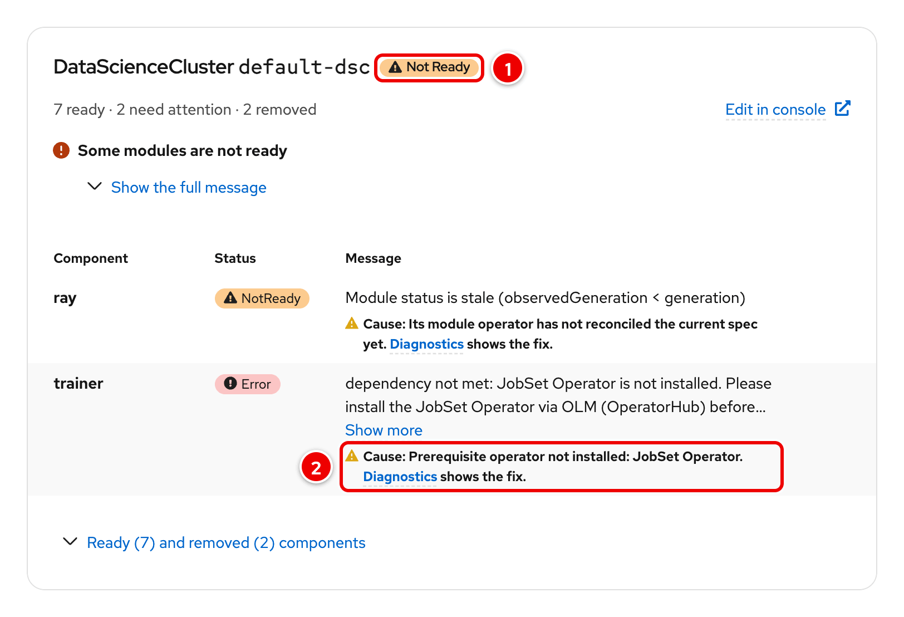

1. The DataScienceCluster state (**Ready** or **Not Ready**).
2. For each failing component, the operator's message and a short **Cause**, with a link to the fix on Diagnostics.

Below it, the Deployments table lists problems first, with pod details, git provenance and what changed since the last update.

### Build Explorer: which build has my change?

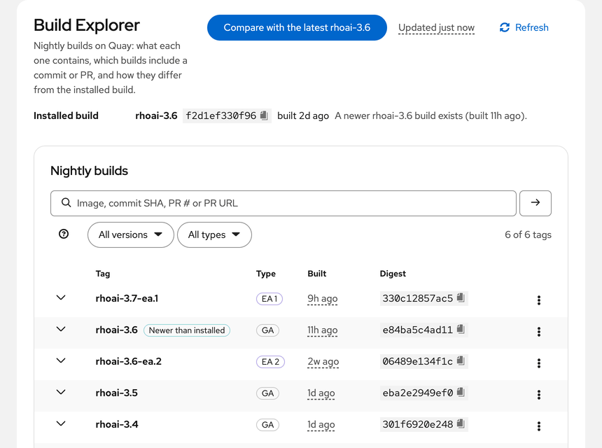

Every nightly tag on Quay: filter, see the contents of a build, compare it with the installed one, and search by image, commit SHA, PR number (`#5123`) or PR URL. See [Build Explorer search](#build-explorer-search) for what it can find and how it decides.

### Dashboard Dev: try an odh-dashboard PR

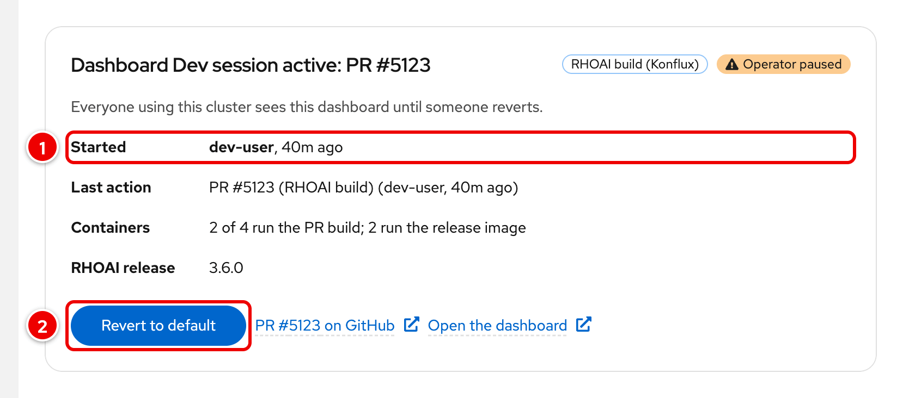

1. Who deployed which build, and when. Everyone on the cluster sees this dashboard until someone reverts.
2. **Revert to default** restores the release images.

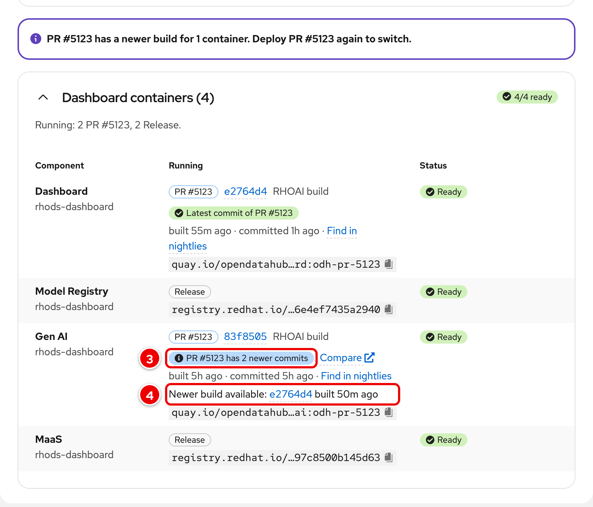

3. The commit each container runs, when it was built, and how far it is behind upstream `main` (or the PR's latest commit), with a link to the comparison on GitHub.
4. The tag has moved on to a newer build. **Deploy PR** or **Deploy latest main** again switches to it.

It deploys RHOAI Konflux builds (`odh-pr-<N>`, `odh-stable`) or ODH OpenShift CI builds (`pr-<N>`, `main`). **Deploy latest main** pins the build under its commit tag (`:<commit>@sha256:...`), so the cluster names the commit it runs even after the `main` or `odh-stable` tag has moved on.

### Environment: S3 storage, pipeline servers, MLflow, models

One tab per feature after an **Overview**, kept in the address so a link opens the same view (`?tab=pipelines&project=<name>`, `?tab=mlflow`, `?tab=models&project=<name>`).


1. How many features are ready.
2. Each feature links to its tab (a project-scoped one with its project).
3. Its state, from the same function as the tab: **Ready**, **Not set up**, **Needs attention**, **Error**, ... Something this tool did not create reads **Ready**, with **Not managed by this tool** under the label: ownership never counts as not ready. A project-scoped feature summarises the projects that have it ("Ready in juntao-test", "Ready in 3 projects", "Error in 1 of 3 projects", "Not set up in any project"); with several, **Show projects** lists each one with its state and a link to the tab there.
4. The next step, a link in the row: **Open pipelines** in its one ready project (with several ready projects, **Choose a project**: the tab's picker decides; with a problem in one of several, **Open** that project), **Open MLflow workspaces** (its list of projects), **Set up** (confirm, then a check that every part can be set up, then the missing parts in order, each counted only once it works), **Migrate storage**, **Show issue** (opens the tab at that part) or **Choose a project**. A step that cannot run says why under it.

Under the table, **Clean up everything** deletes what this tool created (the pipeline servers, the S3 storage, MLflow, the models, then the inference gateway) in one confirmed operation, with a checkbox per part.


1. The feature's state in the selected project. Without `?project=` the tab opens the first project with a ready pipeline server.
2. The project picker (type to filter; each project says what it has).
3. Each part shows its health, its actions and its details inline: the S3 endpoint (`http://seaweedfs-s3.seaweedfs.svc:8333`), the bucket and the admin UI user.
4. The S3 access key and secret key are masked: the eye shows one and the copy button copies it; **Copy as environment variables** copies the whole connection (`AWS_ENDPOINT_URL`, the keys, region, bucket). The admin UI (user `admin`) has a password of its own, shown the same way. Each is read from the server only then (cluster-admins only), and gone when you hide it or leave the tab.
5. The pipeline server is set up as the dashboard sets one up: named `dspa` (the only name workbench pipelines find), with the dashboard's settings, its S3 Secret owned by it, and a dashboard S3 **Connection** `rhoai-nightly-updater-s3` ("Shared S3 storage (RHOAI Nightly Updater)") that workbenches and model deployments in the project can use. The Connection carries the in-cluster address, so it works from pods only. Deleting the pipeline server, here or in the dashboard, deletes both.
6. **Open pipelines** (and **Open admin UI**). Each part's menu (⋮) has **Delete** (and **Repair** when it applies), only for what this tool created; a disabled entry says why.

A pipeline server an earlier version set up is named `nightly-dspa`. It keeps working (the dashboard's pipelines pages, the KFP SDK, Migrate storage, Delete), but workbench pipelines (Elyra) cannot find it, so the tab says so and offers **Recreate with the standard name**:

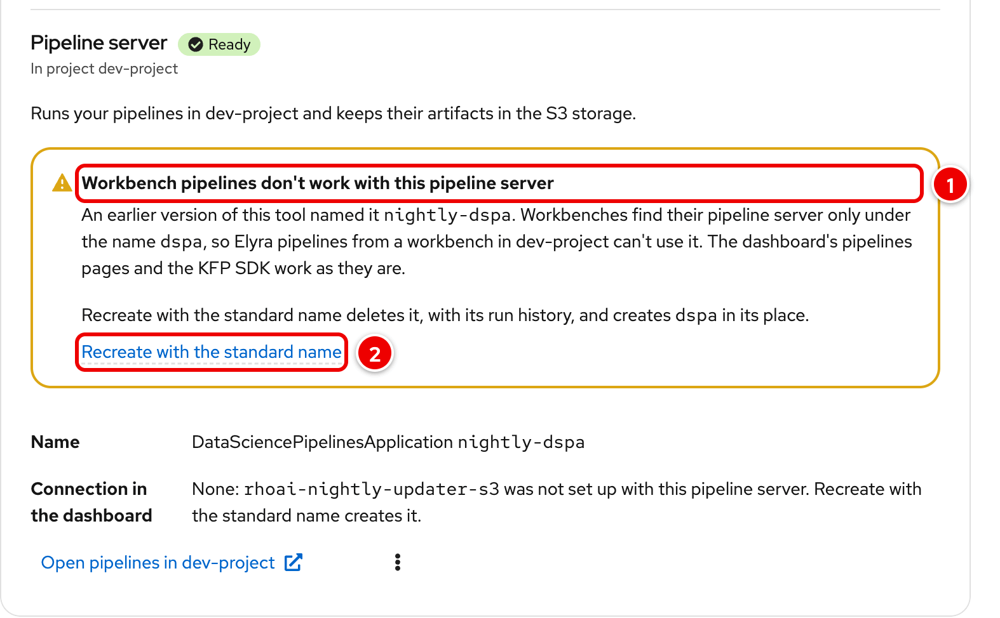

1. Why: workbenches look for the pipeline server named `dspa`.
2. **Recreate with the standard name** asks first; the confirmation says what goes:

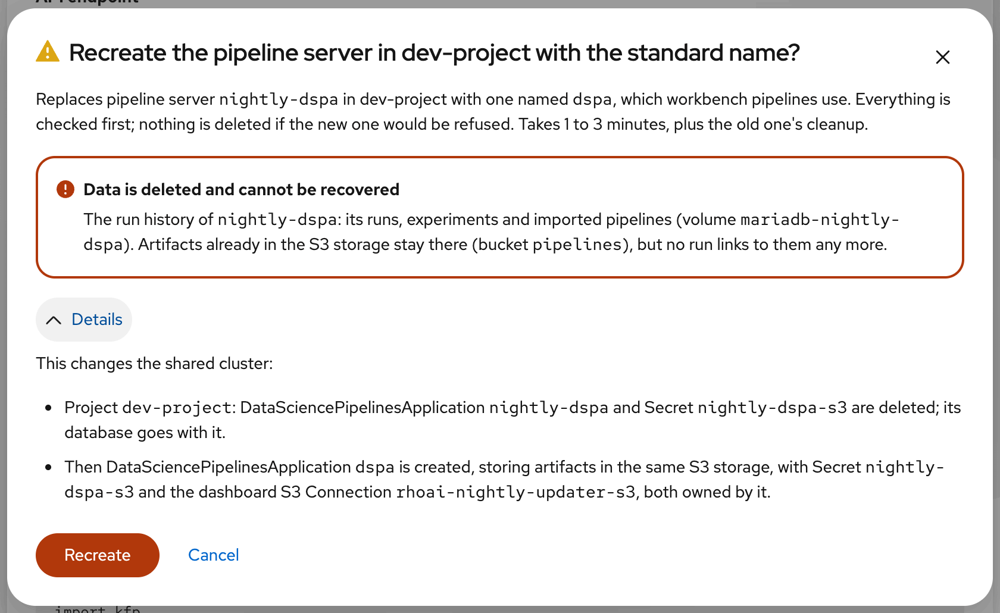

Everything the new server needs is checked first; nothing is deleted if it would be refused. Then `nightly-dspa` is deleted with its database (its runs, experiments and imported pipelines are lost; the artifacts already in the S3 storage stay, but no run links to them), and `dspa` is set up in its place.

Before **Set up**, the tab shows what it needs: a DataScienceCluster component that is not Managed (with **Open Components**), no data science project (with a link to the dashboard's Projects page), or a namespace `seaweedfs` that is someone else's. Set up stays disabled, with the reason under it. Once the pipeline server is ready, **Use it** shows where its runs are, its API endpoint and a KFP SDK snippet, followed by **What next**. Problems read in plain words, with the fix (Repair, Revert, View logs) on the alert and the pod's reasons under **Technical details**. Every change runs in one dialog with its steps and outcome; if you close it, a notification brings the outcome back.

Storage an earlier version set up in namespace `minio` reads **Needs attention**; a warning at the top of the tab says why and offers **Migrate storage**, which moves it, with its data and pipeline servers, and ends there. **Delete old storage** is a separate, later action in the storage's menu ([RUNBOOK §10.1](RUNBOOK.md#101-migrate-storage-from-an-earlier-version)).


1. The **MLflow** tab: the server's health.
2. Ownership, apart: this one was made in the dashboard. It works (Open MLflow, a PR build, Revert), but the tool does not delete it.

MLflow on RHOAI keeps each data science project apart as a workspace. Once it is ready, **Use it** has a project picker, **Open <project> in MLflow** (`<address>/#/experiments?workspace=<project>`), and the client settings to copy (`MLFLOW_TRACKING_URI`, `MLFLOW_TRACKING_TOKEN=$(oc whoami -t)`, `MLFLOW_WORKSPACE=<project>`). Deploying an opendatahub-io/mlflow PR image is under **Test an MLflow PR build**.

#### Models: small models on CPU

The Models tab serves small models from Hugging Face on CPU in a data science project, each pinned to one commit. A project can have several of them:

| Model | Type, for | Reserves (request, limit) | Download | vLLM options |
|---|---|---|---|---|
| `smollm2-135m-instruct`, SmolLM2 135M Instruct | Chat (smoke test) | 2 CPUs, 4 / 5 GiB | about 270 MB | `--max-model-len 4096` |
| `qwen25-05b-instruct`, Qwen2.5 0.5B Instruct (the default) | Chat | 4 CPUs, 6 / 8 GiB | about 1.0 GB | `--max-model-len 4096` |
| `qwen3-1-7b`, Qwen3 1.7B | Chat, tool calling, reasoning (thinking off by default) | 4 CPUs, 12 / 14 GiB | about 4.1 GB | `--max-model-len 4096 --enable-auto-tool-choice --tool-call-parser hermes --reasoning-parser qwen3 --default-chat-template-kwargs '{"enable_thinking":false}'` |
| `granite-embedding-125m-english`, Granite Embedding 125M English | Embeddings (768 dimensions), semantic search | 2 CPUs, 3 / 4 GiB | about 250 MB | `--runner pooling --max-model-len 512` |


1. The feature's state in the selected project, for the chosen model.
2. The **model picker**: which catalog model the tab shows, sets up and deletes (the address keeps it as `model=<name>`).
3. The **inference gateway**, shared by the cluster: every model is reached through it at `https://inference.<apps domain>`, and it checks each caller's OpenShift token. It runs on a cloud load balancer, which costs money while it exists. It accepts models only from the projects it lists by name (**Projects allowed on the gateway**), as RHOAI documents it; setting up a model adds its project. One that RHOAI's installation (or an admin) made reads **Not managed by this tool** and is used as it is.
4. The chosen **model** in the project: what it is, what it is for, what it reserves, where it comes from and its vLLM options. **Open <project> in the dashboard** shows it with the project's deployments, and Gen AI studio offers it in the playground.
5. Its address, which copies with one click. The runtime image below it: on a nightly build the preset's image is not published yet, so the newest released Red Hat image is used (pinned by digest); `VLLM_CPU_IMAGE` overrides it.
6. The hardware profile the dashboard shows. No profile fits Qwen3 on a default cluster, so the dashboard shows "No hardware profile" (and "Unknown" in its details); the model runs as set up.
7. Token authentication: the model's own ServiceAccount and token Secret, as the dashboard makes them. The dashboard lists that token for the model.


1. Each option says what the model is and what it is for, what it reserves, how much is downloaded, and its state in the project.
2. A model no worker has room for now is disabled, and says why. One the project already has stays selectable.

Each model also asks for node disk of about 1.5 times its download (KServe downloads it into an emptyDir by default), and the setup warns when the project's ResourceQuota has no room for it. Qwen3 fits no hardware profile on a default cluster: the dashboard shows "No hardware profile" for it, and the tab says so.

**Set up** creates whatever is missing (the gateway, then the chosen model) in one operation and waits until the model answers, typically 3 to 5 minutes the first time. With the model it makes the dashboard's token authentication, as "Require token authentication" does: ServiceAccount `<model>-sa`, which may only `get` the model, its Role and RoleBinding, and token Secret `default-name-<model>-sa`, all owned by the model. The dashboard then lists that token for the model, and its Edit keeps authentication on. Once ready, **Use it** has commands that read that token (`oc get secret default-name-<model>-sa ... | base64 -d`) and call the model: `/v1/chat/completions` for a chat model, `/v1/embeddings` for the embedding model.

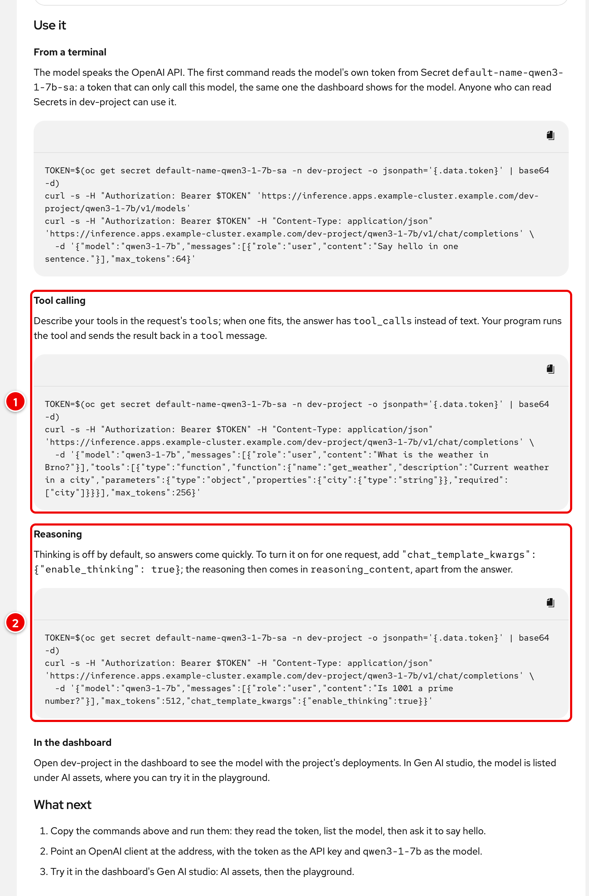

1. Qwen3 calls tools: describe them in the request's `tools`, and the answer has `tool_calls` when one fits.
2. Its thinking is off by default; `"chat_template_kwargs": {"enable_thinking": true}` turns it on for one request. That command streams (`"stream": true`, `curl -N`): thinking on CPU can take over a minute, and the cloud load balancer closes a connection that sends nothing for 60 seconds (the AWS default).

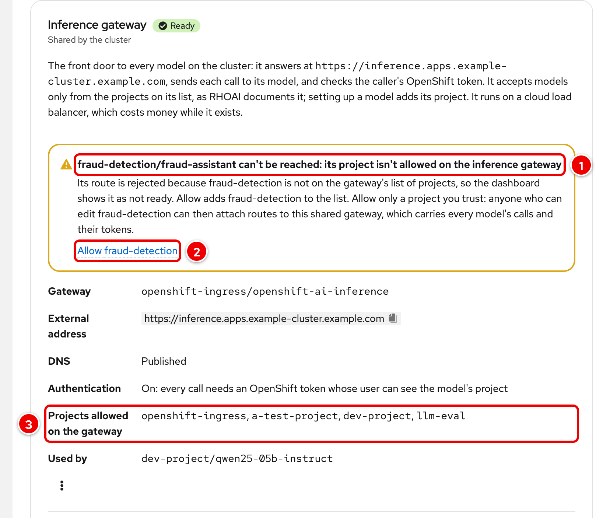

1. A model deployed elsewhere (in the dashboard, say) in a project the gateway does not list: its route is rejected, so it never becomes ready. The Overview's Models row says so too.
2. **Allow <project>** adds the project to the gateway's list; the projects already on it stay. For a gateway this tool did not create, the tab gives RHOAI's step for a cluster admin instead.
3. The projects the gateway allows. Deleting a model leaves its project on the list, since another model there may use the gateway.

Each part's menu has **Delete**, for the chosen model only; the gateway stays while a model uses it. **Clean up Models** deletes every model of this tool in the projects you choose, then the gateway. Troubleshooting: [RUNBOOK §10.2](RUNBOOK.md#102-models-the-inference-gateway-and-cpu-models).

#### Playground: the dashboard's Gen AI playground

The Playground tab sets up the RHOAI dashboard's Gen AI playground, a chat page where you try a project's models and ask about your documents, in a project you choose.


1. The feature's state in the selected project.
2. **Models**: the project's ready chat models, and this tool's embedding model, with their type, where each runs and whether the playground uses it. The playground needs a chat model: when there is none, **Set up a model on the Models tab**.
3. **Playground**: its state as the dashboard reports it, and **Open the playground** (Gen AI studio, then Playground, then the project). One someone set up in the dashboard reads **Not managed by this tool**: open it, but this tool does not delete it.

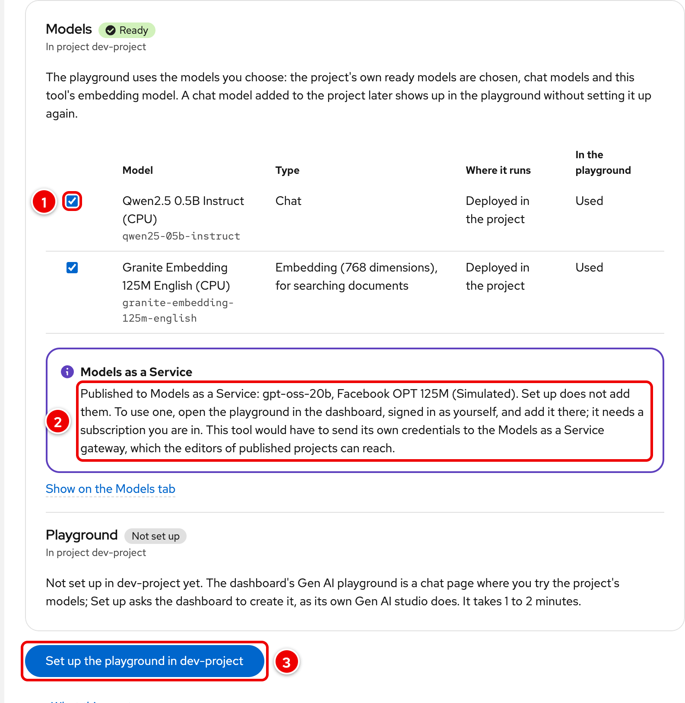

1. Before Set up, the models are rows you choose: the project's own ready models are chosen, as in the dashboard. This tool's Granite embedding model goes in as an embedding model of 768 dimensions, for searching your documents. An embedding model this tool did not set up is not added (its dimension is not known): the tab says to add it in the dashboard's Gen AI studio, choosing **Embedding** and entering its dimension.
2. A Models as a Service model is not used unless you choose it; it works only with a subscription to it.
3. **Set up** runs it.

**Set up** asks the dashboard itself to create the playground, as its Gen AI studio does, with the models you choose, and waits until it is ready, typically 1 to 2 minutes. **Use it** has a chat request to run from a terminal with your own `oc whoami -t` token. **Delete** (in the part's menu) asks the dashboard to delete it, with its chats and documents; the models stay. Troubleshooting: [RUNBOOK §10.3](RUNBOOK.md#103-playground-the-dashboards-gen-ai-playground).

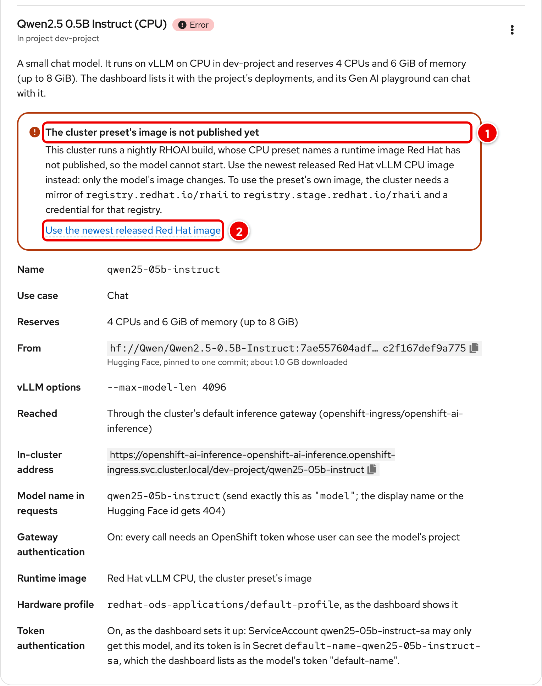

1. On a nightly cluster whose preset image is missing from the registry, the model says so in plain words.
2. **Use the newest released Red Hat image** changes only the model's image.

#### MaaS: Models as a Service

The MaaS tab sets up the cluster's Models as a Service platform the way the [MaaS install docs](https://github.com/opendatahub-io/models-as-a-service/tree/main/docs/content/install) do, and publishes this tool's chat models to it, one at a time: everyone signed in to the cluster can then call a published model with a MaaS API key, up to 100 tokens a minute. The embedding model is not offered; the tab says why.


1. **Database**: a one-instance CloudNativePG PostgreSQL for MaaS's API keys, for development and test, and Secret `maas-db-config` with its address. A connection Secret someone else made is used as it is.
2. **Authorino TLS**: Connectivity Link's Authorino must serve TLS and trust the cluster's service CA. Its operators own it, so this tool only checks it; when it is missing, the part shows the docs' commands for a cluster-admin.
3. **Publish** / **Unpublish** per model of this tool. A published model's address moves to the MaaS gateway until it is unpublished, and, as the dashboard's MaaS option does, it leaves Gen AI studio's AI assets (its genai label and use-case annotation are removed and put back on Unpublish), so the studio lists it once, through MaaS. Its MaaSModelRef is owned by the model and shows the catalog's name.

**Set up** runs the docs' steps in their order: the database, Gateway `maas-default-gateway` with an external load balancer at `maas.<apps domain>`, the Authorino check, then MaaS turned on in the DataScienceCluster (the previous value is recorded), then it waits for maas-api and the default tenant, about 5 minutes. Connectivity Link (a Kuadrant CR) and the CloudNativePG operator are prerequisites a cluster-admin installs. **Use it** has the docs' commands to get a key (shown once), list the models and chat, with your own `oc whoami -t` token, and a link to the dashboard's MaaS pages. **Remove MaaS** unpublishes, turns MaaS back to what it was, then deletes the gateway and the database; GatewayClass `openshift-default`, Connectivity Link and what RHOAI's operator made stay. Troubleshooting: [RUNBOOK §10.4](RUNBOOK.md#104-maas-models-as-a-service).

#### Sample data and a sample pipeline

Once MLflow or a pipeline server works, one click shows it working, with no code.

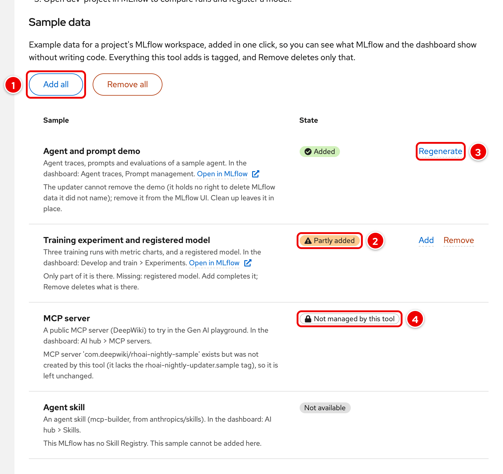

1. **Add all** / **Remove all**: one confirmed operation for every sample that can be added or removed (the updater allows one samples operation per user every 30 seconds).
2. Each sample in the chosen project (MLflow workspace) says what you then see, and where in the dashboard. **Partly added** names what is missing; **Removed** means deleted in MLflow (Add restores it); **Not available** means this MLflow has no such API (skills on older releases).
3. The **agent and prompt demo** is MLflow's own demo. It has **Regenerate**, but no Remove: the updater holds no right to delete MLflow data it did not name, so remove it in the MLflow UI. Clean up leaves it in place. The updater creates the `MLflow Demo` experiment itself, tagged as its own, and never runs the generator on one it did not create (one made with the MLflow UI's demo button, for example): the generator deletes traces in that experiment whoever logged them. Such a demo shows as not managed by this tool.
4. Something of a sample's name that this tool did not create is **Not managed by this tool** and left alone.

The other samples are a training experiment with three runs and a registered model (`champion` alias), an MCP server entry (DeepWiki's public server; the Gen AI playground needs internet access to call it) and an agent skill. Everything the tool adds is tagged `rhoai-nightly-updater.sample`, and Remove deletes only that. Readers see every action disabled with the reason; without a working MLflow the section links to Set up.

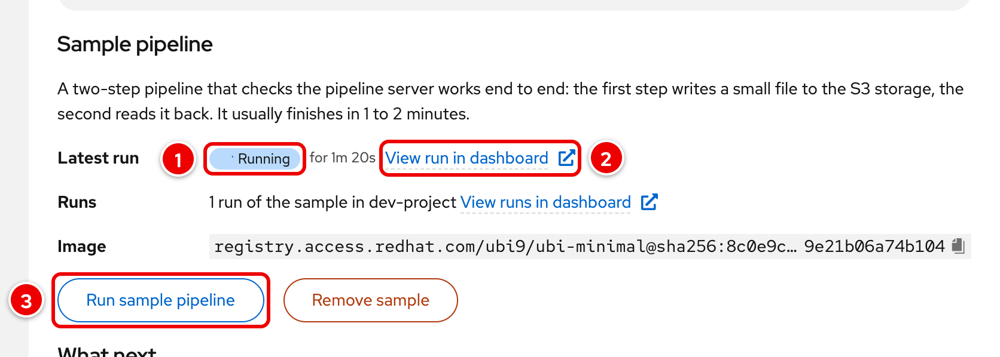

1. **Download rhoai-nightly-sample.yaml**: a two-step pipeline (write a small file to the S3 storage, read it back). The image is UBI 9 minimal, pinned by digest; on a disconnected cluster, mirror it or set `SAMPLE_PIPELINE_IMAGE`. **Show the pipeline YAML** shows it with a copy button.
2. **Open pipelines in dev-project**: choose Import pipeline and the file, then Create run.
3. Or copy the commands (as an admin of the project): they make ServiceAccount `pipeline-api` with a Role that may only use this pipeline server's API (`datasciencepipelinesapplications/api`, `get` `create`, the check its kube-rbac-proxy makes) and a token for it that expires in 15 minutes, then `curl` the pipeline server's API (upload, then start a run). They need `jq`. Your own OpenShift token is not sent there: whoever can edit the project controls what answers at that address. `oc delete rolebinding/pipeline-api role/pipeline-api serviceaccount/pipeline-api -n <project>` removes them.

You run the sample yourself: the updater never calls a pipeline server's API, because that API is a Service in your project and the updater's token must not reach it ([SECURITY.md](SECURITY.md#serviceaccount-rbac)). It works on any ready pipeline server, the dashboard's too.

Every setup has its removal on the same tab: **Delete** in the part's menu for the storage, the pipeline server and MLflow, each confirmed with the outcome first and the objects under Details; **Revert** for a deployed PR image; **Delete old storage** after Migrate storage; and **Clean up** at the bottom of each tab. What this tool did not create has no Delete.

### Diagnostics: what is wrong, and how to fix it

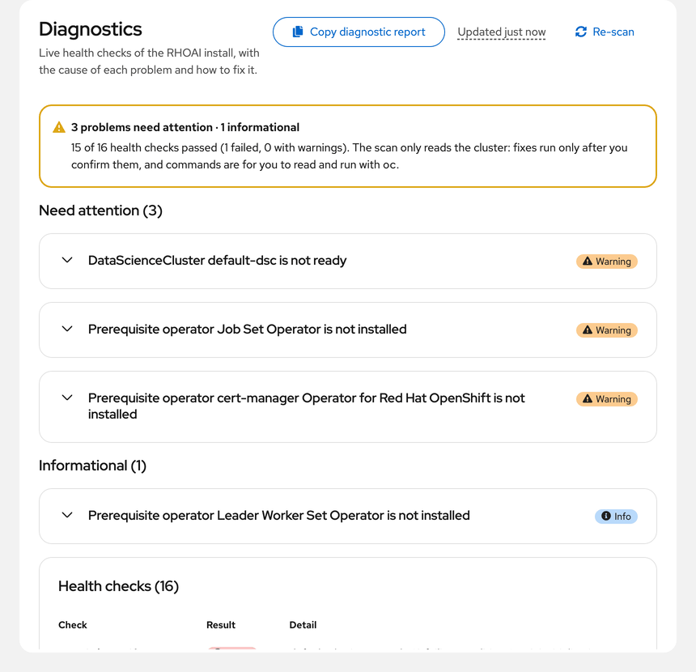

Diagnostics scans on load and only reads the cluster. Each problem shows what was **Observed**, the **Fix**, and a **Command** you copy and run yourself. A few problems have a **Fix** button, which asks for confirmation first.

<details>
<summary><b>All pages, full size (light and dark)</b></summary>

| Page | Screenshot |
|---|---|
| Components | <picture><source media="(prefers-color-scheme: dark)" srcset="docs/images/page-components-dark.png">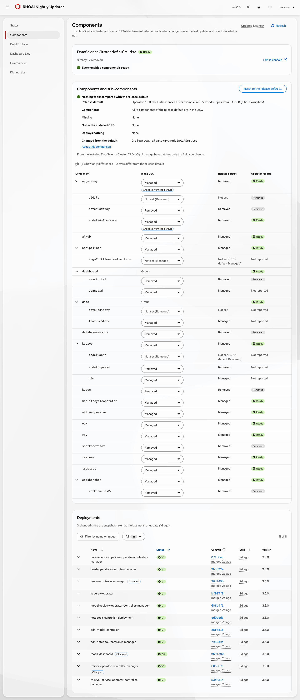</picture> |
| Build Explorer | <picture><source media="(prefers-color-scheme: dark)" srcset="docs/images/page-build-explorer-dark.png">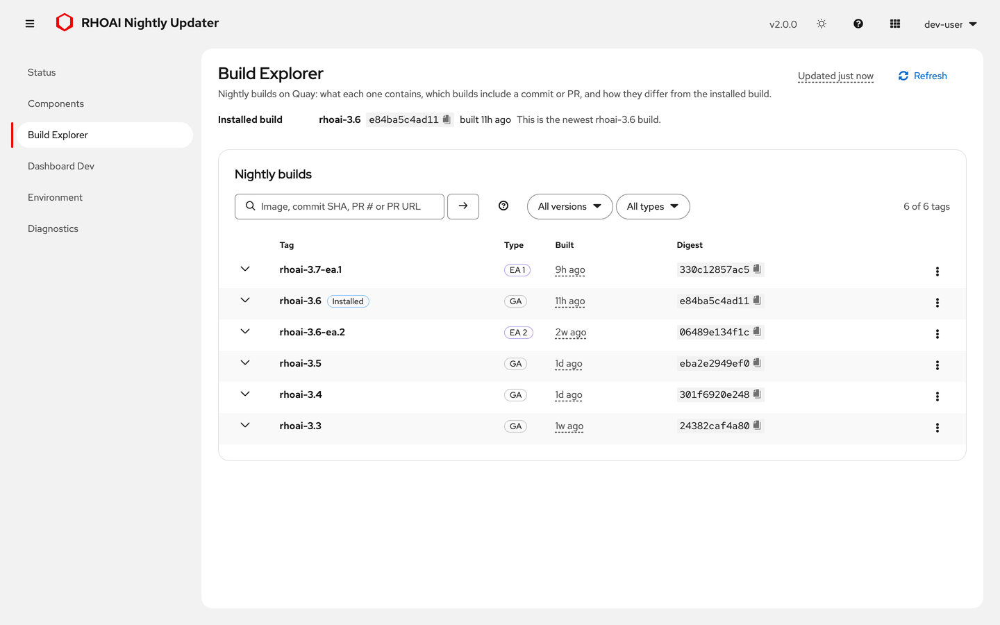</picture> |
| Dashboard Dev | <picture><source media="(prefers-color-scheme: dark)" srcset="docs/images/page-dashboard-dev-dark.png">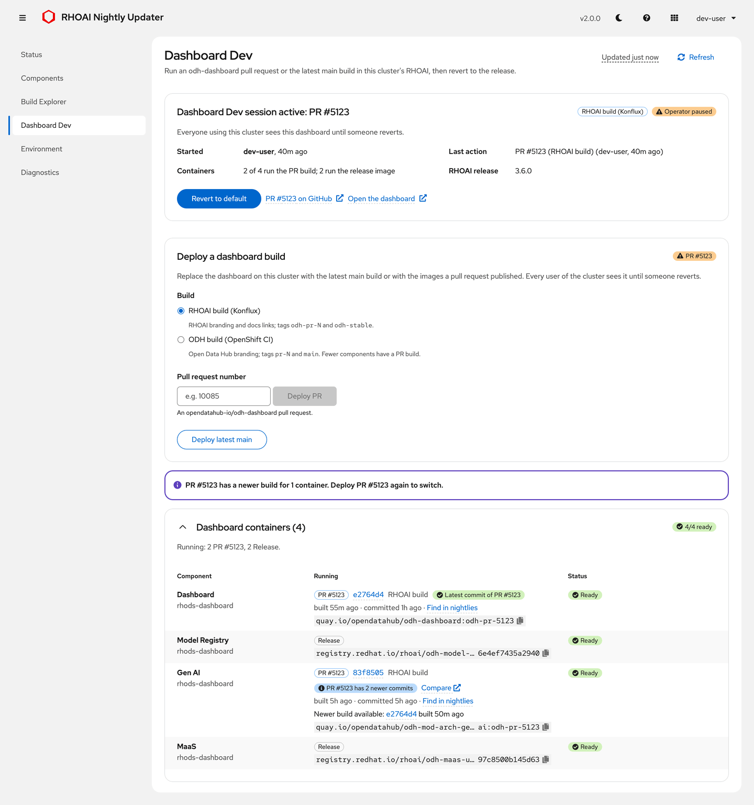</picture> |
| Environment | <picture><source media="(prefers-color-scheme: dark)" srcset="docs/images/page-test-resources-dark.png">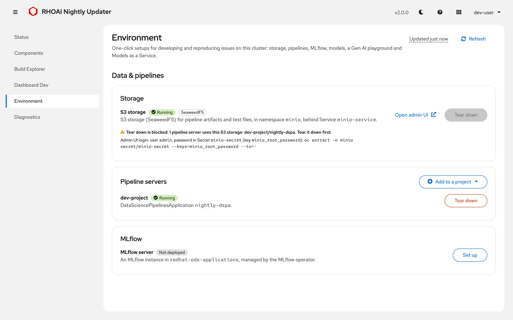</picture> |
| Diagnostics | <picture><source media="(prefers-color-scheme: dark)" srcset="docs/images/page-diagnostics-dark.png">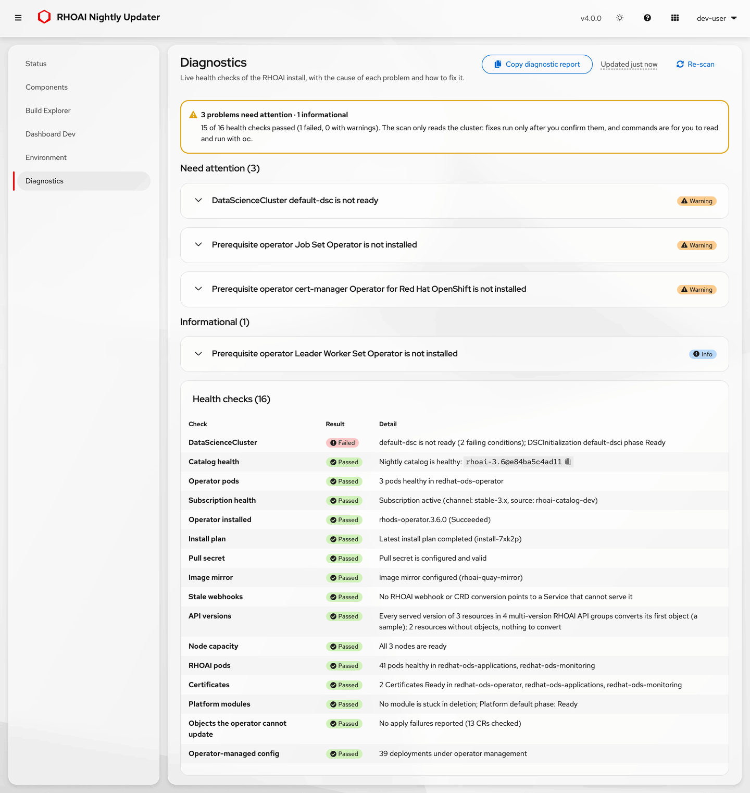</picture> |

The app follows your system's light or dark mode and contrast settings; the appearance button in the masthead sets the color scheme (System, Light, Dark) and the contrast mode (System, Default, High contrast, Glass) instead; on narrow screens the same choices are in the user menu. All screenshots come from a mock backend with made-up data (`make docs-screenshots`, see [docs/tools](docs/tools/README.md)).

</details>

## Documentation

| Doc | For |
|---|---|
| [QUICKSTART.md](docs/QUICKSTART.md) | Install, one-time setup (self-managed OpenShift too), first update, the Environment page |
| [UPGRADING.md](docs/UPGRADING.md) | Which version you run, installs from before releases, moving between releases, 2.x to 3.0.0 |
| [GITOPS.md](docs/GITOPS.md) | Deploying with Argo CD: the Helm chart, its values, upgrades and removal |
| [RUNBOOK.md](RUNBOOK.md) | Troubleshooting: what the app shows, and the fix |
| [CHANGELOG.md](CHANGELOG.md) | What each release changed, and its upgrade notes |
| [CLUSTER_CHANGES.md](docs/CLUSTER_CHANGES.md) | Every object the tool creates, patches or deletes, and when |
| [SECURITY.md](SECURITY.md) | Auth, RBAC, network exposure, residual risks |
| [CONTRIBUTING.md](CONTRIBUTING.md) | Local development, tests, CI, releases |
| [OPENSHIFT_INTEGRATION.md](docs/OPENSHIFT_INTEGRATION.md) | OpenShift and OLM behaviour the code depends on |

## Versions

Releases are `vMAJOR.MINOR.PATCH` ([CHANGELOG.md](CHANGELOG.md), [GitHub releases](https://github.com/DaoDaoNoCode/rhoai-nightly-updater/releases), [GitLab releases](https://gitlab.com/redhat/ai/rhoai-dashboard-team/rhoai-nightly-updater/-/releases)):

- **MAJOR**: the deployment template changed (`TEMPLATE_REVISION`, RBAC). Upgrade with that release's `install.sh` (or `git checkout vX.Y.Z && make upgrade`), which re-applies the template; a new image alone would not work.
- **MINOR**: features. **PATCH**: fixes. Same template.

Each release attaches `install.sh` (its template embedded; it installs exactly that release, pinned by digest) and `deploy/template.yaml`. Image tags: `:vX.Y.Z` (immutable), `:vN` (newest release of major N), `:latest` (newest release of the major line it is on; it never moves to a new major by itself), `:main` and `:<8-char commit>` (test builds of `main`). The app shows the running release in the masthead and a notice when a newer one exists ([UPGRADING §1](docs/UPGRADING.md#1-which-version-am-i-running)).

## How the tool keeps your cluster safe

The updater changes a shared, stateful system (OLM and the RHOAI operator). These rules are built in. [docs/CLUSTER_CHANGES.md](docs/CLUSTER_CHANGES.md) lists every object it touches.

**Who can change things.** Anyone who can sign in sees everything read-only. Changes need the **cluster-admin** role, checked with your own token on every request ([SECURITY.md](SECURITY.md)). Which token goes where, and why your own token is never sent to a model or a pipeline server: [SECURITY.md, Which token is used where](SECURITY.md#which-token-is-used-where). Every change asks for confirmation and names what it will touch.

**One operation at a time.** A running operation shows a banner on every page, with who started it and the current step. Everyone sees it, and action buttons stay disabled until it finishes. A second request gets `409 cluster_busy` and changes nothing. Closing the tab doesn't stop an operation: after a reload, the page reattaches to the running operation. If the connection was lost, the result says "outcome unknown, see the activity log" unless the server reports the final outcome.

**Refuse before changing.** Update, Re-deploy and Install a different build run all their checks first (pull secret, IDMS, a test catalog for the exact image, version, OperatorGroup, a second rhods-operator Subscription). A refusal says "Nothing was changed".

**Dashboard Dev guard.** While a Dashboard Dev session pauses `dashboard-operator`, a banner says so on every page. Update, Re-deploy and Install a different build then refuse, and offer **Revert Dashboard Dev and continue**. A paused dashboard-operator would block RHOAI upgrades of the dashboard and hang any deletion of the Dashboard CR.

**Versions.**
- Update refuses an older build.
- Install a different build to an older version requires an explicit confirmation checkbox. OLM cannot downgrade: it replaces the CRDs that ship in the older bundle with their older versions, so newer-only fields can be pruned and a CRD the newer version no longer ships stays at the older schema after going back (Diagnostics flags it).
- Re-deploy never changes the version. With Automatic approval it refuses if the channel head has moved; with Manual approval it pins `startingCSV`.

**Manual approval is respected.** The Subscription's `installPlanApproval` and `spec.config` are kept. Under Manual approval, the tool approves only the InstallPlan it caused, and only if that plan installs exactly the confirmed rhods-operator CSV.

**Recovery on failure.** If the install fails, the previous catalog and Subscription are restored and the half-installed CSV is removed. A timeout while OLM is still installing keeps the new state. Every step is safe to re-run.

**Only the tool's own objects.** Objects the tool creates carry `app.kubernetes.io/managed-by=rhoai-nightly-updater`. Teardown deletes only labelled objects, with UID preconditions, so a look-alike someone else created is never removed. S3 storage teardown keeps the `minio` namespace; delete it yourself with `oc delete project minio` once it's empty. Teardown is refused while a pipeline server still uses the storage.

**Stale webhooks and finalizers.** A webhook configuration is removed only when all three of these hold:
- its Services are gone, or have had no ready endpoints for 5 minutes;
- its owning CSV or module is gone;
- no operator install is in progress.

Platform-owned configurations, and those whose owner is unknown, are never removed. A component CR's finalizer is removed only after 10 minutes of deletion, and only when its operator Deployment no longer exists.

**Diagnostics.** Most findings are guidance only: they explain the cause and the manual fix. The automatic fixes are:
- delete stale webhooks;
- delete Failed InstallPlans;
- assist a stuck rollout (`maxUnavailable: 1`, recorded and restorable);
- set one allowlisted optional component to Removed;
- restart a module operator that has not retried (a rolling restart).

Each re-checks its precondition right before acting and reports "Nothing to do" when nothing needs changing.

**If the updater pod restarts mid-operation.** On SIGTERM the pod stops taking new changes (503, "restarting") and reports not ready. It then waits up to 980 s for the running operation: its 15-minute deadline plus a bounded restore and bookkeeping. `terminationGracePeriodSeconds` is 1020 and the strategy is `Recreate`, so rollouts never overlap. A deleted or evicted pod is replaced at once while it still drains, so every operation also holds a lease in the operation ConfigMap: the replacement shows the old pod's operation as running "on updater pod ..." and refuses changes until it ends (a crashed pod's lease expires after 45 s). oauth-proxy exits immediately, so **the UI is offline for up to ~17 minutes** in that case. If the pod is killed anyway (SIGKILL, node loss), the next pod finds the operation marker and shows "*X* was interrupted" with what to do. Re-running the same operation is safe. Diagrams: [RUNBOOK §5](RUNBOOK.md#5-operations-busy-stuck-interrupted).

## Build Explorer search

The search box on the Build Explorer takes:

- a build reference (`quay.io/rhoai/rhoai-fbc-fragment:<tag>@sha256:...`), which shows that build's contents;
- `#123` or `PR 123`: which nightlies contain that merged opendatahub-io/odh-dashboard PR;
- the URL of a GitHub PR (or `owner/name#123`) of any RHOAI component repository, for example `https://github.com/opendatahub-io/data-science-pipelines/pull/42`;
- a commit SHA (7 to 40 characters) or the URL of a GitHub commit: which nightlies contain it. An odh-dashboard commit, upstream or in the fork, is checked by containment; a commit GitHub does not know there is matched exactly against the commit each component image was built from.

PR and commit searches cover the installed build and the builds the filters list (up to 40), and answer in one sentence: *PR #5123 is in the installed build and rhoai-3.6.* A search is in the page URL (`/builds?q=%235123`), so it can be shared; Dashboard Dev's containers card links to it with **Find in nightlies**. The search covers repositories of `opendatahub-io`, `red-hat-data-services`, `kubeflow`, `kserve`, `trustyai-explainability`, `llm-d`, `feast-dev` and `ray-project` (the server asks GitHub with its own token, so it does not take any repository).

How "contains" is decided, in plain words: a nightly build is made from Red Hat's copy of each component's repository (`red-hat-data-services/<name>`, named by the component image's labels), which merges in the changes of the upstream project. A build contains the PR when the PR's merge commit is in the history of the commit the build's component image was built from (GitHub compare answers). Builds pushed more than an hour before the PR was merged (or before the commit) are answered from their build date alone, without a read; the hour allows for clock differences between a committer's machine and the registry. If Red Hat's copy takes a change by cherry-pick instead of merge, the commit gets a new ID there and shows as *Does not contain*; the same holds for a dashboard PR cherry-picked to a release branch. *Unknown (commit not on GitHub)* only appears for a SHA GitHub does not know at all.

When nothing contains the PR or commit, the results explain why under the heading *Why no nightly has it yet*. For odh-dashboard a change travels in steps: `main` → the `stable` branch (a workflow updates it in batches) → Red Hat's copy (`red-hat-data-services/odh-dashboard`, which merges `stable`) → the release branch (`rhoai-3.6`) → the nightly build. The page asks GitHub whether `stable` has the change yet and when `stable` was last updated, so "2 commits behind main" on Dashboard Dev and "no nightly has it" on the Build Explorer can both be true: the commit is fresh on `main` and still on its way. For other components the explanation names the copy the nightlies come from.

GitHub allows 60 unauthenticated requests per hour **per egress IP**, which every user of the pod shares. One uncached search costs about one call per build that is newer than the merge. Answers are cached, so repeats are free. Dashboard Dev's "commits behind main" uses the same quota, one call per container. Set a `GITHUB_TOKEN` (5000/hour); without it, once the limit is hit, commit dates stay blank, the search reports the rate limit until GitHub's reset time, and Dashboard Dev shows *Distance from main unknown*.

## Configuration

Environment variables of the `app` container. The template sets the first group; leave those alone.

| Variable | Default | Purpose |
|---|---|---|
| `BIND_ADDRESS`, `PORT` | `127.0.0.1`, `8080` | API listener, reachable only by oauth-proxy |
| `METRICS_PORT` | `9090` | probes, `/api/version` and `/metrics` |
| `TEMPLATE_REVISION` | `5` | lets the UI warn admins when the Deployment is older than the image expects |
| `INSTALL_METHOD` | empty; `gitops` from the Helm chart | `gitops` words the upgrade notices for Git (change the chart's `targetRevision` and image) instead of `install.sh` ([GITOPS.md](docs/GITOPS.md)) |
| `PROFILE` | empty (`full`); `gitops` from the Helm chart unless its `profile` is `full` | what the updater may do: `full`, every feature; `gitops`, only Update's Argo CD path and the Status, Components and Diagnostics reads, for cluster-admins ([GITOPS.md §11](docs/GITOPS.md#11-profiles)). Any other value stops the updater at startup |
| `SUBSCRIPTION_ENV_ALLOWLIST`, `GITOPS_ADMISSION_POLICY` | `DISABLE_DSC_CONFIG`; `<APP_NAME>-<NAMESPACE>-gitops` | gitops profile only: the environment variables the RHOAI Subscription's `spec.config.env` may set (the chart sets it from `gitops.subscriptionEnvAllowlist`), and the admission policy Update needs in place ([GITOPS.md §11](docs/GITOPS.md#the-admission-policy)) |
| `IMAGE_REPOSITORY`, `RELEASES_URL` | the Quay repository, the GitLab releases page | the update check: the highest `vX.Y.Z` tag of the repository; its release notes are linked on the public releases page (`INSTALLER_RELEASES_URL` below); an empty `IMAGE_REPOSITORY` turns it off |
| `INSTALLER_RELEASES_URL` | unset: `RELEASES_URL`, except that the default GitLab project maps to its public GitHub mirror (`https://github.com/DaoDaoNoCode/rhoai-nightly-updater/releases`), whose assets download without a sign-in | the releases page the update notice links the release notes on and downloads `install.sh` from: a GitHub (`https://github.com/<owner>/<repo>/releases`) or GitLab (`https://<host>/<project>/-/releases`) releases page. Not a template parameter; set it on the `app` container. A value of another shape, or with characters outside `A-Z a-z 0-9 . _ ~ / -` (and a `:port`), shows no command, only the release notes |
| `GITHUB_TOKEN` | unset | GitHub API token for commit dates, PR search and Dashboard Dev's distance from `main`. A read-only fine-grained token with public-repository read access is enough |
| `VLLM_CPU_IMAGE` | unset | the Models tab's runtime image, for example a mirror on a disconnected cluster. Unset: the CPU preset's own image, or on a nightly cluster without a mirror for it the newest released `registry.redhat.io/rhaii/vllm-cpu-rhel9` found in Red Hat's public container catalog |
| `SEAWEEDFS_IMAGE` | pinned `ghcr.io/chrislusf/seaweedfs@sha256:...` (4.54) | the S3 storage image, for example a mirror; must be a SeaweedFS 4.x whose `weed mini` reads `WEED_ADMIN_*`. `MINIO_IMAGE` is no longer read |
| `RCLONE_IMAGE` | pinned `docker.io/rclone/rclone@sha256:...` (1.76.0) | the image of Migrate storage's copy Job, for example a mirror; must be an rclone 1.x image with `/bin/sh` |
| `SEAWEEDFS_ACCESS_KEY_ID`, `SEAWEEDFS_SECRET_ACCESS_KEY` | random per install, kept in `seaweedfs/seaweedfs-s3-credentials` | S3 access key and secret key on a first setup; keys already stored are kept. The admin UI password is always random, its own, and kept in the same Secret only. `MINIO_ROOT_USER` and `MINIO_ROOT_PASSWORD` are no longer read |
| `STABLE_SOURCE`, `STABLE_CHANNEL` | `redhat-operators`, detected | the catalog and channel used for "stable" |
| `DSC_SAMPLE_REF` | unset | take DSC defaults from this rhods-operator git ref instead of the installed CSV's `alm-examples` |
| `LOG_LEVEL` | `info` | `debug`, `warn`, `error` |
| `SHUTDOWN_DRAIN_TIMEOUT` | 980s | how long a terminating pod waits for a running operation; keep it below the grace period |

To set `GITHUB_TOKEN`, keep the token in a Secret. The Deployment restarts afterwards:

```bash
oc create secret generic github-token -n rhoai-nightly-updater --from-literal=GITHUB_TOKEN=<token>
oc set env deployment/rhoai-nightly-updater -n rhoai-nightly-updater -c app --from=secret/github-token
```

Upgrades (`install.sh`, `make upgrade`) keep it: `oc apply` removes only fields that the previous apply set ([Kubernetes: declarative management](https://kubernetes.io/docs/tasks/manage-kubernetes-objects/declarative-config/)).

Local development variables (`DEV_MODE`, `DEV_TOKEN`, `KUBE_CA_FILE`, `DEV_INSECURE_TLS`, `DEV_ALLOW_REMOTE`, ...) are in [CONTRIBUTING.md](CONTRIBUTING.md#environment-variables).

## Architecture

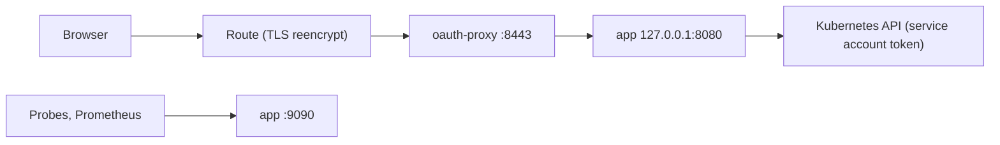

- **Backend:** Go `net/http`, a raw-HTTP Kubernetes client (no client-go), JSON logs. API routes are in `pkg/api/routes.go`.
- **Frontend:** React 18, PatternFly 6, TypeScript, webpack; served by the backend.
- **Progress:** Update, Re-deploy and Install a different build stream their steps over SSE. Afterwards the page polls `/api/status`, and `GET /api/operation` shows the running operation to every viewer.
- **State:** ConfigMaps `rhoai-nightly-updater-activity` (audit log), `-snapshot` (pre-operation snapshot and the recorded Subscription), `-operation` (running-operation marker, last result and the cross-pod lease).

## License

Apache License 2.0
