<p align="center">
  
</p>

<h1 align="center">RHOAI Nightly Updater</h1>

The RHOAI Nightly Updater is a web app that installs and updates Red Hat OpenShift AI (RHOAI) nightly builds on your own ROSA HCP or OpenShift cluster. It also deploys odh-dashboard pull requests, sets up test environments on its Environment page (S3 storage, pipeline servers, MLflow, a model registry, a CPU model) and explains what is wrong when RHOAI is not healthy. You need no `oc` commands day to day: everything is a button, and every change asks for confirmation first.

Cluster-admins make the changes. Since 5.0.0 everyone RHOAI lets in can sign in too and see what runs: a short Status page, Build Explorer and their own data science projects ([Not a cluster-admin?](#not-a-cluster-admin-what-you-see)).

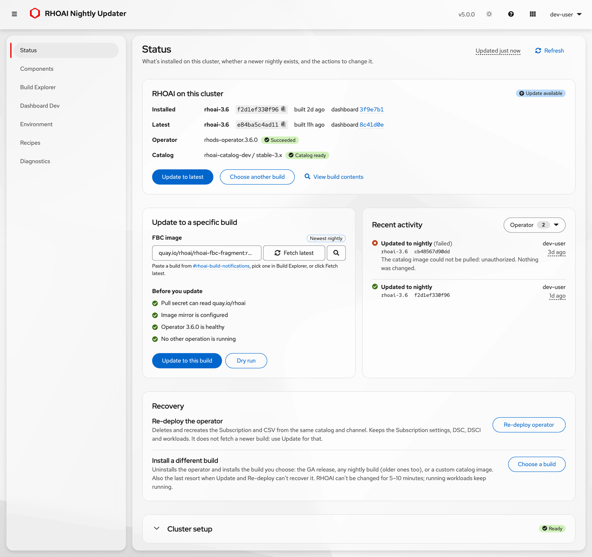

## Install

Download the latest release's `install.sh` and run it. You need `oc` (logged in as cluster-admin) and `curl`:

```bash
curl -fsSLO https://github.com/DaoDaoNoCode/rhoai-nightly-updater/releases/latest/download/install.sh
bash install.sh --dry-run && bash install.sh
```

Clusters that sign users in directly through an external OIDC provider (OpenShift's direct authentication: `authentications.config.openshift.io/cluster` has `spec.type: OIDC`) are not supported: the app signs in through OpenShift's built-in OAuth server, which such clusters turn off, and the installer refuses them ([SECURITY.md](SECURITY.md#residual-risk)).

The installer prints the app URL when it is done. To check the download, compare `sha256sum install.sh` (macOS: `shasum -a 256 install.sh`) with the SHA-256 in the [release notes](https://github.com/DaoDaoNoCode/rhoai-nightly-updater/releases/latest). For a specific version, download `https://github.com/DaoDaoNoCode/rhoai-nightly-updater/releases/download/vX.Y.Z/install.sh` instead.

**New here? Follow the [Quick Start](docs/QUICKSTART.md)**: install, one-time setup, your first update and the Environment page, step by step. Upgrading from 2.x to 3.0.0? Read [UPGRADING §5](docs/UPGRADING.md#5-upgrade-to-v300): the S3 storage moves, and a pipeline server needs the standard name `dspa` for workbench pipelines. Installed before releases existed (your Deployment uses `:latest`)? Read [UPGRADING.md](docs/UPGRADING.md) first. Cluster configured from Git by Argo CD? Deploy the Helm chart `deploy/chart` instead: [GITOPS.md](docs/GITOPS.md).

## A short tour

### Status: what is installed, and Update

The **RHOAI on this cluster** card (top of the screenshot above):

- **Installed**: the nightly build the cluster runs (tag, digest, build date, dashboard commit).
- **Latest**: the newest build of the same stream on Quay.
- The verdict: **Update available**, **Up to date**, **Operator failed** or **No Subscription**.
- **Update to latest** installs the newest build. Progress streams step by step; if OLM fails, the previous catalog and Subscription are restored.

The same page has one-time cluster setup (pull secret, image mirror), **Update to a specific build**, **Recent activity** and **Recovery** (**Re-deploy operator**, **Choose a build**). On self-managed OpenShift the setup is one click each: **Create the image mirror** and **Add to the nodes' pull secret** (with removals), each after a review of exactly what changes and what the nodes do, run with your own permissions; ROSA HCP keeps the `rosa create image-mirror` instructions ([QUICKSTART](docs/QUICKSTART.md#3-one-time-setup-pull-secret-and-image-mirror)).

### Components: is RHOAI ready?

The **DataScienceCluster** card shows its state (**Ready** or **Not Ready**) and, for each failing component, the operator's message and a short **Cause**, with a link to the fix on Diagnostics. The whole page: [screenshot](docs/images/page-components.png).

#### Components and sub-components: change them without the OpenShift console

When nothing needs fixing, the card reads **Nothing to fix compared with the release default**, as in the [Components screenshot](docs/images/page-components.png). With differences, the summary names each one and offers **Fix**:

- The comparison with the release default: the count and paths of each kind of difference, or **None**.
- **Fix** sets what is missing to the release default and removes what the CRD does not define.
- **Show only differences** keeps the rows that differ, with the rows above them.
- Each row's labels; click one for what it means.

The tree is read from the installed DataScienceCluster CRD, so it follows whatever the release defines (`dashboard.standard`, `kserve.nim`, `aigateway.modelsAsAService`, ...). Each row shows the value in the DSC (a select limited to the values the CRD accepts), the **release default** (the example the installed operator's CSV ships in `alm-examples`) and what the operator reports.

- **Change a component**: pick a value. The confirmation lists exactly what changes and what is deployed or removed; removing a component first checks that it can be cleaned up (the same checks as Diagnostics' disable fix) and refuses otherwise. A sub-component set to Managed under a parent that is not Managed is offered together with its parent. Only that one field is patched (a JSON Patch that fails if the field changed since you looked, after a server-side dry run).
- **The comparison with the release default** is always at the top of the card, so "nothing missing" is something you can read, not something you have to guess from an empty space. It names the release default (operator version and CSV), how many of its components your DSC has, and for each kind of difference the count and paths, or **None**: **Missing** (the release default sets it, your DSC does not, so the operator uses the CRD's default for it or treats it as Removed), **Not in the installed CRD** (the operator never sees it), **Deploys nothing** (Managed under a parent that is not Managed) and **Changed from the default** (a value you chose; not a problem). Values the API server fills in are not differences. Without a release default (the installed CSV ships no DataScienceCluster example), it says so, and Missing and Changed read **Not checked**. **Fix** sets the missing ones to the release default and removes the fields the CRD does not define; a sub-component that deploys nothing is yours to decide (set the parent to Managed, or the sub-component to Removed). **About this comparison** explains the kinds, and why deprecated fields are not listed: the CRD marks only whole API versions as deprecated, the API server prunes fields a CRD no longer defines, so after an upgrade what matters is what the new release default sets that your DSC lacks (Missing).
- **Each row is labelled** with its difference (**Changed from the default**, **Missing — default Managed**, **Not in the installed CRD**, **Deploys nothing — parent Removed**); click a label for what it means and what Fix does. A field the CRD does not define is a row too, under the component it is in. **Show only differences** keeps the rows that differ, with the rows above them for context.
- **Reset to the release default**: a **soft reset** (recommended) changes in place only what differs, keeping the workbench and AI hub namespaces. A **hard reset** deletes the DSC and creates the release default in its place: every component is torn down and comes back, which can clear stuck deployments. It needs the DSC's name typed, and stops without creating anything if the old DSC is not gone within 10 minutes. Both keep **the components you turned on** (checked by default): what is enabled in your DSC but off in the release default, such as `aigateway` and `aigateway.modelsAsAService` after MaaS setup, stays as it is, with the parents it needs; the dialog names them. Unchecked, the reset applies the pure release default. See [RUNBOOK §11.9](RUNBOOK.md#119-change-or-reset-the-datasciencecluster).

  In the dialog the option reads **Keep the components you turned on (N)**, with each kept path checked, and the plan lists them under **Kept**.

- **MaaS is never removed from here while it is in use.** A change that would stop `aigateway` or `aigateway.modelsAsAService` (setting either to Removed, a reset without the option above, Diagnostics' disable fix, a repair) is refused while any model is published to MaaS, any MaaSSubscription or MaaSAuthPolicy exists, or this tool's MaaS setup is recorded: without MaaS, every published model and every API key stops working. The message names the models and subscriptions. Remove MaaS on the Environment page's MaaS tab (**Clean up MaaS** unpublishes and removes it in order), or keep `aigateway` Managed. When the tool cannot read those, it refuses too.

  Such a dialog starts with **This change is not possible now**, names the published models, and leaves its button disabled.

Changes are off with the reason when Argo CD or an ACM policy manages the DSC, in the gitops profile, or without cluster-admin.

Below it, the Deployments table lists problems first, with pod details, git provenance and what changed since the last update.

### Build Explorer: which build has my change?

Every nightly tag on Quay: filter, see the contents of a build, compare it with the installed one, and search by image, commit SHA, PR number (`#5123`) or PR URL (the box reads "Image, commit SHA, PR # or PR URL"); the result lists which builds contain it. See [Build Explorer search](#build-explorer-search) for what it can find and how it decides.

### Dashboard Dev: try an odh-dashboard PR

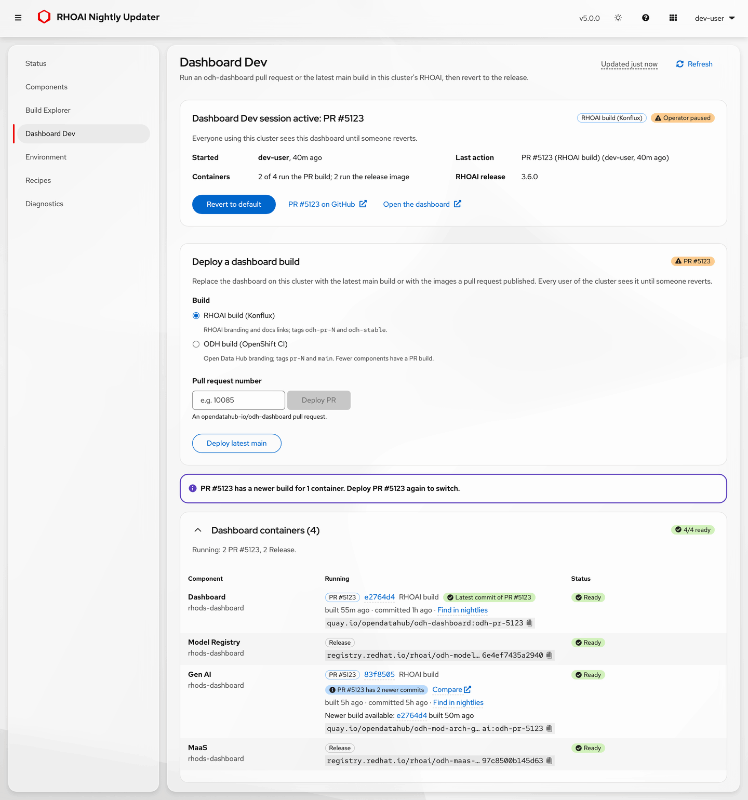

- **Dashboard Dev session active: PR #5123**: who deployed which build, and when. Everyone on the cluster sees this dashboard until someone reverts.
- **Revert to default** restores the release images.
- **Dashboard containers**: the commit each container runs, when it was built, and how far it is behind upstream `main` (or the PR's latest commit, "PR #5123 has 2 newer commits"), with **Compare** on GitHub.
- **Newer build available**: the tag has moved on to a newer build. **Deploy PR** or **Deploy latest main** again switches to it.

It deploys RHOAI Konflux builds (`odh-pr-<N>`, `odh-stable`) or ODH OpenShift CI builds (`pr-<N>`, `main`). **Deploy latest main** pins the build under its commit tag (`:<commit>@sha256:...`), so the cluster names the commit it runs even after the `main` or `odh-stable` tag has moved on.

### Environment: S3 storage, pipeline servers, MLflow, models

One tab per feature after an **Overview**, kept in the address so a link opens the same view (`?tab=storage`, `?tab=pipelines&project=<name>`, `?tab=mlflow`, `?tab=models&project=<name>`).


- How many features are ready ("3 of 9 ready").
- Each feature links to its tab (a project-scoped one with its project).
- Its state, from the same function as the tab: **Ready**, **Not set up**, **Needs attention**, **Error**, ... Something this tool did not create reads **Ready**, with **Not managed by this tool** under the label: ownership never counts as not ready. A project-scoped feature summarises the projects that have it ("Ready in juntao-test", "Ready in 3 projects", "Error in 1 of 3 projects", "Not set up in any project"); with several, **Show projects** lists each one with its state and a link to the tab there.
- The next step, a link in the row: **Open pipelines** in its one ready project (with several ready projects, **Choose a project**: the tab's picker decides; with a problem in one of several, **Open** that project), **Open MLflow experiments** (MLflow's experiments in the dashboard), **Open admin UI** (the S3 storage's), **Set up** (confirm, then a check that every part can be set up, then the missing parts in order, each counted only once it works), **Migrate storage**, **Show issue** (opens the tab at that part; a problem with the S3 storage opens the S3 storage tab, from its row or from Pipelines) or **Choose a project**. A step that cannot run says why under it.

Under the table, **Clean up everything** deletes what this tool created (first the MaaS publications, then the pipeline servers, the S3 storage, MLflow, the model registry, the playgrounds, the models, the inference gateway, and the MaaS platform last) in one confirmed operation, with a checkbox per part.

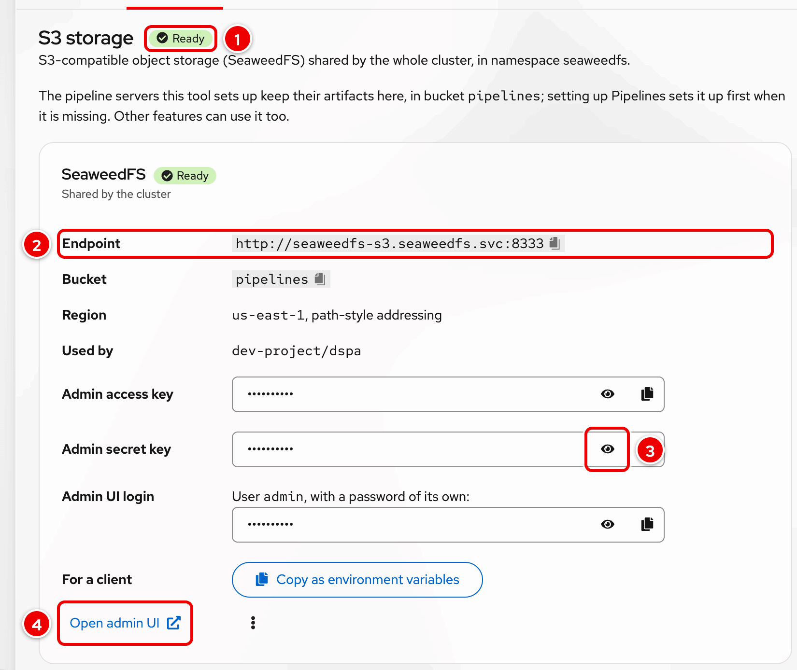

The **S3 storage** tab is the cluster's S3 storage (SeaweedFS in namespace `seaweedfs`), so it has no project picker. Every pipeline server this tool sets up keeps its artifacts there, in bucket `pipelines`; other features can use it too.

- Its state. **Set up S3 storage** sets it up on its own; **Set up Pipelines** sets it up first when it is missing.
- Its details inline: the S3 endpoint (`http://seaweedfs-s3.seaweedfs.svc:8333`), the bucket, the region and the pipeline servers that use it.
- The S3 access key and secret key are masked: the eye shows one and the copy button copies it; **Copy as environment variables** copies the whole connection (`AWS_ENDPOINT_URL`, the keys, region, bucket) as shell assignments with single-quoted values, to paste into a shell or `source`. The admin UI (user `admin`) has a password of its own, shown the same way. Each is read from the server only then (cluster-admins only), and gone when you hide it or leave the tab.
- **Open admin UI**. The menu (⋮) has **Delete S3 storage** (disabled while a pipeline server uses it, saying which) and **Repair** when it applies. Storage from an earlier version shows **Migrate storage** and, later, **Delete old storage** here ([RUNBOOK §10.1](RUNBOOK.md#101-migrate-storage-from-an-earlier-version)).

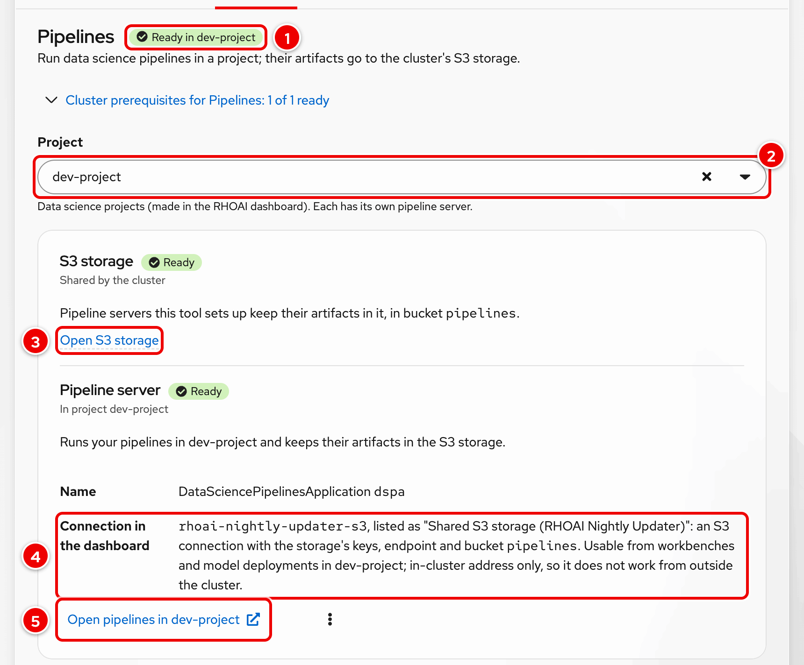

- The feature's state in the selected project. Without `?project=` the tab opens the first project with a ready pipeline server.
- The project picker (type to filter; each project says what it has).
- The S3 storage as Pipelines needs it: its health only, with **Open S3 storage** for its details, keys and changes.
- The pipeline server is set up as the dashboard sets one up: named `dspa` (the only name workbench pipelines find), with the dashboard's settings, its S3 Secret owned by it, and a dashboard S3 **Connection** `rhoai-nightly-updater-s3` ("Shared S3 storage (RHOAI Nightly Updater)") that workbenches and model deployments in the project can use. The Connection carries the in-cluster address, so it works from pods only. Deleting the pipeline server, here or in the dashboard, deletes both.
- **Open pipelines**. The pipeline server's menu (⋮) has **Delete**, only for what this tool created; a disabled entry says why.

A pipeline server an earlier version set up is named `nightly-dspa`. It keeps working (the dashboard's pipelines pages, the KFP SDK, Migrate storage, Delete), but workbench pipelines (Elyra) cannot find it, so the tab warns "Workbench pipelines don't work with this pipeline server" (workbenches look for the pipeline server named `dspa`) and offers **Recreate with the standard name**. It asks first; the confirmation says what goes: `nightly-dspa`, its Secret and its database are deleted, then `dspa`, its Secret and the Connection are created.

Everything the new server needs is checked first; nothing is deleted if it would be refused. Then `nightly-dspa` is deleted with its database (its runs, experiments and imported pipelines are lost; the artifacts already in the S3 storage stay, but no run links to them), and `dspa` is set up in its place.

Before **Set up**, the tab shows what it needs: a DataScienceCluster component that is not Managed (with **Open Components**), no data science project (with a link to the dashboard's Projects page), or a namespace `seaweedfs` that is someone else's. Set up stays disabled, with the reason under it. Once the pipeline server is ready, **Use it** shows where its runs are, its API endpoint and a KFP SDK snippet, followed by **What next**. Problems read in plain words, with the fix (Repair, Revert, View logs) on the alert and the pod's reasons under **Technical details**. Every change runs in one dialog with its steps and outcome. If you close it, or leave the page, the alert at the top of every page names the run and its step, with **View progress** to open the dialog again, and changes on other pages wait for it; when it ends with its dialog closed, a notification wherever you are gives its outcome, with **Show details**.

Storage an earlier version set up in namespace `minio` reads **Migration needed** (on the Overview, the S3 storage tab and the Pipelines tab); a warning at the top of the S3 storage tab says why, and the storage's **Migrate storage** button moves it, with its data and pipeline servers, and ends there. **Delete old storage** is a separate, later action in the storage's menu ([RUNBOOK §10.1](RUNBOOK.md#101-migrate-storage-from-an-earlier-version)).

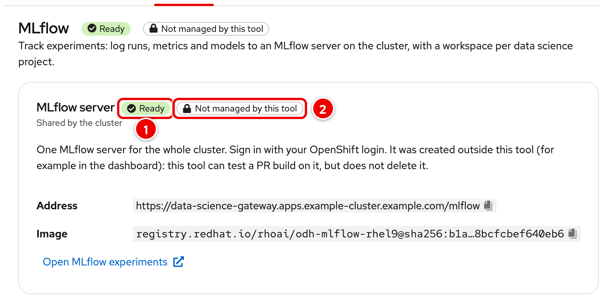

- The **MLflow** tab: the server's health.
- Ownership, apart: this one was made in the dashboard. It works (Open MLflow experiments, a PR build, Revert), but the tool does not delete it.

MLflow on RHOAI keeps each data science project apart as a workspace. Once it is ready, **Use it** has a project picker, **Open <project> in MLflow** (the dashboard's MLflow experiments for the project, `/develop-train/mlflow/experiments?workspace=<project>`; MLflow's own `<address>/#/experiments?workspace=<project>` only when the dashboard's address is not known), and the client settings to copy (`MLFLOW_TRACKING_URI`, `MLFLOW_TRACKING_TOKEN=$(oc whoami -t)`, `MLFLOW_WORKSPACE=<project>`). Deploying an opendatahub-io/mlflow PR image is under **Test an MLflow PR build**.

#### Model registry

The Model registry tab sets up one model registry for the cluster, `nightly-registry`, the way the dashboard's **Settings > Model registry settings > Create model registry** does with **Default database (non-production)**: a ModelRegistry with `spec.postgres.generateDeployment: true`, in the namespace the DataScienceCluster names for registries (`rhoai-model-registries` by default), so it shows in the dashboard like one made there. The default database is RHOAI's for development and testing, not production; RHOAI provides it from 3.4 on, and on a cluster without it Set up refuses before changing anything.

1. **Needed on the cluster first**: the DataScienceCluster component that runs registries, `aiHub` on RHOAI 3.6 (it also runs the Model Catalog) or `modelregistry` before, set to Managed with **Set up what the model registry needs**, as for the other tabs.
2. **Model registry**: its state (starting while its database and server come up, then Ready), its REST address through the cluster's gateway, and **Open in the dashboard**. A registry of that name someone else made reads **Not managed by this tool**: shown, never changed or deleted.
3. **Sample model**: Set up registers the model the Models tab serves (`qwen25-05b-instruct`, version `v1`, its Hugging Face address) as the dashboard's Register model form does, unless you untick **Add a sample model** in the confirmation. Registered models cannot be deleted, only archived; setting up again puts an archived sample back to live.

No access is granted to anyone: cluster-admins can use the registry, and others are added on the dashboard's **Manage permissions** page. **Delete** (the registry's menu) and **Clean up the model registry** delete the registry, with every model registered in it and its database. **Clean up** also offers to turn the DataScienceCluster component back off when this tool turned it on, unticked, with the line that `aiHub` also removes the Model Catalog; it is turned off only while nobody changed it since and no model registry is left in its namespace. Troubleshooting: [RUNBOOK §10.5](RUNBOOK.md#105-model-registry).

#### Models: small models on CPU

The Models tab serves small models from Hugging Face on CPU in a data science project, each pinned to one commit. A project can have several of them:

| Model | Type, for | Reserves (request, limit) | Download | vLLM options |
|---|---|---|---|---|
| `smollm2-135m-instruct`, SmolLM2 135M Instruct | Chat (smoke test) | 2 CPUs, 4 / 5 GiB | about 270 MB | `--max-model-len 4096 --enable-force-include-usage` |
| `qwen25-05b-instruct`, Qwen2.5 0.5B Instruct (the default) | Chat | 4 CPUs, 6 / 8 GiB | about 1.0 GB | `--max-model-len 4096 --enable-force-include-usage` |
| `qwen3-1-7b`, Qwen3 1.7B | Chat, tool calling, reasoning (thinking off by default) | 4 CPUs, 12 / 14 GiB | about 4.1 GB | `--max-model-len 4096 --enable-auto-tool-choice --tool-call-parser hermes --reasoning-parser qwen3 --default-chat-template-kwargs '{"enable_thinking":false}' --enable-force-include-usage` |
| `granite-embedding-125m-english`, Granite Embedding 125M English | Embeddings (768 dimensions), semantic search | 2 CPUs, 3 / 4 GiB | about 250 MB | `--runner pooling --max-model-len 512` |

Every chat model runs with `--enable-force-include-usage`, so vLLM reports token usage in streamed responses too: Models as a Service counts tokens from it, and without it a streamed chat would count 0 and never reach a token limit (the MaaS docs' model setup). A model set up by an earlier version lacks it; set it up again (it restarts) before you publish it. vLLM has the flag from 0.10.0 on (vLLM `vllm/entrypoints/openai/cli_args.py`; 0.9.2 lacks it), which covers RHOAI 3.6's CPU preset image (vLLM 0.18, KServe `config/overlays/odh/params.env` `kserve-llm-d-cpu-upstream-version`) and the released image (0.24); an image you set with `VLLM_CPU_IMAGE` must be vLLM 0.10.0 or later too, or the model does not start (`unrecognized arguments`).

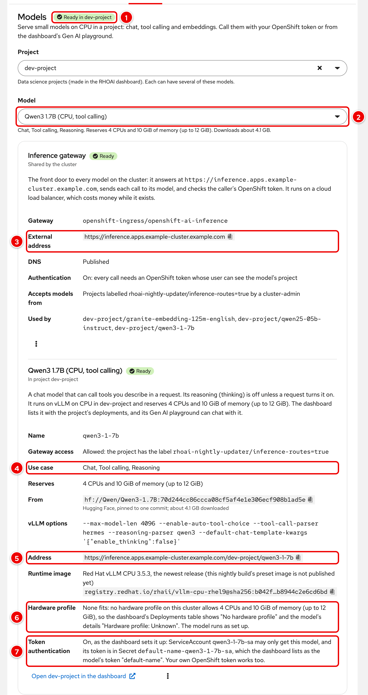

- The feature's state in the selected project, for the chosen model.
- The **model picker**: which catalog model the tab shows, sets up and deletes (the address keeps it as `model=<name>`).
- The **inference gateway**, shared by the cluster, with its own **Set up the inference gateway**: a front door at `https://inference.<apps domain>` that checks each caller's OpenShift token. A model does not need it (see **How it is reached** below); a model setup never creates it. It runs on a cloud load balancer, which costs money while it exists. It needs a cluster that gives a LoadBalancer Service an address (a cloud cluster such as ROSA, or MetalLB): setup fails when the gateway gets no address within 2 minutes. When OpenShift does not publish its hostname in DNS (no DNS zone in the cluster's DNS configuration, or DNS managed elsewhere), setup succeeds with a warning that says what to check. An OpenShift Route in front of a ClusterIP gateway (the MaaS docs' `INGRESS_MODE=ocproute`, odh-gitops' `openshiftRoute`) is not supported by this tool yet. It accepts models only from the projects it lists by name (**Projects allowed on the gateway**), as RHOAI documents it; a model set up through it adds its project, and deleting the project's last model on it takes the project off again. Projects on the list that no model uses are named with **Remove** ("The gateway accepts projects that don't use it"). A project on the list that no longer exists is not something to attend to: one this tool added goes off the list by itself at the next Models change or Clean up, and until then a plain line says so ("Project X no longer exists; it is removed from the gateway at the next Models change") with a **Remove** that runs at once, with your sign-in. One that RHOAI's installation (or an admin) made reads **Not managed by this tool** and is used as it is.
- The chosen **model** in the project: what it is, what it is for, what it reserves, where it comes from and its vLLM options. **Open <project> in the dashboard** shows it with the project's deployments, and Gen AI studio offers it in the playground.
- Its address, which copies with one click. The runtime image below it: on a nightly build the preset's image is not published yet, so the newest released Red Hat image is used (pinned by digest); `VLLM_CPU_IMAGE` overrides it.
- The hardware profile the dashboard shows. No profile fits Qwen3 on a default cluster, so the dashboard shows "No hardware profile" (and "Unknown" in its details); the model runs as set up.
- Token authentication: the model's own ServiceAccount and token Secret, as the dashboard makes them. The dashboard lists that token for the model.

In the model picker ("Models this tool can set up"), each option says what the model is and what it is for, what it reserves, how much is downloaded, and its state in the project. A model no worker has room for now is disabled, and says why. One the project already has stays selectable.

Each model also asks for node disk of about 1.5 times its download (KServe downloads it into an emptyDir by default), and the setup warns when the project's ResourceQuota has no room for it. Qwen3 fits no hardware profile on a default cluster: the dashboard shows "No hardware profile" for it, and the tab says so.

**Needed on the cluster first** follows the choice of how the model is reached when something is missing: Model serving (KServe) turned on, the cert-manager Operator, and (only when the model is reached through a gateway) Red Hat Connectivity Link and its instance (Kuadrant), with **Set up what Models needs** as the page's primary action (the model's own Set up waits for it) and **Do it from the CLI instead**: the same steps as one ordered script. Its confirmation shows the plan open and installs with **Install and turn on**. Pipelines, MLflow and the Playground have the same checklist; when it is ready it collapses to "Cluster prerequisites for <feature>: N of N ready". On the Overview, Models' **Set up what Models needs** plans for the recommended inference gateway, so it includes Connectivity Link; a feature that reads Ready while its cluster prerequisites are not **Needs attention**.

**Model access** (how the model is reached) is chosen before Set up, with the tool's recommendation and why; to change it later, delete the model and set it up again. What the cluster needs for the choice is listed after it:

| Choice | The model's route | When the tool recommends it |
|---|---|---|
| Through the cluster's default inference gateway | `router: {route: {}, gateway: {}}`, as the dashboard deploys: KServe's default gateway (`inferenceservice-config`), with RHOAI's token check. Offered only when KServe's configuration names its default gateway (an unreadable or unset one is never assumed) | the default gateway exists, is programmed, admits the project (this tool's own adds the project to its list), is in `openshift-ingress` and is not labelled `opendatahub.io/managed=false` |
| Through MaaS only | `refs: [maas-default-gateway]`, published to MaaS at setup; no inference gateway. Its publication is part of its setup: **Delete** unpublishes it first, in the same operation, and **Unpublish** on the MaaS tab leaves it with no route at all (only inside the cluster), never on a gateway nobody chose | the MaaS platform is ready and the default gateway cannot be used |
| Through another gateway: `<namespace>/<name>` | `refs: [that gateway]`; the gateway is never changed | never: whether RHOAI checks tokens there is not known to the tool outside `openshift-ingress`; offered for an explicit choice. Only gateways that are programmed and admit the project; never MaaS's or the RHOAI operator's own (`data-science-gateway`) |
| Only inside the cluster | no route: `https://<model>-kserve-workload-svc.<project>.svc.cluster.local:<port>` (the port of the Service KServe makes, 8000 on RHOAI 3.6, read once it exists), not authenticated inside the cluster | never by default; the tab warns first |

An unavailable choice says why under it, with a link to fix it where there is one (set up the inference gateway, the MaaS tab). When nothing fits, the tab recommends setting up the inference gateway. **Set up** then creates the chosen model in one operation and waits until it runs, typically 3 to 5 minutes the first time. A failing image pull is waited on (2 minutes, 8 on a node that joined minutes ago, whose pull credentials can arrive late) before the setup says what to check, also when the 10-minute ready wait ends first. Then **Can it be called?**: the tool sends the model one minimal request the way it is reached, with the model's own token, and reports whether it answers; a failure fails the setup (the model stays) and names the problem (a 404 from vLLM means the request's `model` is not the served name; a 404 without a body means the gateway did not route the request to the model yet; 401, 403, 5xx, no answer). Through a gateway it then sends the same request without a token: the gateway must refuse it, and an answer fails the check as **Answers without a token** (the gateway does not check who calls). A model that cannot be called, or answers without a token, **Needs attention** on its card. **Check again** on the model repeats it in place (it changes nothing, so it asks nothing). With the model it makes the dashboard's token authentication, as "Require token authentication" does: ServiceAccount `<model>-sa`, which may only `get` the model, its Role and RoleBinding, and token Secret `default-name-<model>-sa`, all owned by the model. The dashboard then lists that token for the model, and its Edit keeps authentication on. Once ready, **Use it** has commands that read that token (`oc get secret default-name-<model>-sa ... | base64 -d`) and call the model: `/v1/chat/completions` for a chat model, `/v1/embeddings` for the embedding model.

For Qwen3, **Use it** also has a **Tool calling** and a **Reasoning** request:

- Qwen3 calls tools: describe them in the request's `tools`, and the answer has `tool_calls` when one fits.
- Its thinking is off by default; `"chat_template_kwargs": {"enable_thinking": true}` turns it on for one request. That command streams (`"stream": true`, `curl -N`): thinking on CPU can take over a minute, and the cloud load balancer closes a connection that sends nothing for 60 seconds (the AWS default).

A model deployed elsewhere (in the dashboard, say) in a project the gateway does not list:

- Its route is rejected, so it never becomes ready. The inference gateway part says "<project>/<model> can't be reached: its project isn't allowed on the inference gateway", and the Overview's Models row says so too.
- **Allow <project>** adds the project to the gateway's list; the projects already on it stay. For a gateway this tool did not create, the tab gives RHOAI's step for a cluster admin instead.
- **Projects allowed on the gateway** lists them. Deleting a project's last model takes the project off the list (it stays while another model there uses the gateway); a project that was deleted leaves it at the next Models change, and **Remove from the list** does it by hand.

Each part's menu has **Delete**, for the chosen model only; the gateway stays while a model uses it. **Clean up Models** deletes every model of this tool in the projects you choose, then the gateway. Troubleshooting: [RUNBOOK §10.2](RUNBOOK.md#102-models-the-inference-gateway-and-cpu-models).

#### Workbench: a Jupyter workbench made as the dashboard makes it

The Workbench tab sets up a Jupyter workbench `nightly-workbench` in a project you choose, exactly as the dashboard's **Create workbench** form does, so the dashboard lists and runs it like any other.

1. **Set up** names what it creates before it runs: an image that is not deprecated, RHOAI's own first (the one RHOAI marks as its default when it is current, as Jupyter Minimal on 3.6; on 3.7, where that image is deprecated, the first current one in the dashboard's image list, Jupyter | CPU; a deprecated image only when every image is, and then it says so), the dashboard's default hardware profile for the project (in a Kueue-managed project only a Queue profile whose LocalQueue the project has), storage `nightly-workbench-storage` of the dashboard's default size and storage class, and the pipeline server's S3 connection when the project has one. When no hardware profile fits, or the cluster runs RHOAI 2.x, it says why and Set up stays off.
2. **Workbench**: its state as the dashboard shows it (Starting, Running, Stopping, Stopped, Failed), with **Open workbench**, **Start** and **Stop** (the dashboard's own patches), and **Delete workbench**, which keeps the storage unless you tick **Also delete its storage (files are lost)**. Setting up again uses kept storage; until then the card shows it, with **Delete storage** in its menu. A `nightly-workbench` this tool did not create reads **Not managed by this tool**; one whose state cannot be read reads **Unknown**, with **Retry**.

Troubleshooting: [RUNBOOK §10.6](RUNBOOK.md#106-workbench).

#### Distributed workloads: Kueue as the RHOAI docs set it up

The Distributed workloads tab sets up Kueue in one project so the dashboard's **Observe & monitor, Workload metrics** page (its name on RHOAI 3.6 and 3.7) and **Observe & monitor, Infrastructure** show real workloads.

1. **Prerequisites** (above the tab): the cert-manager Operator and the Red Hat build of Kueue from OperatorHub, then the DataScienceCluster's `kueue` set to `Unmanaged` (RHOAI 3.x rejects `Managed`); RHOAI then creates the Kueue CR `cluster`. The operators stay after Clean up.
2. **Set up** in a project (a project of its own is best, for example `nightly-kueue`, created in the dashboard): ResourceFlavor `nightly-kueue-cpu`, ClusterQueue `nightly-kueue` with 14 CPUs, 44 GiB and 12 GiB of ephemeral storage (both samples, a workbench and the largest catalog model at once, with room for the second pod the model's rolling update adds) for that project only (not preemptive), LocalQueue `nightly-kueue`, and the project label `kueue.openshift.io/managed=true`. The confirmation warns when the project already has other setups.
3. **Samples**: a RayCluster (on by default; the Workload metrics page with its metrics) and a RayJob (off by default; the Infrastructure page's Workloads tab), both on one small CPU cluster and sent to the LocalQueue. The Ray image is editable; the default `quay.io/modh/ray:2.47.1-py311-cu121` is the x86 image the docs use (large); the docs' `-cpu` tags are ppc64le only.
4. **Dashboard Kueue setting** (off by default, its own confirmation): sets `disableKueue: false`. In every new project on the cluster, workbenches and model deployments can then only use a queue hardware profile, so a project without its own LocalQueue cannot create them until an admin adds one. It also adds hardware profile `nightly-kueue-cpu` for the tool's LocalQueue. Turning it off restores what nobody changed.

Set up refuses a Kueue that does not serve `kueue.x-k8s.io/v1beta2`, one installed outside OLM (told by its CRDs' OLM labels), a Kueue CR with `labelPolicy: None`, KueueReady not `True`, a project with a LocalQueue named `default` or with `kueue.openshift.io/managed` set to another value, and any read that fails. Troubleshooting: [RUNBOOK §10.7](RUNBOOK.md#107-distributed-workloads-kueue).

#### Playground: the dashboard's Gen AI playground

The Playground tab sets up the RHOAI dashboard's Gen AI playground, a chat page where you try a project's models and ask about your documents, in a project you choose.

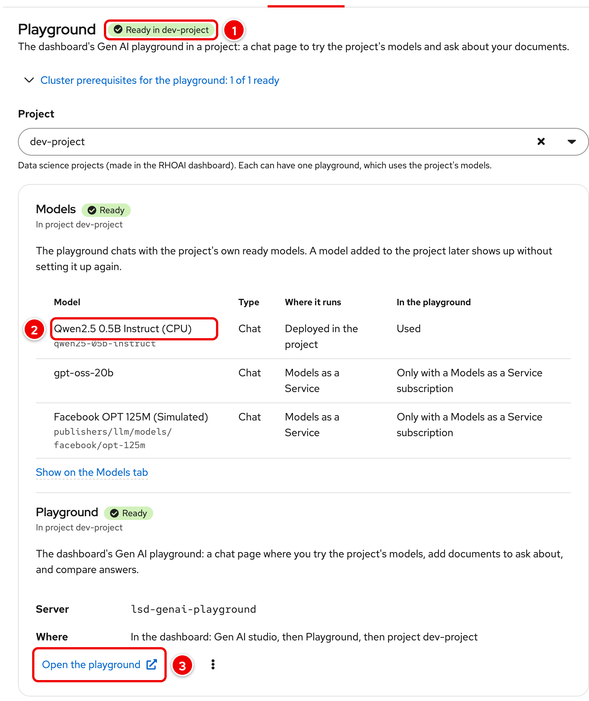

- The feature's state in the selected project.
- **Models**: the project's ready chat models, and this tool's embedding model, with their type, where each runs and whether the playground uses it. The playground needs a chat model: when there is none, **Set up a model on the Models tab**.
- **Playground**: its state as the dashboard reports it, and **Open the playground** (Gen AI studio, then Playground, then the project). One someone set up in the dashboard reads **Not managed by this tool**: open it, but this tool does not delete it.

Before **Set up the playground in <project>**:

- The models are rows you choose: the project's own ready models are chosen, as in the dashboard. This tool's Granite embedding model goes in as an embedding model of 768 dimensions, for searching your documents. An embedding model this tool did not set up is not added (its dimension is not known): the tab says to add it in the dashboard's Gen AI studio, choosing **Embedding** and entering its dimension.
- Models as a Service models are listed but not chosen ("Not used unless you choose it"): choose one to add it. It answers only with a Models as a Service subscription to it. Since 4.0.0 Set up runs with your own sign-in, so a chosen MaaS model is added as you, not with the tool's credentials (3.0.1 left them out for that reason).
- **Set up** runs it.

**Set up** asks the dashboard itself to create the playground, as its Gen AI studio does, with the models you choose, and waits until it is ready, typically 1 to 2 minutes. **Use it** has a chat request to run from a terminal with your own `oc whoami -t` token. **Delete** (in the part's menu) asks the dashboard to delete it, with its chats and documents; the models stay. Troubleshooting: [RUNBOOK §10.3](RUNBOOK.md#103-playground-the-dashboards-gen-ai-playground).

On a nightly cluster whose preset image is missing from the registry, the model reads **Error** with "The cluster preset's image is not published yet", and **Use the newest released Red Hat image** changes only the model's image.

#### MaaS: Models as a Service

The MaaS tab sets up the cluster's Models as a Service platform the way the [MaaS install docs](https://github.com/opendatahub-io/models-as-a-service/tree/main/docs/content/install) do, and publishes this tool's chat models to it, one at a time: everyone signed in to the cluster (or the groups and users you name) can then call a published model with a MaaS API key, up to the model's limit. The embedding model is not offered; the tab says why.

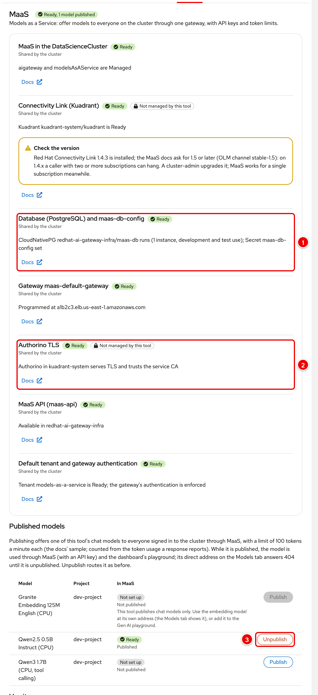

- **Database**: MaaS keeps its API keys in PostgreSQL, which the MaaS docs leave to you ("customer-provided"), so Set up asks. **Development database** (the default) is exactly the docs' `scripts/setup-database.sh`: one pod without storage, nothing else installed, but API keys are lost whenever its pod restarts (the dialog warns; the tab then says to restart maas-api). The tool never reads or changes its Secret `postgres-creds`: it records the UID when it creates it and deletes only that one. **Persistent development database (CloudNativePG)** is this tool's own option, in neither the MaaS nor the RHOAI docs: it installs the CloudNativePG operator from `certified-operators` and keeps keys on a 1 GiB volume. **Your PostgreSQL** is for anything whose keys must last: you enter its connection URL, which goes only into Secret `maas-db-config` and is never shown again or logged; the tool never touches the database. A `maas-db-config` someone else made is used as it is. **Change database** switches between them, from a database that runs (every API key is lost; refused while others use MaaS), and is also how your PostgreSQL's URL changes.
- **Authorino TLS**: Connectivity Link's Authorino must serve TLS and trust the cluster's service CA. Set up (or the part's **Configure Authorino TLS**) applies the docs' `setup-authorino-tls.sh` steps; **Do it from the CLI instead** shows the same commands.
- **Publish** / **Unpublish** per model of this tool. Publish asks who can use the published models (everyone signed in, or groups and users exactly as your identity provider names them, OIDC groups such as `/admins` included; a group with no OpenShift Group is a warning, in the dialog as you type and on the tab with the commands that create it; set with the first model, then **Change who can use them**) and the model's token limit for each user: the docs' premium example (100,000 a day, the default) or free example (100 a minute), unlimited where the cluster's MaaS offers it (read from its MaaSSubscription CRD; usage still counted; never faked with a huge number), or your own token rate limits. The table shows each limit, with **Change limit**; API keys keep working across both changes. A published model's address moves to the MaaS gateway until it is unpublished, and, as the dashboard's MaaS option does, it leaves Gen AI studio's AI assets (its genai label and use-case annotation are removed and put back on Unpublish), so the studio lists it once, through MaaS. Its MaaSModelRef is owned by the model and shows the catalog's name.

**Set up** does every step of the docs that is not done yet, in their order, after one confirmation that lists each change: Red Hat Connectivity Link from `redhat-operators` on the channel that meets the docs' minimum, and its Kuadrant instance; the AI gateway's infrastructure namespace; the database you choose (and the CloudNativePG operator only if you choose it); Gateway `maas-default-gateway` with an external load balancer at `maas.<apps domain>` (setup stops there when the cluster gives it no load balancer address, and warns when its hostname is not published in DNS; an OpenShift Route in front of a ClusterIP gateway (the MaaS docs' `INGRESS_MODE=ocproute`, odh-gitops' `openshiftRoute`) is not supported by this tool yet); Authorino TLS; then `aigateway` and MaaS turned on in the DataScienceCluster (the previous values are recorded); then it waits for maas-api and the default tenant. On a cluster without any of it this takes about 10 minutes; if a step fails, Set up again continues from there. What exists already is used as it is. Parts offer their own fixes: **Upgrade Connectivity Link** (below the docs' 1.5, along the path OLM offers, then Authorino TLS again), **Raise the memory limit** (only after the Kuadrant operator was OOMKilled), **Remove the old tier policies** (left by a tier-based MaaS). Every part has **Do it from the CLI instead**. **Use it** has the docs' commands to get a key (shown once), list the models and chat, with your own `oc whoami -t` token, and a link to the dashboard's MaaS pages. **Clean up MaaS** unpublishes, puts the DataScienceCluster back to what it was, then deletes the gateway, the database and the namespace it created (only when nothing else is in it); GatewayClass `openshift-default`, Connectivity Link with its Kuadrant instance and Authorino TLS, CloudNativePG, and what RHOAI's operator made stay, also when this tool installed them: other RHOAI features use them. Troubleshooting: [RUNBOOK §10.4](RUNBOOK.md#104-maas-models-as-a-service).

#### Observability: MaaS usage logs and dashboards

The Observability tab sets up RHOAI's monitoring the way RHOAI's own docs do (odh-observability `docs/usage-logs.md` and `docs/observability-modes.md`), so the RHOAI dashboard's **Observe & monitor, Dashboard** pages show the MaaS usage dashboards ("Usage" and "My Usage") and the metrics dashboards. It is for the whole cluster, not a project.

1. **Operators**: the cert-manager Operator first, then the Cluster Observability Operator, the Red Hat build of OpenTelemetry and the Loki Operator from `redhat-operators`, on each package's default channel, in the namespaces RHOAI's odh-gitops uses. An `openshift-operators-redhat` that exists without an OperatorGroup (ROSA) gets the OperatorGroup only; the namespace is not changed. The operators stay after Clean up.
2. **Usage-logs storage**: a bucket `rhoai-usage-logs-<random suffix>` on the tool's S3 storage, SeaweedFS user `rnu-usage-logs-<the same suffix>` whose key reaches that bucket only (their names are recorded on the DSCInitialization before they are made; Clean up deletes exactly those), and Secret `rhoai-nightly-updater-usage-logs` in RHOAI's monitoring namespace with the seven keys the docs list. It needs the S3 storage set up and secured (IAM writes on), and says so otherwise.
3. **DSCInitialization**: `spec.monitoring.metrics.storage` (5Gi, 90 days, as the docs write it; it also deploys Perses) and `spec.monitoring.usageLogs` (size `1x.demo`, S3 static credentials, the cluster's default StorageClass: the field's default `gp3-csi` exists on AWS only). Only missing fields are added; an annotation on the DSCInitialization records which, and Clean up removes only those. Usage logs configured by someone else are shown and never changed.
4. **Wait** for the Monitoring CR to report the stack, Perses and the usage logs available (about 3 minutes).

Cost, shown before Set up: about 51Gi of disks in 7 PVCs and about 25 pods (measured with RHOAI 3.7.0-ea.1); `1x.demo` is a test size, not for production. The tab flags two known product problems from object state: the metrics collector waiting for certificates that were never made (with the manual fix, labelled as not in RHOAI's docs), and dashboards Perses has not taken yet (they retry by themselves). The admin "Usage" view is shown to cluster-admins only (the dashboard's own rule); "My Usage" stays empty until MaaS records user IDs. **Clean up usage logs** removes the fields, waits for RHOAI to delete the stack, then deletes the disks and certificate Secrets the stack left (only those recorded by name and UID), the Secret, the SeaweedFS user and the bucket, with all the data. Troubleshooting: [RUNBOOK §10.8](RUNBOOK.md#108-observability-usage-logs-and-dashboards).

#### Sample data and a sample pipeline

Once MLflow or a pipeline server works, one click shows it working, with no code.

The MLflow tab's **Sample data**:

- **Add all** / **Remove all**: one confirmed operation for every sample that can be added or removed (the updater allows one samples operation per user every 30 seconds).
- Each sample in the chosen project (MLflow workspace) says what you then see, and where in the dashboard. **Partly added** names what is missing; **Removed** means deleted in MLflow (Add restores it); **Not available** means this MLflow has no such API (skills on older releases).
- The **agent and prompt demo** is MLflow's own demo. It has **Regenerate**, but no Remove: the updater holds no right to delete MLflow data it did not name, so remove it in the MLflow UI. Clean up leaves it in place. The updater creates the `MLflow Demo` experiment itself, tagged as its own, and never runs the generator on one it did not create (one made with the MLflow UI's demo button, for example): the generator deletes traces in that experiment whoever logged them. Such a demo shows as not managed by this tool.
- Something of a sample's name that this tool did not create is **Not managed by this tool** and left alone.

The other samples are a training experiment with three runs and a registered model (`champion` alias), an MCP server entry (DeepWiki's public server; the Gen AI playground needs internet access to call it) and an agent skill. Everything the tool adds is tagged `rhoai-nightly-updater.sample`, and Remove deletes only that. Readers see every action disabled with the reason; without a working MLflow the section links to Set up.

The Pipelines tab's **Run a sample pipeline** (also on a user's Environment page, [screenshot](docs/images/page-user-environment.png)):

- **Download rhoai-nightly-sample.yaml**: a two-step pipeline (write a small file to the S3 storage, read it back). The image is UBI 9 minimal, pinned by digest; on a disconnected cluster, mirror it or set `SAMPLE_PIPELINE_IMAGE`. **Show the pipeline YAML** shows it with a copy button.
- **Open pipelines in dev-project**: choose Import pipeline and the file, then Create run.
- Or copy the commands (as an admin of the project): they make ServiceAccount `pipeline-api` with a Role that may only use this pipeline server's API (`datasciencepipelinesapplications/api`, `get` `create`, the check its kube-rbac-proxy makes) and a token for it that expires in 15 minutes, then `curl` the pipeline server's API (upload, then start a run). They need `jq`. Your own OpenShift token is not sent there: whoever can edit the project controls what answers at that address. `oc delete rolebinding/pipeline-api role/pipeline-api serviceaccount/pipeline-api -n <project>` removes them.

You run the sample yourself: the updater never calls a pipeline server's API, because that API is a Service in your project and the updater's token must not reach it ([SECURITY.md](SECURITY.md#the-sample-pipelines-token)). It works on any ready pipeline server, the dashboard's too.

Every setup has its removal on the same tab: **Delete** in the part's menu for the storage, the pipeline server and MLflow, each confirmed with the outcome first and the objects under Details; **Revert** for a deployed PR image; **Delete old storage** after Migrate storage; and **Clean up** at the bottom of each tab. What this tool did not create has no Delete.

### Recipes: set up a cluster in one run

**Recipes** (cluster-admins) sets up a dev cluster in one run on the updater: an RHOAI nightly, the release's default DataScienceCluster, a project the recipe creates (or one of yours), and the features you switch on: Pipelines, MLflow and its samples, Models as a Service, a model of the catalog (and how it is reached), the playground, the model registry (with its sample model), a workbench, distributed workloads (Kueue, with its samples and, only if you tick it, the dashboard's cluster-wide Kueue setting), and a Dashboard Dev main or pull request build, which goes last. Each step does what the Environment or Dashboard Dev page's own button does, and checks the cluster first: **Review and run** shows each step as Runs, Already set up or Blocked, with how long it usually takes. The run holds the cluster lock until it ends; you can close the browser, **Stop after this step**, and **Resume**, which skips what is set up. **Clean up** deletes only what the run created: the project with everything in it, the components it turned on, and, unticked until you choose them, the MaaS platform, the model registry and the distributed workloads setup it created. See [RUNBOOK §5.1](RUNBOOK.md#51-environment-recipe-runs-resume-interrupted-sign-in-again).

### Diagnostics: what is wrong, and how to fix it

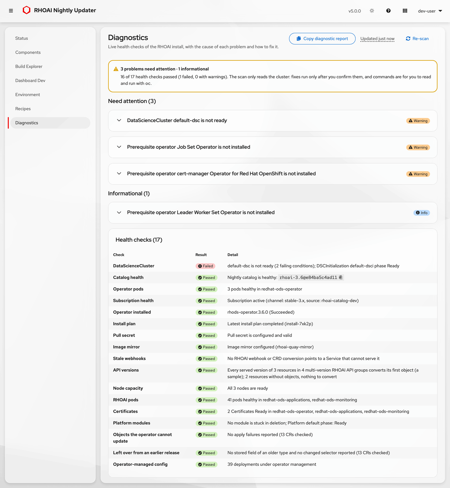

Diagnostics scans on load and only reads the cluster. Each problem shows what was **Observed**, the **Fix**, and a **Command** you copy and run yourself. A few problems have a **Fix** button, which asks for confirmation first.

### Not a cluster-admin? What you see

Since 5.0.0 whoever RHOAI lets in can sign in: anyone who may `get` `auths.services.platform.opendatahub.io`, which RHOAI grants to the allowed groups of its Auth CR (by default every OpenShift user; without RHOAI, only cluster-admins). Cluster-admins see everything above. Everyone else sees three pages, and changes only what their role in a project allows (below):


- **Status**: RHOAI's version, channel and phase, the nightly build the cluster runs and whether a newer one exists, and the DataScienceCluster with each component. No update, activity log or cluster setup.
- **Build Explorer**: as above, without the comparison with the installed build.
- **Environment**: their own data science projects only (the ones the projects API lists for them), read with their own permissions: the pipeline server, models, workbench, playground and MLflow sample data of the project they pick, and the sample pipeline. A project's admins and editors can set up, start, stop and delete the workbench, set up and delete the playground, and add and remove the MLflow sample data there: each action runs with their own permissions after the updater checked that their role in the project allows every request it makes, and a button they may not use says why. Pipeline servers, models and the shared parts (S3 storage, the inference gateway, MaaS) stay a cluster-admin's. With no projects, the page reads **You have no data science projects** and says to create one in the RHOAI dashboard or to ask a project admin. [Screenshot](docs/images/page-user-environment.png) of a user's project.
- Components, Dashboard Dev and Diagnostics are not in the navigation; a direct link says **Only cluster-admins can see this page**, with **Go to Status**.
- A running cluster operation shows as a banner with its start time, never who started it or what it is: "A cluster operation is running since 14:26 UTC. Project actions can start when it ends."

- Their own running project action shows with **Cancel** when it can be cancelled ("Your action (Set up the workbench) in project dev-project is running since 14:28."); another person's action in one of their projects shows with its label and project, never who runs it. Actions in projects that are not theirs do not show.

  Cancel asks first and says what the action leaves, with **Cancel action** and **Keep it running**. It is a request: the action stops before its next step and keeps what it made by then as its own failure there would; one that finishes first is recorded as done.

Which token each read uses, and the summary's exact fields: [SECURITY.md, Per-user views](SECURITY.md#per-user-views-500); what a project action checks: [SECURITY.md, Project actions for non-admins](SECURITY.md#project-actions-for-non-admins-500).

<details>
<summary><b>All pages, full size</b></summary>

| Page | Screenshot |
|---|---|
| Components | 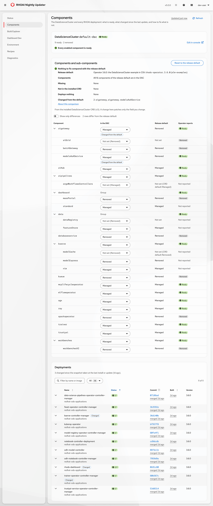 |
| Build Explorer | 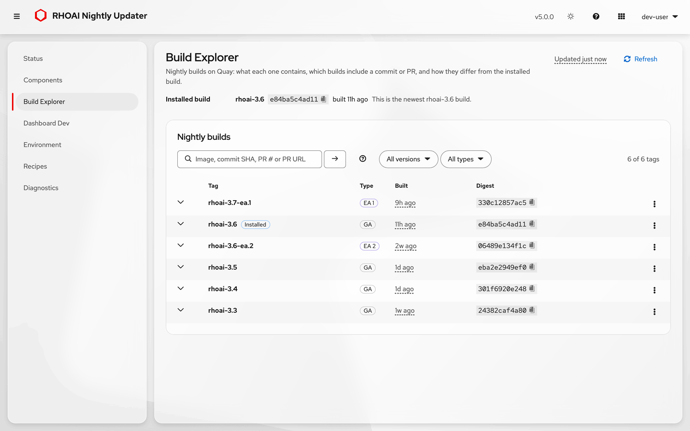 |
| Dashboard Dev |  |
| Environment | 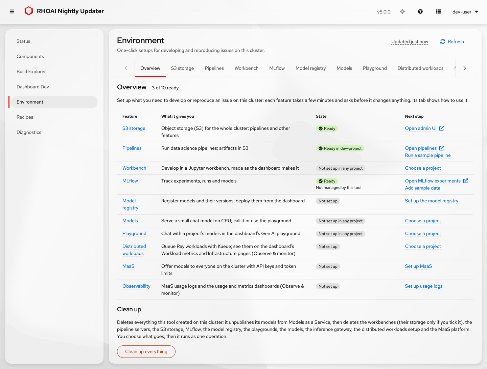 |
| Diagnostics |  |
| Status, not a cluster-admin | 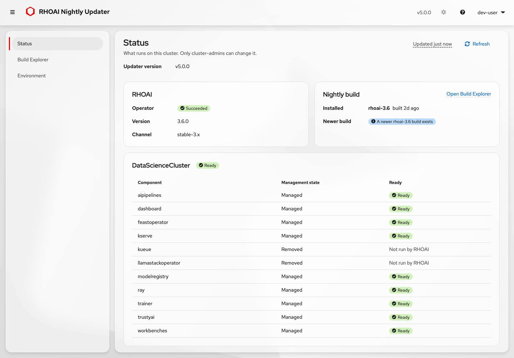 |
| Environment, not a cluster-admin | 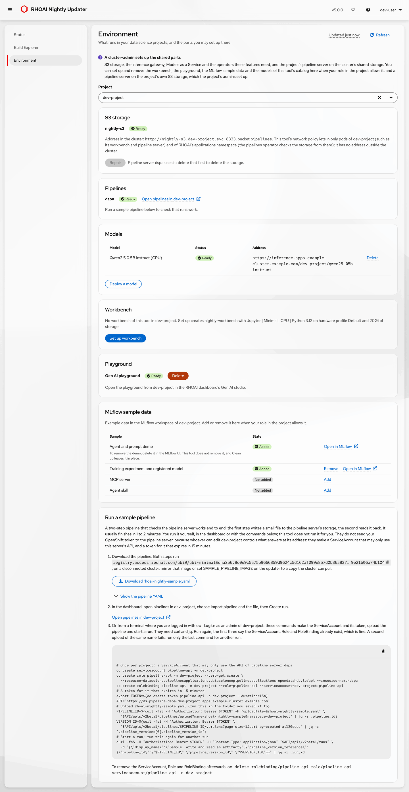 |

The app follows your system's light or dark mode and contrast settings; the appearance button in the masthead sets the color scheme (System, Light, Dark) and the contrast mode (System, Default, High contrast, Glass) instead; on narrow screens the same choices are in the user menu. All screenshots come from a mock backend with made-up data, in the light theme and the Glass contrast mode (`make docs-screenshots`, see [docs/tools](docs/tools/README.md)).

</details>

## Documentation

| Doc | For |
|---|---|
| [QUICKSTART.md](docs/QUICKSTART.md) | Install, one-time setup (self-managed OpenShift too), first update, the Environment page |
| [UPGRADING.md](docs/UPGRADING.md) | Which version you run, installs from before releases, moving between releases, 2.x to 3.0.0 |
| [GITOPS.md](docs/GITOPS.md) | Deploying with Argo CD: the Helm chart, its values, upgrades and removal |
| [RUNBOOK.md](RUNBOOK.md) | Troubleshooting: what the app shows, and the fix |
| [CHANGELOG.md](CHANGELOG.md) | What each release changed, and its upgrade notes |
| [CLUSTER_CHANGES.md](docs/CLUSTER_CHANGES.md) | Every object the tool creates, patches or deletes, and when |
| [SECURITY.md](SECURITY.md) | Auth, RBAC, network exposure, residual risks |
| [CONTRIBUTING.md](CONTRIBUTING.md) | Local development, tests, CI, releases |
| [OPENSHIFT_INTEGRATION.md](docs/OPENSHIFT_INTEGRATION.md) | OpenShift and OLM behaviour the code depends on |

## Versions

Releases are `vMAJOR.MINOR.PATCH` ([CHANGELOG.md](CHANGELOG.md), [GitHub releases](https://github.com/DaoDaoNoCode/rhoai-nightly-updater/releases), [GitLab releases](https://gitlab.com/redhat/ai/rhoai-dashboard-team/rhoai-nightly-updater/-/releases)):

- **MAJOR**: the deployment template changed (`TEMPLATE_REVISION`, RBAC). Upgrade with that release's `install.sh` (or `git checkout vX.Y.Z && make upgrade`), which re-applies the template; a new image alone would not work.
- **MINOR**: features. **PATCH**: fixes. Same template.

Each release attaches `install.sh` (its template embedded; it installs exactly that release, pinned by digest) and `deploy/template.yaml`. Image tags: `:vX.Y.Z` (immutable), `:vN` (newest release of major N), `:latest` (newest release of the major line it is on; it never moves to a new major by itself), `:main` and `:<8-char commit>` (test builds of `main`). The app shows the running release in the masthead and a notice when a newer one exists ([UPGRADING §1](docs/UPGRADING.md#1-which-version-am-i-running)).

## How the tool keeps your cluster safe

The updater changes a shared, stateful system (OLM and the RHOAI operator). These rules are built in. [docs/CLUSTER_CHANGES.md](docs/CLUSTER_CHANGES.md) lists every object it touches.

**Who can see and change things.** Every user RHOAI lets in (its allowed groups; by default every OpenShift user) can sign in (5.0.0). Cluster-admins see every page; everyone else sees a short cluster summary, Build Explorer and the Environment page for their own projects, read with their own permissions ([SECURITY.md, Per-user views](SECURITY.md#per-user-views-500)). Changes need the **cluster-admin** role, checked with your own token on every request, and since 4.0.0 every change is made with your own OpenShift token: the cluster checks it against your permissions and its audit log names you ([SECURITY.md](SECURITY.md)). The updater's own ServiceAccount only reads, keeps its records and runs one background clean-up of gone MaaS publications. Which token goes where, and why your own token is never sent to a model or a pipeline server: [SECURITY.md, Which token is used where](SECURITY.md#which-token-is-used-where). Every change asks for confirmation and names what it will touch.

**One operation at a time.** A running operation shows a banner on every page, with who started it and the current step (users who are not cluster-admins see only that a cluster operation runs and since when, and the project actions in their own projects, never who runs another person's). A workbench setup, a playground setup and a user's MLflow sample changes can be cancelled by whoever started them or a cluster-admin: the action stops before its next step. A cluster-admin's MLflow sample changes hold the cluster lock and cannot be cancelled. Action buttons stay disabled until it finishes. A second request gets `409 cluster_busy` and changes nothing. Closing the tab doesn't stop an operation: after a reload, the page reattaches to the running operation. If the connection was lost, the result says "outcome unknown, see the activity log" unless the server reports the final outcome.

**Refuse before changing.** Update, Re-deploy and Install a different build run all their checks first (pull secret, IDMS, a test catalog for the exact image, version, OperatorGroup, a second rhods-operator Subscription). A refusal says "Nothing was changed".

**Dashboard Dev guard.** While a Dashboard Dev session pauses the dashboard module's operator (found at run time from its RBAC in the DSCInitialization's applications namespace; `dashboard-operator` on RHOAI 3.6), a banner names it on every page. Update, Re-deploy and Install a different build then refuse, and offer **Revert Dashboard Dev and continue**. A paused dashboard operator would block RHOAI upgrades of the dashboard and hang any deletion of the Dashboard CR.

**Versions.**
- Update refuses an older build.
- Install a different build to an older version requires an explicit confirmation checkbox. OLM cannot downgrade: it replaces the CRDs that ship in the older bundle with their older versions, so newer-only fields can be pruned and a CRD the newer version no longer ships stays at the older schema after going back (Diagnostics flags it).
- Re-deploy never changes the version. With Automatic approval it refuses if the channel head has moved; with Manual approval it pins `startingCSV`.

**Manual approval is respected.** The Subscription's `installPlanApproval` and `spec.config` are kept. Under Manual approval, the tool approves only the InstallPlan it caused, and only if that plan installs exactly the confirmed rhods-operator CSV.

**Recovery on failure.** If the install fails, the previous catalog and Subscription are restored and the half-installed CSV is removed. A timeout while OLM is still installing keeps the new state. Every step is safe to re-run.

**Only the tool's own objects.** Objects the tool creates carry `app.kubernetes.io/managed-by=rhoai-nightly-updater`. Teardown deletes only labelled objects, with UID preconditions, so a look-alike someone else created is never removed. Deleting the S3 storage keeps its namespace `seaweedfs` unless you tick **Also delete namespace seaweedfs (created by this tool)**, offered only when the tool created it; **Delete old storage** does the same for the earlier storage's namespace `minio` (**Also delete namespace minio**). A kept namespace is yours to delete (`oc delete project <name>`) once it is empty. Teardown is refused while a pipeline server still uses the storage.

**Stale webhooks and finalizers.** A webhook configuration is removed only when all three of these hold:
- its Services are gone, or have had no ready endpoints for 5 minutes;
- its owning CSV or module is gone;
- no operator install is in progress.

Platform-owned configurations, and those whose owner is unknown, are never removed. A component CR's finalizer is removed only after 10 minutes of deletion, and only when its operator, identified from RBAC, no longer has a Deployment; an operator the tool cannot identify leaves it alone.

**Diagnostics.** Most findings are guidance only: they explain the cause and the manual fix. The automatic fixes are:
- delete stale webhooks;
- delete Failed InstallPlans;
- assist a stuck rollout (`maxUnavailable: 1`, recorded and restorable);
- set one allowlisted optional component to Removed;
- restart a module operator that has not retried (a rolling restart);
- left over from an earlier release: set module CR fields that an older release stored with another type to the installed CRD's default (or remove an optional one), as a tested JSON Patch after a dry run; recreate a Deployment, StatefulSet, DaemonSet or Job whose `spec.selector` changed, only when a module CR (or the DSC) that reports it owns it and its operator runs; and "Retry now", which adds and removes an annotation on the DataScienceCluster ([RUNBOOK §11.6](RUNBOOK.md#116-upgrade-leftovers-the-operator-cannot-fix-itself)).

Each re-checks its precondition right before acting and reports "Nothing to do" when nothing needs changing. A fix whose effect the tool cannot fully check (for example a workload whose users it cannot list) asks you to tick an acknowledgement first, and the server refuses it without one.

**If the updater pod restarts mid-operation.** On SIGTERM the pod stops taking new changes (503, "restarting") and reports not ready. It then waits up to 980 s for the running operation: its 15-minute deadline plus a bounded restore and bookkeeping. `terminationGracePeriodSeconds` is 1020 and the strategy is `Recreate`, so rollouts never overlap. A deleted or evicted pod is replaced at once while it still drains, so every operation also holds a lease in the operation ConfigMap: the replacement shows the old pod's operation as running "on updater pod ..." and refuses changes until it ends (a crashed pod's lease expires after 45 s). oauth-proxy exits immediately, so **the UI is offline for up to ~17 minutes** in that case. If the pod is killed anyway (SIGKILL, node loss), the next pod finds the operation marker and shows "*X* was interrupted" with what to do. Re-running the same operation is safe. Diagrams: [RUNBOOK §5](RUNBOOK.md#5-operations-busy-stuck-interrupted).

## Build Explorer search

The search box on the Build Explorer takes:

- a build reference (`quay.io/rhoai/rhoai-fbc-fragment:<tag>@sha256:...`), which shows that build's contents;
- `#123` or `PR 123`: which nightlies contain that merged opendatahub-io/odh-dashboard PR;
- the URL of a GitHub PR (or `owner/name#123`) of any RHOAI component repository, for example `https://github.com/opendatahub-io/data-science-pipelines/pull/42`;
- a commit SHA (7 to 40 characters) or the URL of a GitHub commit: which nightlies contain it. An odh-dashboard commit, upstream or in the fork, is checked by containment; a commit GitHub does not know there is matched exactly against the commit each component image was built from.

PR and commit searches cover the installed build and the builds the filters list (up to 40), and answer in one sentence: *PR #5123 is in the installed build and rhoai-3.6.* A search is in the page URL (`/builds?q=%235123`), so it can be shared; Dashboard Dev's containers card links to it with **Find in nightlies**. The search covers repositories of `opendatahub-io`, `red-hat-data-services`, `kubeflow`, `kserve`, `trustyai-explainability`, `llm-d`, `feast-dev` and `ray-project` (the server asks GitHub with its own token, so it does not take any repository).

How "contains" is decided, in plain words: a nightly build is made from Red Hat's copy of each component's repository (`red-hat-data-services/<name>`, named by the component image's labels), which merges in the changes of the upstream project. A build contains the PR when the PR's merge commit is in the history of the commit the build's component image was built from (GitHub compare answers). Builds pushed more than an hour before the PR was merged (or before the commit) are answered from their build date alone, without a read; the hour allows for clock differences between a committer's machine and the registry. If Red Hat's copy takes a change by cherry-pick instead of merge, the commit gets a new ID there and shows as *Does not contain*; the same holds for a dashboard PR cherry-picked to a release branch. *Unknown (commit not on GitHub)* only appears for a SHA GitHub does not know at all.

When nothing contains the PR or commit, the results explain why under the heading *Why no nightly has it yet*. For odh-dashboard a change travels in steps: `main` → the `stable` branch (a workflow updates it in batches) → Red Hat's copy (`red-hat-data-services/odh-dashboard`, which merges `stable`) → the release branch (`rhoai-3.6`) → the nightly build. The page asks GitHub whether `stable` has the change yet and when `stable` was last updated, so "2 commits behind main" on Dashboard Dev and "no nightly has it" on the Build Explorer can both be true: the commit is fresh on `main` and still on its way. For other components the explanation names the copy the nightlies come from.

GitHub allows 60 unauthenticated requests per hour **per egress IP**, which every user of the pod shares. One uncached search costs about one call per build that is newer than the merge. Answers are cached, so repeats are free. Dashboard Dev's "commits behind main" uses the same quota, one call per container. Set a `GITHUB_TOKEN` (5000/hour); without it, once the limit is hit, commit dates stay blank, the search reports the rate limit until GitHub's reset time, and Dashboard Dev shows *Distance from main unknown*.

## Configuration

Environment variables of the `app` container. The template sets the first group; leave those alone.

| Variable | Default | Purpose |
|---|---|---|
| `BIND_ADDRESS`, `PORT` | `127.0.0.1`, `8080` | API listener, reachable only by oauth-proxy |
| `METRICS_PORT` | `9090` | probes, `/api/version` and `/metrics` |
| `TEMPLATE_REVISION` | `5` | lets the UI warn admins when the Deployment is older than the image expects |
| `INSTALL_METHOD` | empty; `gitops` from the Helm chart | `gitops` words the upgrade notices for Git (change the chart's `targetRevision` and image) instead of `install.sh` ([GITOPS.md](docs/GITOPS.md)) |
| `PROFILE` | empty (`full`); `gitops` from the Helm chart unless its `profile` is `full` | what the updater may do: `full`, every feature; `gitops`, only Update's Argo CD path and the Status, Components and Diagnostics reads, for cluster-admins ([GITOPS.md §11](docs/GITOPS.md#11-profiles)). Any other value stops the updater at startup |
| `SUBSCRIPTION_ENV_ALLOWLIST`, `GITOPS_ADMISSION_POLICY` | `DISABLE_DSC_CONFIG`; `<APP_NAME>-<NAMESPACE>-gitops` | gitops profile only: the environment variables the RHOAI Subscription's `spec.config.env` may set (the chart sets it from `gitops.subscriptionEnvAllowlist`), and the admission policy Update needs in place ([GITOPS.md §11](docs/GITOPS.md#the-admission-policy)) |
| `IMAGE_REPOSITORY`, `RELEASES_URL` | the Quay repository, the GitLab releases page | the update check: the highest `vX.Y.Z` tag of the repository (pre-release tags are never offered; an updater running one is offered its release once it is out); its release notes are linked on the public releases page (`INSTALLER_RELEASES_URL` below); an empty `IMAGE_REPOSITORY` turns it off |
| `INSTALLER_RELEASES_URL` | unset: `RELEASES_URL`, except that the default GitLab project maps to its public GitHub mirror (`https://github.com/DaoDaoNoCode/rhoai-nightly-updater/releases`), whose assets download without a sign-in | the releases page the update notice links the release notes on and downloads `install.sh` from: a GitHub (`https://github.com/<owner>/<repo>/releases`) or GitLab (`https://<host>/<project>/-/releases`) releases page. Not a template parameter; set it on the `app` container. A value of another shape, or with characters outside `A-Z a-z 0-9 . _ ~ / -` (and a `:port`), shows no command, only the release notes |
| `GITHUB_TOKEN` | unset | GitHub API token for commit dates, PR search and Dashboard Dev's distance from `main`. A read-only fine-grained token with public-repository read access is enough |
| `VLLM_CPU_IMAGE` | unset | the Models tab's runtime image, for example a mirror on a disconnected cluster. Unset: the CPU preset's own image, or on a nightly cluster without a mirror for it the newest released `registry.redhat.io/rhaii/vllm-cpu-rhel9` found in Red Hat's public container catalog. It must be vLLM 0.10.0 or later: chat models pass `--enable-force-include-usage` |
| `SEAWEEDFS_IMAGE` | pinned `ghcr.io/chrislusf/seaweedfs@sha256:...` (4.54) | the S3 storage image, for example a mirror; must be a SeaweedFS 4.x whose `weed mini` reads `WEED_ADMIN_*`. `MINIO_IMAGE` is no longer read |
| `RCLONE_IMAGE` | pinned `docker.io/rclone/rclone@sha256:...` (1.76.0) | the image of Migrate storage's copy Job, for example a mirror; must be an rclone 1.x image with `/bin/sh` |
| `SEAWEEDFS_ACCESS_KEY_ID`, `SEAWEEDFS_SECRET_ACCESS_KEY` | random per install, kept in `seaweedfs/seaweedfs-s3-credentials` | S3 access key and secret key on a first setup; keys already stored are kept. The admin UI password is always random, its own, and kept in the same Secret only. `MINIO_ROOT_USER` and `MINIO_ROOT_PASSWORD` are no longer read |
| `SAMPLE_PIPELINE_IMAGE` | pinned `registry.access.redhat.com/ubi9/ubi-minimal@sha256:...` | the image both steps of the sample pipeline run (Pipelines tab, **Run a sample pipeline**), for example a mirror on a disconnected cluster; it needs `sh`, `mkdir`, `dirname`, `echo` and `cat` |
| `STABLE_SOURCE`, `STABLE_CHANNEL` | `redhat-operators`, detected | the catalog and channel used for "stable" |
| `DSC_SAMPLE_REF` | unset | take DSC defaults from this rhods-operator git ref instead of the installed CSV's `alm-examples` |
| `LOG_LEVEL` | `info` | `debug`, `warn`, `error` |
| `SHUTDOWN_DRAIN_TIMEOUT` | 980s | how long a terminating pod waits for a running operation; keep it below the grace period |

To set `GITHUB_TOKEN`, keep the token in a Secret. It is read without echo, so it stays out of your shell history and the terminal. The Deployment restarts afterwards:

```bash
printf 'GitHub token: ' && read -rs GITHUB_TOKEN && echo
oc create secret generic github-token -n rhoai-nightly-updater --from-literal="GITHUB_TOKEN=$GITHUB_TOKEN"
unset GITHUB_TOKEN
oc set env deployment/rhoai-nightly-updater -n rhoai-nightly-updater -c app --from=secret/github-token
```

Upgrades (`install.sh`, `make upgrade`) keep it: `oc apply` removes only fields that the previous apply set ([Kubernetes: declarative management](https://kubernetes.io/docs/tasks/manage-kubernetes-objects/declarative-config/)).

Local development variables (`DEV_MODE`, `DEV_TOKEN`, `KUBE_CA_FILE`, `DEV_INSECURE_TLS`, `DEV_ALLOW_REMOTE`, ...) are in [CONTRIBUTING.md](CONTRIBUTING.md#environment-variables).

## Architecture

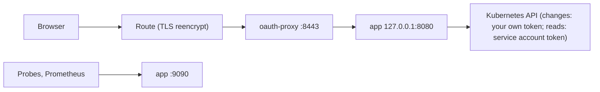

- **Backend:** Go `net/http`, a raw-HTTP Kubernetes client (no client-go), JSON logs. API routes are in `pkg/api/routes.go`.
- **Frontend:** React 19, PatternFly 6, TypeScript, webpack; served by the backend.
- **Progress:** Update, Re-deploy and Install a different build stream their steps over SSE. Afterwards the page polls `/api/status`, and `GET /api/operation` shows the running operation to every viewer.
- **State:** ConfigMaps `rhoai-nightly-updater-activity` (audit log), `-snapshot` (pre-operation snapshot and the recorded Subscription), `-operation` (running-operation marker, last result and the cross-pod lease).

## License

Apache License 2.0
