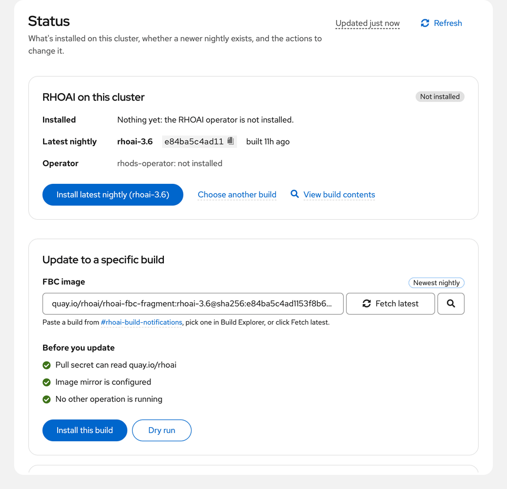
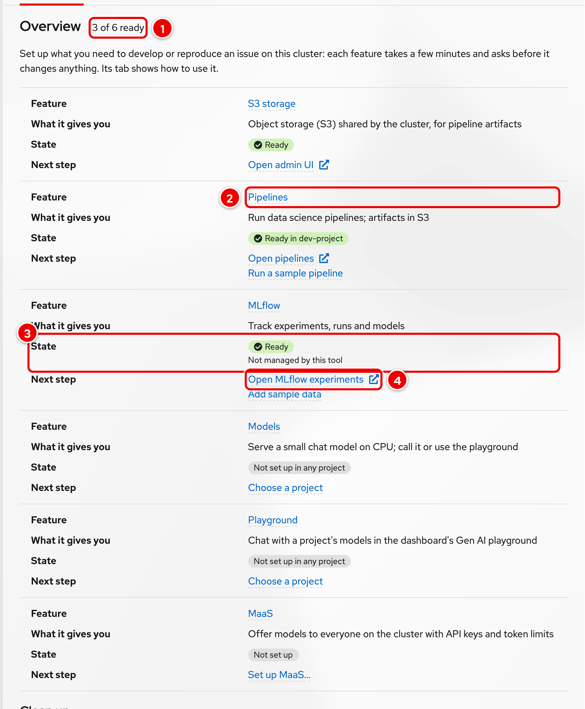
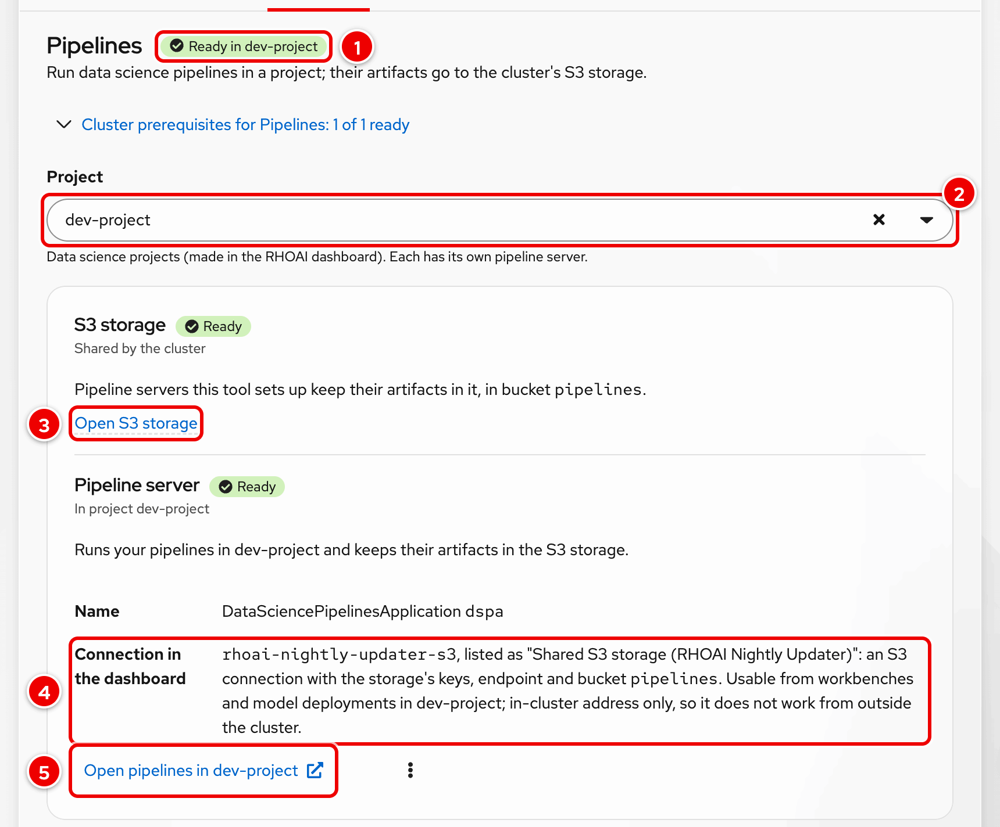
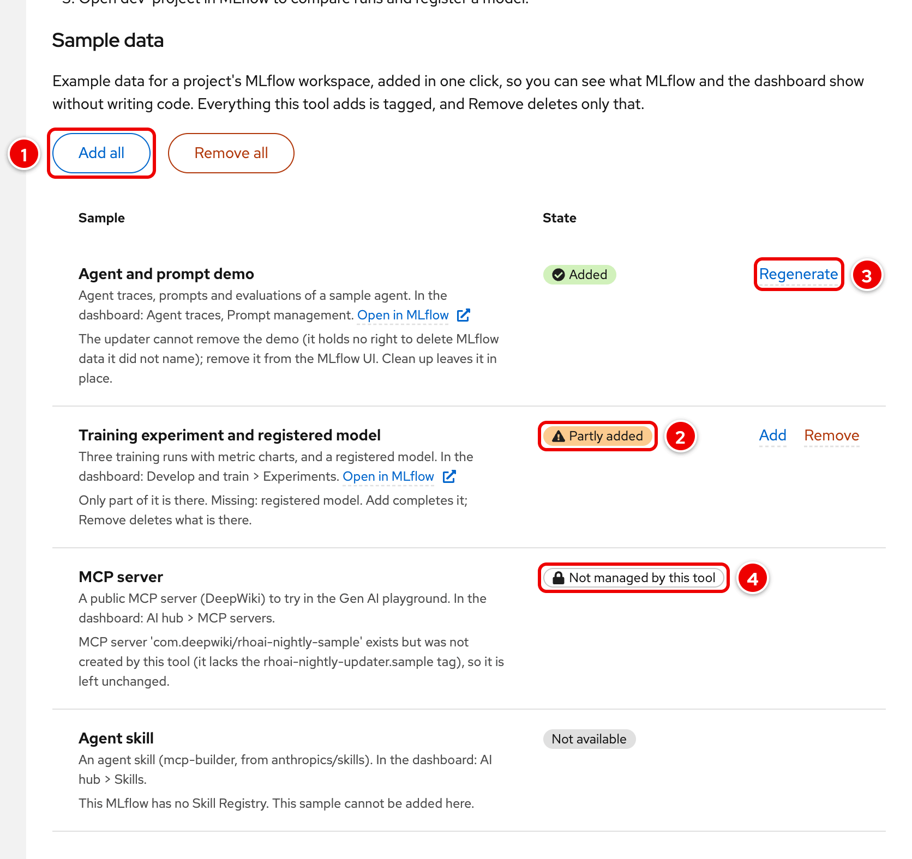
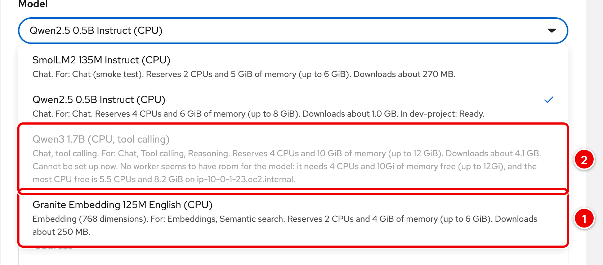
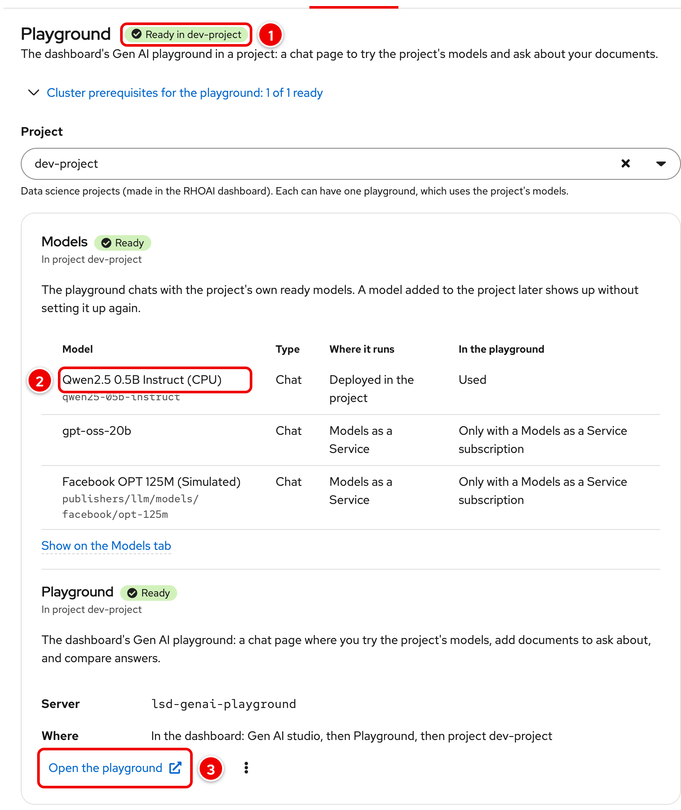
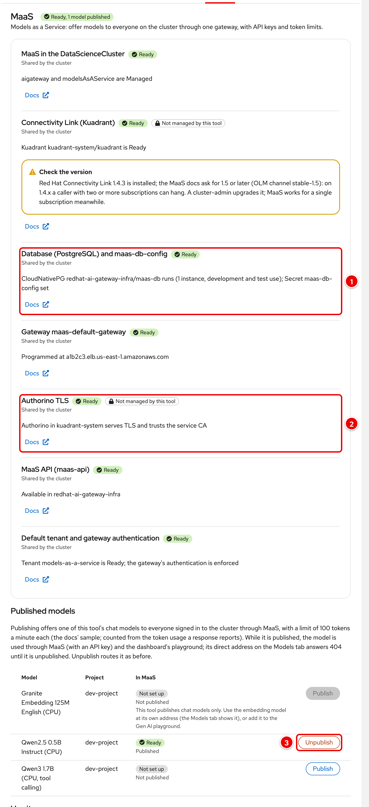

# Quick Start

From an empty ROSA HCP (or OpenShift) cluster to a running RHOAI nightly in about 15 minutes, then a test environment on the Environment page. After step 1, everything happens in the app, except the image mirror (step 3) and, on self-managed OpenShift, the cluster pull secret.

Before your first change, read **[How the tool keeps your cluster safe](../README.md#how-the-tool-keeps-your-cluster-safe)**.

| Step | You do | Time |
|---|---|---|
| [0](#0-before-you-start) | Check the prerequisites | 2 min |
| [1](#1-install-the-updater) | Install the updater with the release's `install.sh` | 3 min |
| [2](#2-open-the-app) | Open the app | 1 min |
| [3](#3-one-time-setup-pull-secret-and-image-mirror) | One-time setup: pull secret and image mirror | 5 min |
| [4](#4-install-rhoai) | Install the latest RHOAI nightly | 5–8 min |
| [5](#5-create-the-datasciencecluster) | Create the DataScienceCluster | 1 min |
| [6](#6-check-that-rhoai-is-healthy) | Check that RHOAI is healthy | 2 min |
| [7](#7-environment-pipelines-and-s3-storage) | Optional: pipelines and S3 storage | 3 min |
| [8](#8-environment-mlflow-and-sample-data) | Optional: MLflow and sample data | 3 min |
| [9](#9-environment-a-model-on-cpu) | Optional: a model on CPU | 5 min |
| [10](#10-environment-the-gen-ai-playground) | Optional: the dashboard's Gen AI playground | 2 min |
| [11](#11-environment-maas) | Optional: Models as a Service | 10 min |

## 0. Before you start

- A ROSA HCP or OpenShift cluster, **OCP 4.15 or newer**. The `ose-oauth-proxy-rhel9` image has no v4.14 tag.
- **cluster-admin** on that cluster. You need it to install the updater, and the app allows changes only to cluster-admins (everyone else is read-only). On ROSA, the cluster owner can grant it to a user of the cluster's identity provider:
  ```bash
  rosa grant user cluster-admin --user=<username> --cluster=<cluster-name>
  ```
  For a quick break-glass login, `rosa create admin --cluster=<cluster-name>` creates a `cluster-admin` user and prints an `oc login` command. Syntax checked with `rosa` 1.2.57 (`rosa grant user --help`, `rosa create admin --help`).
- `oc`, logged in (`oc whoami` shows your cluster-admin user), and `curl`. `git` and `make` only for the clone path.
- A Quay.io pull token for `quay.io/rhoai`. Get it from [Bitwarden](https://vault.bitwarden.com/#/vault?collectionId=75f54536-fa36-4ef9-8f1a-b09701646cac&itemId=e6e1fdde-6601-4e8b-8154-b211005518a1) (Openshift AI devel collection). No access? Ask in [#rhoai-devtestops-requests](https://redhat.enterprise.slack.com/archives/C07TF3MBMMW).

## 1. Install the updater

Is the cluster's configuration applied by Argo CD from Git? Deploy the Helm chart instead and continue at step 2: [GITOPS.md](GITOPS.md).

Download the latest release's `install.sh` (it contains that release's `deploy/template.yaml`) and read it before you run it:

```bash
curl -fsSLO https://github.com/DaoDaoNoCode/rhoai-nightly-updater/releases/latest/download/install.sh
less install.sh
```

- **Check the download:** compare `sha256sum install.sh` (macOS: `shasum -a 256 install.sh`) with the SHA-256 in the release notes ([GitHub](https://github.com/DaoDaoNoCode/rhoai-nightly-updater/releases/latest), [GitLab](https://gitlab.com/redhat/ai/rhoai-dashboard-team/rhoai-nightly-updater/-/releases)).
- **A specific version:** download `https://github.com/DaoDaoNoCode/rhoai-nightly-updater/releases/download/vX.Y.Z/install.sh` instead.

Then run it:

```bash
bash install.sh --dry-run   # optional: resolve, check and validate with the API server only
bash install.sh             # namespace rhoai-nightly-updater; --namespace / --app-name to change
```

`install.sh`:
- checks that you are logged in as cluster-admin;
- resolves `quay.io/juntao_wang/rhoai-nightly-updater:vX.Y.Z` to its digest and checks that the image was built from the release's commit;
- creates the namespace and the oauth-proxy cookie Secret;
- applies the template, with the oauth-proxy tag that matches your cluster's OCP version;
- waits for the rollout, then adds the app to the console's application menu.

**What you should see:** the last line is `App URL: https://...`. `bash install.sh --help` lists the options.

<details>
<summary>From a clone instead (contributors; also needed for <code>make rollback</code> and the smoke test)</summary>

```bash
git clone https://gitlab.com/redhat/ai/rhoai-dashboard-team/rhoai-nightly-updater.git
cd rhoai-nightly-updater
git checkout vX.Y.Z         # make deploy installs the release HEAD is on
make deploy                 # DRY_RUN=1 only validates
```

`make deploy` runs the same `scripts/install.sh`, with the template of your checkout. Optional, from a checkout of the same release: `./scripts/smoke-test.sh rhoai-nightly-updater rhoai-nightly-updater` runs read-only checks of the live install.

</details>

If it stops with an `ERROR:` line:
- *"HEAD is not on a release tag"*: check out a release (`git checkout vX.Y.Z`), or pass `TAG=main` / `TAG=<commit>` to test a build.
- *"deploy/template.yaml in this checkout differs"*: your checkout is not the release you install. *"uncommitted changes"* means you edited the template locally.
- *"cannot resolve ... to a digest"*: the tag doesn't exist, or quay.io is unreachable.
- More in [UPGRADING.md](UPGRADING.md#7-faq).

## 2. Open the app

Open the printed URL, or use the grid icon in the OpenShift console (Red Hat Applications → RHOAI Nightly Updater). Sign in with OpenShift. To find the URL again:

```bash
oc get route rhoai-nightly-updater -n rhoai-nightly-updater -o jsonpath='https://{.spec.host}{"\n"}'
```


**What you should see:** the **Status** page. The masthead shows (1) the release you installed (`v2.0.0` in the picture), then the appearance button (color scheme and contrast), **Help** (`?`), the application menu and your user name. A fresh cluster shows **One-time cluster setup** first.

## 3. One-time setup: pull secret and image mirror

Nightly builds come from `quay.io/rhoai`. The cluster needs a pull secret for it and an image mirror, once.


1. **Pull secret:** paste the `quay.io/rhoai` token (step 0) and click **Create secret**. The tool stores it in `kube-system/additional-pull-secret` and replaces only the `quay.io/rhoai` entry. On self-managed OpenShift, also add it to the cluster pull secret (below).
2. **Image mirror (IDMS):** click **How to create the image mirror** for the instructions. RHOAI images reference `registry.redhat.io/rhoai`; the mirror redirects them to `quay.io/rhoai`.

### Self-managed OpenShift: the cluster pull secret

Only hosted control planes (ROSA HCP) pass `kube-system/additional-pull-secret` to the nodes. On a self-managed cluster the nodes pull with the cluster pull secret, `openshift-config/pull-secret`, so add the `quay.io/rhoai` entry there too. The standard procedure (OpenShift docs: "Updating the global cluster pull secret"):

```bash
oc get secret/pull-secret -n openshift-config --template='{{index .data ".dockerconfigjson" | base64decode}}' > pull-secret.json
oc registry login --registry=quay.io/rhoai --auth-basic=<user>:<token> --to=pull-secret.json
oc set data secret/pull-secret -n openshift-config --from-file=.dockerconfigjson=pull-secret.json
rm pull-secret.json
```

- `<user>:<token>` is the token from step 0 decoded: `echo '<token from step 0>' | base64 -d`.
- `pull-secret.json` holds every registry credential of the cluster: delete it right away.
- The nodes pick up the new pull secret within a few minutes, without a drain or a reboot.
- The app's **Pull secret** item checks `kube-system/additional-pull-secret` only, so it does not show whether this step is done.

### The image mirror

On ROSA HCP the mirror is created through OCM. You need the Red Hat VPN and ROSA CLI access (separate from `oc`):

```bash
kinit <your-username>@IPA.REDHAT.COM
rh-aws-saml-login                # select iaps-rhods-odh-dev
rosa login --use-auth-code
rosa whoami

rosa create image-mirror --cluster=<cluster-name> \
  --source=registry.redhat.io/rhoai \
  --mirrors=quay.io/rhoai
```

(Syntax checked with `rosa create image-mirror --help`, rosa 1.2.57. `digest` is the default and only type.) A 403 means you lack OCM write access to the cluster; ask its owner.

On self-managed OpenShift, create the ImageDigestMirrorSet with `oc` (cluster-admin). Creating it does not drain or reboot the nodes; deleting it later does drain them.

```bash
oc apply -f - <<'EOF'
apiVersion: config.openshift.io/v1
kind: ImageDigestMirrorSet
metadata:
  name: rhoai-quay-mirror
spec:
  imageDigestMirrors:
    - source: registry.redhat.io/rhoai
      mirrors:
        - quay.io/rhoai
EOF
```

**What you should see:** both items stop saying **Missing**. Once both are done, the setup card moves to the bottom of the page, collapsed, as **Cluster setup** with a green **Ready** label, and **Install latest nightly** is enabled. Allow 2–3 minutes for the nodes to pick up the credentials and the mirror.

## 4. Install RHOAI

On the **Status** page, the **RHOAI on this cluster** card shows the newest nightly. Click **Install latest nightly**, read the confirmation, and click **Install**:



To install another build, use **Choose another build**, or paste an image from [#rhoai-build-notifications](https://redhat.enterprise.slack.com/archives/C07ANR2U56C) under **Update to a specific build**. **Dry run** checks a build and changes nothing.

**What you should see:** eight steps, from **Check prerequisites** to **Wait for the operator install**, each with a green check. OLM gets up to 8 minutes to install the operator. You can leave the page: the operation keeps running, and every page shows a banner until it ends. Then **Update complete** appears, the card says **Up to date**, and a **Create the DataScienceCluster** card appears.

If a step fails, the card says which one and why. A failed install restores the previous state; see [RUNBOOK §6](../RUNBOOK.md#6-update--install-a-different-build-failed).

## 5. Create the DataScienceCluster


1. Click **Create DataScienceCluster...**. The dialog shows the YAML of `default-dsc`, with the defaults of the installed operator. Click **Create**.

**What you should see:** a success message. The operator now deploys the components (dashboard, pipelines, model serving, ...); this takes a few minutes. You can change components later on the **Components** page.

## 6. Check that RHOAI is healthy

Open **Components**, then **Diagnostics**.


**What you should see:**
- **Components:** DataScienceCluster `default-dsc` is **Ready** and every enabled component is ready. Right after step 5, some deployments are still rolling out; refresh after a few minutes.
- **Diagnostics:** **All 15 checks passed, no issues detected**. If a problem is listed, open it: it shows what was observed and the fix. [RUNBOOK §11.7](../RUNBOOK.md#117-datasciencecluster-not-ready) explains each one.

## 7. Environment: pipelines and S3 storage

Steps 7 to 11 are optional: each sets up one feature to develop against or reproduce an issue with. Open **Environment**. The **Overview** has one row per feature (Pipelines, MLflow, Models, Playground, MaaS) with its state and next step; each feature has its own tab.



Before **Set up**, each tab says what it still needs, and Set up stays disabled with the reason under it: a DataScienceCluster component that is not Managed (with **Open Components**), or no data science project. The tool never creates a project: create one in the RHOAI dashboard (Projects, then Create project) first. Every Set up asks first, names what it creates, and shows its steps.

1. On the **Overview**, **Pipelines** reads **Not set up in any project**: click **Choose a project**, or open the **Pipelines** tab.
2. Pick a data science project, click **Set up** and confirm. The tool deploys SeaweedFS in namespace `seaweedfs` (bucket `pipelines`, Service `seaweedfs-s3`), then the pipeline server `dspa` in the project, as the dashboard sets one up, with a dashboard S3 Connection that workbenches can use. (If S3 storage reads **Needs attention** with **Migrate storage**, an earlier version's storage is still in namespace `minio`: see [UPGRADING §5](UPGRADING.md#5-upgrade-to-v300).)



**What you should see:** the tab reads **Ready in** your project, with **Open pipelines** (after 1–3 minutes) and **Open admin UI** (user `admin`; the eye beside the password shows it, cluster-admins only). **Run a sample pipeline** on the same tab offers a two-step pipeline to import in the dashboard, or commands that make a token that may only use the pipeline API (it expires in 15 minutes), then upload and run it. To remove it all, use **Clean up Pipelines** at the bottom of the tab (or **Delete** in a part's menu: the storage's stays disabled while a pipeline server uses it).

## 8. Environment: MLflow and sample data

1. Open the **MLflow** tab, click **Set up** and confirm. MLflow runs in `redhat-ods-applications`, with the MLflow operator's own resource defaults. One someone set up in the dashboard reads **Not managed by this tool** and works the same; the tool does not delete it.
2. Under **Sample data**, choose a project (its MLflow workspace) and click **Add all**: MLflow's agent and prompt demo, a training experiment with a registered model, an MCP server entry and an agent skill. Each row says where it shows in the dashboard.



**What you should see:** MLflow **Ready**, with **Open MLflow** and the client settings (`MLFLOW_TRACKING_URI`, `MLFLOW_TRACKING_TOKEN`, `MLFLOW_WORKSPACE`) under **Use it**. **Remove all** removes the samples the tool added (the agent and prompt demo is removed in the MLflow UI).

## 9. Environment: a model on CPU

Open the **Models** tab and pick a data science project.

1. **Choose a model** in the picker. Each option says what it is for, what it reserves and how much it downloads; one no worker has room for is disabled, with the reason.

   | Model | For | Reserves (CPUs, memory) |
   |---|---|---|
   | SmolLM2 135M Instruct | chat, a quick smoke test | 2, 4 GiB |
   | Qwen2.5 0.5B Instruct (the default) | chat | 4, 6 GiB |
   | Qwen3 1.7B | chat, tool calling, reasoning | 4, 12 GiB |
   | Granite Embedding 125M English | embeddings (768 dimensions) | 2, 3 GiB |

2. Click **Set up** and confirm. It creates what is missing: the inference gateway (once per cluster; it runs a cloud load balancer, which costs money while it exists), then the model. The gateway accepts models only from the projects on its list, as RHOAI documents it; the setup adds the project to that list before it creates the model. The first time takes 3 to 5 minutes.



**The runtime image.** A model runs on the vLLM CPU image that the installed RHOAI's CPU preset names. On a nightly build that image is not published yet, so the cluster cannot pull it, and the tool uses the newest released Red Hat vLLM CPU image instead (`registry.redhat.io/rhaii/vllm-cpu-rhel9`, found in Red Hat's container catalog and pinned by digest); the model's details say which image it runs. A released RHOAI, or a cluster with a mirror for the preset's image, uses the preset's own image. `VLLM_CPU_IMAGE` sets an image of your own, for example a mirror on a disconnected cluster.

**What you should see:** the model **Ready**, with its address, and under **Use it** the `curl` commands that call it with its own token. The dashboard lists it with the project's deployments. Troubleshooting: [RUNBOOK §10.2](../RUNBOOK.md#102-models-the-inference-gateway-and-cpu-models).

## 10. Environment: the Gen AI playground

Needs a ready chat model in the project (step 9) and the DataScienceCluster component that runs the playground Managed (the tab says which).

1. Open the **Playground** tab and pick the project. Before Set up, the project's ready chat models are chosen, and this tool's embedding model is added for searching your documents.
2. Click **Set up** and confirm. The tool asks the RHOAI dashboard to create its playground, as a click in its Gen AI studio does; this takes 1 to 2 minutes.



**What you should see:** the playground **Ready**, with **Open the playground** (Gen AI studio, then Playground, then the project). Troubleshooting: [RUNBOOK §10.3](../RUNBOOK.md#103-playground-the-dashboards-gen-ai-playground).

## 11. Environment: MaaS

Models as a Service lets everyone signed in to the cluster call a published model with a MaaS API key. The **MaaS** tab sets up the platform as the MaaS install docs do and publishes this tool's chat models, one at a time.

It needs, installed by a cluster-admin first (the tab says which is missing, and Set up stays disabled until then):
- Red Hat Connectivity Link, with its Kuadrant CR (the MaaS docs ask for 1.5; the tab warns about an older one);
- the CloudNativePG operator, for MaaS's database (or your own PostgreSQL in Secret `maas-db-config`);
- the DataScienceCluster's `aigateway` component Managed.

1. Click **Set up** and confirm (about 5 minutes). It creates the database, Gateway `maas-default-gateway` at `maas.<apps domain>` (another cloud load balancer) and turns MaaS on in the DataScienceCluster.
2. If **Authorino TLS** needs attention, a cluster-admin runs the commands the part shows; until then API keys are refused.
3. **Publish** a chat model. While it is published, it is reached through MaaS only: its direct address answers 404 until you unpublish it.



**What you should see:** MaaS **Ready**, and under **Use it** the commands to get an API key and call the model. **Remove MaaS** unpublishes and removes what the tool set up. More: [README: MaaS](../README.md#maas-models-as-a-service), troubleshooting: [RUNBOOK §10.4](../RUNBOOK.md#104-maas-models-as-a-service).

Each tab has **Clean up** at the bottom, and the Overview has **Clean up everything**: one confirmed operation with a checkbox per part.

## Day to day

| Task | Where |
|---|---|
| Update to a new nightly | Status → **Update to latest**, or **Update to a specific build** ([what it looks like](images/update.gif)) |
| Re-deploy the installed version (same version, fresh pods) | Status → Recovery → **Re-deploy operator...** |
| Switch to stable, another nightly, or an exact older build | Status → Recovery → **Choose a build...** (downgrades need a confirmation checkbox) |
| Test an odh-dashboard PR or main | Dashboard Dev → choose the RHOAI (Konflux) or ODH (OpenShift CI) build → **Deploy PR** or **Deploy latest main**; **Revert to default** when done. The containers card shows each container's commit, how far behind `main` (or the PR) it is, and when a newer build exists |
| S3 storage (SeaweedFS), pipeline servers, MLflow, models, the playground, MaaS | Environment |
| Which nightly contains PR #N? | Build Explorer → search `#123` ([Build Explorer search](../README.md#build-explorer-search)) |
| Something looks wrong | Diagnostics → open the problem; automatic fixes ask for confirmation. [RUNBOOK](../RUNBOOK.md) |

## Upgrade, roll back or remove the updater

- **Upgrade:** when the app says "vX.Y.Z is available", download that release's `install.sh` (step 1) and run it; it sees the existing install and upgrades it, keeping everyone signed in. From a clone: `git fetch --tags && git checkout vX.Y.Z && make upgrade`. Details, and installs from before releases: [UPGRADING.md](UPGRADING.md); from 2.x to 3.0.0: [UPGRADING §5](UPGRADING.md#5-upgrade-to-v300).
- **Roll back:** from a clone, `git fetch --tags && make rollback TAG=v1.0.0` (`DRY_RUN=1` validates). It applies that release's own template with its image and keeps sessions. `oc rollout undo` does not work, because old ReplicaSets are pruned on purpose. [UPGRADING §6](UPGRADING.md#6-roll-back).
- If a cluster operation is running, an upgrade or rollback waits for it: the updater (UI included) is offline for up to ~17 minutes.
- **Remove:** `bash install.sh uninstall` (or `make undeploy` from a clone) removes the updater, its cluster-wide RBAC and its ConsoleLink. It does **not** remove RHOAI, the nightly catalog, the pull secret, the IDMS, or anything set up on the Environment page. Remove those in the app first (Environment, Overview, **Clean up everything**).

## Notes

- Metrics and alerts work only with user workload monitoring enabled (OpenShift docs: "Enabling monitoring for user-defined projects"). It is off by default; see [RUNBOOK §7](../RUNBOOK.md#7-metrics-and-alerts).
- Build Explorer PR and commit searches work better with a `GITHUB_TOKEN` (see [README: Configuration](../README.md#configuration)).
- Problems: [RUNBOOK.md](../RUNBOOK.md). Everything the tool changes: [CLUSTER_CHANGES.md](CLUSTER_CHANGES.md).
