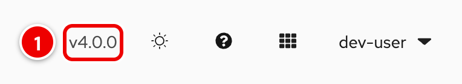
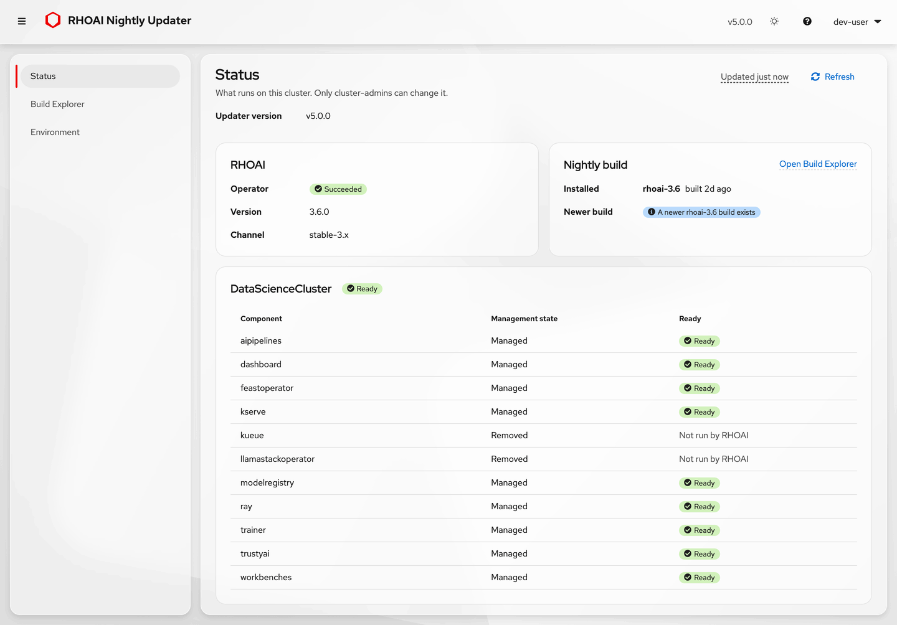
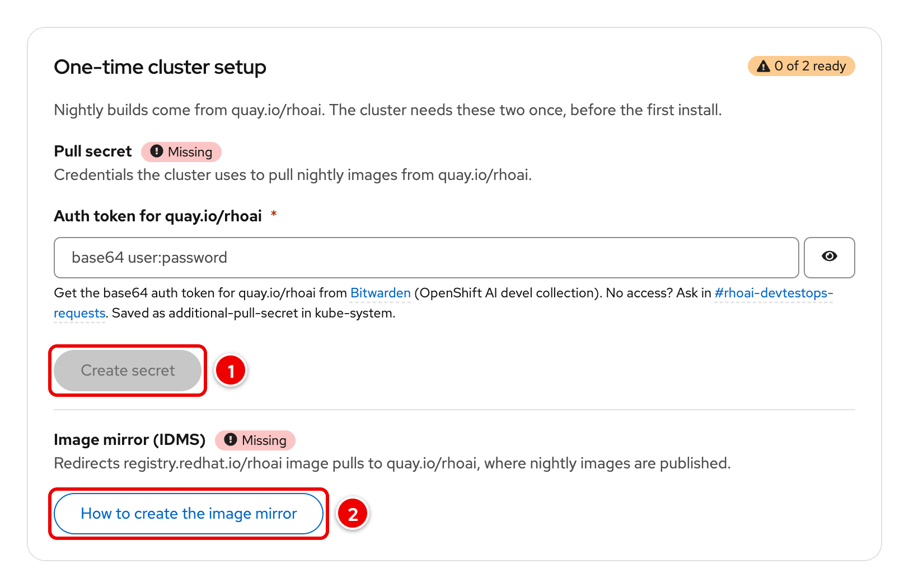
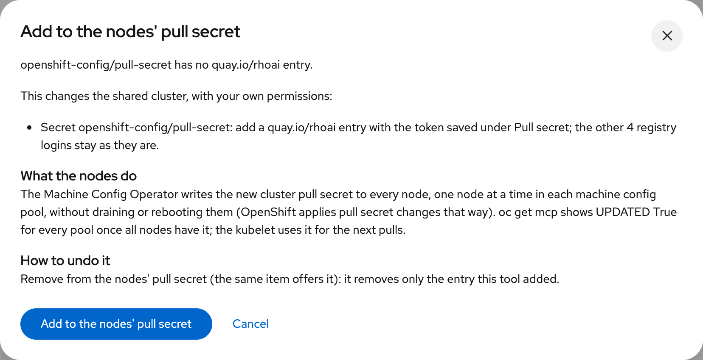
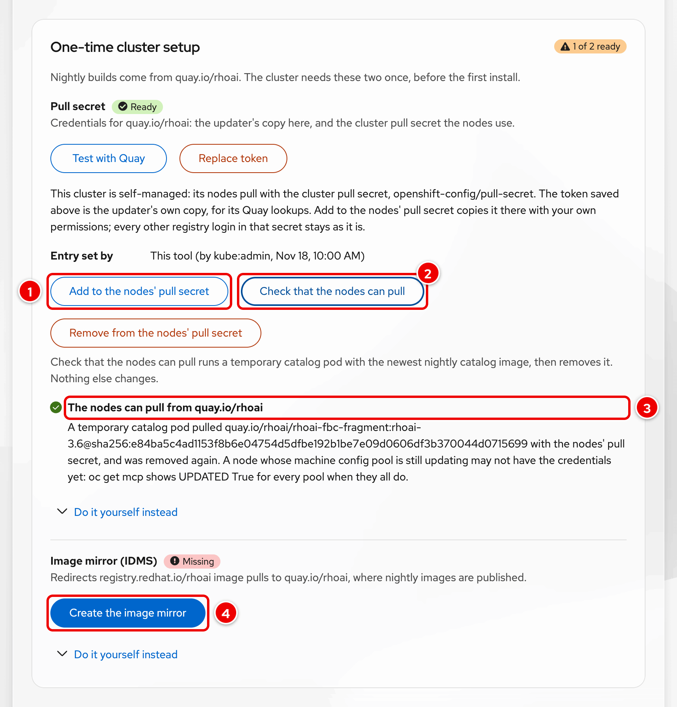
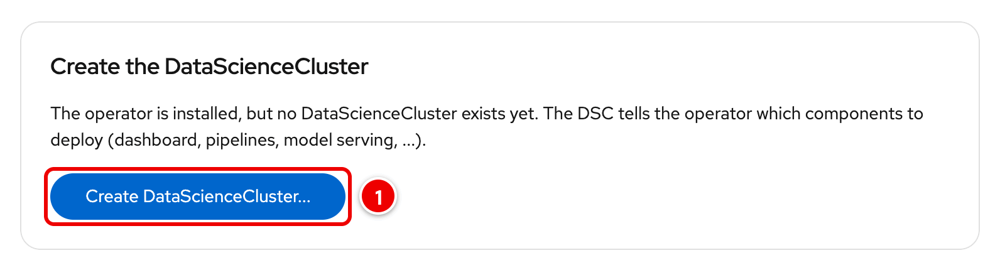
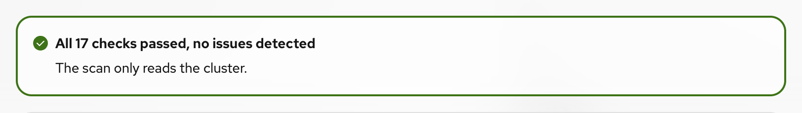

# Quick Start

From an empty ROSA HCP (or OpenShift) cluster to a running RHOAI nightly in about 15 minutes, then a test environment on the Environment page. After step 1, everything happens in the app, except the image mirror (step 3) and, on self-managed OpenShift, the cluster pull secret.

Before your first change, read **[How the tool keeps your cluster safe](../README.md#how-the-tool-keeps-your-cluster-safe)**.

| Step | You do | Time |
|---|---|---|
| [0](#0-before-you-start) | Check the prerequisites | 2 min |
| [1](#1-install-the-updater) | Install the updater with the release's `install.sh` | 3 min |
| [2](#2-open-the-app) | Open the app | 1 min |
| [3](#3-one-time-setup-pull-secret-and-image-mirror) | One-time setup: pull secret and image mirror | 5 min |
| [4](#4-install-rhoai) | Install the latest RHOAI nightly | 5–8 min |
| [5](#5-create-the-datasciencecluster) | Create the DataScienceCluster | 1 min |
| [6](#6-check-that-rhoai-is-healthy) | Check that RHOAI is healthy | 2 min |
| [7](#7-environment-pipelines-and-s3-storage) | Optional: pipelines and S3 storage | 3 min |
| [8](#8-environment-mlflow-and-sample-data) | Optional: MLflow and sample data | 3 min |
| [9](#9-environment-a-model-on-cpu) | Optional: a model on CPU | 5 min |
| [10](#10-environment-the-gen-ai-playground) | Optional: the dashboard's Gen AI playground | 2 min |
| [11](#11-environment-maas) | Optional: Models as a Service | 10 min |

## 0. Before you start

- A ROSA HCP or OpenShift cluster, **OCP 4.15 or newer**. The `ose-oauth-proxy-rhel9` image has no v4.14 tag.
- **cluster-admin** on that cluster. You need it to install the updater and to make changes in the app; everyone else RHOAI lets in can sign in and look ([step 2](#2-open-the-app)). On ROSA, the cluster owner can grant it to a user of the cluster's identity provider:
  ```bash
  rosa grant user cluster-admin --user=<username> --cluster=<cluster-name>
  ```
  For a quick break-glass login, `rosa create admin --cluster=<cluster-name>` creates a `cluster-admin` user and prints an `oc login` command. Syntax checked with `rosa` 1.2.57 (`rosa grant user --help`, `rosa create admin --help`).
- `oc`, logged in (`oc whoami` shows your cluster-admin user), and `curl`. `git` and `make` only for the clone path.
- A Quay.io pull token for `quay.io/rhoai`. Get it from [Bitwarden](https://vault.bitwarden.com/#/vault?collectionId=75f54536-fa36-4ef9-8f1a-b09701646cac&itemId=e6e1fdde-6601-4e8b-8154-b211005518a1) (Openshift AI devel collection). No access? Ask in [#rhoai-devtestops-requests](https://redhat.enterprise.slack.com/archives/C07TF3MBMMW).

## 1. Install the updater

Is the cluster's configuration applied by Argo CD from Git? Deploy the Helm chart instead and continue at step 2: [GITOPS.md](GITOPS.md).

Download the latest release's `install.sh` (it contains that release's `deploy/template.yaml`):

```bash
curl -fsSLO https://github.com/DaoDaoNoCode/rhoai-nightly-updater/releases/latest/download/install.sh
```

- **Check the download:** compare `sha256sum install.sh` (macOS: `shasum -a 256 install.sh`) with the SHA-256 in the release notes ([GitHub](https://github.com/DaoDaoNoCode/rhoai-nightly-updater/releases/latest), [GitLab](https://gitlab.com/redhat/ai/rhoai-dashboard-team/rhoai-nightly-updater/-/releases)).
- **A specific version:** download `https://github.com/DaoDaoNoCode/rhoai-nightly-updater/releases/download/vX.Y.Z/install.sh` instead.

Then run it:

```bash
bash install.sh --dry-run   # optional: resolve, check and validate with the API server only
bash install.sh             # namespace rhoai-nightly-updater; --namespace / --app-name to change
```

`install.sh`:
- checks that you are logged in as cluster-admin;
- resolves `quay.io/juntao_wang/rhoai-nightly-updater:vX.Y.Z` to its digest and checks that the image was built from the release's commit;
- creates the namespace and the oauth-proxy cookie Secret;
- applies the template, with the oauth-proxy tag that matches your cluster's OCP version;
- waits for the rollout, then adds the app to the console's application menu.

**What you should see:** the last line is `App URL: https://...`. `bash install.sh --help` lists the options.

**It stops with "reports revision &lt;none&gt;"** (the 3.0.x installers) or "cannot read the revision label": the installer could not read the image's labels from this machine. Read that entry in the [UPGRADING.md FAQ](UPGRADING.md#7-faq) before you override the check.

<details>
<summary>From a clone instead (contributors; also needed for <code>make rollback</code> and the smoke test)</summary>

```bash
git clone https://gitlab.com/redhat/ai/rhoai-dashboard-team/rhoai-nightly-updater.git
cd rhoai-nightly-updater
git checkout vX.Y.Z         # make deploy installs the release HEAD is on
make deploy                 # DRY_RUN=1 only validates
```

`make deploy` runs the same `scripts/install.sh`, with the template of your checkout. Optional, from a checkout of the same release: `./scripts/smoke-test.sh rhoai-nightly-updater rhoai-nightly-updater` runs read-only checks of the live install.

</details>

If it stops with an `ERROR:` line:
- *"HEAD is not on a release tag"*: check out a release (`git checkout vX.Y.Z`), or pass `TAG=main` / `TAG=<commit>` to test a build.
- *"deploy/template.yaml in this checkout differs"*: your checkout is not the release you install. *"uncommitted changes"* means you edited the template locally.
- *"cannot resolve ... to a digest"*: the tag doesn't exist, or quay.io is unreachable.
- *"reports revision &lt;none&gt;"* (installers up to 3.0.1) or *"cannot read the revision label"*: the installer could not read the image's labels from this machine. Read that entry in the [UPGRADING.md FAQ](UPGRADING.md#7-faq) before you override the check.
- More in [UPGRADING.md](UPGRADING.md#7-faq).

## 2. Open the app

Open the printed URL, or use the grid icon in the OpenShift console (Red Hat Applications → RHOAI Nightly Updater). Sign in with OpenShift; there is no "Authorize Access" page (since 4.0.0 the updater has its own OAuth client, which `install.sh` creates). Your changes run with your own OpenShift permissions. To find the URL again:

```bash
oc get route rhoai-nightly-updater -n rhoai-nightly-updater -o jsonpath='https://{.spec.host}{"\n"}'
```



**What you should see:** the **Status** page. The masthead shows (1) the release you installed, then the appearance button (color scheme and contrast), **Help** (`?`), the application menu and your user name. A fresh cluster shows **One-time cluster setup** first.

**Your teammates** open the same URL. Since 5.0.0 whoever RHOAI lets in can sign in: by default every OpenShift user, since RHOAI grants `get` on `auths.services.platform.opendatahub.io` to the allowed groups of its Auth CR (`oc get auths.services.platform.opendatahub.io auth -o jsonpath='{.spec.allowedGroups}'`). Narrow those groups to narrow who signs in (it narrows the RHOAI dashboard too). Until RHOAI is installed ([step 4](#4-install-rhoai)) only cluster-admins sign in. Cluster-admins see every page. Everyone else sees a short Status page, Build Explorer and the Environment page for their own projects, read with their own permissions, and changes nothing ([README: Not a cluster-admin?](../README.md#not-a-cluster-admin-what-you-see)):

<picture>
  <source media="(prefers-color-scheme: dark)" srcset="images/page-user-status-dark.png">
  
</picture>

## 3. One-time setup: pull secret and image mirror

Nightly builds come from `quay.io/rhoai`. The cluster needs a pull secret for it and an image mirror, once.




1. **Pull secret:** paste the `quay.io/rhoai` token (step 0) and click **Create secret**. The tool stores it in `kube-system/additional-pull-secret` and replaces only the `quay.io/rhoai` entry. On self-managed OpenShift, also add it to the cluster pull secret (below). On ROSA HCP the tool also copies it for the internal registry, which pulls the workbench images, into Secret `rhoai-nightly-updater-pull` in RHOAI's applications namespace (once RHOAI is installed; the item says whether the internal registry can pull nightly images).
2. **Image mirror (IDMS):** RHOAI images reference `registry.redhat.io/rhoai`; the mirror redirects them to `quay.io/rhoai`. On self-managed OpenShift click **Create the image mirror**; on ROSA HCP click **How to create the image mirror** for the `rosa` steps (below).

What the app offers depends on the cluster. It reads Infrastructure `cluster` (`status.controlPlaneTopology`; `External` is a hosted control plane) and, if the control plane runs on the cluster, whether Red Hat SRE's admission webhooks (`*.managed.openshift.io`, installed on ROSA Classic and OpenShift Dedicated only) are there:

| Cluster | Image mirror | Nodes' pull secret |
|---|---|---|
| Self-managed (any install type, any cloud, bare metal, single node) | **Create the image mirror** (one click) | **Add to the nodes' pull secret** (one click) |
| ROSA Classic, OpenShift Dedicated | **Create the image mirror** (their webhook allows a mirror of `registry.redhat.io/rhoai`, and their docs describe creating an ImageDigestMirrorSet) | No button: Red Hat creates that secret and these services document no procedure for changing it; the commands are shown |
| ROSA HCP (hosted control plane) | `rosa create image-mirror` (through OpenShift Cluster Manager) | Not needed: HyperShift merges `additional-pull-secret` with the cluster's own pull secret onto the nodes of AWS and Azure node pools that replace their nodes on an update (not in-place ones), restarting the kubelet on each; where the cluster's own already has a `quay.io/rhoai` entry, that one is used ([HyperShift global pull secret](https://github.com/openshift/hypershift/blob/0f43b296/docs/content/how-to/common/global-pull-secret.md)) |
| Not known (a read failed) | The instructions, and **Try to create it here** | The command, and **Add to the nodes' pull secret** as an attempt: its review refuses unless your own token shows the cluster is not ROSA Classic or OSD |

Every one-click action first opens a review: the app reads the cluster again with **your own** OpenShift token, runs a server-side dry run of the change, and shows what it creates or changes, what the nodes do, and how to undo it. A refusal (your RBAC, an admission webhook, someone else's object in the way) is shown there, with nothing changed. Then **Confirm** runs the steps: check, dry run, change, read back. The commands stay under **Do it yourself instead** for people who prefer the CLI.



### Self-managed OpenShift: the cluster pull secret

Only hosted control planes (ROSA HCP) pass `kube-system/additional-pull-secret` to the nodes. On a self-managed cluster the nodes pull with the cluster pull secret, `openshift-config/pull-secret`, so the `quay.io/rhoai` entry has to go there too. The app keeps writing `additional-pull-secret` on every cluster: its own Quay lookups (the newest nightly, Build Explorer) read it.

Once the token is saved, the **Pull secret** item shows **Nodes not checked** and **Add to the nodes' pull secret**. It copies the token the app already holds (it never goes to the browser) into `openshift-config/pull-secret`, as OpenShift documents for a new registry login ("Update the global cluster pull secret"), with your own permissions:

- The token is checked with Quay first; a token Quay refuses is not given to the nodes.
- Only the `quay.io/rhoai` entry changes; every other registry login stays as it is.
- It refuses, changing nothing, when the Secret cannot be read, has no readable list of registry logins (writing only one entry would drop the cluster's own), or is kept in sync by External Secrets.
- The write carries the `resourceVersion` the review was made on, so a change made meanwhile stops it with a conflict instead of being overwritten.
- What the nodes do: the Machine Config Operator writes the new pull secret to every node without a drain or a reboot; `oc get mcp` shows `UPDATED True` for every pool when done. A paused pool takes it once unpaused (the review names paused or degraded pools).

The app never removes or overwrites a setup it did not make. When it adds the entry it records that in its own ConfigMap (the Secret's UID and a salted hash of the token, never the token). If `openshift-config/pull-secret` already has a `quay.io/rhoai` entry it did not add, for example one the cluster's provisioner put there, **Add to the nodes' pull secret** changes nothing: with the same token there is nothing to do; with another token it says so and offers **Check that the nodes can pull** (if that entry works, nothing more is needed), and replaces it only after you tick a box that says its token is not kept and the app cannot restore it. When the nodes can pull and the app added nothing, the button reads **Already set up (not by this tool)**. The item shows who set the entry: this tool, someone else, or not known (the app's ServiceAccount cannot read that Secret).

**Remove from the nodes' pull secret** is offered only for the entry the app added, and takes only that entry out again (it checks its record, the Secret's UID and the token's hash first; anything else is refused, with the command below). After it, images already on a node stay and running pods keep running, but a new nightly, or a pod that starts on a node without its image, fails with an unauthorized pull error.



(1) **Add to the nodes' pull secret**; (2) **Check that the nodes can pull**; (3) its result; (4) **Create the image mirror**.

Do it yourself instead (cluster-admin, bash or zsh, `jq` 1.6 or later):

```bash
printf 'quay.io/rhoai token (the one you saved under Pull secret; base64 user:password, with its = padding): ' && read -rs QUAY_AUTH && echo
[ -n "$QUAY_AUTH" ] && oc get secret pull-secret -n openshift-config -o json \
  | QUAY_AUTH="$QUAY_AUTH" jq '.data[".dockerconfigjson"] |= (@base64d | fromjson | .auths["quay.io/rhoai"] = {auth: $ENV.QUAY_AUTH} | tojson | @base64)' \
  | oc replace -f -
unset QUAY_AUTH
```

- It asks for the token you saved under **Pull secret** and does not echo it, so it stays off the screen and out of the shell history. The prompt is printed by `printf` because zsh's `read` has no `-p`.
- The token reaches `jq` through its environment, not its arguments, which `ps` shows to every user of the machine. Without a token (an empty line, Ctrl-D) nothing runs.
- `oc get -o json` keeps the Secret's `resourceVersion`, so `oc replace` fails with a conflict if someone changed the Secret meanwhile. A missing or garbled Secret makes `jq` fail, so `oc replace` gets nothing and changes nothing. Nothing is written to disk.
- The token must keep its `=` padding: CRI-O rejects an unpadded value.

To remove the entry again. Unlike the button, this removes whatever `quay.io/rhoai` entry is there, also one the cluster was set up with, whose token the app cannot restore, so it asks you to type `yes` first:

```bash
printf 'This removes the quay.io/rhoai entry of openshift-config/pull-secret, whoever added it: also one the cluster was set up with, whose token the updater cannot restore. Type yes to remove it: ' && read -r ANSWER && [ "$ANSWER" = yes ] && oc get secret pull-secret -n openshift-config -o json \
  | jq '.data[".dockerconfigjson"] |= (@base64d | fromjson | del(.auths["quay.io/rhoai"]) | tojson | @base64)' \
  | oc replace -f -
unset ANSWER
```

Then click **Check that the nodes can pull**. It runs Update's own catalog check: a temporary CatalogSource with the newest nightly catalog image, which tells whether a node can pull it, and removes it again (up to two minutes). Until the check has passed the item reads **Nodes not checked**; if a node cannot pull the image it reads **Nodes can't pull**, with the reason under the button (add the entry again, wait for `oc get mcp`, then check again). The item says **Ready** once the check passes, and from then on while the nightly catalog runs its `quay.io/rhoai` image. Until then the setup card stays at the top of the page; **Install latest nightly** is not held back, and its own catalog check says the same if the nodes cannot pull.

### The image mirror

On ROSA HCP the mirror is created through OCM. You need the Red Hat VPN and ROSA CLI access (separate from `oc`):

```bash
kinit <your-username>@IPA.REDHAT.COM
rh-aws-saml-login                # select iaps-rhods-odh-dev
rosa login --use-auth-code
rosa whoami

rosa create image-mirror --cluster=<cluster-name> \
  --source=registry.redhat.io/rhoai \
  --mirrors=quay.io/rhoai
```

(Syntax checked with `rosa create image-mirror --help`, rosa 1.2.57. `digest` is the default and only type.) A 403 means you lack OCM write access to the cluster; ask its owner.

On self-managed OpenShift (and ROSA Classic or OpenShift Dedicated), **Create the image mirror** creates ImageDigestMirrorSet `rhoai-quay-mirror`, exactly as OpenShift documents ("Configure image registry repository mirroring"), with your own permissions. It counts as done when an ImageDigestMirrorSet or ImageContentSourcePolicy already redirects `registry.redhat.io/rhoai` to `quay.io/rhoai` (one that maps it only to another mirror does not count: both objects' mirrors are then merged). It refuses, with nothing changed, when an object named `rhoai-quay-mirror` exists that does not; when a mirror object maps a parent such as `registry.redhat.io` or `*.redhat.io` that the nodes use for these images today (a mirror for exactly `registry.redhat.io/rhoai` would take those pulls away from it; the review names the entry to add to that object instead); and when an entry for the source sets `mirrorSourcePolicy: NeverContactSource` (the Machine Config Operator would refuse the whole mirror configuration). Creating it does not drain or reboot the nodes (a new digest-only mirror is applied with a CRI-O reload). **Remove the image mirror** deletes only that object, and only while it holds exactly this one source and mirror; removing a mirror drains each node, one node at a time by default (the pool's `maxUnavailable`), without a reboot (a single-node cluster is not drained; a PodDisruptionBudget can hold a node's drain for up to an hour, then that node's update fails), and afterwards nightly images cannot be pulled until the mirror is back. When another ImageDigestMirrorSet or ImageContentSourcePolicy still lists `quay.io/rhoai` for the source, the review says so: nothing rolls out. Sources: [docs/research/node-setup.md](research/node-setup.md). Do it yourself instead:

```bash
oc create -f - <<'EOF'
apiVersion: config.openshift.io/v1
kind: ImageDigestMirrorSet
metadata:
  name: rhoai-quay-mirror
spec:
  imageDigestMirrors:
    - source: registry.redhat.io/rhoai
      mirrors:
        - quay.io/rhoai
EOF

oc delete imagedigestmirrorset rhoai-quay-mirror   # to remove it
```

The sources for what the nodes do and what each platform allows: [research/node-setup.md](research/node-setup.md).


**What you should see:** both items stop saying **Missing**. Once both are done, the setup card moves to the bottom of the page, collapsed, as **Cluster setup** with a green **Ready** label, and **Install latest nightly** is enabled. Allow 2–3 minutes for the nodes to pick up the credentials and the mirror.

## 4. Install RHOAI

On the **Status** page, the **RHOAI on this cluster** card shows the newest nightly. Click **Install latest nightly**, read the confirmation, and click **Install**:


To install another build, use **Choose another build**, or paste an image from [#rhoai-build-notifications](https://redhat.enterprise.slack.com/archives/C07ANR2U56C) under **Update to a specific build**. **Dry run** checks a build and changes nothing.

**What you should see:** eight steps, from **Check prerequisites** to **Wait for the operator install**, each with a green check. OLM gets up to 11 minutes to install the operator. You can leave the page: the operation keeps running, and every page shows a banner until it ends. Then **Update complete** appears, the card says **Up to date**, and a **Create the DataScienceCluster** card appears.

If a step fails, the card says which one and why. A failed install restores the previous state; see [RUNBOOK §6](../RUNBOOK.md#6-update--install-a-different-build-failed).

## 5. Create the DataScienceCluster



1. Click **Create DataScienceCluster**. The dialog shows the YAML of `default-dsc`, with the defaults of the installed operator. Click **Create**.

**What you should see:** a success message. The operator now deploys the components (dashboard, pipelines, model serving, ...); this takes a few minutes. You can change components later on the **Components** page.

## 6. Check that RHOAI is healthy

Open **Components**, then **Diagnostics**.



**What you should see:**
- **Components:** DataScienceCluster `default-dsc` is **Ready** and every enabled component is ready. Right after step 5, some deployments are still rolling out; refresh after a few minutes.
- **Diagnostics:** **All 16 checks passed, no issues detected**. If a problem is listed, open it: it shows what was observed and the fix. [RUNBOOK §11.7](../RUNBOOK.md#117-datasciencecluster-not-ready) explains each one.

## 7. Environment: pipelines and S3 storage

Steps 7 to 11 are optional: each sets up one feature to develop against or reproduce an issue with. Open **Environment**. The **Overview** has one row per feature (S3 storage, Pipelines, MLflow, Models, Playground, MaaS) with its state and next step; each feature has its own tab.


Before **Set up**, each tab says what it still needs, and Set up stays disabled with the reason under it: a DataScienceCluster component that is not Managed (with **Open Components**), or no data science project. The tool never creates a project here: create one in the RHOAI dashboard (Projects, then Create project) first. (The one exception is an environment recipe with `project.mode: create`, which creates its project as the dashboard does and removes it in Clean up: [CLUSTER_CHANGES §8](CLUSTER_CHANGES.md#environment-recipes-the-recipe-project-500).) Every Set up asks first, names what it creates, and shows its steps.

1. On the **Overview**, **Pipelines** reads **Not set up in any project**: click **Choose a project**, or open the **Pipelines** tab.
2. Pick a data science project, click **Set up** and confirm. The tool deploys SeaweedFS in namespace `seaweedfs` (bucket `pipelines`, Service `seaweedfs-s3`), then the pipeline server `dspa` in the project, as the dashboard sets one up, with a dashboard S3 Connection that workbenches can use. The **S3 storage** tab shows the storage on its own; you can also set it up there first. (If the Pipelines tab says your pipeline data is in storage from an earlier version, an earlier version's storage is still in namespace `minio`: run **Migrate storage** on the **S3 storage** tab, see [UPGRADING §5](UPGRADING.md#5-upgrade-to-v300). If the storage reads **Not secured**, an earlier version set it up and gave its admin key to every pipeline project: run **Secure S3 storage** on the **S3 storage** tab first; each pipeline server then has a key of its own.)


**What you should see:** the tab reads **Ready in** your project, with **Open pipelines** (after 1–3 minutes). The **S3 storage** tab has the storage's endpoint, keys and **Open admin UI** (user `admin`; the eye beside the password shows it, cluster-admins only). **Run a sample pipeline** on the same tab offers a two-step pipeline to import in the dashboard, or commands that make a token that may only use the pipeline API (it expires in 15 minutes), then upload and run it. To remove the pipeline servers, use **Clean up Pipelines** at the bottom of the tab (or **Delete** in the pipeline server's menu); it keeps the S3 storage, which other features can use. The storage goes only with **Delete S3 storage** on the S3 storage tab or **Clean up everything** on the Overview, and not while a pipeline server uses it.

## 8. Environment: MLflow and sample data

1. Open the **MLflow** tab, click **Set up** and confirm. MLflow runs in `redhat-ods-applications`, with the MLflow operator's own resource defaults. One someone set up in the dashboard reads **Not managed by this tool** and works the same; the tool does not delete it.
2. Under **Sample data**, choose a project (its MLflow workspace) and click **Add all**: MLflow's agent and prompt demo, a training experiment with a registered model, an MCP server entry and an agent skill. Each row says where it shows in the dashboard.


**What you should see:** MLflow **Ready**, with **Open MLflow experiments** (MLflow's pages in the RHOAI dashboard) and the client settings (`MLFLOW_TRACKING_URI`, `MLFLOW_TRACKING_TOKEN`, `MLFLOW_WORKSPACE`) under **Use it**. **Remove all** removes the samples the tool added (the agent and prompt demo is removed in the MLflow UI).

## 9. Environment: a model on CPU

Open the **Models** tab and pick a data science project.

1. **Choose a model** in the picker. Each option says what it is for, what it reserves and how much it downloads; one no worker has room for is disabled, with the reason.

   | Model | For | Reserves (CPUs, memory) |
   |---|---|---|
   | SmolLM2 135M Instruct | chat, a quick smoke test | 2, 4 GiB |
   | Qwen2.5 0.5B Instruct (the default) | chat | 4, 6 GiB |
   | Qwen3 1.7B | chat, tool calling, reasoning | 4, 12 GiB |
   | Granite Embedding 125M English | embeddings (768 dimensions) | 2, 3 GiB |

2. Under **Model access**, keep the recommended choice or pick another: the cluster's default inference gateway, MaaS only, another gateway that admits the project, or only inside the cluster. When no gateway fits, the tab offers **Set up the inference gateway** (once per cluster; it runs a cloud load balancer, which costs money while it exists).
3. If **Needed on the cluster first** lists missing parts (KServe, cert-manager, and Connectivity Link when the model goes through a gateway), click **Set up what Models needs** and confirm with **Install and turn on**.
4. Click **Set up** and confirm. The first time takes 3 to 5 minutes. Once the model runs, the tool calls it once, as a user would, and reports whether it answers.


**The runtime image.** A model runs on the vLLM CPU image that the installed RHOAI's CPU preset names. On a nightly build that image is not published yet, so the cluster cannot pull it, and the tool uses the newest released Red Hat vLLM CPU image instead (`registry.redhat.io/rhaii/vllm-cpu-rhel9`, found in Red Hat's container catalog and pinned by digest); the model's details say which image it runs. A released RHOAI, or a cluster with a mirror for the preset's image, uses the preset's own image. `VLLM_CPU_IMAGE` sets an image of your own, for example a mirror on a disconnected cluster.

**What you should see:** the model **Ready**, **Can it be called?** reading **Answers requests**, its address and the exact name to send as `"model"`, and under **Use it** the `curl` commands that call it with its own token. The dashboard lists it with the project's deployments. Troubleshooting: [RUNBOOK §10.2](../RUNBOOK.md#102-models-the-inference-gateway-and-cpu-models).

## 10. Environment: the Gen AI playground

Needs a ready chat model in the project (step 9) and the DataScienceCluster component that runs the playground Managed (the tab says which).

1. Open the **Playground** tab and pick the project. Before Set up, the project's ready chat models are chosen, and this tool's embedding model is added for searching your documents.
2. Click **Set up** and confirm. The tool asks the RHOAI dashboard to create its playground, as a click in its Gen AI studio does; this takes 1 to 2 minutes.


**What you should see:** the playground **Ready**, with **Open the playground** (Gen AI studio, then Playground, then the project). Troubleshooting: [RUNBOOK §10.3](../RUNBOOK.md#103-playground-the-dashboards-gen-ai-playground).

## 11. Environment: MaaS

Models as a Service lets everyone signed in to the cluster call a published model with a MaaS API key. The **MaaS** tab sets up the platform as the MaaS install docs do and publishes this tool's chat models, one at a time.

Nothing has to be installed first: the tab lists every part MaaS needs and what Set up will do about each.

1. Click **Set up** and choose where MaaS keeps its API keys: the preselected **Development database** (one pod with no storage, as the MaaS docs' `setup-database.sh` sets it up; API keys are lost whenever it restarts: fine for trying MaaS out), **Persistent development database (CloudNativePG)** (not in the MaaS docs: this tool's own option; installs the CloudNativePG operator), or **Your PostgreSQL** (enter its connection URL; for keys that must last). Read the changes it lists, and confirm (about 10 minutes on a cluster without any of it). It installs what is missing as the MaaS docs do: Red Hat Connectivity Link and its Kuadrant instance, the AI gateway's namespace, the database you chose, Gateway `maas-default-gateway` at `maas.<apps domain>` (another cloud load balancer), Authorino TLS, and `aigateway` with MaaS turned on in the DataScienceCluster. If a step fails, **Set up** again continues from there.
2. If a part offers a fix of its own (**Upgrade Connectivity Link** on a version below the docs' 1.5, **Remove the old tier policies** after a tier-based MaaS), run it; each lists its changes first. **Do it from the CLI instead** under a part shows the same change as commands.
3. **Publish** a chat model: choose who can use it (everyone signed in, or groups and users as your identity provider names them; a group with no OpenShift Group is flagged as you type) and its token limit for each user (the docs' premium example of 100,000 a day, preselected; their free example of 100 a minute; unlimited where the cluster's MaaS offers it; or your own token rate limits). While it is published, it is reached through MaaS only: its direct address answers 404 until you unpublish it. **Change limit** in the table and **Change who can use them** above it change these later.


**What you should see:** MaaS **Ready**, and under **Use it** the commands to get an API key and call the model. **Clean up MaaS** unpublishes and removes what the tool set up for MaaS alone (your own PostgreSQL is never touched); Connectivity Link, Kuadrant, Authorino TLS and CloudNativePG stay, since other RHOAI features use them. More: [README: MaaS](../README.md#maas-models-as-a-service), troubleshooting: [RUNBOOK §10.4](../RUNBOOK.md#104-maas-models-as-a-service).

Each tab has **Clean up** at the bottom, and the Overview has **Clean up everything**: one confirmed operation with a checkbox per part.

## 12. Environment: usage logs and dashboards

The **Observability** tab sets up RHOAI's monitoring for the MaaS usage logs and the dashboards in **Observe & monitor**. It needs the S3 storage, set up and secured (step 7 and **Secure S3 storage**). Click **Set up usage logs and dashboards**, read the changes and the cost (about 51Gi of disks; a test-size Loki, not for production), and confirm (about 5 minutes). Then call a model through MaaS: its calls show in the RHOAI dashboard's **Observe & monitor, Dashboard**, Usage tab (cluster-admins). **Clean up usage logs** deletes the stack's disks and the logs with them; the operators stay. More: [README: Observability](../README.md#observability-maas-usage-logs-and-dashboards).

## Day to day

| Task | Where |
|---|---|
| Update to a new nightly | Status → **Update to latest**, or **Update to a specific build** ([what it looks like](images/update.gif)) |
| Re-deploy the installed version (same version, fresh pods) | Status → Recovery → **Re-deploy operator** |
| Switch to stable, another nightly, or an exact older build | Status → Recovery → **Choose a build** (downgrades need a confirmation checkbox) |
| Test an odh-dashboard PR or main | Dashboard Dev → choose the RHOAI (Konflux) or ODH (OpenShift CI) build → **Deploy PR** or **Deploy latest main**; **Revert to default** when done. The containers card shows each container's commit, how far behind `main` (or the PR) it is, and when a newer build exists |
| S3 storage (SeaweedFS), pipeline servers, MLflow, models, the playground, MaaS | Environment |
| Which nightly contains PR #N? | Build Explorer → search `#123` ([Build Explorer search](../README.md#build-explorer-search)) |
| Something looks wrong | Diagnostics → open the problem; automatic fixes ask for confirmation. [RUNBOOK](../RUNBOOK.md) |

## Upgrade, roll back or remove the updater

- **Upgrade:** when the app says "vX.Y.Z is available", download that release's `install.sh` (step 1) and run it; it sees the existing install and upgrades it, keeping everyone signed in. From a clone: `git fetch --tags && git checkout vX.Y.Z && make upgrade`. Details, and installs from before releases: [UPGRADING.md](UPGRADING.md); from 2.x to 3.0.0: [UPGRADING §5](UPGRADING.md#5-upgrade-to-v300).
- **Roll back:** from a clone, `git fetch --tags && make rollback TAG=v1.0.0` (`DRY_RUN=1` validates). It applies that release's own template with its image and keeps sessions. `oc rollout undo` does not work, because old ReplicaSets are pruned on purpose. [UPGRADING §6](UPGRADING.md#6-roll-back).
- If a cluster operation is running, an upgrade or rollback waits for it: the updater (UI included) is offline for up to ~17 minutes.
- **Remove:** `bash install.sh uninstall` (or `make undeploy` from a clone) removes the updater, its OAuthClient (revoking its sign-ins), its cluster-wide RBAC and its ConsoleLink. It does **not** remove RHOAI, the nightly catalog, the pull secret, the IDMS, anything set up on the Environment page, or a project an environment recipe created. Remove those in the app first (Environment, Overview, **Clean up everything**). Do not just delete the namespace: that leaves the OAuthClient (live-checked), whose redirect host anyone could later claim with a Route, and its sign-ins ([SECURITY.md](../SECURITY.md#the-oauthclient-400)). If you did, run `install.sh uninstall` anyway (same `--app-name` and `--namespace`; it works after the namespace is gone), or `oc delete oauthclient <APP_NAME>-<NAMESPACE>` and `oc delete oauthaccesstokens --field-selector clientName=<APP_NAME>-<NAMESPACE>`.

## Notes

- Metrics and alerts work only with user workload monitoring enabled (OpenShift docs: "Enabling monitoring for user-defined projects"). It is off by default; see [RUNBOOK §7](../RUNBOOK.md#7-metrics-and-alerts).
- Build Explorer PR and commit searches work better with a `GITHUB_TOKEN` (see [README: Configuration](../README.md#configuration)).
- Problems: [RUNBOOK.md](../RUNBOOK.md). Everything the tool changes: [CLUSTER_CHANGES.md](CLUSTER_CHANGES.md).
