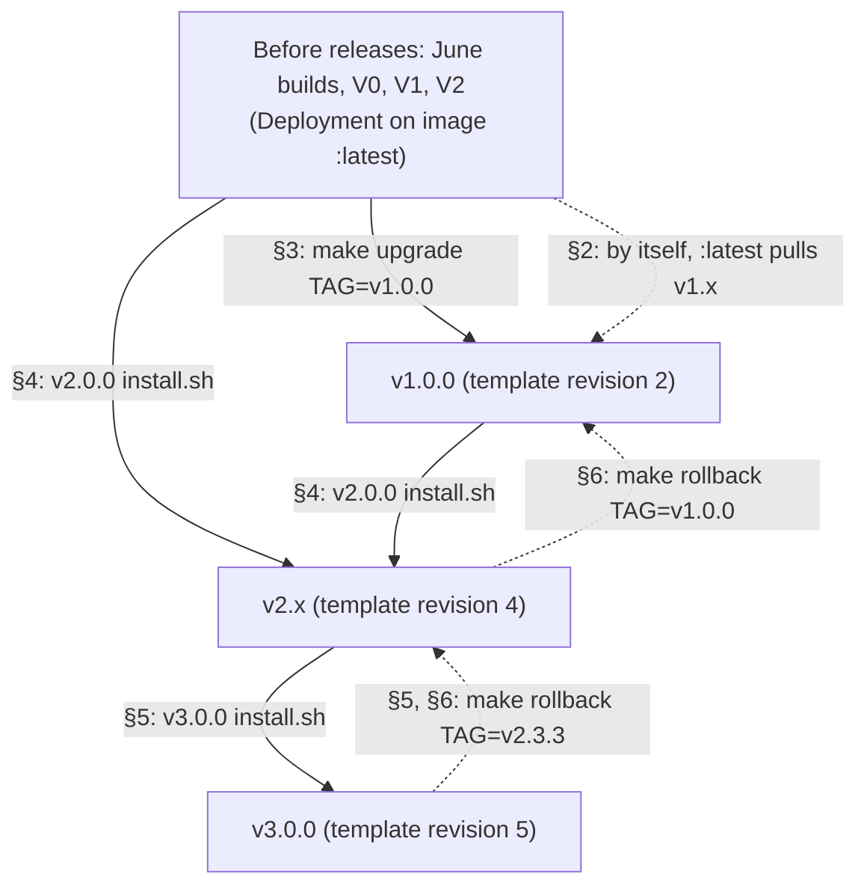
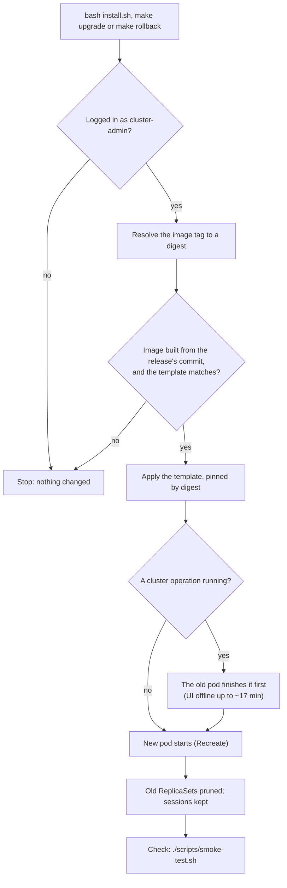

# Upgrading the RHOAI Nightly Updater

For anyone who installed the updater before releases existed (before
2026-10-06), or who wants to move between releases. Versions follow
`vMAJOR.MINOR.PATCH`; a new MAJOR means the deployment template changed and
needs a full redeploy ([CHANGELOG.md](../CHANGELOG.md)). From 2.x to 3.0.0:
[section 5](#5-upgrade-to-v300); to 4.0.0 (changes run with your own token, sign in again once):
[Upgrade to v4.0.0](#upgrade-to-v400-changes-run-with-your-own-token); to 5.0.0 (every RHOAI user can sign in and sees their own part):
[Upgrade to v5.0.0](#upgrade-to-v500).

Releases: [GitHub](https://github.com/DaoDaoNoCode/rhoai-nightly-updater/releases)
and [GitLab](https://gitlab.com/redhat/ai/rhoai-dashboard-team/rhoai-nightly-updater/-/releases)
(the GitLab project may ask you to sign in). Each release has an `install.sh`
with that release's template inside; it needs only `oc`, logged in as
cluster-admin, and `curl`.

The commands below use the default names; set yours first:

```bash
NS=rhoai-nightly-updater APP=rhoai-nightly-updater
```

## Patch and minor releases

When the app shows "vX.Y.Z is available" without "requires a full redeploy",
the release has the same template as yours, or, when you run a pre-release of
it, possibly a newer one: the installer applies the release's template either
way. Run that release's installer:
the notice shows the command to copy, for example

```bash
curl -fsSLO https://github.com/DaoDaoNoCode/rhoai-nightly-updater/releases/download/v2.0.1/install.sh
bash install.sh --dry-run                           # optional: validate only
bash install.sh
```

The notice links the release notes and downloads `install.sh` from the
public GitHub release, because the GitLab project's release pages and assets
need a sign-in (a fork's own `RELEASES_URL` is used as it is). Both releases
carry the same notes and the same `install.sh`: its SHA-256 is in the release
notes.

What it does: it re-applies that release's template with its image pinned by
digest (it refuses an image not built from the release's commit), keeps the
cookie Secret so everyone stays signed in, lets a running cluster operation
finish first (the UI is offline for up to ~17 minutes then), and prunes old
ReplicaSets. The app's own state on the cluster (activity log, test
resources, Dashboard Dev sessions) is not touched.

Settings: the template's parameters come from the installer's options, not
from the running Deployment. With the default names nothing needs to be
passed. If you installed with another namespace or app name, pass
`--namespace $NS --app-name $APP` again: without them `install.sh` installs a
second copy under the default names. Likewise pass `--image-repo` (or
`IMAGE`) and `RELEASES_URL` again if you set them.

## Upgrade paths at a glance



Solid arrows are upgrades you run (sections 3 to 5). The dashed arrows are
rollbacks (section 6) and what an install on `:latest` does by itself
(section 2). Every upgrade re-applies the release's own template; a new major
version never works with only a new image.

How an upgrade or a rollback runs:



## 1. Which version am I running?

### In the app

- The masthead shows the running release (`vX.Y.Z`), left of the
  appearance button. Builds of `main` or of a commit show no version here.
- **Help** (`?`) → **About this installation** → **Updater build**: the
  release, its commit and its build date.

When a newer release exists, every page shows a notice, **vX.Y.Z is
available**, with the command to copy: "An admin upgrades with the vX.Y.Z
installer" (`curl`, the checksum check, `bash install.sh`). A new MAJOR
version says "vX.Y.Z is a new major version and requires a full redeploy"
and that an admin redeploys. A MINOR or PATCH release needs only that
release's `install.sh` (or `make upgrade` from its checkout).

The command checks the download against the SHA-256 in that release's notes
(`echo '<sha256>  install.sh' | sha256sum -c -`) before anything runs; the
app reads the checksum from the release's GitHub or GitLab API. When it
cannot (no access to the API, a releases page of another kind), the command
has no check and the notice asks you to compare with the release notes
first.

If the Deployment was created from an older template than the running image
expects (typically an install on `:latest` that pulled a newer image), every
page shows the notice **For admins: this updater's deployment is out of
date**. Upgrade as in sections 3 to 5.

Dismissing the release notice hides it until an even newer release.

### From the command line

```bash
# The image reference of each container: a tag (:latest), a digest (@sha256:...) or a release (:vX.Y.Z)
oc get deploy $APP -n $NS -o jsonpath='{range .spec.template.spec.containers[*]}{.name}={.image}{"\n"}{end}'
# Shape of the Deployment and the template revision (empty before v1.0.0)
oc get deploy $APP -n $NS -o jsonpath='replicas={.spec.replicas} strategy={.spec.strategy.type} grace={.spec.template.spec.terminationGracePeriodSeconds} revision={.spec.template.spec.containers[?(@.name=="app")].env[?(@.name=="TEMPLATE_REVISION")].value}{"\n"}'
# The Route timeout (180s or 960s before v1.0.0)
oc get route $APP -n $NS -o jsonpath='{.metadata.annotations.haproxy\.router\.openshift\.io/timeout}{"\n"}'
# The digest the running pod actually runs
oc get pods -n $NS -l app=$APP -o jsonpath='{range .items[*]}{.metadata.name} {.status.containerStatuses[?(@.name=="app")].imageID}{"\n"}{end}'
```

To see which build a digest is, read its labels (the `version` label is the
release, or the 8-character commit for builds from before releases):

```bash
oc image info quay.io/juntao_wang/rhoai-nightly-updater@sha256:<digest> --filter-by-os=linux/amd64 | grep -E 'version=|revision='
```

The running app also reports it: the masthead shows a release (for example
`v2.0.0`), and the help dialog (`?`) shows the build. From the command line:
`oc exec -n $NS deploy/$APP -c app -- curl -s http://127.0.0.1:9090/api/version`
(builds from before v1.0.0 answer on port 8080, if at all).

| Install | How to recognise it |
|---|---|
| June 25 – July 1 builds | 7-character image tags; the image labels are the UBI base's (`version` 9.6), with no app commit. Template unknown, most likely V0 |
| V0 (template 5051672, July 2) | `replicas=2`, `RollingUpdate`, image `:latest`, no `TEMPLATE_REVISION`, Route timeout 180s, `COOKIE_SECRET` as a plain env value, ClusterRole/ClusterRoleBinding/ConsoleLink named `<APP_NAME>` |
| V1 (template 68f6f58, July 3 – Sept 29) | as V0 but `replicas=1` |
| V2 (template b394d00, Sept 30 – Oct 5) | as V1 but Route timeout 960s |
| v1.0.0 | image `@sha256:...`, `Recreate`, grace 1020, `TEMPLATE_REVISION=2`, cookie secret in Secret `<APP_NAME>-proxy`, RBAC named `<APP_NAME>-<NAMESPACE>` |
| v2.0.0 to v2.3.3 | as v1.0.0 with `TEMPLATE_REVISION=4`; the masthead shows the release, for example `v2.3.3` |
| v3.0.0 | as v2.x with `TEMPLATE_REVISION=5`; the masthead shows `v3.0.0` |

The template changes of October 3–5 were never published before v1.0.0, so no
install runs them.

## 2. "My Deployment references `:latest`. Am I at risk?"

V0, V1 and V2 installs (and the June builds) reference `:latest` by tag, and a
`:latest` tag pulls on every pod start. Any rollout (a node drain, a cluster
upgrade, an eviction) then runs whatever `:latest` is.

`:latest` is now the newest release **of major version 1** and never moves to
a new major version by itself, so these installs get v1.0.0 (or a later
v1.x) and keep working: every page loads, and the "this updater's deployment
is out of date" notice asks an admin to upgrade. Verified on 2026-10-06 for
V0, V1 and V2.

Still, upgrade deliberately (sections 3–4): until then the image can change
under you. To freeze the install first, pin the Deployment to the digest it
runs now:

```bash
oc set image deployment/$APP -n $NS app="$(oc get pods -n $NS -l app=$APP -o jsonpath='{.items[0].status.containerStatuses[?(@.name=="app")].imageID}')"
```

## 3. Upgrade to v1.0.0

v1.0.0 has no `install.sh` (it predates the installer), so this needs a clone:

```bash
git clone https://gitlab.com/redhat/ai/rhoai-dashboard-team/rhoai-nightly-updater.git
cd rhoai-nightly-updater
git fetch --tags && git checkout v1.0.0
make upgrade NAMESPACE=$NS APP_NAME=$APP TAG=v1.0.0    # DRY_RUN=1 validates only
./scripts/smoke-test.sh $NS $APP
```

What it changes: the image is pinned by digest; `Recreate` with a 1020-second
grace period (one replica, so a V0 install goes from 2 replicas to 1); the
cookie secret moves from the env value to Secret `<APP_NAME>-proxy`, so
sessions survive; RBAC is renamed to `<APP_NAME>-<NAMESPACE>` and narrowed;
the legacy ClusterRole, ClusterRoleBinding and ConsoleLink named `<APP_NAME>`
are deleted; old ReplicaSets are pruned. Verified on 2026-10-06 for V0, V1
and V2: the smoke test passes.

## 4. Upgrade to v2.0.0

From v1.0.0, or directly from V0, V1, V2 or a June build. Without a clone:

```bash
curl -fsSLO https://github.com/DaoDaoNoCode/rhoai-nightly-updater/releases/download/v2.0.0/install.sh
bash install.sh --dry-run --namespace $NS --app-name $APP
bash install.sh --namespace $NS --app-name $APP
```

Check the download first: `sha256sum install.sh` (macOS: `shasum -a 256 install.sh`) must match the SHA-256 in the release notes.

**Verified live on 2026-10-06**, with a v2.0.0 `install.sh` generated from the release branch:

| Path | Result |
|---|---|
| Fresh install | Installed and running |
| V0 → v2.0.0 (directly) | 2 replicas → 1; `Recreate`; template revision 4; no literal `COOKIE_SECRET` (it moved to Secret `<APP_NAME>-proxy`); the legacy ClusterRole, ClusterRoleBinding and ConsoleLink replaced by the namespaced ones; smoke test passed |
| V1 → v2.0.0, V2 → v2.0.0 (directly) | The same as V0, without the replica change; smoke test passed |
| v1.0.0 → v2.0.0 | Upgraded; smoke test passed |
| `make rollback TAG=v1.0.0` from v2.0.0 | Rolled back with the image pinned by digest; the v2 smoke test passed against the running image's expected template revision 2 |
| v1.0.0 → v2.0.0 again, with the installer | Upgraded |
| `bash install.sh uninstall` | Removed everything; no cluster-scoped objects left |

v2.0.0 was not published yet, so the installer in these tests pointed at an
image in the cluster's own registry instead of `quay.io`. The final check
with the published `install.sh` happens at release.

From a clone: `git fetch --tags && git checkout v2.0.0 && make upgrade NAMESPACE=$NS APP_NAME=$APP`.
Then check with `./scripts/smoke-test.sh $NS $APP` from a v2.0.0 checkout.

`install.sh` does everything `make upgrade` does (section 3), so the same
steps apply to legacy installs. It installs exactly v2.0.0: it resolves
`:v2.0.0` to a digest and refuses an image that was not built from the
release's commit.

What v2.0.0 changes on top of v1.0.0:
- template revision 4 and new RBAC (prerequisite operands, cert-manager
  Certificates, the SeaweedFS objects);
- the S3 test storage moves from MinIO to SeaweedFS on the next storage setup
  or repair. SeaweedFS starts empty; the old `minio-pvc` is kept until
  teardown ([RUNBOOK §10.1](../RUNBOOK.md#101-migrate-storage-from-an-earlier-version));
- Diagnostics explain why the DataScienceCluster is not ready;
- the masthead shows the release, and a notice says when a newer one exists.

A June build or an install that does not match any row of section 1: run the
same upgrade and then the smoke test. If anything is off, uninstall and
install fresh: `bash install.sh uninstall --namespace $NS --app-name $APP`
removes the current names; also delete the legacy ones
(`oc delete clusterrolebinding,clusterrole,consolelink $APP --ignore-not-found`),
then `bash install.sh`.

## 5. Upgrade to v3.0.0

From v2.x (v2.3.3 is the last). Installs from before v2.0.0 can upgrade
directly too; what section 4 says about them applies.

3.0.0 is a MAJOR release: template revision 5 adds RBAC, so the template is
re-applied. The installer upgrades the existing install in place:

```bash
curl -fsSLO https://github.com/DaoDaoNoCode/rhoai-nightly-updater/releases/download/v3.0.0/install.sh
bash install.sh --dry-run --namespace $NS --app-name $APP
bash install.sh --namespace $NS --app-name $APP
```

From a clone: `git fetch --tags && git checkout v3.0.0 && make upgrade NAMESPACE=$NS APP_NAME=$APP`,
then `./scripts/smoke-test.sh $NS $APP`.

As for every release, sessions are kept, a running cluster operation
finishes first, and the app's own state is not touched. What the earlier
version set up on the Environment page (the S3 storage, pipeline servers,
MLflow) keeps running as it is: 3.0.0 changes it only when you click a
button, as described below.

**With Argo CD (the Helm chart).** The upgrade is the usual commit
([GITOPS §6](GITOPS.md#6-upgrading-and-rolling-back)): `targetRevision: v3.0.0`
and `parameters.IMAGE` set to the v3.0.0 image by digest. The chart carries
both RBAC files, so the commit brings the RBAC with it. With the default `profile: gitops`, `deploy/rbac-gitops.yaml` has no
rule change in 3.0.0, and that profile has no Environment page, so nothing
else below applies. With `profile: full`, the chart applies template
revision 5; its new parameters `INGRESS_NAMESPACE` and
`INGRESS_OPERATOR_NAMESPACE` accept only their defaults, so leave them
unset.

### What changes for an existing install

**The Test resources page is now the Environment page.** Its address stays
`/test-resources`, so bookmarks keep working; links to the old tabs
(`?tab=cluster`, `?tab=projects`) open Pipelines. It has an **Overview** and
one tab per feature: **Pipelines**, **MLflow**, **Models**, **Playground**
and **MaaS** ([README tour](../README.md#environment-s3-storage-pipeline-servers-mlflow-models)).
Set up now refuses a namespace that is not a data science project instead
of creating it: create the project in the RHOAI dashboard first.

**RBAC (template revision 5).** Every new rule was audited in
[SECURITY_HISTORY.md](SECURITY_HISTORY.md#audits-of-earlier-template-revisions)
(since 4.0.0 the ServiceAccount holds none of the write rules:
[SECURITY.md](../SECURITY.md#serviceaccount-rbac)). In short:

- Roles in `openshift-ingress` and `openshift-ingress-operator`, for the
  inference gateway, the MaaS gateway and reading IngressController
  `default`.
- ClusterRole rules, limited to fixed names wherever the API allows: the
  inference GatewayClass, the four catalog models (LLMInferenceServices)
  and their presets, MaaS objects, the playground's OGXServer and
  ConfigMaps, and each model's token authentication (ServiceAccounts,
  Roles, RoleBindings `create`; `get delete` only on the dashboard's names
  for the four models). The ServiceAccount has no `bind` or `escalate`.
- Storage: rules for the new names (namespace `seaweedfs`, Secret
  `seaweedfs-s3-credentials`, the copy Job and its Secret
  `seaweedfs-migrate-source`, `delete` on namespace `seaweedfs`); the
  MinIO-era names keep only `get` and `delete`. Secret
  `rhoai-nightly-updater-s3` for the pipeline server's dashboard Connection.
- 2.x could already create and patch Deployments in any namespace; 3.0.0
  adds Jobs, LLMInferenceServices, OGXServers and CloudNativePG Clusters.
  Together they give a leaked ServiceAccount token cluster-admin reach
  ([SECURITY_HISTORY.md, Worst case](SECURITY_HISTORY.md#worst-case-cluster-wide-workload-create)).
- `get` on Infrastructure `cluster` (`config.openshift.io`, read-only), for
  the control plane topology: on a self-managed cluster the setup shows the
  command that adds `quay.io/rhoai` to `openshift-config/pull-secret`. Until
  the template is re-applied the app cannot read the topology and shows that
  part as "if this cluster is self-managed".

**Self-managed clusters: the nodes' pull secret.** If an earlier version
was set up on a self-managed cluster, the nodes already have the
`quay.io/rhoai` entry in `openshift-config/pull-secret` (Update would have
failed otherwise), and the running nightly catalog shows it: the
**Pull secret** item says **Ready**. Otherwise it shows **Nodes not
checked**, the command and **Check that the nodes can pull**
([QUICKSTART](QUICKSTART.md#self-managed-openshift-the-cluster-pull-secret)).

If a tab says a call is "not allowed ... run `make upgrade`", the template
was not re-applied: run the installer again.

**S3 storage: Migrate storage.** 2.x kept the storage in namespace `minio`
(MinIO, or SeaweedFS behind the MinIO-era names); 3.0.0 keeps it in
namespace `seaweedfs`. After the upgrade, the **S3 storage** tab reads
**Migration needed**, with **Migrate storage**
([RUNBOOK §10.1](../RUNBOOK.md#101-migrate-storage-from-an-earlier-version)):

1. **Migrate storage** sets up the new storage with **new keys**, copies
   every bucket and object and checks each byte, then moves the pipeline
   servers this tool created to the new storage and gives them the new
   keys. Until it has copied the data, Set up and new pipeline servers
   wait. Each run resumes where the last stopped.
2. Before you remove the old storage, update what this tool did not create
   (data connections, workbenches, other pipeline servers): the endpoint
   becomes `http://seaweedfs-s3.seaweedfs.svc:8333` and the keys are the
   new ones (the S3 storage tab shows them); buckets and object paths stay.
   The old keys give no access to the new storage.
3. **Delete old storage** (the storage's menu) is a separate, later step:
   it copies and checks once more, then deletes the old objects.
   **Also delete namespace minio** is a separate choice, unticked.

Namespace `minio` counts as the earlier version's storage only when the
namespace shows the tool made it: it carries the label
`app.kubernetes.io/managed-by=rhoai-nightly-updater` (2.x set it), or the
earliest versions created it (no `openshift.io/requester` annotation).
Otherwise the tab says "Namespace minio is not this tool's", nothing in it
is read, copied or changed, and you set up the storage from scratch. Check
with `oc get namespace minio --show-labels`.

`MINIO_ROOT_USER`, `MINIO_ROOT_PASSWORD` and `MINIO_IMAGE` are no longer
read; the storage's settings are `SEAWEEDFS_IMAGE`,
`SEAWEEDFS_ACCESS_KEY_ID` and `SEAWEEDFS_SECRET_ACCESS_KEY`
([README: Configuration](../README.md#configuration)).

**Pipeline servers named `nightly-dspa`.** 2.x named its pipeline server
`nightly-dspa`. It keeps working (the dashboard's pipelines pages, the KFP
SDK, Migrate storage, Delete), but workbench pipelines (Elyra) find only a
pipeline server named `dspa`, the name 3.0.0 and the dashboard use. The
Pipelines tab says so and offers **Recreate with the standard name**: it
checks everything first, then deletes `nightly-dspa` with its database (its
runs, experiments and imported pipelines are lost; the artifacts in the S3
storage stay, but no run links to them) and sets up `dspa`. Run Migrate
storage first: the new server waits for it.

**MLflow.** An MLflow set up by 2.x keeps its 2 GiB memory limit, which
MLflow's agent and prompt demo runs out of. The MLflow tab's sample data
says so; adding the demo first removes that limit (the operator's defaults
apply), MLflow restarts, and you add the demo again once it is ready.

**Models, Playground and MaaS** are new: 2.x set up none of them. These
notes are only for clusters that ran a pre-release 3.0.0 build (`:main` or
a commit build):

- *Inference gateway.* The gateway this tool creates now lists the
  projects it allows by name, as RHOAI documents it (`allowedRoutes`
  `kubernetes.io/metadata.name In [...]`); a model setup adds its project.
  A gateway a pre-release build created (routes from every project, or from
  projects with a namespace label) gets that list at its next change, a
  model setup or **Allow <project>**, with the projects of this tool's own
  models on it, so none of them is detached. A model of another project on
  that gateway (one deployed in the dashboard, or any LLMInferenceService
  someone made) is then cut off: the Models tab and the Overview name it,
  with **Allow <project>**. Allow only a project you trust, since anyone
  who can edit it can then attach routes to the shared gateway. Before, a route in any project could take
  over a model's address and receive its callers' tokens ([SECURITY.md, The inference
  gateway](../SECURITY.md#the-inference-gateway)).
  A gateway someone else made (RHOAI's install, an admin) is not changed.
- *Which models are the tool's.* A model is the tool's only when its UID
  is in the tool's record. A model a pre-release build set up has none and
  shows as not managed by this tool: unpublish it on the MaaS tab if it is
  published, delete it with `oc delete llminferenceservice <model> -n <project>`,
  then set it up again ([RUNBOOK §10.2](../RUNBOOK.md#102-models-the-inference-gateway-and-cpu-models)).
- *MaaS.* Publish now routes a published model through the MaaS gateway
  only. While it is published, its direct address
  (`inference.<apps domain>/<project>/<model>`) answers 404: use it through
  MaaS with an API key, or in the dashboard's playground; Unpublish brings
  the direct address back. A publication by an earlier build shows as
  **Partly published** (its direct address answered 500): Unpublish, then
  Publish again ([RUNBOOK §10.4](../RUNBOOK.md#104-maas-models-as-a-service)).
- *MaaS setup.* Set up now installs what MaaS needs (Connectivity Link,
  the Kuadrant CR, CloudNativePG, Authorino TLS, the infrastructure
  namespace, `aigateway`) when it is missing; what a cluster-admin
  installed by hand is used as it is and shown as not managed by this
  tool. On a platform a pre-release build set up, the tab may now ask for
  attention where it did not: Connectivity Link below 1.5 (**Upgrade
  Connectivity Link**; Publish refuses on 1.4.0, and below 1.5 while other
  MaaSSubscriptions exist), tier-era gateway policies (**Remove the old
  tier policies**), or a foreign gateway that admits every namespace.
  Publishing again moves this tool's subscription below every other
  subscription's priority (5.0.0 changes this: see
  [Upgrade to v5.0.0](#upgrade-to-v500)). Remove keeps the shared pieces it
  installed.

### Rolling back from 3.0.0 to 2.3.x

`make rollback TAG=v2.3.3`, or the v2.3.3 `install.sh` (section 6). Before
you roll back, remove what 2.x cannot see, or it keeps running with no
button to remove it: **Clean up everything** on the Overview, with the
playgrounds, MaaS, the models and the inference gateway ticked (or
**Clean up MaaS** and each tab's Clean up). The inference gateway and the
MaaS gateway each run a cloud load balancer, which costs money while it
exists. By hand: the Rollback lines of
[RUNBOOK §10.2 to §10.4](../RUNBOOK.md#102-models-the-inference-gateway-and-cpu-models).

What a 2.3.x install then sees (read from the v2.3.3 source, not tried on
a cluster):

- The **Test resources** page of 2.x: no Models, Playground or MaaS tabs.
- 2.x reads the S3 storage only in namespace `minio`. Before Migrate
  storage, nothing changed. After it, the moved pipeline servers keep
  working on `seaweedfs`, which 2.x neither shows nor deletes. After Delete
  old storage, 2.x shows no storage, and its Set up would create a second,
  empty one in `minio`.
- A pipeline server `dspa` that 3.0.0 set up carries the tool label, so
  2.x shows it as an earlier version's and can delete it, but its Set up
  refuses the project until it is deleted.
- The Roles and RoleBindings only template revision 5 has, in
  `openshift-ingress` and `openshift-ingress-operator`, stay: the rollback
  applies 2.3.3's template and deletes nothing. `make undeploy` from a
  3.0.0 clone, or 3.0.0's `install.sh uninstall`, removes them with the
  rest; 2.3.3's `install.sh uninstall` leaves the one in
  `openshift-ingress-operator`. To remove that one while you stay on 2.3.x
  (2.3.x does not use it):
  `oc delete role,rolebinding rhoai-nightly-updater-rhoai-nightly-updater -n openshift-ingress-operator`
  (the names are `<APP_NAME>-<NAMESPACE>`, here with the defaults). It is
  safe: only this tool uses that name, and the command deletes nothing
  else.

## Upgrade to v4.0.0: changes run with your own token

4.0.0 is a MAJOR release (template revision 7): run its `install.sh` (or
`git checkout v4.0.0 && make upgrade`) as for 3.0.0. The installer handles
an existing 3.x install:

1. It keeps Secret `$APP-proxy` (sessions) and creates Secret
   `$APP-oauth-client` (the OAuth client secret).
2. It applies the template: oauth-proxy now signs users in through
   OAuthClient `$APP-$NS` with `--scope=user:full` instead of through the
   ServiceAccount, the ServiceAccount loses its OAuth redirect annotation
   and almost all of its write rules (it only reads, keeps the app's records
   and runs the MaaS prune job), and the Deployment rolls.
3. Before the rollout finishes it creates OAuthClient `$APP-$NS` with the
   Route's host as its redirect URI.

What users notice:

- No "Authorize Access" page any more (`grantMethod: auto`).
- **Everyone signs in again once to make changes.** The old session cookie
  still works for reading, but its token was issued to the ServiceAccount
  client and can only identify the user, so a change is refused with "Your
  sign-in cannot make changes ... Log out and log in again", and the UI says
  so before they try: a banner on every page says to sign in again (not
  "Read-only access", which is for users without the cluster-admin role),
  changes are off, and each one says why. Log out from the banner or the
  user menu and log in again.

  The banner reads **Sign in again to make changes**, with the reason and
  **Log out**; each change is disabled, with the same reason in its tooltip.

- Changes are made with the user's own permissions and the API server's
  audit log names the user, not the ServiceAccount. A change is also refused
  ("Log out and log in again") when the sign-in expires before the change
  could finish.
- The Playground can add Models as a Service models again (3.0.1 had turned
  that off because it ran with the ServiceAccount's token).

Check it: `oc get oauthclient $APP-$NS` and the [RUNBOOK's sign-in
section](../RUNBOOK.md#sign-in-and-the-oauthclient).

**With Argo CD (the Helm chart).** The usual commit (`targetRevision: v4.0.0`
and the v4.0.0 image by digest). With `profile: gitops` (the default)
nothing changes for sign-in: that profile makes no change with the user's
token, so users keep signing in through the ServiceAccount as with 3.x
([GITOPS §11](GITOPS.md#sign-in-in-the-gitops-profile)) and nobody needs
to sign in again. With `profile: full` the chart's new hooks create the
Secret (Sync) and the OAuthClient (PostSync); their ServiceAccounts, not
the app's, get the OAuthClient rights, only while they run. With
`gitops.oauthClient.enabled: false`, create both before the sync
([GITOPS §4](GITOPS.md#4-the-hook-jobs)). Argo CD never prunes the
OAuthClient: `install.sh uninstall` removes it.

**Rolling back to 3.x** (`make rollback TAG=v3.0.1`): the 3.x template
signs users in through the ServiceAccount again and re-grants its RBAC.
Once the rollout finished, `make rollback` deletes OAuthClient `$APP-$NS`
(unused, and with `grantMethod: auto` only a risk) and revokes its sign-ins;
it keeps Secret `$APP-oauth-client` for the roll forward. A rollback with
an older clone's `install.sh` does not know the client: delete it by hand,
`oc delete oauthclient $APP-$NS` and `oc delete oauthaccesstokens
--field-selector clientName=$APP-$NS`.

**Removing it.** Use `install.sh uninstall` (or `make undeploy`): it deletes
the OAuthClient and revokes its sign-ins before the namespace. Deleting the
namespace by hand leaves both the client and its sign-ins (live-checked:
the client stays, Kubernetes' garbage collector does not remove it); a
client left behind lets whoever later claims its redirect host with a
Route collect a signed-in user's token
([SECURITY.md](../SECURITY.md#the-oauthclient-400)). If you did, run
`install.sh uninstall` with the same `--app-name` and `--namespace`: it
works after the namespace is gone (live-checked). Or delete the client with
`oc delete oauthclient $APP-$NS` and revoke with
`oc delete oauthaccesstokens --field-selector clientName=$APP-$NS`.
A client applied by a 4.0.0 test build has an ownerReference to the
namespace, which never deleted it; deploy and upgrade remove it.

## Upgrade to v5.0.0

5.0.0 is a MAJOR release (template revision 8): run its `install.sh` (or
`git checkout v5.0.0 && make upgrade`) as for 4.0.0. Sessions are kept;
nobody signs in again. The template changes two things:

1. **Who signs in.** oauth-proxy's gate becomes "may `get`
   `auths.services.platform.opendatahub.io`", which RHOAI grants to its
   Auth CR's `allowedGroups` (by default `system:authenticated`). So by
   default **every OpenShift user can now open the updater**, not only
   users who may list pods in `redhat-ods-operator` (in practice
   cluster-admins). To limit who signs in, narrow RHOAI's allowed groups
   (`oc edit auths.services.platform.opendatahub.io auth`, `spec.allowedGroups`):
   that narrows the RHOAI dashboard too. Without RHOAI installed only
   cluster-admins sign in.
2. **The ServiceAccount loses rules it no longer uses**: `get` on the MLflow
   samples' names, on ConfigMap `gen-ai-aa-custom-model-endpoints`, and on
   InferenceServices. The Playground and MLflow samples status now read with
   the signed-in user's own token. It gains nothing.

What users notice:

- **Cluster-admins** see every page as before.
- **Everyone else** sees a short read-only Status page (the RHOAI version,
  channel and phase, the installed nightly build and whether a newer one
  exists, the DataScienceCluster and its components), Build Explorer, and
  the Environment page for their own projects, read with their own
  permissions. Components, Dashboard Dev and Diagnostics say "Only
  cluster-admins can see this page". A running update shows without who
  started it. Their Help dialog describes only these pages. Who sees what,
  and with which token:
  [SECURITY.md, Per-user views](../SECURITY.md#per-user-views-500); the
  pages: [README, Not a cluster-admin?](../README.md#not-a-cluster-admin-what-you-see).


**MaaS subscription priority.** Earlier versions gave this tool's
MaaSSubscription priority 10 (or a negative value), so API keys minted
without naming a subscription could be bound to it instead of an admin's
subscription at priority 0. From 5.0.0 every write of it sets 0: Publish,
Change limit, Change who can use them, Unpublish of one of several
models, and the background prune. It then no longer outranks other
subscriptions; on a tie at 0 MaaS takes the one whose largest single token limit on any of its models is larger (the time window is not compared; Unlimited counts as largest), then the first by name,
and naming the subscription when creating a key avoids the choice. Until
one of those writes, the MaaS tab shows the old priority with **Set to
the lowest priority (0)**. Keys already bound to this tool's subscription
keep it (maas-api stores the subscription when the key is minted): revoke
them and make them again.

**With Argo CD (the Helm chart).** The usual commit (`targetRevision:
v5.0.0` and the v5.0.0 image by digest). Both profiles get the new sign-in
gate; in `profile: gitops` every page still needs cluster-admin, so other
users who sign in see only "Cluster-admin required".

**Rolling back to 4.x** (`make rollback TAG=v4.0.0`) re-applies the 4.x
template: the old gate (only users who may list pods in
`redhat-ods-operator`) and the ServiceAccount's old rules.

**Old and new pods side by side.** While a replaced pod drains, both pods
read and respect each other's cluster lock (key `lock`, same format). A pod
older than 5.0.0 does not know project locks (keys `projectLock.<UID>`): it
can start a cluster operation while a newer pod runs a project action.
Project actions (later 5.0.0 pre-releases) start only once every updater
pod runs a version that knows them, so roll out fully before using them.

## 6. Roll back

From a clone, to a release or any published commit build:

```bash
git fetch --tags
make rollback TAG=v1.0.0 NAMESPACE=$NS APP_NAME=$APP DRY_RUN=1   # validate
make rollback TAG=v1.0.0 NAMESPACE=$NS APP_NAME=$APP
```

It applies that release's own template with its image (by digest) and keeps
sessions. Check it with `./scripts/smoke-test.sh $NS $APP`: it compares the
template revision with what the running image expects, and only notes that
your checkout is a newer revision (verified live on a v1.0.0 install with
the v2 smoke test: all checks pass).
It does not undo what the newer version did on the cluster: a storage
migration stays, and so do the Roles that only the newer template had.
From 3.0.0 to 2.3.x, read
[Rolling back from 3.0.0 to 2.3.x](#rolling-back-from-300-to-23x) first. Roll forward with the newer release's
`install.sh` or `make upgrade` from its checkout. `oc rollout undo` does not
work: old ReplicaSets are pruned on purpose.

## 7. FAQ

**"deploy/template.yaml in this checkout differs from the template of commit ..."**
Your checkout is not the release you install. Check out the release tag
(`git checkout vX.Y.Z`), or use that release's `install.sh`.

**"HEAD is not on a release tag"**
`make deploy` and `make upgrade` install the release your checkout is on.
Check one out, or pass `TAG=main` / `TAG=<commit>` to test a build.

**"cannot tell which commit ... was built from"**
The image has no revision label of this repository (a build from before the
label). Run the command once more with `ALLOW_TEMPLATE_MISMATCH=1`; later
releases carry the label.

**"reports revision \<none\>" or "cannot read the revision label"**

```
ERROR: quay.io/juntao_wang/rhoai-nightly-updater@sha256:... reports revision <none>, not 94e2cc72..., the commit of v3.0.1 whose template this installer holds.
```

Every release image carries its commit in the label
`org.opencontainers.image.revision`. The installers up to 3.0.1 read it
only with `oc image info` on your machine and hid oc's error. Where oc
cannot read the image (for example, a credential helper named in
`~/.docker/config.json` fails, or `oc` is old), they report `<none>` for an
image that is correct. See oc's own error with:

```bash
oc image info quay.io/juntao_wang/rhoai-nightly-updater@sha256:<digest> --filter-by-os=linux/amd64
```

From 3.0.2 the installer reads the label from the registry's API first,
anonymously (needs only `curl`; `oc` is the fallback), and when neither
works it stops with "cannot read the revision label" and the reason each
way failed: the registry's HTTP status or curl's error, and oc's error.
Fix what it names (network or proxy access to `quay.io`, the credential
helper) and run it again. 3.0.2 is the same app as 3.0.1, so the simplest
way past this error is the `install.sh` of 3.0.2 or later.

To run an older installer anyway, first check the label yourself. Use the
digest from the installer's `Resolved ... to ...@sha256:<digest>` line.
With the registry's API (anonymous; needs `curl` and `jq`):

```bash
REPO=juntao_wang/rhoai-nightly-updater
DIGEST=sha256:<digest>
CONFIG=$(curl -fsSL -H 'Accept: application/vnd.oci.image.manifest.v1+json,application/vnd.docker.distribution.manifest.v2+json' \
  "https://quay.io/v2/$REPO/manifests/$DIGEST" | jq -r .config.digest)
curl -fsSL "https://quay.io/v2/$REPO/blobs/$CONFIG" | jq -r '.config.Labels["org.opencontainers.image.revision"]'
```

Or, where oc works, `oc image info quay.io/juntao_wang/rhoai-nightly-updater@sha256:<digest> --filter-by-os=linux/amd64 | grep revision=`.
Only if it prints exactly the commit that the error names (the release's
commit), run the installer again with `ALLOW_TEMPLATE_MISMATCH=1 bash install.sh`.
Release tags are never rewritten, so check that its `Resolved ... to` line
shows the same digest. That variable turns off the check entirely, so
never set it for an image you have not checked.

**"This installer installs vX.Y.Z only"**
Each `install.sh` installs its own release. Download the one of the release
you want.

**The notices in the app.**
"This updater's deployment is out of date": the Deployment was created from
an older template than the running image expects; upgrade (sections 3–5).
"vX.Y.Z is available": a newer release exists; "requires a full redeploy"
means a new major version, so use its `install.sh` (or check it out and run
`make upgrade`) rather than changing the image.

**Several updater installs on one cluster.**
Each namespace has its own operation lock, so two installs do not see each
other's running operations and can change the cluster at the same time.
Keep one install per cluster.
